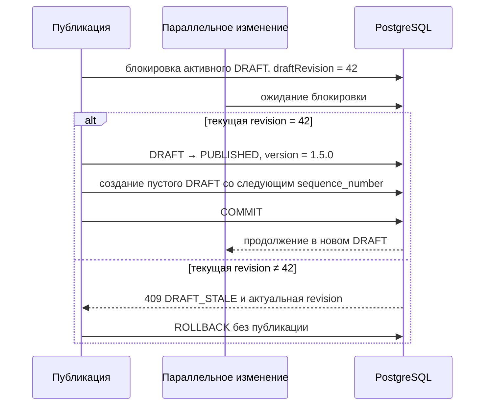

# ADR-0007: Версионные данные, многопользовательское редактирование и журнал изменений

## Статус

Принято.

## Контекст

Сейчас редактор хранит пользовательские изменения в `localStorage`. Сервер не является источником актуального
состояния, другие участники не видят изменения сразу, а состояние старой опубликованной версии нельзя надёжно открыть
в редакторе или запросить через предметный API.

Целевая серверная часть — `backend-kt/ds-service`. Существующие предметные HTTP-методы изменяют токены, темы,
дизайн-системы и данные компонентов. Решение не добавляет недостающие предметные команды редактора, но меняет способ
хранения принадлежащих дизайн-системе данных.

Полный JSON всей дизайн-системы неудобен для предметных запросов. Полное копирование всех строк при каждой публикации
дублирует неизменившиеся данные. Отдельный продуктовый журнал повторяет сведения, которые уже можно получить как
разницу черновика и предыдущей опубликованной границы состояния.

## Границы

В решение входят:

- один общий серверный черновик дизайн-системы;
- хранение только изменённых предметных сущностей относительно предыдущей опубликованной границы состояния;
- чтение активного черновика и любой опубликованной версии через предметные репозитории;
- автосохранение через существующие изменяющие HTTP-методы;
- ревизии логических сущностей и отдельных путей;
- автоматическое объединение изменений разных полей;
- правило «последняя запись побеждает» для одного поля;
- вычисляемый журнал отличий без отдельных таблиц продуктового журнала;
- откат создания, изменения и удаления до публикации;
- публикация черновика с номером версии;
- защита небезопасных повторных запросов.

Не входят:

- полный аудит каждого промежуточного автосохранения;
- изменение уже опубликованной версии;
- новые предметные HTTP-методы токенов или компонентов;
- CRDT, отдельная служба совместного редактирования, WebSocket/SSE и присутствие пользователей;
- обязательный диалог подтверждения отката;
- показ предупреждений о параллельной записи в первой версии интерфейса;
- реализация палитры в текущем изменении.

Палитра в будущем подключается к той же модели предметных редакций.

## Решение

### Независимая версия как граница состояния дизайн-системы

Черновик и опубликованная версия представлены одной сущностью `design_system_versions`. Версии упорядочены, но не
ссылаются друг на друга:

```text
BASELINE          sequence_number = 0
Published 1.4.0   sequence_number = 8
Draft             sequence_number = 9, содержит только изменённые редакции

После публикации:
Published 1.5.0   sequence_number = 9
Draft             sequence_number = 10, пока не содержит редакций
```

```text
design_system_versions
  id
  design_system_id
  status: BASELINE | DRAFT | PUBLISHED
  version: null для BASELINE и DRAFT
  sequence_number
  revision
  changelog
  snapshot: null для новой модели, прежнее значение для архивной строки
  created_at
  published_at
```

Для дизайн-системы существует не более одной версии со статусом `DRAFT`. Опубликованные версии неизменяемы.
`sequence_number` уникален внутри дизайн-системы, монотонно возрастает и задаёт границу состояния. Он не зависит от
сравнения строковых номеров версий.

Версия логически представляет полное состояние дизайн-системы, но физически не владеет копией всех данных. Её
состояние определяется последними предметными редакциями, начавшими действовать не позднее её `sequence_number`.
Для этого не нужен родительский идентификатор, рекурсивный обход или существование предыдущей версии.

`BASELINE` создаётся при миграции из текущего состояния предметных таблиц. Он содержит исходные предметные редакции,
имеет `sequence_number = 0`, не имеет продуктового номера и не показывается как опубликованная версия. Активный
черновик получает следующий номер. После первой публикации техническая исходная граница остаётся частью временной
истории, но не является зависимостью опубликованной версии.

Существующие до миграции строки со `snapshot` не преобразуются в предметные редакции и не включаются в новую временную
шкалу. Они сохраняются в `design_system_versions` как архивные записи: `snapshot` остаётся заполненным, а
`sequence_number` отсутствует. Для новой модели `snapshot` допускает `NULL`; у `BASELINE`, `DRAFT` и новых
`PUBLISHED` он всегда равен `NULL`. Новые записи никогда не записывают снимок. Архивные строки не возвращаются новым
списком версий, не принимаются как `versionId` предметными методами и не открываются редакторами. Отдельный API для
чтения или восстановления архивных снимков не создаётся.

### Устойчивые сущности и предметные редакции

Каждый предметный модуль владеет двумя видами данных:

1. Таблица устойчивой сущности хранит идентификатор и неизменяемую принадлежность.
2. Таблица `*_revisions` хранит изменяемое состояние только для тех версий, где сущность действительно менялась.

Существующая предметная таблица после миграции становится таблицей устойчивой сущности. Из неё удаляются изменяемые
поля: они переносятся в новую таблицу редакций и больше не записываются в двух местах. Например:

```text
tokens
  id, design_system_id, created_at

token_revisions
  id, token_id, design_system_version_id
  version_sequence_number
  name, description, token_type, enabled, deleted

token_values
  id, design_system_id, token_id, tenant_id, platform, mode, created_at

token_value_revisions
  id, token_value_id, design_system_version_id
  version_sequence_number
  palette_id, value, deleted
```

Изменение одного токена создаёт редакции только этого токена. Остальные данные не копируются. Общая таблица
`design_system_entities` не вводится: токены, темы и компоненты сохраняют независимое владение данными и типизированные
внешние ключи внутри своих модулей.

`platform` и `mode` являются неизменяемой частью идентичности значения: для другой платформы или режима создаётся
другое значение. `token_values` имеет уникальный ключ `(token_id, tenant_id, platform, mode)`. Изменяющий метод значения
больше не принимает `platform` и `mode`; для переноса данных между комбинациями клиент удаляет прежнее и создаёт новое
значение существующими предметными методами. Повторное создание ранее удалённой комбинации использует прежний
`token_values.id` и добавляет редакцию с `deleted = false`, поэтому историческая строка не мешает понятному созданию.

`token_values` после миграции больше не хранит `palette_id`, `value` и `updated_at`. `token_value_revisions` является
единственным источником этих значений и времени их изменения. Временное наличие значений в обеих таблицах
допустимо только внутри управляемого перехода: создать редакции, сверить данные, переключить чтение и запись, удалить
старые изменяемые столбцы. Постоянная двойная запись запрещена.

Таблицы редакций следуют существующим предметным таблицам `ds-service`. Отдельная редакция нужна и таблицам связей,
если принадлежность, порядок или содержимое связи меняется в черновике. Каждая предметная редакция хранит номер
границы из своей версии. Согласованность пары
`(design_system_version_id, version_sequence_number)` обеспечивается внешним ключом на уникальную пару таблицы
версий. Это позволяет использовать предметный индекс без соединения с таблицей версий при каждом чтении.

Каждая таблица редакций имеет уникальность `(stable_entity_id, design_system_version_id)`: в одной версии существует
не более одной редакции устойчивой сущности. Редакция хранит собственное `updated_at`; при преобразовании существующих
данных туда переносится прежняя метка предметной строки, а новые записи получают время предметного изменения. Запись
выполняется атомарным обновлением или вставкой после блокировки `entity_edit_states`, поэтому выбор последней редакции
детерминирован.

Принадлежность одной дизайн-системе обеспечивается в БД, а не только кодом. Версия, устойчивые сущности и редакции
содержат `design_system_id` и альтернативные уникальные ключи с ним. Составные внешние ключи редакции одновременно
проверяют `(stable_entity_id, design_system_id)` и
`(design_system_version_id, version_sequence_number, design_system_id)`. Изменяемые ссылки на токен, appearance,
style и другие сущности также используют составной внешний ключ с `design_system_id`. Ссылка между разными
дизайн-системами должна отклоняться PostgreSQL.

#### Преобразование существующих таблиц `ds-service`

Таблицы ядра, тем и токенов преобразуются следующим образом:

| Существующая таблица | Целевое изменение |
|---|---|
| `design_systems` | Оставить `id`, `project_id`, неизменяемый совместимый `project_name` и `created_at`; изменяемые `name`, `description` и `updated_at` перенести в `design_system_revisions`. В API время изменения брать из выбранной редакции, а не хранить вторым источником в устойчивой строке. Удаление всей дизайн-системы остаётся отдельной операцией над корнем. |
| `design_system_versions` | Добавить `status`, `sequence_number`, `revision`, `created_at`; сделать `snapshot` допускающим `NULL`. Старые строки со снимком сохранить как архивные вне новой временной шкалы, новые строки создавать только без снимка. |
| `design_system_changes` | Удалить после переключения на вычисляемый журнал. |
| `tenants` | Оставить `id`, `design_system_id`, `created_at`; `name`, `description`, `color_config` и признак удаления перенести в `tenant_revisions`. `edit_revision` заменить общим техническим механизмом редактирования. |
| `tokens` | Оставить `id`, `design_system_id`, `created_at`; `name`, `type`, `display_name`, `description`, `enabled` и признак удаления перенести в `token_revisions`. |
| `token_values` | Оставить `id`, добавить явный `design_system_id`, сохранить неизменяемые `token_id`, `tenant_id`, `platform`, `mode`, `created_at`; `palette_id`, `value` и признак удаления перенести в `token_value_revisions`. |
| `palette` | Не менять в этом изменении; версионность палитры проектируется отдельно. |
| `documentation_pages`, `saved_queries` | Не менять: они не являются публикуемым предметным состоянием дизайн-системы в рамках этого решения. |

Общие сведения API компонентов остаются общими для всех дизайн-систем и не получают редакций:
`components`, `component_deps`, `properties`, `variations`, `property_platform_params`, `property_variations`, `states`,
`state_sets`. Компонент сохраняет обязательную платформу и устойчивую идентичность `(name, platform)`. Признаки
`deprecated` и `deprecated_message` остаются текущими общими свойствами платформенного имени
`property_platform_params`; они не входят в версии и журнал отдельной дизайн-системы.

Эти общие сведения не удаляются через публичный API. Импорт API-меты дополняет общий каталог и меняет признаки
устаревания платформенных имён, но не удаляет отсутствующие в очередном файле компоненты, свойства, состояния или
вариации. Публичные `DELETE` для перечисленных общих ресурсов удаляются. Внешние ключи от конфигурации
дизайн-системы и её редакций к общему каталогу используют `RESTRICT`, поэтому физическое удаление не может повредить
активное или историческое состояние. Отдельная служебная очистка допустима только после проверки отсутствия всех
таких зависимостей и не является пользовательским маршрутом.

Изменения общего каталога сразу видны всем дизайн-системам, в том числе при чтении опубликованных версий: сам каталог
осознанно не версионируется этим решением. Импорт API-меты не создаёт запись в журнале дизайн-системы и после удаления
`design_system_changes` не получает отдельного продуктового журнала в рамках этого изменения.

Существующие таблицы конфигурации компонентов принадлежат конкретной дизайн-системе и получают парные таблицы
редакций. В исходной таблице остаются идентификатор, неизменяемая принадлежность и время создания; перечисленные
изменяемые поля переходят в редакции:

| Существующая таблица → новая таблица редакций | Поля, переходящие в редакцию |
|---|---|
| `design_system_components` → `design_system_component_revisions` | `deleted` |
| `appearances` → `appearance_revisions` | `name`, `root_variation_id`, `color_scheme_variation_id`, `deleted` |
| `styles` → `style_revisions` | `name`, `description`, `deleted` |
| `component_reuse_configs` → `component_reuse_config_revisions` | `appearance_id`, `variation_id`, `style_id`, `deleted` |
| `appearance_variations` → `appearance_variation_revisions` | `position`, `default_style_id`, `declared_type`, `deleted` |
| `appearance_variation_values` → `appearance_variation_value_revisions` | `style_id`, `position`, `authored_id`, `deleted` |
| `appearance_combinations` → `appearance_combination_revisions` | `combination_key`, `position`, `authored_id`, `deleted` |
| `appearance_combination_members` → `appearance_combination_member_revisions` | `style_id`, `position`, `deleted` |
| `invariant_property_values` → `invariant_property_value_revisions` | `token_id`, `value`, `alpha`, `adjustment`, `position`, `state_set_id`, `deleted` |
| `invariant_platform_param_adjustments` → `invariant_platform_param_adjustment_revisions` | `value`, `template`, `deleted` |
| `variation_property_values` → `variation_property_value_revisions` | `token_id`, `value`, `alpha`, `adjustment`, `position`, `state_set_id`, `deleted` |
| `variation_platform_param_adjustments` → `variation_platform_param_adjustment_revisions` | `value`, `template`, `deleted` |
| `style_combinations` → `style_combination_revisions` | `combination_key`, `value`, `token_id`, `alpha`, `adjustment`, `position`, `state_set_id`, `deleted` |
| `style_combination_members` → `style_combination_member_revisions` | `style_id`, `deleted` |
| `component_style_references` → `component_style_reference_revisions` | ссылка на исходное значение, `target_appearance_id`, `reference`, `deleted` |
| `component_style_reference_styles` → `component_style_reference_style_revisions` | `style_id`, `deleted` |

Каждая новая таблица из правого столбца дополнительно содержит собственный `id`, ссылку на строку устойчивой
таблицы, `design_system_version_id` и `version_sequence_number`. Не перечисленные внешние ключи остаются в устойчивой
таблице и задают неизменяемую принадлежность. Если реализация существующей операции позволяет менять такой ключ,
миграция должна перенести его в редакцию, а не вводить двойную запись.

Платформа конфигурации внешнего вида определяется через `appearances.component_id → components.platform` и не
дублируется в `appearance_revisions`. Роли корневой оси и оси цветовой схемы принадлежат конкретной дизайн-системе,
поэтому хранятся в `appearance_revisions`. Поле совместимости `appearance_variations.is_color_scheme` не является
вторым историческим источником: при чтении выбранной версии значение ответа выводится из
`appearance_revisions.color_scheme_variation_id`. Его удаление из исходной схемы либо техническая синхронизация на
переходный период выполняются миграцией без отдельной предметной редакции.

Существующий `PATCH /api/ds/appearance-variations/{id}` сохраняется. Поля `position`, `defaultStyleId` и
`declaredType` изменяют `appearance_variation_revisions`, а `isRoot` и `isColorScheme` изменяют ссылки ролей в
`appearance_revisions`. Если один запрос содержит обе группы полей, он блокирует обе логические сущности в общем
порядке, создаёт две предметные редакции и фиксирует их одной транзакцией. Удаление оси, которая выполняет одну из
ролей, также одновременно очищает соответствующую ссылку в редакции внешнего вида. Так контракт API остаётся
совместимым, но исторический источник ролей остаётся единственным.

### ER-схема целевой модели

```mermaid
erDiagram
    DESIGN_SYSTEMS ||--o{ DESIGN_SYSTEM_VERSIONS : has
    DESIGN_SYSTEMS ||--o{ DESIGN_SYSTEM_REVISIONS : changes
    DESIGN_SYSTEM_VERSIONS ||--o{ DESIGN_SYSTEM_REVISIONS : contains
    DESIGN_SYSTEMS ||--o{ TENANTS : owns
    TENANTS ||--o{ TENANT_REVISIONS : changes
    DESIGN_SYSTEM_VERSIONS ||--o{ TENANT_REVISIONS : contains
    DESIGN_SYSTEMS ||--o{ TOKENS : owns
    TOKENS ||--o{ TOKEN_REVISIONS : changes
    TOKENS ||--o{ TOKEN_VALUES : has
    TOKEN_VALUES ||--o{ TOKEN_VALUE_REVISIONS : changes
    DESIGN_SYSTEM_VERSIONS ||--o{ TOKEN_REVISIONS : contains
    DESIGN_SYSTEM_VERSIONS ||--o{ TOKEN_VALUE_REVISIONS : contains
    DESIGN_SYSTEM_VERSIONS ||--o{ ENTITY_EDIT_STATES : tracks
    ENTITY_EDIT_STATES ||--o{ ENTITY_EDIT_PATHS : tracks
    DESIGN_SYSTEMS {
        uuid id PK
        string project_id
        timestamp created_at
    }
    DESIGN_SYSTEM_VERSIONS {
        uuid id PK
        uuid design_system_id FK
        string status
        string version
        bigint sequence_number
        bigint revision
        string changelog
        jsonb snapshot "только архивные строки"
        timestamp created_at
        timestamp published_at
    }
    DESIGN_SYSTEM_REVISIONS {
        uuid design_system_id FK
        uuid design_system_version_id FK
        bigint version_sequence_number
        string name
        string description
        timestamp updated_at
    }
    TENANTS {
        uuid id PK
        uuid design_system_id FK
    }
    TENANT_REVISIONS {
        uuid id PK
        uuid tenant_id FK
        uuid design_system_version_id FK
        bigint version_sequence_number
        string name
        boolean deleted
        timestamp updated_at
    }
    TOKENS {
        uuid id PK
        uuid design_system_id FK
    }
    TOKEN_REVISIONS {
        uuid id PK
        uuid token_id FK
        uuid design_system_version_id FK
        bigint version_sequence_number
        string name
        string token_type
        boolean enabled
        boolean deleted
        timestamp updated_at
    }
    TOKEN_VALUES {
        uuid id PK
        uuid design_system_id FK
        uuid token_id FK
        uuid tenant_id FK
        string platform
        string mode
        timestamp created_at
    }
    TOKEN_VALUE_REVISIONS {
        uuid token_value_id FK
        uuid design_system_version_id FK
        bigint version_sequence_number
        uuid palette_id FK
        jsonb value
        boolean deleted
        timestamp updated_at
    }
    ENTITY_EDIT_STATES {
        uuid design_system_version_id FK
        string entity_type
        uuid entity_id
        bigint revision
        uuid last_actor_id
        timestamp updated_at
    }
    ENTITY_EDIT_PATHS {
        uuid design_system_version_id FK
        string entity_type
        uuid entity_id
        string path
        bigint last_revision
        uuid last_actor_id
        timestamp updated_at
    }
    IDEMPOTENT_REQUESTS {
        string project_id
        string idempotency_key
        uuid actor_id
        string operation
        string request_hash
        int response_status
        text response_body
        timestamp created_at
    }

    COMPONENTS {
        uuid id PK
        string name
        string platform
        string description
    }
    PROPERTY_PLATFORM_PARAMS {
        uuid id PK
        uuid property_id FK
        string platform
        string name
        boolean deprecated
        string deprecated_message
    }
    APPEARANCES {
        uuid id PK
        uuid design_system_id FK
        uuid component_id FK
    }
    APPEARANCE_REVISIONS {
        uuid appearance_id FK
        uuid design_system_version_id FK
        bigint version_sequence_number
        string name
        uuid root_variation_id FK
        uuid color_scheme_variation_id FK
        boolean deleted
    }
    APPEARANCE_VARIATIONS {
        uuid id PK
        uuid appearance_id FK
        uuid variation_id FK
    }
    APPEARANCE_VARIATION_REVISIONS {
        uuid appearance_variation_id FK
        uuid design_system_version_id FK
        bigint version_sequence_number
        int position
        uuid default_style_id FK
        string declared_type
        boolean deleted
    }

    COMPONENTS ||--o{ COMPONENT_DEPS : defines
    COMPONENTS ||--o{ PROPERTIES : defines
    COMPONENTS ||--o{ VARIATIONS : defines
    COMPONENTS ||--o{ STATES : defines
    PROPERTIES ||--o{ PROPERTY_PLATFORM_PARAMS : defines
    PROPERTIES ||--o{ PROPERTY_VARIATIONS : connects
    COMPONENTS ||--o{ STATE_SETS : owns

    DESIGN_SYSTEMS ||--o{ DESIGN_SYSTEM_COMPONENTS : owns
    COMPONENTS ||--o{ DESIGN_SYSTEM_COMPONENTS : selects
    DESIGN_SYSTEMS ||--o{ APPEARANCES : owns
    COMPONENTS ||--o{ APPEARANCES : configures
    DESIGN_SYSTEMS ||--o{ STYLES : owns
    VARIATIONS ||--o{ STYLES : classifies
    DESIGN_SYSTEMS ||--o{ COMPONENT_REUSE_CONFIGS : owns
    COMPONENT_DEPS ||--o{ COMPONENT_REUSE_CONFIGS : configures
    APPEARANCES ||--o{ APPEARANCE_VARIATIONS : has
    VARIATIONS ||--o{ APPEARANCE_VARIATIONS : selects
    APPEARANCE_VARIATIONS ||--o{ APPEARANCE_VARIATION_VALUES : has
    APPEARANCES ||--o{ APPEARANCE_COMBINATIONS : has
    APPEARANCE_COMBINATIONS ||--o{ APPEARANCE_COMBINATION_MEMBERS : has
    PROPERTIES ||--o{ INVARIANT_PROPERTY_VALUES : values
    INVARIANT_PROPERTY_VALUES ||--o{ INVARIANT_PLATFORM_PARAM_ADJUSTMENTS : adjusts
    PROPERTIES ||--o{ VARIATION_PROPERTY_VALUES : values
    VARIATION_PROPERTY_VALUES ||--o{ VARIATION_PLATFORM_PARAM_ADJUSTMENTS : adjusts
    PROPERTIES ||--o{ STYLE_COMBINATIONS : values
    STYLE_COMBINATIONS ||--o{ STYLE_COMBINATION_MEMBERS : has
    DESIGN_SYSTEMS ||--o{ COMPONENT_STYLE_REFERENCES : owns
    COMPONENT_STYLE_REFERENCES ||--o{ COMPONENT_STYLE_REFERENCE_STYLES : has

    DESIGN_SYSTEM_COMPONENTS ||--o{ DESIGN_SYSTEM_COMPONENT_REVISIONS : changes
    APPEARANCES ||--o{ APPEARANCE_REVISIONS : changes
    STYLES ||--o{ STYLE_REVISIONS : changes
    COMPONENT_REUSE_CONFIGS ||--o{ COMPONENT_REUSE_CONFIG_REVISIONS : changes
    APPEARANCE_VARIATIONS ||--o{ APPEARANCE_VARIATION_REVISIONS : changes
    APPEARANCE_VARIATION_VALUES ||--o{ APPEARANCE_VARIATION_VALUE_REVISIONS : changes
    APPEARANCE_COMBINATIONS ||--o{ APPEARANCE_COMBINATION_REVISIONS : changes
    APPEARANCE_COMBINATION_MEMBERS ||--o{ APPEARANCE_COMBINATION_MEMBER_REVISIONS : changes
    INVARIANT_PROPERTY_VALUES ||--o{ INVARIANT_PROPERTY_VALUE_REVISIONS : changes
    INVARIANT_PLATFORM_PARAM_ADJUSTMENTS ||--o{ INVARIANT_PLATFORM_PARAM_ADJUSTMENT_REVISIONS : changes
    VARIATION_PROPERTY_VALUES ||--o{ VARIATION_PROPERTY_VALUE_REVISIONS : changes
    VARIATION_PLATFORM_PARAM_ADJUSTMENTS ||--o{ VARIATION_PLATFORM_PARAM_ADJUSTMENT_REVISIONS : changes
    STYLE_COMBINATIONS ||--o{ STYLE_COMBINATION_REVISIONS : changes
    STYLE_COMBINATION_MEMBERS ||--o{ STYLE_COMBINATION_MEMBER_REVISIONS : changes
    COMPONENT_STYLE_REFERENCES ||--o{ COMPONENT_STYLE_REFERENCE_REVISIONS : changes
    COMPONENT_STYLE_REFERENCE_STYLES ||--o{ COMPONENT_STYLE_REFERENCE_STYLE_REVISIONS : changes

    DESIGN_SYSTEM_VERSIONS ||--o{ DESIGN_SYSTEM_COMPONENT_REVISIONS : contains
    DESIGN_SYSTEM_VERSIONS ||--o{ APPEARANCE_REVISIONS : contains
    DESIGN_SYSTEM_VERSIONS ||--o{ STYLE_REVISIONS : contains
    DESIGN_SYSTEM_VERSIONS ||--o{ COMPONENT_REUSE_CONFIG_REVISIONS : contains
    DESIGN_SYSTEM_VERSIONS ||--o{ APPEARANCE_VARIATION_REVISIONS : contains
    DESIGN_SYSTEM_VERSIONS ||--o{ APPEARANCE_VARIATION_VALUE_REVISIONS : contains
    DESIGN_SYSTEM_VERSIONS ||--o{ APPEARANCE_COMBINATION_REVISIONS : contains
    DESIGN_SYSTEM_VERSIONS ||--o{ APPEARANCE_COMBINATION_MEMBER_REVISIONS : contains
    DESIGN_SYSTEM_VERSIONS ||--o{ INVARIANT_PROPERTY_VALUE_REVISIONS : contains
    DESIGN_SYSTEM_VERSIONS ||--o{ INVARIANT_PLATFORM_PARAM_ADJUSTMENT_REVISIONS : contains
    DESIGN_SYSTEM_VERSIONS ||--o{ VARIATION_PROPERTY_VALUE_REVISIONS : contains
    DESIGN_SYSTEM_VERSIONS ||--o{ VARIATION_PLATFORM_PARAM_ADJUSTMENT_REVISIONS : contains
    DESIGN_SYSTEM_VERSIONS ||--o{ STYLE_COMBINATION_REVISIONS : contains
    DESIGN_SYSTEM_VERSIONS ||--o{ STYLE_COMBINATION_MEMBER_REVISIONS : contains
    DESIGN_SYSTEM_VERSIONS ||--o{ COMPONENT_STYLE_REFERENCE_REVISIONS : contains
    DESIGN_SYSTEM_VERSIONS ||--o{ COMPONENT_STYLE_REFERENCE_STYLE_REVISIONS : contains
```



На единой схеме показаны существующие общие таблицы API компонентов, основные внешние ключи конфигурации конкретной
дизайн-системы, пары исходных таблиц с новыми таблицами редакций и принадлежность редакций версии. Общие таблицы API
компонентов не получают редакций; в них сохраняются платформа компонента и признаки устаревания платформенного имени.
Дополнительные ссылки значений на стили, состояния и токены сохраняются согласно таблице преобразований выше.
`state_sets.state_ids` остаётся массивом UUID без внешнего ключа; линия от `components` к `state_sets` показывает
фактический `owner_component_id`, а не несуществующую таблицу связи состояний. Внешние ключи от конфигурации и её
редакций к общим сущностям используют `RESTRICT`, а не каскадное удаление.

Палитра не включена в ER-схему, поскольку её версионная модель относится к отдельному изменению.

### Чтение состояния

Выбранная версия задаёт номер временной границы. Для каждой логической сущности сервер выбирает последнюю редакцию,
номер которой не превышает эту границу:

```text
selected_sequence = 12

редакции сущности: 2, 7, 11, 14
выбранная редакция: 11
```

Репозиторий выполняет один индексный поиск по `version_sequence_number <= selected_sequence`, а не обходит версии
по одной. Для списка сущностей последняя применимая редакция выбирается одним множественным запросом. Редакция
`deleted = true` означает отсутствие сущности в выбранном состоянии.

Необходимы индексы:

```text
(entity_id, version_sequence_number desc)
(design_system_version_id)
(design_system_id, status) where status = 'DRAFT'
(design_system_id, version) where status = 'PUBLISHED'
```

Точные составные ключи определяет предметный модуль. Например, значение токена дополнительно различается по теме,
платформе и режиму.

### Без отдельного текущего представления

Обычные предметные таблицы не дублируют актуальные значения черновика. Активный черновик и опубликованные версии
читаются одним способом: по последней предметной редакции на выбранной временной границе. Запись не должна одновременно
обновлять «текущее состояние» и историческую редакцию.

Отдельное текущее представление может быть добавлено позже только как восстанавливаемое средство ускорения после
измерения производительности. Оно не является источником данных и не входит в первую реализацию.

## Многопользовательское редактирование

`ENTITY_EDIT_STATES` и `ENTITY_EDIT_PATHS` не хранят предметные данные или историю версий. Это технические таблицы
процесса редактирования. Первая хранит текущий счётчик редакции логической сущности и служит строкой блокировки.
Вторая хранит редакцию последнего изменения каждого изменяемого пути. Благодаря этому сервер отличает параллельное
изменение разных полей от повторной записи одного поля.

Строка `ENTITY_EDIT_STATES` уникальна по
`(design_system_version_id, entity_type, entity_id)`, а строка `ENTITY_EDIT_PATHS` — по
`(design_system_version_id, entity_type, entity_id, path)`. Техническое состояние может сохраниться даже после
удаления лишней предметной редакции, если итоговое значение снова совпало с предыдущим опубликованным состоянием.

### Единица конкурентности

Ревизия назначается логической сущности, а не всей теме или компоненту:

| Данные | Ключ логической сущности |
| --- | --- |
| Метаданные токена | `token:{id}` |
| Значение токена темы | `token-value:{id}`; создание до получения `id` блокирует нормализованный ключ `tokenId + tenantId + platform + mode` |
| Тема | `tenant:{id}` |
| Связь компонента с дизайн-системой | `design-system-component:{id}` |
| Appearance | `appearance:{id}` |
| Стиль | `style:{id}` |
| Настройка переиспользования | `component-reuse-config:{id}` |
| Вариант appearance | `appearance-variation:{id}` |
| Значение варианта appearance | `appearance-variation-value:{id}` |
| Комбинация appearance | `appearance-combination:{id}` |
| Участник комбинации appearance | `appearance-combination-member:{id}` |
| Неизменяемое значение свойства | `invariant-property-value:{id}` |
| Поправка платформенного параметра неизменяемого значения | `invariant-platform-param-adjustment:{id}` |
| Значение свойства варианта | `variation-property-value:{id}` |
| Поправка платформенного параметра значения варианта | `variation-platform-param-adjustment:{id}` |
| Комбинация стилей | `style-combination:{id}` |
| Участник комбинации стилей | `style-combination-member:{id}` |
| Ссылка на стиль компонента | `component-style-reference:{id}` |
| Стиль ссылки компонента | `component-style-reference-style:{id}` |

Единица конкурентности, запись журнала и обработчик отката совпадают с существующим ресурсом API и устойчивой строкой.
Изменяемые пути равны полям соответствующей таблицы редакций из раздела преобразования схемы. Поэтому изменение двух
разных значений или связей одного компонента не создаёт общий конфликт на весь компонент.

Операция, затрагивающая несколько ресурсов конкретной дизайн-системы, например импорт её конфигурации, создаёт или
обновляет несколько независимых записей журнала, но фиксирует их одной транзакцией. Глобальный импорт API-меты сюда
не относится. Технические состояния блокируются в порядке `(entity_type, entity_id)`.
Откат `UPDATE` или `DELETE` восстанавливает предыдущую предметную редакцию конкретного ресурса. Откат `CREATE`
удаляет его черновую редакцию и устойчивую строку только при отсутствии действующих зависимых ресурсов. Если
зависимость появилась позже, сервер возвращает `409 REVERT_DEPENDENCY_CONFLICT`; автоматический каскадный откат графа
и группировка изменений в аналог коммита не вводятся.

Общее описание API компонента, его свойства и состояния не получают редакций в рамках этого решения и не входят в
версии конкретной дизайн-системы. Их публичные операции удаления убираются, импорт остаётся дополняющим, а внешние
ключи `RESTRICT` сохраняют ссылки активных и опубликованных версий. Физическая служебная очистка возможна только при
отсутствии зависимостей.

Запрос передаёт:

```http
X-DS-Base-Revision: 17
```

Предметный DTO содержит только намеренно изменённые поля. Разные пути устаревшей сущности объединяются. При записи
одного пути побеждает последняя успешно зафиксированная запись; сервер возвращает машиночитаемое предупреждение, но
первая версия интерфейса его не показывает. Обычная гонка не приводит к `409 Conflict`.

### Транзакция изменения

1. Проверить права и защиту от повторного выполнения, если она требуется.
2. Заблокировать активную версию `DRAFT`.
3. Заблокировать `ENTITY_EDIT_STATES` затронутых сущностей в устойчивом порядке.
4. Сравнить ревизии изменяемых путей.
5. Создать или обновить предметную редакцию, принадлежащую активному `DRAFT`.
6. Если состояние снова равно состоянию на предыдущей опубликованной границе, удалить лишнюю черновую редакцию.
7. Обновить ревизии сущности и путей.
8. Зафиксировать транзакцию и вернуть актуальное разрешённое состояние.

`localStorage` содержит только неподтверждённые запросы, ключи повторяемости и исходные ревизии. Предметные данные
хранятся в PostgreSQL.

## Граница компонентов

Общими для всех дизайн-систем остаются описание API компонента, его свойства, варианты и состояния:

```text
components
component_deps
properties
variations
property_platform_params
property_variations
states
state_sets
```

Они не получают редакции конкретной дизайн-системы и не входят в её журнал. Импорт API-меты дополняет этот каталог и
может менять признаки устаревания платформенных имён, но не удаляет отсутствующие элементы и не пишет запись
`components:import-api-meta` в журнал дизайн-системы.

Из публичного API удаляются операции:

```http
DELETE /api/ds/components/{id}
DELETE /api/ds/component-deps/{id}
DELETE /api/ds/properties/{id}
DELETE /api/ds/variations/{id}
DELETE /api/ds/property-platform-params/{id}
DELETE /api/ds/property-variations/{id}
DELETE /api/ds/states/{id}
```

У `state_sets` публичной операции удаления уже нет. Ссылки данных дизайн-системы и их редакций на общий каталог
используют `RESTRICT`. Поэтому служебное физическое удаление возможно только для общего ресурса без активных и
исторических зависимостей.

Данные, принадлежащие дизайн-системе, версионируются и входят в журнал. Это перечисленные выше фактические таблицы от
`design_system_components`, `appearances` и `styles` до таблиц значений, комбинаций, поправок и ссылок на стили.
В журнал попадает изменение логической сущности, а не отдельная техническая строка каждой таблицы редакций.

Демонстрационные свойства Storybook (`Props`) и состояние интерфейса не сохраняются в версиях.

## Вычисляемый журнал

Таблицы `design_system_draft_changes` и `design_system_draft_change_items` не вводятся. Кандидатами журнала являются
предметные редакции, принадлежащие выбранной версии.

Для активного черновика сервер сравнивает принадлежащие ему редакции с состоянием на предыдущей опубликованной
границе. Для опубликованной версии её редакции сравниваются с состоянием на непосредственно предшествующей
опубликованной границе или `BASELINE`. Граница определяется по `sequence_number`, а не по ссылке на родительскую
версию.

| Состояние на предыдущей границе | Редакция выбранной версии | Операция журнала |
| --- | --- | --- |
| нет | данные, `deleted = false` | `CREATE` |
| есть | отличающиеся данные | `UPDATE` |
| есть | `deleted = true` | `DELETE` |
| есть | данные равны предыдущему состоянию | записи журнала нет, лишняя редакция удаляется |

Одна запись журнала соответствует логической сущности. Изменённые поля вычисляет предметный модуль. Автор и время
последнего изменения пути берутся из `ENTITY_EDIT_PATHS`.

`changeId` не является идентификатором строки отдельной таблицы журнала. Это устойчивое представление ссылки на
логическую сущность в выбранной версии, формируемое сервером из типа сущности и её идентификатора.

Чтение журнала:

```http
GET /api/ds/design-systems/{id}/changes
GET /api/ds/design-systems/{id}/changes?versionId={versionId}
```

Без `versionId` возвращается журнал активного черновика; с `versionId` — разница опубликованной версии и предыдущей
опубликованной границы или `BASELINE`.

Удаляется группа `/api/ds/design-system-changes`, включая публичный `POST`: клиент не создаёт журнал.

## Удаление

Удаление опубликованной сущности создаёт в активном черновике предметную редакцию `deleted = true`. Исходная редакция
остаётся в опубликованной версии, поэтому общая таблица удалённых объектов и поля `deleted_in_draft_id` не нужны.

Создание и последующее удаление в одном черновике удаляет черновую редакцию и устойчивую сущность, если на неё не
ссылается ни одна опубликованная версия.

Уникальность проверяется для разрешённого состояния активного черновика. Удалённая в черновике сущность не занимает
уникальный ключ, поэтому пользователь может создать новую сущность с тем же именем. Обычный индекс одной физической
таблицы не выражает состояние на временной границе; проверка выполняется предметным репозиторием внутри транзакции.

Для защиты от одновременного создания одинаковых значений предметный модуль строит нормализованный ключ уникальности,
блокирует его на время транзакции, повторно проверяет состояние на границе активного черновика и только затем пишет
редакцию. Общая инфраструктура предоставляет механизм такой блокировки, а состав ключа определяет предметный модуль.

## Откат

```http
POST /api/ds/design-systems/{id}/changes/{changeId}/revert
X-DS-Base-Revision: 24
Idempotency-Key: 54e18c99-...
```

Откатываются только редакции активного `DRAFT`. Маршрут является общей точкой входа, но не пишет произвольный JSON в
предметные таблицы. Он определяет тип логической сущности из `changeId` и вызывает типизированный обработчик модуля.

```text
UPDATE → удалить черновую редакцию или восстановить в ней поля предыдущего опубликованного состояния
DELETE → удалить черновую редакцию с deleted = true
CREATE → удалить черновую редакцию и устойчивую сущность после проверки зависимостей
```

После предметного изменения сервер удаляет ставшие лишними сведения о ревизиях путей. Отдельная запись «откат» не
создаётся.

Если ревизия изменения устарела, сервер возвращает `409 DRAFT_CHANGE_STALE` и текущую ревизию. Клиент обновляет
журнал и не повторяет откат автоматически. Обязательный диалог подтверждения не нужен.

## Публикация

Используется существующий маршрут с новым смыслом:

```http
POST /api/ds/design-system-versions
Idempotency-Key: release:...
```

```json
{
  "designSystemId": "...",
  "draftId": "...",
  "draftRevision": 42,
  "version": "1.5.0",
  "changelog": "Обновлены основные цвета и конфигурация кнопки."
}
```

Клиент не передаёт `snapshot`, `changesSnapshot`, `publicationStatus` и `publishedAt`. Поле `snapshot` удаляется из
целевого контракта публикации, но сохраняется допускающим `NULL` в таблице только для прежних архивных строк. Новые
версии всегда создаются со `snapshot = NULL`. Номер имеет формат `major.minor.patch` и уникален внутри дизайн-системы.



Транзакция публикации:

1. Блокирует активный `DRAFT`.
2. Сравнивает переданные `draftId` и `draftRevision` с заблокированным активным черновиком.
3. При несовпадении возвращает `409 DRAFT_STALE` с актуальными `draftId` и `draftRevision`, ничего не публикует.
4. Проверяет право публикации, непустую вычисляемую разницу, формат и уникальность номера.
5. Назначает черновику номер, `published_at`, `changelog` и статус `PUBLISHED`.
6. Делает все его предметные редакции неизменяемыми.
7. Создаёт пустой `DRAFT` со следующим `sequence_number` без ссылки на опубликованную версию.
8. Сохраняет результат запроса публикации и фиксирует транзакцию.

Если другая запись завершилась после чтения журнала, но до блокировки публикации, она увеличивает редакцию черновика,
и публикация отклоняется с `409 DRAFT_STALE`. Клиент обновляет журнал и данные черновика; пользователь явно повторяет
публикацию новым запросом и ключом повторяемости. Это гарантирует, что опубликован именно просмотренный пользователем
набор изменений.

Запись, пришедшая после успешной блокировки публикации, ждёт и выполняется уже в новом черновике. Обычное
автосохранение по-прежнему объединяет непересекающиеся поля и не получает `409 DRAFT_STALE`.

Опубликованная версия не изменяется и не удаляется отдельными `PATCH` или `DELETE`. Соответствующие существующие
маршруты удаляются из публичного API. Чтение версий сохраняется.

## Чтение опубликованных версий новой модели

Предметные методы чтения принимают необязательный `versionId`. Без него возвращается разрешённое состояние активного
черновика; с ним — состояние указанной опубликованной границы новой модели. Те же модели используются редакторами
токенов и компонентов в режиме только для чтения.

Прежние версии со `snapshot` не входят в этот контракт: они скрыты из нового списка версий, не разрешаются через
предметные методы и не имеют отдельного маршрута чтения. Их строки сохраняются в БД только как архивные данные.

Примеры целевого вида маршрутов:

```http
GET /api/ds/design-systems/{id}/tokens?versionId={versionId}
GET /api/ds/design-systems/{id}/components?versionId={versionId}
GET /api/ds/design-systems/{id}/components/{componentId}/styles?versionId={versionId}
```

Новые изменяющие маршруты компонентов этим ADR не вводятся.

## Защита от повторного выполнения запросов

Таблица `idempotent_requests` отделена от предметных редакций и используется для создания через `POST`, импорта,
публикации и отката. Обычные `PATCH`, `PUT` и `DELETE` автосохранения записей в ней не создают.

```text
idempotent_requests
  project_id, idempotency_key, actor_id, operation
  request_hash, response_status, response_body, created_at
```

Действует `unique (project_id, idempotency_key)`. Повтор с тем же ключом возвращает сохранённый ответ; тот же ключ с
другим `request_hash` отклоняется. `project_id` является значением области ключа, а не внешним ключом: таблица проектов
находится в другом сервисе. В первой реализации записи сохраняются без каскадного удаления; политика очистки по сроку
хранения выносится в отдельное эксплуатационное решение.

`response_body` хранится как непрозрачный текст, а не `jsonb`: PostgreSQL не должен менять порядок полей и пробелы,
поскольку повтор запроса воспроизводит статус и тело первого HTTP-ответа без перечитывания предметной сущности.

## Изменения по слоям

```text
Редактор
  автосохранение + выбор версии + режим чтения + вычисляемый журнал
      ↓
Слой представления
  существующие предметные DTO + versionId + ревизии
      ↓
Прикладной слой
  разрешение состояния версии + отслеживаемое изменение + публикация + откат
      ↓
Предметные модули
  устойчивые сущности + собственные *_revisions + сравнение с предыдущей границей
      ↓
PostgreSQL
```

- `presentation` не интерпретирует редакции и не формирует журнал.
- `application` выбирает активный черновик или опубликованную версию и управляет транзакцией.
- каждый предметный модуль владеет чтением состояния на временной границе, сравнением и типизированным откатом;
- `data` предоставляет индексы и запросы выбора ближайшей редакции;
- общая инфраструктура хранит корни версий, техническое состояние редактирования и результаты повторяемых запросов;
- общий инфраструктурный механизм предоставляет выбор временной границы, шаблоны чтения последней редакции,
  обработку признака удаления и блокировку нормализованных ключей уникальности; предметные поля, ограничения,
  сравнение и откат остаются внутри соответствующего модуля.

## Последовательность внедрения

1. Расширить `design_system_versions`: статус, порядковый номер и ревизия; сделать `snapshot` допускающим `NULL` и
   сохранить его только в прежних архивных строках.
2. Добавить устойчивые сущности и предметные `*_revisions` для данных дизайн-системы.
3. Создать технический `BASELINE` и активный `DRAFT` для существующих дизайн-систем.
4. Реализовать разрешение состояния выбранной версии в предметных репозиториях.
5. Перевести существующие изменяющие сценарии на запись редакций активного черновика.
6. Добавить `ENTITY_EDIT_STATES`, `ENTITY_EDIT_PATHS` и метаданные ответов.
7. Заменить каскадные внешние ключи от конфигурации дизайн-системы к общему каталогу компонентов на `RESTRICT` и
   удалить публичные операции удаления общих компонентных сущностей.
8. Реализовать вычисляемый журнал, прекратить запись импорта API-меты в него и удалить
   `/api/ds/design-system-changes`.
9. Добавить типизированный откат через вложенный маршрут дизайн-системы.
10. Изменить публикацию на перевод `DRAFT → PUBLISHED` без копирования предметных данных.
11. Добавить чтение опубликованных версий и режим редакторов только для чтения.
12. Перевести клиент с хранения предметных данных в `localStorage` на серверное автосохранение.

## Последствия

Положительные:

- опубликованные версии новой модели доступны обычным предметным запросам;
- версии не зависят друг от друга через родительские ссылки;
- чтение не выполняет рекурсивный обход истории, а использует номер временной границы;
- не требуется предотвращать разрывы и циклы в графе версий;
- неизменившиеся данные не копируются;
- единый JSON всей дизайн-системы не нужен;
- активный журнал и история версий выводятся из предметных редакций;
- отдельные таблицы продуктового журнала и признаки удаления черновика не нужны;
- публикация не копирует граф данных, а меняет статус корня версии;
- каждый предметный модуль сохраняет владение своей схемой и ограничениями;
- нет двух одновременно изменяемых представлений текущего состояния, которые могли бы рассогласоваться;
- повторяющаяся техническая работа с временными границами выносится в общий инфраструктурный механизм без общей
  таблицы предметных данных.

Ограничения и стоимость:

- прежние версии со `snapshot` сохраняются в БД, но не показываются и не читаются через новый предметный API;
- до отдельного изменения палитры историческое чтение не гарантирует прежнее содержимое изменяемой записи `palette`,
  на которую ссылается `palette_id`;
- общий каталог API компонентов не версионируется: старая версия дизайн-системы использует актуальные описания,
  платформы и признаки устаревания общих сущностей;
- чтение должно выбирать последнюю предметную редакцию на заданной временной границе;
- каждый версионируемый предметный модуль получает собственные таблицы редакций;
- уникальность активного состояния проверяется с учётом редакций, действующих на временной границе;
- связи должны различать устойчивую сущность и её редакцию; внешние ключи к общему каталогу запрещают физическое
  удаление при наличии активной или исторической зависимости;
- объём истории растёт пропорционально числу фактических изменений и требует предметных индексов и контроля планов
  запросов;
- точный состав предметных таблиц редакций проектируется отдельно в каждом модуле.
- `idempotent_requests` в первой реализации не очищаются автоматически и требуют последующей политики хранения.

## Отклонённые альтернативы

- единый JSON опубликованной дизайн-системы — затрудняет предметные запросы и режим редактора опубликованной версии;
- полное копирование всех предметных строк при публикации — дублирует неизменившиеся данные;
- зависимые версии с `base_version_id` — требуют поддерживать цепочку и создают ошибочное впечатление, что чтение
  должно последовательно обходить предыдущие версии;
- отдельные изменяемые таблицы текущего состояния — упрощают обычное чтение, но требуют синхронно обновлять два
  представления одних данных и усложняют публикацию и откат;
- общая `design_system_entities` — связывает все предметные модули общей таблицей типов и идентификаторов;
- отдельные таблицы продуктового журнала — дублируют разницу, уже выраженную предметными редакциями;
- физическое удаление опубликованных данных — делает более ранние версии новой модели неполными;
- одна ревизия на всю тему или компонент — создаёт ложные столкновения;
- `409` для любой устаревшей записи — мешает объединению разных путей;
- CRDT и блокировка на всё время редактирования — избыточны для первой версии.

## Отложенное развитие

- предметные редакции палитры;
- отображение предупреждений о параллельной перезаписи;
- новые предметные команды токенов и компонентов, если они понадобятся продукту.
