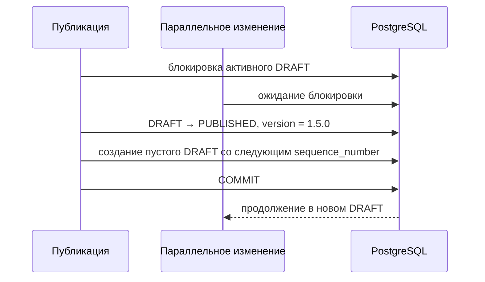

# ADR-0007: Версионные данные, многопользовательское редактирование и журнал изменений

## Статус

Принято.

## Контекст

Сейчас редактор хранит пользовательские изменения в `localStorage`. Сервер не является источником актуального
состояния, другие участники не видят изменения сразу, а состояние старой опубликованной версии нельзя надёжно открыть
в редакторе или запросить через предметный API.

Целевая серверная часть — `backend-kt/ds-service`. Существующие предметные HTTP-методы изменяют токены, темы,
дизайн-системы и данные компонентов. Решение не добавляет недостающие предметные команды редактора, но меняет способ
хранения принадлежащих дизайн-системе данных.

Полный JSON всей дизайн-системы неудобен для предметных запросов. Полное копирование всех строк при каждой публикации
дублирует неизменившиеся данные. Отдельный продуктовый журнал повторяет сведения, которые уже можно получить как
разницу черновика и предыдущей опубликованной границы состояния.

## Границы

В решение входят:

- один общий серверный черновик дизайн-системы;
- хранение только изменённых предметных сущностей относительно предыдущей опубликованной границы состояния;
- чтение активного черновика и любой опубликованной версии через предметные репозитории;
- автосохранение через существующие изменяющие HTTP-методы;
- ревизии логических сущностей и отдельных путей;
- автоматическое объединение изменений разных полей;
- правило «последняя запись побеждает» для одного поля;
- вычисляемый журнал отличий без отдельных таблиц продуктового журнала;
- откат создания, изменения и удаления до публикации;
- публикация черновика с номером версии;
- защита небезопасных повторных запросов.

Не входят:

- полный аудит каждого промежуточного автосохранения;
- изменение уже опубликованной версии;
- новые предметные HTTP-методы токенов или компонентов;
- CRDT, отдельная служба совместного редактирования, WebSocket/SSE и присутствие пользователей;
- обязательный диалог подтверждения отката;
- показ предупреждений о параллельной записи в первой версии интерфейса;
- реализация палитры в текущем изменении.

Палитра в будущем подключается к той же модели предметных редакций.

## Решение

### Независимая версия как граница состояния дизайн-системы

Черновик и опубликованная версия представлены одной сущностью `design_system_versions`. Версии упорядочены, но не
ссылаются друг на друга:

```text
BASELINE          sequence_number = 0
Published 1.4.0   sequence_number = 8
Draft             sequence_number = 9, содержит только изменённые редакции

После публикации:
Published 1.5.0   sequence_number = 9
Draft             sequence_number = 10, пока не содержит редакций
```

```text
design_system_versions
  id
  design_system_id
  status: BASELINE | DRAFT | PUBLISHED
  version: null для BASELINE и DRAFT
  sequence_number
  revision
  changelog
  created_at
  published_at
```

Для дизайн-системы существует не более одной версии со статусом `DRAFT`. Опубликованные версии неизменяемы.
`sequence_number` уникален внутри дизайн-системы, монотонно возрастает и задаёт границу состояния. Он не зависит от
сравнения строковых номеров версий.

Версия логически представляет полное состояние дизайн-системы, но физически не владеет копией всех данных. Её
состояние определяется последними предметными редакциями, начавшими действовать не позднее её `sequence_number`.
Для этого не нужен родительский идентификатор, рекурсивный обход или существование предыдущей версии.

`BASELINE` используется только при миграции существующей дизайн-системы без опубликованной версии. Он содержит
исходные предметные редакции, имеет `sequence_number = 0`, не имеет продуктового номера и не показывается как
опубликованная версия. Активный черновик получает следующий номер. После первой публикации техническая исходная
граница остаётся частью временной истории, но не является зависимостью опубликованной версии.

### Устойчивые сущности и предметные редакции

Каждый предметный модуль владеет двумя видами данных:

1. Таблица устойчивой сущности хранит идентификатор и неизменяемую принадлежность.
2. Таблица `*_revisions` хранит изменяемое состояние только для тех версий, где сущность действительно менялась.

Пример токена:

```text
tokens
  id, design_system_id, created_at

token_revisions
  id, token_id, design_system_version_id
  version_sequence_number
  name, description, token_type, enabled, deleted

token_value_revisions
  id, token_id, design_system_version_id
  version_sequence_number
  tenant_id, platform, mode, value, deleted
```

Изменение одного токена создаёт редакции только этого токена. Остальные данные не копируются. Общая таблица
`design_system_entities` не вводится: токены, темы и компоненты сохраняют независимое владение данными и типизированные
внешние ключи внутри своих модулей.

Таблицы редакций проектируются по границам логических сущностей, а не механически для каждой служебной таблицы.
Каждая предметная редакция хранит номер границы из своей версии. Согласованность пары
`(design_system_version_id, version_sequence_number)` обеспечивается внешним ключом на уникальную пару таблицы
версий. Это позволяет использовать предметный индекс без соединения с таблицей версий при каждом чтении.

### ER-схема целевой модели

```mermaid
erDiagram
    PROJECTS ||--o{ DESIGN_SYSTEMS : contains
    PROJECTS ||--o{ IDEMPOTENT_REQUESTS : protects

    DESIGN_SYSTEMS ||--o{ DESIGN_SYSTEM_VERSIONS : has
    DESIGN_SYSTEMS ||--o{ TENANTS : owns
    TENANTS ||--o{ TENANT_REVISIONS : changes
    DESIGN_SYSTEM_VERSIONS ||--o{ TENANT_REVISIONS : contains

    DESIGN_SYSTEMS ||--o{ TOKENS : owns
    TOKENS ||--o{ TOKEN_REVISIONS : changes
    TOKENS ||--o{ TOKEN_VALUE_REVISIONS : has_values
    DESIGN_SYSTEM_VERSIONS ||--o{ TOKEN_REVISIONS : contains
    DESIGN_SYSTEM_VERSIONS ||--o{ TOKEN_VALUE_REVISIONS : contains

    COMPONENTS ||--o{ PROPERTIES : defines
    COMPONENTS ||--o{ COMPONENT_STATES : defines

    DESIGN_SYSTEMS ||--o{ DESIGN_SYSTEM_COMPONENTS : connects
    COMPONENTS ||--o{ DESIGN_SYSTEM_COMPONENTS : used_by
    DESIGN_SYSTEM_COMPONENTS ||--o{ DS_COMPONENT_REVISIONS : changes
    DESIGN_SYSTEM_VERSIONS ||--o{ DS_COMPONENT_REVISIONS : contains

    DESIGN_SYSTEM_COMPONENTS ||--o{ COMPONENT_CONFIGURATIONS : owns
    COMPONENT_CONFIGURATIONS ||--o{ CONFIGURATION_REVISIONS : changes
    DESIGN_SYSTEM_VERSIONS ||--o{ CONFIGURATION_REVISIONS : contains

    COMPONENT_CONFIGURATIONS ||--o{ CONFIGURATION_AXES : owns
    CONFIGURATION_AXES ||--o{ AXIS_REVISIONS : changes
    DESIGN_SYSTEM_VERSIONS ||--o{ AXIS_REVISIONS : contains

    CONFIGURATION_AXES ||--o{ VARIATION_VALUES : owns
    VARIATION_VALUES ||--o{ VARIATION_VALUE_REVISIONS : changes
    DESIGN_SYSTEM_VERSIONS ||--o{ VARIATION_VALUE_REVISIONS : contains

    DESIGN_SYSTEM_COMPONENTS ||--o{ DESIGN_SYSTEM_STYLES : owns
    DESIGN_SYSTEM_STYLES ||--o{ STYLE_REVISIONS : changes
    DESIGN_SYSTEM_VERSIONS ||--o{ STYLE_REVISIONS : contains

    DESIGN_SYSTEM_VERSIONS ||--o{ ENTITY_EDIT_STATES : tracks
    ENTITY_EDIT_STATES ||--o{ ENTITY_EDIT_PATHS : tracks

    PROJECTS {
        string id PK
    }
    DESIGN_SYSTEMS {
        uuid id PK
        string project_id FK
        string name
    }
    DESIGN_SYSTEM_VERSIONS {
        uuid id PK
        uuid design_system_id FK
        string status
        string version
        bigint sequence_number
        bigint revision
        string changelog
        timestamp created_at
        timestamp published_at
    }
    TENANTS {
        uuid id PK
        uuid design_system_id FK
    }
    TENANT_REVISIONS {
        uuid id PK
        uuid tenant_id FK
        uuid design_system_version_id FK
        bigint version_sequence_number
        string name
        boolean deleted
    }
    TOKENS {
        uuid id PK
        uuid design_system_id FK
    }
    TOKEN_REVISIONS {
        uuid id PK
        uuid token_id FK
        uuid design_system_version_id FK
        bigint version_sequence_number
        string name
        string token_type
        boolean enabled
        boolean deleted
    }
    TOKEN_VALUE_REVISIONS {
        uuid id PK
        uuid token_id FK
        uuid design_system_version_id FK
        bigint version_sequence_number
        uuid tenant_id FK
        string platform
        string mode
        jsonb value
        boolean deleted
    }
    COMPONENTS {
        uuid id PK
        string name
    }
    PROPERTIES {
        uuid id PK
        uuid component_id FK
        string name
    }
    COMPONENT_STATES {
        uuid id PK
        uuid component_id FK
        string name
    }
    DESIGN_SYSTEM_COMPONENTS {
        uuid id PK
        uuid design_system_id FK
        uuid component_id FK
    }
    DS_COMPONENT_REVISIONS {
        uuid id PK
        uuid design_system_component_id FK
        uuid design_system_version_id FK
        bigint version_sequence_number
        boolean deleted
    }
    COMPONENT_CONFIGURATIONS {
        uuid id PK
        uuid design_system_component_id FK
    }
    CONFIGURATION_REVISIONS {
        uuid id PK
        uuid configuration_id FK
        uuid design_system_version_id FK
        bigint version_sequence_number
        string name
        int position
        boolean deleted
    }
    CONFIGURATION_AXES {
        uuid id PK
        uuid configuration_id FK
    }
    AXIS_REVISIONS {
        uuid id PK
        uuid axis_id FK
        uuid design_system_version_id FK
        bigint version_sequence_number
        string name
        int position
        boolean deleted
    }
    VARIATION_VALUES {
        uuid id PK
        uuid axis_id FK
    }
    VARIATION_VALUE_REVISIONS {
        uuid id PK
        uuid variation_value_id FK
        uuid design_system_version_id FK
        bigint version_sequence_number
        string value
        int position
        boolean deleted
    }
    DESIGN_SYSTEM_STYLES {
        uuid id PK
        uuid design_system_component_id FK
    }
    STYLE_REVISIONS {
        uuid id PK
        uuid style_id FK
        uuid design_system_version_id FK
        bigint version_sequence_number
        string role
        string size
        uuid sdds_style_id
        boolean deleted
    }
    ENTITY_EDIT_STATES {
        uuid design_system_version_id FK
        string entity_type
        uuid entity_id
        bigint revision
        uuid last_actor_id
        timestamp updated_at
    }
    ENTITY_EDIT_PATHS {
        uuid design_system_version_id FK
        string entity_type
        uuid entity_id
        string path
        bigint last_revision
        uuid last_actor_id
        timestamp updated_at
    }
    IDEMPOTENT_REQUESTS {
        string project_id FK
        string idempotency_key
        uuid actor_id
        string operation
        string request_hash
        int response_status
        jsonb response_body
        timestamp created_at
    }
```



Палитра не показана, поскольку её версионная модель относится к отдельному изменению.

### Чтение состояния

Выбранная версия задаёт номер временной границы. Для каждой логической сущности сервер выбирает последнюю редакцию,
номер которой не превышает эту границу:

```text
selected_sequence = 12

редакции сущности: 2, 7, 11, 14
выбранная редакция: 11
```

Репозиторий выполняет один индексный поиск по `version_sequence_number <= selected_sequence`, а не обходит версии
по одной. Для списка сущностей последняя применимая редакция выбирается одним множественным запросом. Редакция
`deleted = true` означает отсутствие сущности в выбранном состоянии.

Необходимы индексы:

```text
(entity_id, version_sequence_number desc)
(design_system_version_id)
(design_system_id, status) where status = 'DRAFT'
(design_system_id, version) where status = 'PUBLISHED'
```

Точные составные ключи определяет предметный модуль. Например, значение токена дополнительно различается по теме,
платформе и режиму.

### Без отдельного текущего представления

Обычные предметные таблицы не дублируют актуальные значения черновика. Активный черновик и опубликованные версии
читаются одним способом: по последней предметной редакции на выбранной временной границе. Запись не должна одновременно
обновлять «текущее состояние» и историческую редакцию.

Отдельное текущее представление может быть добавлено позже только как восстанавливаемое средство ускорения после
измерения производительности. Оно не является источником данных и не входит в первую реализацию.

## Многопользовательское редактирование

`ENTITY_EDIT_STATES` и `ENTITY_EDIT_PATHS` не хранят предметные данные или историю версий. Это технические таблицы
процесса редактирования. Первая хранит текущий счётчик редакции логической сущности и служит строкой блокировки.
Вторая хранит редакцию последнего изменения каждого изменяемого пути. Благодаря этому сервер отличает параллельное
изменение разных полей от повторной записи одного поля.

Строка `ENTITY_EDIT_STATES` уникальна по
`(design_system_version_id, entity_type, entity_id)`, а строка `ENTITY_EDIT_PATHS` — по
`(design_system_version_id, entity_type, entity_id, path)`. Техническое состояние может сохраниться даже после
удаления лишней предметной редакции, если итоговое значение снова совпало с предыдущим опубликованным состоянием.

### Единица конкурентности

Ревизия назначается логической сущности, а не всей теме или компоненту:

| Данные | Ключ логической сущности |
| --- | --- |
| Метаданные токена | `token:{id}` |
| Логический токен темы | `theme-token:{tenantId}:{familyKey}` |
| Тема | `tenant:{id}` |
| Связь компонента с дизайн-системой | `design-system-component:{id}` |
| Конфигурация | `component-configuration:{id}` |
| Ось | `component-axis:{id}` |
| Значение варианта | `component-variation-value:{id}` |
| Стиль дизайн-системы | `design-system-style:{id}` |

Общее описание API компонента, его свойства и состояния также получают собственные ревизии, но не входят в версии
конкретной дизайн-системы.

Запрос передаёт:

```http
X-DS-Base-Revision: 17
```

Предметный DTO содержит только намеренно изменённые поля. Разные пути устаревшей сущности объединяются. При записи
одного пути побеждает последняя успешно зафиксированная запись; сервер возвращает машиночитаемое предупреждение, но
первая версия интерфейса его не показывает. Обычная гонка не приводит к `409 Conflict`.

### Транзакция изменения

1. Проверить права и защиту от повторного выполнения, если она требуется.
2. Заблокировать активную версию `DRAFT`.
3. Заблокировать `ENTITY_EDIT_STATES` затронутых сущностей в устойчивом порядке.
4. Сравнить ревизии изменяемых путей.
5. Создать или обновить предметную редакцию, принадлежащую активному `DRAFT`.
6. Если состояние снова равно состоянию на предыдущей опубликованной границе, удалить лишнюю черновую редакцию.
7. Обновить ревизии сущности и путей.
8. Зафиксировать транзакцию и вернуть актуальное разрешённое состояние.

`localStorage` содержит только неподтверждённые запросы, ключи повторяемости и исходные ревизии. Предметные данные
хранятся в PostgreSQL.

## Граница компонентов

Общими для всех дизайн-систем остаются только описание API компонента, его свойства и состояния:

```text
components
properties
component_states
```

Они не получают редакции конкретной дизайн-системы и не входят в её журнал.

Данные, принадлежащие дизайн-системе, версионируются и входят в журнал:

- связь `design_system_components`;
- конфигурации компонента;
- оси конфигурации;
- значения вариантов;
- роли, размеры и привязки стилей SDDS.

Демонстрационные свойства Storybook (`Props`) и состояние интерфейса не сохраняются в версиях.

## Вычисляемый журнал

Таблицы `design_system_draft_changes` и `design_system_draft_change_items` не вводятся. Кандидатами журнала являются
предметные редакции, принадлежащие выбранной версии.

Для активного черновика сервер сравнивает принадлежащие ему редакции с состоянием на предыдущей опубликованной
границе. Для опубликованной версии её редакции сравниваются с состоянием на непосредственно предшествующей
опубликованной границе или `BASELINE`. Граница определяется по `sequence_number`, а не по ссылке на родительскую
версию.

| Состояние на предыдущей границе | Редакция выбранной версии | Операция журнала |
| --- | --- | --- |
| нет | данные, `deleted = false` | `CREATE` |
| есть | отличающиеся данные | `UPDATE` |
| есть | `deleted = true` | `DELETE` |
| есть | данные равны предыдущему состоянию | записи журнала нет, лишняя редакция удаляется |

Одна запись журнала соответствует логической сущности. Изменённые поля вычисляет предметный модуль. Автор и время
последнего изменения пути берутся из `ENTITY_EDIT_PATHS`.

`changeId` не является идентификатором строки отдельной таблицы журнала. Это устойчивое представление ссылки на
логическую сущность в выбранной версии, формируемое сервером из типа сущности и её идентификатора.

Чтение журнала:

```http
GET /api/ds/design-systems/{id}/changes
GET /api/ds/design-systems/{id}/changes?versionId={versionId}
```

Без `versionId` возвращается журнал активного черновика; с `versionId` — разница опубликованной версии и предыдущей
опубликованной границы или `BASELINE`.

Удаляется группа `/api/ds/design-system-changes`, включая публичный `POST`: клиент не создаёт журнал.

## Удаление

Удаление опубликованной сущности создаёт в активном черновике предметную редакцию `deleted = true`. Исходная редакция
остаётся в опубликованной версии, поэтому общая таблица удалённых объектов и поля `deleted_in_draft_id` не нужны.

Создание и последующее удаление в одном черновике удаляет черновую редакцию и устойчивую сущность, если на неё не
ссылается ни одна опубликованная версия.

Уникальность проверяется для разрешённого состояния активного черновика. Удалённая в черновике сущность не занимает
уникальный ключ, поэтому пользователь может создать новую сущность с тем же именем. Обычный индекс одной физической
таблицы не выражает состояние на временной границе; проверка выполняется предметным репозиторием внутри транзакции.

Для защиты от одновременного создания одинаковых значений предметный модуль строит нормализованный ключ уникальности,
блокирует его на время транзакции, повторно проверяет состояние на границе активного черновика и только затем пишет
редакцию. Общая инфраструктура предоставляет механизм такой блокировки, а состав ключа определяет предметный модуль.

## Откат

```http
POST /api/ds/design-systems/{id}/changes/{changeId}/revert
X-DS-Base-Revision: 24
Idempotency-Key: 54e18c99-...
```

Откатываются только редакции активного `DRAFT`. Маршрут является общей точкой входа, но не пишет произвольный JSON в
предметные таблицы. Он определяет тип логической сущности из `changeId` и вызывает типизированный обработчик модуля.

```text
UPDATE → удалить черновую редакцию или восстановить в ней поля предыдущего опубликованного состояния
DELETE → удалить черновую редакцию с deleted = true
CREATE → удалить черновую редакцию и устойчивую сущность после проверки зависимостей
```

После предметного изменения сервер удаляет ставшие лишними сведения о ревизиях путей. Отдельная запись «откат» не
создаётся.

Если ревизия изменения устарела, сервер возвращает `409 DRAFT_CHANGE_STALE` и текущую ревизию. Клиент обновляет
журнал и не повторяет откат автоматически. Обязательный диалог подтверждения не нужен.

## Публикация

Используется существующий маршрут с новым смыслом:

```http
POST /api/ds/design-system-versions
Idempotency-Key: release:...
```

```json
{
  "designSystemId": "...",
  "draftId": "...",
  "draftRevision": 42,
  "version": "1.5.0",
  "changelog": "Обновлены основные цвета и конфигурация кнопки."
}
```

Клиент не передаёт `snapshot`, `changesSnapshot`, `publicationStatus` и `publishedAt`. Поле `snapshot` удаляется из
целевого контракта и таблицы версий. Номер имеет формат `major.minor.patch` и уникален внутри дизайн-системы.



Транзакция публикации:

1. Блокирует активный `DRAFT`.
2. Проверяет право публикации, непустую вычисляемую разницу, формат и уникальность номера.
3. Назначает черновику номер, `published_at`, `changelog` и статус `PUBLISHED`.
4. Делает все его предметные редакции неизменяемыми.
5. Создаёт пустой `DRAFT` со следующим `sequence_number` без ссылки на опубликованную версию.
6. Сохраняет результат запроса публикации и фиксирует транзакцию.

Запись, завершённая до блокировки, входит в публикацию. Запись, пришедшая после блокировки, ждёт и выполняется уже в
новом черновике. Переданная `draftRevision` используется для диагностики, но не исключает изменения других
участников, зафиксированные до границы публикации.

Опубликованная версия не изменяется и не удаляется отдельными `PATCH` или `DELETE`. Соответствующие существующие
маршруты удаляются из публичного API. Чтение версий сохраняется.

## Чтение старых версий

Предметные методы чтения принимают необязательный `versionId`. Без него возвращается разрешённое состояние активного
черновика; с ним — состояние указанной опубликованной версии. Те же модели используются редакторами токенов и
компонентов в режиме только для чтения.

Примеры целевого вида маршрутов:

```http
GET /api/ds/design-systems/{id}/tokens?versionId={versionId}
GET /api/ds/design-systems/{id}/components?versionId={versionId}
GET /api/ds/design-systems/{id}/components/{componentId}/styles?versionId={versionId}
```

Новые изменяющие маршруты компонентов этим ADR не вводятся.

## Защита от повторного выполнения запросов

Таблица `idempotent_requests` отделена от предметных редакций и используется для создания через `POST`, импорта,
публикации и отката. Обычные `PATCH`, `PUT` и `DELETE` автосохранения записей в ней не создают.

```text
idempotent_requests
  project_id, idempotency_key, actor_id, operation
  request_hash, response_status, response_body, created_at
```

Действует `unique (project_id, idempotency_key)`. Повтор с тем же ключом возвращает сохранённый ответ; тот же ключ с
другим `request_hash` отклоняется. Записи хранятся весь срок жизни проекта и удаляются каскадно вместе с ним.

## Изменения по слоям

```text
Редактор
  автосохранение + выбор версии + режим чтения + вычисляемый журнал
      ↓
Слой представления
  существующие предметные DTO + versionId + ревизии
      ↓
Прикладной слой
  разрешение состояния версии + отслеживаемое изменение + публикация + откат
      ↓
Предметные модули
  устойчивые сущности + собственные *_revisions + сравнение с предыдущей границей
      ↓
PostgreSQL
```

- `presentation` не интерпретирует редакции и не формирует журнал.
- `application` выбирает активный черновик или опубликованную версию и управляет транзакцией.
- каждый предметный модуль владеет чтением состояния на временной границе, сравнением и типизированным откатом;
- `data` предоставляет индексы и запросы выбора ближайшей редакции;
- общая инфраструктура хранит корни версий, техническое состояние редактирования и результаты повторяемых запросов;
- общий инфраструктурный механизм предоставляет выбор временной границы, шаблоны чтения последней редакции,
  обработку признака удаления и блокировку нормализованных ключей уникальности; предметные поля, ограничения,
  сравнение и откат остаются внутри соответствующего модуля.

## Последовательность внедрения

1. Расширить `design_system_versions`: статус, порядковый номер и ревизия; убрать `snapshot` и зависимость от другой
   версии.
2. Добавить устойчивые сущности и предметные `*_revisions` для данных дизайн-системы.
3. Создать технический `BASELINE` и активный `DRAFT` для существующих дизайн-систем.
4. Реализовать разрешение состояния выбранной версии в предметных репозиториях.
5. Перевести существующие изменяющие сценарии на запись редакций активного черновика.
6. Добавить `ENTITY_EDIT_STATES`, `ENTITY_EDIT_PATHS` и метаданные ответов.
7. Реализовать вычисляемый журнал и удалить `/api/ds/design-system-changes`.
8. Добавить типизированный откат через вложенный маршрут дизайн-системы.
9. Изменить публикацию на перевод `DRAFT → PUBLISHED` без копирования предметных данных.
10. Добавить чтение опубликованных версий и режим редакторов только для чтения.
11. Перевести клиент с хранения предметных данных в `localStorage` на серверное автосохранение.

## Последствия

Положительные:

- старые версии доступны обычным предметным запросам;
- версии не зависят друг от друга через родительские ссылки;
- чтение не выполняет рекурсивный обход истории, а использует номер временной границы;
- не требуется предотвращать разрывы и циклы в графе версий;
- неизменившиеся данные не копируются;
- единый JSON всей дизайн-системы не нужен;
- активный журнал и история версий выводятся из предметных редакций;
- отдельные таблицы продуктового журнала и признаки удаления черновика не нужны;
- публикация не копирует граф данных, а меняет статус корня версии;
- каждый предметный модуль сохраняет владение своей схемой и ограничениями;
- нет двух одновременно изменяемых представлений текущего состояния, которые могли бы рассогласоваться;
- повторяющаяся техническая работа с временными границами выносится в общий инфраструктурный механизм без общей
  таблицы предметных данных.

Ограничения и стоимость:

- чтение должно выбирать последнюю предметную редакцию на заданной временной границе;
- каждый версионируемый предметный модуль получает собственные таблицы редакций;
- уникальность активного состояния проверяется с учётом редакций, действующих на временной границе;
- связи и каскады должны различать устойчивую сущность и её редакцию;
- объём истории растёт пропорционально числу фактических изменений и требует предметных индексов и контроля планов
  запросов;
- точный состав предметных таблиц редакций проектируется отдельно в каждом модуле.

## Отклонённые альтернативы

- единый JSON опубликованной дизайн-системы — затрудняет предметные запросы и режим редактора старой версии;
- полное копирование всех предметных строк при публикации — дублирует неизменившиеся данные;
- зависимые версии с `base_version_id` — требуют поддерживать цепочку и создают ошибочное впечатление, что чтение
  должно последовательно обходить предыдущие версии;
- отдельные изменяемые таблицы текущего состояния — упрощают обычное чтение, но требуют синхронно обновлять два
  представления одних данных и усложняют публикацию и откат;
- общая `design_system_entities` — связывает все предметные модули общей таблицей типов и идентификаторов;
- отдельные таблицы продуктового журнала — дублируют разницу, уже выраженную предметными редакциями;
- физическое удаление опубликованных данных — делает старые версии неполными;
- одна ревизия на всю тему или компонент — создаёт ложные столкновения;
- `409` для любой устаревшей записи — мешает объединению разных путей;
- CRDT и блокировка на всё время редактирования — избыточны для первой версии.

## Отложенное развитие

- предметные редакции палитры;
- отображение предупреждений о параллельной перезаписи;
- новые предметные команды токенов и компонентов, если они понадобятся продукту.
