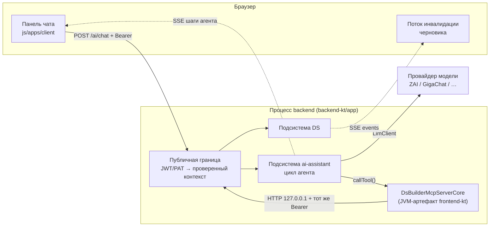
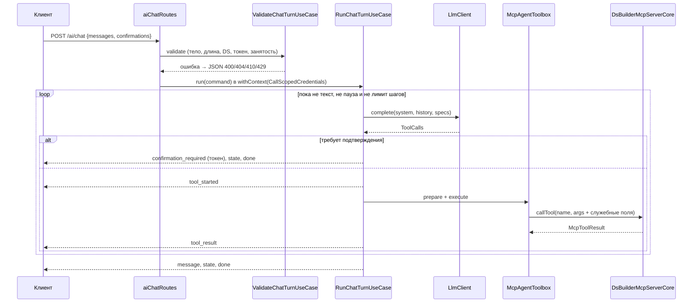

## Контекст

- Публичный backend — один JVM-процесс `backend-kt/app` (возможность `backend-monolith-runtime`). Он проверяет JWT или PAT, строит проверенный контекст запроса и передаёт его подсистемам: DS, проектам, документации, согласиям. Ограничения частоты по IP задаёт внешняя инфраструктура, а не монолит.
- `frontend-kt/mcp-server-core` содержит 61 инструмент: 31 на чтение и 30 на запись. Класс `DsBuilderMcpServerCore` в `commonMain` не использует типы MCP SDK: `tools()` отдаёт описания и схемы, `callTool(name, JsonObject)` выполняет вызов через use case модулей `feature-*`. Эти use case ходят в публичный API `/api/projects/{projectId}/...` с учётными данными из `CredentialProvider`. JVM-артефакт модуля при этом зависит от MCP SDK: `jvmMain` наследует `sdkMain`.
- В CLI и `dsbuilder-mcp` учётные данные берутся из env, локального хранилища сессии или служебной учётной записи. Контекст DS задаётся ссылкой `designSystem` либо `.sdds/config.json`.
- Клиент уже подписан на поток инвалидации черновика (`js/apps/client/src/api/draftInvalidationStream.ts`). Поток не подавляет события от записей без `X-DS-Client-Id`, то есть и записи чата.
- Чат должен работать с ZAI (`glm-4.5-flash`) и с GigaChat. Обе модели слабее Claude в вызове инструментов.

## Цели / Вне целей

**Цели:**

- Один набор инструментов для внешних агентов (через MCP) и встроенного чата, без второй реализации операций.
- Изменения из чата идут теми же путями, что и ручные: те же проверки прав, ревизии, журнал и поток инвалидации.
- Провайдер модели меняется настройками. Добавить формат API — значит добавить адаптер, а не переписать цикл агента.
- Удаляющие операции выполняются только после явного подтверждения пользователя.

**Вне целей:**

- Удалённый MCP по HTTP/SSE, хранение разговоров на сервере, учёт расхода токенов и квоты по проектам.
- Изменение каталога компонентов, публикация версий, управление участниками.
- Отмена хода чата и поиск по документации (решения 5 и 7).
- Составные «умные» инструменты под слабые модели. Они добавляются отдельным изменением по итогам эталонных сценариев.

## Архитектура



Агент вызывает инструменты от имени пользователя. Ядро MCP обращается к публичному API своего же процесса по адресу `127.0.0.1` с тем же заголовком `Authorization`, поэтому каждый вызов проходит обычную проверку доступа и попадает в журнал от имени пользователя. Подсистема `ai-assistant` не зависит от подсистемы DS напрямую. Исключение — предварительная проверка принадлежности DS проекту через существующий адаптер `InProcessDesignSystemOwnership` (решение 4).

## Решения

### 1. Подсистема монолита, а не отдельный сервис

Подсистема `backend-kt/ai-assistant` повторяет форму `documentation-service`: отдельная сборка с `runtime` и `feature-chat`. Монолит подключает её как включаемую сборку (`includeBuild`) — так же, как документацию. Маршруты регистрируются под `/api/projects/{projectId}/ai` с проверенным контекстом. Префикс `/api/projects/` уже публичный, поэтому менять границу не нужно. Тело запроса ограничено общим лимитом 2 МиБ. Ресурсы `runtime` переносятся в пространство имён `dsbuilder/ai/...` по соглашению монолита, а OpenAPI добавляется в каталог `backend-kt/api-reference`.

Рассмотренные варианты:

- **Отдельный JVM-сервис в `frontend-kt`.** Отклонён: монолит — единственный поддерживаемый прикладной процесс. Отдельный контейнер потребовал бы своего шлюза, Dockerfile и развёртывания в Coolify.
- **Чат целиком в браузере** (как в ветке `AI-CHAT`). Отклонён: ключ модели попадает в браузер или в прокси разработки, а логику инструментов пришлось бы дублировать на TypeScript.
- **Удалённый MCP по HTTP и агент как MCP-клиент.** Отклонён: это лишний протокольный слой внутри одного процесса, и он противоречит ADR-0004.

### 2. Ядро MCP подключается как библиотека, вызовы идут через собственный HTTP

Подсистема использует JVM-артефакт `:mcp-server-core` и вызывает `tools()`/`callTool()` напрямую. Use case ядра обращаются к бэкенду через уже существующие HTTP-адаптеры `feature-theme`, `feature-components`, `feature-ds`. В монолите эти запросы идут на `127.0.0.1` в публичный API того же процесса с исходным заголовком `Authorization` пользователя.

Это расходится с требованием «Независимость поведения от транспорта», которое запрещает монолиту обращаться по HTTP к собственным функциям. Поэтому изменение вводит в требование одно узкое исключение для инструментов чата (дельта `backend-monolith-runtime`). Доводы за такой вариант:

- **Одна реализация операций.** Сопоставление аргументов, ревизии, повторяемость, обработка неопределённого исхода и формат результатов уже написаны и проверены для внешних агентов (`frontend-mcp-server`). Вызов внутри процесса потребовал бы вторых реализаций примерно десятка HTTP-адаптеров поверх use case ds-service. При этом `frontend-kt` — мультиплатформенная клиентская сборка и не может зависеть от `backend-kt`, так что эти реализации жили бы отдельно от ядра и расходились бы с ним.
- **Тот же путь безопасности, что у браузера.** Каждый вызов агента проходит публичную границу: проверку JWT или PAT, построение проверенного контекста, `PolicyEvaluator`, принадлежность DS, лимиты тела. Вызову внутри процесса пришлось бы обходить границу и повторять эти проверки вручную, а ошибка в повторе — это обход прав.
- **Та же семантика записи.** `Idempotency-Key`, `X-DS-Base-Revision`, `X-DS-Mutation-Metadata`, автор в журнале и событие инвалидации черновика формируются маршрутами ds-service. Через HTTP чат получает их без изменений. Внутри процесса пришлось бы вызывать оркестрацию уровня маршрутов.
- **Одна поверхность проверки.** Встроенный чат ведёт себя так же, как внешний агент через `dsbuilder-mcp`. Ошибка, найденная в одном пути, исправляется для обоих, а тесты ядра покрывают оба.
- **Подсистему можно вынести.** `ai-assistant` не зависит от внутренностей подсистемы DS. При выносе в отдельный процесс меняется только базовый адрес API.
- **Цена мала.** Лишний переход через `127.0.0.1` занимает миллисекунды, а ответ модели — секунды.

Рассмотренные варианты:

- **Прямые вызовы use case ds-service.** Отклонены по причинам выше: вторая реализация операций и обход публичной границы.
- **Собственный движок HTTP-клиента Ktor, который передаёт запрос в обработку запросов монолита без сокета.** Формально снимает сетевой вызов, но запрос остаётся HTTP по смыслу и проходит ту же границу. Это нестандартный код, который придётся поддерживать для потоковых ответов, лимитов тела и отмены, а выигрыш — миллисекунды. Пересматривается, если обратные вызовы станут узким местом.

Ограничения исключения:

- Обратные вызовы делает только `ai-assistant` и только к маршрутам под `/api/projects/{projectId}/`.
- Передаётся только исходный `Authorization`. Доверенные заголовки `X-*` подсистема не ставит, а граница всё равно отбрасывает присланные и подставляет проверенный контекст (`VerifiedRequestContext.kt`).
- Другие подсистемы монолита по-прежнему не обращаются к собственным функциям по HTTP.

Базовый адрес API задаётся переменной `DSBUILDER_API_URL=http://127.0.0.1:${BACKEND_PORT}` в `EnvironmentReader` серверного `ClientRuntime`. Файловая система и хранилище сессии в этом `ClientRuntime` пустые.

**Граф зависимостей ядра** собирается в слое `di` подсистемы `ai-assistant`, как это делает `mcp-node` (`NodeClientRuntime.kt`), а не в самом `mcp-server-core`: по `frontend-kt/AGENTS.md` модуль ядра — общая библиотека, а не точка сборки. Используется изолированный `koinApplication {}`, а не глобальный Koin монолита: монолит запрещает переопределение регистраций (`allowOverride(false)`). `CredentialProvider` в этом графе — `CallScopedCredentialProvider`, а HTTP-клиент — JVM-реализация `KtorAuthenticatedHttpClientFactory` из `core-network`.

**MCP SDK в JVM-артефакте.** `jvmMain` модуля ядра наследует `sdkMain`, поэтому SDK и его зависимости Ktor попадут в JAR монолита. Изменение принимает это и проверяет совместимость версий Ktor (задача 1.3). Если версии конфликтуют, общий JVM-код без SDK выносится в отдельный набор исходников. Это решается в той же задаче.

**Сборка.** Основной путь — публикация, а не составная сборка (composite build). Причины: обе сборки подключают включаемую сборку `build-system` с одинаковым именем, а `frontend-kt/settings.gradle.kts` применяет плагин настроек IntelliJ Platform и подключает модули плагинов IDE и платформ macOS/Windows/JS, что в Linux-образе потребовало бы лишних загрузок.

- В `frontend-kt` появляется свойство `dsbuilder.serverSubset=true`. С ним сборка подключает только модули, нужные ядру (`core-*`, нужные `feature-*`, `mcp-server-core`), и не применяет плагины IDE.
- Задача `publishMcpCoreForBackend` публикует JVM-публикации этих модулей в `frontend-kt/build/repo`.
- `backend-kt/ai-assistant` и `backend-kt/app` берут артефакт из этого каталога как из maven-репозитория. Задача Gradle в `backend-kt` вызывает публикацию перед сборкой, а `app/Dockerfile` делает это в стадии сборки.
- `.dockerignore` пропускает `frontend-kt` без `build`, `.gradle`, `node_modules`, `kotlin-js-store`.
- `validate-backend-kt.yml` срабатывает и на `frontend-kt/**`, в его матрицы и в корневой `backend-kt/settings.gradle.kts` добавляется `ai-assistant`.

Критерий готовности задачи 1.3: стадия сборки образа не скачивает IntelliJ Platform и не собирает Kotlin/Native-цели. Если отключение нативных целей свойством не получится, ядро собирается в CI заранее и передаётся в образ готовым артефактом.

### 3. Учётные данные из контекста корутины

В `core-application` появляется `CallScopedCredentialProvider`. Он реализует существующий публичный порт `CredentialProvider` и возвращает Bearer из элемента контекста корутины `CallScopedCredentials`. Граф ядра создаётся один раз при запуске, а каждый ход чата выполняется внутри `withContext(CallScopedCredentials(bearer))`. Так один экземпляр ядра обслуживает параллельных пользователей без общего изменяемого состояния. `toString()` элемента маскирует токен.

- Если элемента в контексте нет, возвращается `AUTH_REQUIRED`. Подставлять «чужой» или служебный токен нельзя.
- При запросе с `forceRefresh = true` (так делает `RefreshingAuthenticatedHttpClientFactory` после ответа 401) провайдер возвращает `AUTH_REQUIRED`, а не тот же токен. Обновить токен пользователя сервер не может, и повторять запрос с ним бессмысленно.

**Срок жизни JWT.** Ход длится до `AI_TURN_TIMEOUT_SECONDS`, а каждый обратный вызов заново проверяет JWT. Чтобы токен не истёк посреди хода:

- клиент перед `POST /ai/chat` получает токен с запасом не меньше `AI_TURN_TIMEOUT_SECONDS + 30` секунд и при меньшем остатке обновляет его принудительно. Запас клиент берёт из `ai/status` (`minTokenLifetimeSeconds`);
- если обратный вызов всё же получил 401, ход завершается событием `error` с `auth_expired`, затем `state` и `done`. Клиент обновляет токен и предлагает повторить запрос;
- `AI_TURN_TIMEOUT_SECONDS` должен быть меньше срока жизни токена доступа Keycloak. Срок в репозитории не переопределён, значит действует значение Keycloak по умолчанию, 300 секунд. Это сверяется с настройками realm в задаче 6.2.

Рассмотренный вариант — создавать граф Koin на каждый запрос. Отклонён: это дорого и требует закрывать HTTP-клиенты на каждый ход.

### 4. Сервер без состояния, история хранится у клиента

Каждый запрос содержит всю историю разговора в нейтральном формате (раздел «Модель данных и контракты»). Сервер не хранит разговор между запросами. Клиент держит историю только в памяти вкладки, а не в `localStorage`. Подделанная клиентом история влияет только на ответ модели: каждый вызов инструмента всё равно выполняется с правами пользователя.

**Проверки до открытия потока.** Маршрут выполняет синхронный шаг `ValidateChatTurnUseCase` до того, как начать ответ `text/event-stream`. Ошибки этого шага возвращаются обычным JSON:

- разбор тела и ограничение `AI_MESSAGE_MAX_CHARS`;
- принадлежность `designSystemId` проекту маршрута через существующий адаптер `InProcessDesignSystemOwnership`, тот же, что использует документация;
- проверка `confirmationToken`;
- ограничение «один активный ход на пользователя» (решение 4а).

**Подтверждение** на историю не опирается: история приходит от клиента, и по ней сервер не может проверить, что пользователю показали именно эту операцию. Поэтому, когда агент останавливается на операции с подтверждением, сервер:

- сам формирует итоговые аргументы вызова, включая служебные поля, и заранее выдаёт `idempotencyKey`;
- выпускает `confirmationToken`. Это подпись HMAC-SHA256 над идентификатором ключа (`kid`), `userId`, `projectId`, `designSystemId`, именем инструмента, каноническим JSON итоговых аргументов, `idempotencyKey` и сроком действия (10 минут). Черновик входит в подпись через ссылку `designSystem` с `version=draft` среди аргументов. Bearer в токен не входит;
- отдаёт клиенту в событии `confirmation_required` описание операции, её аргументы без служебных полей и токен.

Подтверждение — это `confirmations: [{ confirmationToken, approved }]`. Сервер проверяет подпись, срок и совпадение пользователя, проекта и DS с текущим запросом. Затем он выполняет ровно ту операцию, что записана в токене, с её `idempotencyKey`. Аргументы ожидающего вызова в присланной истории игнорируются. В историю записывается вызов с аргументами из токена. Повторная отправка того же подтверждения идёт с тем же ключом, и ds-service воспроизводит сохранённый ответ без второй записи.

Ключ подписи и его `kid` генерируются случайно при старте процесса и в env не хранятся. Если `kid` токена неизвестен, значит процесс перезапускался: ответ `410 confirmation_expired`. Если `kid` известен, но подпись не сходится или область не совпадает, ответ `400 confirmation_invalid`.

**История для модели** обрезается до лимита `AI_HISTORY_MAX_CHARS` (по умолчанию 60000): сначала сокращается текст старых результатов инструментов, затем старые реплики. Сообщение `tool` при сокращении не удаляется, а получает текст «[результат сокращён]». Иначе API формата OpenAI отклонит вызов инструмента без ответа. Системный промпт и последнее сообщение пользователя не сокращаются. Одно сообщение пользователя ограничено `AI_MESSAGE_MAX_CHARS` (по умолчанию 8000); более длинное отклоняется ответом `400 message_too_long`.

### 4а. Защита от перерасхода и массовых записей

- **Один активный ход на пользователя.** Счётчик в памяти процесса; второй одновременный запрос получает `429 ai_busy`. Это ограничивает расход ключа провайдера одним участником и снимает гонку двух ходов одного пользователя по одной DS.
- **Лимит записей за ход** `AI_MAX_WRITES` (по умолчанию 10). Запись сверх лимита требует подтверждения, как удаляющая операция. Так внедрённая через данные DS инструкция не может молча переписать много значений, а отмены хода в первой версии нет.

### 5. Набор инструментов задаёт сервер

`ChatToolPolicy` — список разрешённых инструментов в коде подсистемы. Разрешения сверены с use case ds-service:

| Инструмент | Разрешение | Источник проверки |
|---|---|---|
| все инструменты чтения | соответствующее `*:read` | маршруты чтения ds-service |
| `token_value_update` | `tokens:write` | `UpdateTokenValueUseCase` |
| `color_token_values_update` | `tenants:write` | `UpdateColorTokenValuesUseCase` |
| `size_token_value_update` | `tenants:write` | `UpdateSizeTokenValueUseCase` |
| `typography_style_update` | `tenants:write` | `UpdateTypographyStyleUseCase` |
| `component_property_set` | `components:variations:write` | `SetAppearancePropertyValueUseCase` → `modelMutate` |
| `component_axis_value_create` | `components:variations:write` | `AddAppearanceAxisValueUseCase` → `modelCreate` |
| `component_configuration_duplicate` | `components:variations:write` | `DuplicateAppearanceConfigurationUseCase` → `modelCreate` |
| `component_property_reset` | `components:variations:delete` | `RemoveAppearancePropertyValueUseCase` → `modelDelete` |

Инструменты чтения: `design_system_get_context`, `tenants_list`, `tokens_list`, `token_get`, `token_values_get`, `token_groups_list`, `palette_get`, `token_edit_data_get`, `components_list`, `component_configurations_list`, `component_variations_get`, `component_properties_get`, `component_editor_get`, `component_config_get`, `component_tokens_get`. Подтверждения требуют все разрешённые инструменты с `destructive = true` (суффиксы `_delete`, `_reset`); на старте это `component_property_reset`. По `authorization/policy.json` право `components:variations:delete` есть у maintainer и owner, поэтому у editor этого инструмента нет и подтверждения он не увидит.

Правила:

- Каждый инструмент отбирается по своему точному разрешению через существующий `PolicyEvaluator.isAllowed(principal, permission)`. Принципал строится из проверенного контекста. Для JWT разрешения задаёт роль в проекте. Для PAT — пересечение скоупов токена и прав роли владельца. Собственной логики ролей и скоупов подсистема не пишет. Это отступление от требования `frontend-mcp-server` «Backend authorization остается серверной ответственностью», которое запрещает скрывать инструменты по локально вычисленной роли. Требование изменено дельтой: отбор делает серверный `PolicyEvaluator` по проверенному контексту, а ds-service всё равно проверяет каждый вызов.
- `documentation_search` в первую версию не входит. Существующий поиск разрешает публикацию в рамках проекта и не проверяет её принадлежность к DS, а граница чата — одна DS. Инструмент вернётся отдельным изменением вместе с такой проверкой.
- Поля `designSystem`, `version` и `idempotencyKey` убираются из схемы для модели и из её списка `required`. Сервер подставляет их только тем инструментам, в схеме которых они есть: ссылку `dsbuilder://projects/{projectId}/design-systems/{designSystemId}?version=draft`, `version=draft` и новый UUID на каждый вызов записи. Набор полей ядро публикует как `mcpServerFilledFields`, а схему для модели строит публичная функция ядра `McpToolDefinition.inputJsonSchema(hidden)`. Она использует тот же внутренний перевод в JSON Schema, что и MCP, включая `type = "json"` и `nullable`. Закрытый `editorOptionFields`, который при разборе команды отделяет служебные поля, включая `baseRevision`, не меняется.
- Поля ревизий `baseRevision` и `editRevision` остаются видимыми. Модель берёт их из предшествующего чтения. При конфликте ревизии сервер не повторяет вызов сам: ошибка возвращается модели, и та может перечитать данные и попробовать снова новым вызовом с новым ключом. Это соответствует требованию «Ревизии и повторяемость мутаций».

### 6. Нейтральная модель и адаптеры провайдеров

Цикл агента работает только с типами `ChatMessage`, `ToolCall`, `ToolResult`, `ToolSpec`. `LlmClient` выполняет один шаг: принимает системный промпт, историю и инструменты, возвращает либо текст, либо вызовы инструментов.

- `OpenAiCompatibleClient` использует формат `chat/completions` с `tools`/`tool_calls`. Отличия провайдеров задаются конфигурацией: `AI_EXTRA_BODY` подмешивается в тело запроса как есть, `AI_RETRY_ERROR_CODES` дополняет 429 и 5xx. Повтор — до трёх раз с экспоненциальной задержкой.
- `GigaChatClient` получает токен доступа по `AI_GIGACHAT_AUTH_KEY` и `AI_GIGACHAT_SCOPE` (заголовок `RqUID`), кеширует его до истечения минус минута и обновляет при 401. Инструменты передаются как `functions`, ответ — `function_call`, результат — сообщение `role: function`. Значения по умолчанию: `AI_GIGACHAT_OAUTH_URL=https://ngw.devices.sberbank.ru:9443/api/v2/oauth`, `AI_GIGACHAT_BASE_URL=https://gigachat.devices.sberbank.ru/api/v1`, `AI_GIGACHAT_SCOPE=GIGACHAT_API_PERS`. Доверенный корень берётся из файла `AI_GIGACHAT_CA_PATH`, смонтированного в контейнер томом только для чтения. Его добавляют к системным корням, а не заменяют ими. Значения по умолчанию, имена полей и совместимость наших JSON Schema (`enum` с `null`, вложенные объекты) с `functions` сверяются с актуальной документацией GigaChat при реализации.
- Цикл агента рассчитан на один вызов за шаг. Если OpenAI-совместимая модель вернула несколько `tool_calls`, они выполняются последовательно в порядке ответа. Если в этом наборе есть вызов, требующий подтверждения, вызовы до него выполняются, а сам вызов и все последующие уходят в `confirmation_required`. В историю записываются только выполненные вызовы.

Рассмотренный вариант — Koog или LangChain4j. Отклонён для первого шага: цикл должен управлять подтверждениями, подстановкой полей и событиями интерфейса, а адаптер формата OpenAI занимает несколько сотен строк. Решение пересматривается, если провайдеров станет больше трёх.

### 7. События хода и обновление интерфейса

Ответ на `POST /ai/chat` — поток `text/event-stream`. Браузерный `EventSource` не поддерживает POST, поэтому клиент читает поток через `fetch` и `ReadableStream`. Пока ход ждёт модель, сервер каждые 15 секунд пишет комментарий `: heartbeat`, как поток черновика (`DraftInvalidationRoutes.kt`). Так обрыв соединения клиентом обнаруживается и ход отменяется, а прокси не закрывает молчащее соединение. Сжатие монолита потока не касается: оно применяется только к JSON.

Изменения в интерфейсе появляются через существующий поток инвалидации черновика.

Кнопки «Отменить ход» в первой версии нет. Существующий откат журнала возвращает сущность к предыдущему опубликованному состоянию (ADR-0007, раздел «Откат»). Если пользователь вручную изменил значение, а чат затем изменил его же, откат журнала сотрёт и ручную правку. Правильная отмена хода — компенсирующие записи прежних значений с проверкой ревизии. Она делается отдельным изменением. Панель не предлагает откат журнала как отмену хода.

### 8. Выключатель и настройка

По умолчанию провайдер — ZAI: `AI_PROVIDER=openai-compatible`, `AI_BASE_URL=https://api.z.ai/api/paas/v4`, `AI_MODEL=glm-4.5-flash`, `AI_EXTRA_BODY={"thinking":{"type":"disabled"}}`, `AI_RETRY_ERROR_CODES=1234,1305`. Чтобы включить чат на стенде, достаточно задать `AI_ENABLED=true` и `AI_API_KEY`.

- `AI_ENABLED=false` по умолчанию. Тогда остальные `AI_*` не читаются, `GET /ai/status` возвращает `{ "enabled": false }`, а `POST /ai/chat` — `503 ai_unavailable`.
- При `AI_ENABLED=true` неполная или недопустимая конфигурация — нет ключа, неразбираемое число или JSON, `AI_HISTORY_MAX_CHARS` не вмещает системный промпт и сообщение предельной длины — обрабатывается как любая ошибочная конфигурация монолита. Приложение не открывает готовность и сообщает понятную ошибку с именем переменной, без значений секретов. Это действующее требование «Независимость конфигурации от способа запуска», сценарий «Ошибочная конфигурация»; исключение для ИИ не вводится. Включение чата — осознанное действие, и ошибка должна быть видна сразу, а не в виде молча выключенной функции.
- Клиент показывает панель, только если `VITE_AI_CHAT_ENABLED=true` и `status.enabled`.

## Программное проектирование

`frontend-kt/core-application`:

```kotlin
/** Bearer текущего вызова для серверного встраивания ядра; toString() маскирует токен. */
public class CallScopedCredentials(public val bearer: String) : AbstractCoroutineContextElement(Key) {
    public companion object Key : CoroutineContext.Key<CallScopedCredentials>
}

/** Берёт учётные данные только из [CallScopedCredentials]; без него и при forceRefresh возвращает AUTH_REQUIRED. */
public class CallScopedCredentialProvider : CredentialProvider {
    override suspend fun resolve(request: CredentialRequest): CredentialResult
}
```

`frontend-kt/mcp-server-core`:

```kotlin
/** Поля, которые встраивающий сервер заполняет сам и скрывает от модели. */
public val mcpServerFilledFields: Set<String> // designSystem, version, idempotencyKey

/** JSON Schema входа инструмента без [hidden] полей в properties и required; тот же перевод, что для MCP. */
public fun McpToolDefinition.inputJsonSchema(hidden: Set<String> = emptySet()): JsonObject
```

`backend-kt/ai-assistant/feature-chat` — слои domain и application:

```kotlin
public enum class ChatRole { USER, ASSISTANT, TOOL }
public data class ToolCall(val id: String, val name: String, val arguments: JsonObject)
public data class ToolResult(val callId: String, val name: String, val content: String, val isError: Boolean)
public data class ChatMessage(val role: ChatRole, val text: String?, val toolCalls: List<ToolCall>, val toolResult: ToolResult?)
public data class ToolSpec(val name: String, val description: String, val parameters: JsonObject)

public data class LlmRequest(val system: String, val messages: List<ChatMessage>, val tools: List<ToolSpec>)
public sealed interface LlmResponse {
    public data class Text(val text: String) : LlmResponse
    public data class ToolCalls(val calls: List<ToolCall>) : LlmResponse
}
public sealed class LlmFailure(message: String) : Exception(message) // Unavailable, RateLimited, InvalidResponse

/** Порт провайдера модели. Реализации живут в data. */
public interface LlmClient {
    public suspend fun complete(request: LlmRequest): LlmResponse
}

/** Инструменты, доступные агенту в конкретном ходе. Bearer берётся из контекста корутины, а не из параметров. */
public interface AgentToolbox {
    public fun specs(access: ChatAccess): List<ToolSpec>
    public fun requiresConfirmation(name: String, writesInTurn: Int): Boolean
    public fun prepare(call: ToolCall, scope: ChatScope): ToolCall // подставляет служебные поля и ключ
    public suspend fun execute(prepared: ToolCall): ToolResult
}

/** Область хода без учётных данных: безопасна для журнала и подписи. */
public data class ChatScope(val userId: String, val projectId: String, val designSystemId: String)

/** Действующие разрешения пользователя, вычисленные PolicyEvaluator из проверенного контекста. */
public fun interface ChatAccess {
    public fun isAllowed(permission: String): Boolean
}

public data class AgentLimits(
    val maxSteps: Int,
    val maxWrites: Int,
    val turnTimeout: Duration,
    val historyMaxChars: Int,
    val messageMaxChars: Int,
)

public data class ChatTurnCommand(
    val scope: ChatScope,
    val access: ChatAccess,
    val messages: List<ChatMessage>,
    val confirmed: ConfirmedOperation?, // результат проверки подтверждения до потока
)
public data class ToolConfirmation(val confirmationToken: String, val approved: Boolean)

/** Операция, ожидающая подтверждения: итоговые аргументы и ключ фиксируются сервером. */
public data class PendingOperation(
    val callId: String,
    val tool: String,
    val arguments: JsonObject, // уже со служебными полями
    val idempotencyKey: String,
    val scope: ChatScope,
    val expiresAt: Instant,
)
public data class ConfirmedOperation(val operation: PendingOperation, val approved: Boolean)

public sealed interface ConfirmationCheck {
    public data class Valid(val operation: PendingOperation) : ConfirmationCheck
    public data object Expired : ConfirmationCheck // неизвестный kid или истёк срок
    public data object Invalid : ConfirmationCheck // подпись или область не совпали
}

/** Выпускает и проверяет подпись подтверждения; ключ и kid создаются при старте процесса. */
public interface ConfirmationSigner {
    public fun issue(operation: PendingOperation): String
    public fun verify(token: String, scope: ChatScope): ConfirmationCheck
}

/** Синхронные проверки до открытия потока. */
public class ValidateChatTurnUseCase internal constructor(
    ownership: DesignSystemOwnership,
    signer: ConfirmationSigner,
    activeTurns: ActiveTurnRegistry,
    limits: AgentLimits,
) {
    public suspend fun validate(request: ChatTurnRequest, scope: ChatScope, access: ChatAccess): ChatTurnValidation
}

/** Один ход: шаги модели и инструментов до текста, паузы на подтверждение или лимита. */
public class RunChatTurnUseCase internal constructor(
    llm: LlmClient,
    toolbox: AgentToolbox,
    signer: ConfirmationSigner,
    limits: AgentLimits,
) {
    public fun run(command: ChatTurnCommand): Flow<ChatEvent>
}
```

- `data`: `OpenAiCompatibleClient`, `GigaChatClient`, `GigaChatTokenCache`, `McpAgentToolbox(core: DsBuilderMcpServerCore, policy: ChatToolPolicy)`, `HmacConfirmationSigner`, `InMemoryActiveTurnRegistry`.
- `presentation`: `aiChatRoutes(prefix, contextOf)` — маршруты, DTO, проверка до потока и кодирование событий SSE с `: heartbeat`.
- `di`: `aiAssistantModule(configuration)` выбирает `LlmClient` по `AI_PROVIDER` и собирает изолированный граф ядра MCP.
- `runtime`: `createAiAssistantRuntime(configuration, ownership)` и `AiAssistantConfiguration.fromEnvironment()`.



## Модель данных и контракты

`POST /api/projects/{projectId}/ai/chat`:

```json
{
  "designSystemId": "…",
  "messages": [
    { "role": "user", "text": "Перекрась кнопку в красный" },
    { "role": "assistant", "toolCalls": [{ "id": "c1", "name": "components_list", "arguments": { "name": "Button" } }] },
    { "role": "tool", "toolResult": { "callId": "c1", "name": "components_list", "content": "{…}", "isError": false } }
  ],
  "confirmations": [{ "confirmationToken": "…", "approved": true }]
}
```

События потока. Каждое событие — строка `event:` с типом и строка `data:` с JSON. Между событиями возможны комментарии `: heartbeat`.

| Событие | Данные |
|---|---|
| `tool_started` | `callId`, `tool`, `arguments` без служебных полей |
| `tool_result` | `callId`, `tool`, `isError`, `summary` (до 500 символов) |
| `confirmation_required` | `callId`, `tool`, `arguments` без служебных полей, `reason` (`destructive` или `write_limit`), `confirmationToken`, `expiresAt` |
| `message` | `text` — итоговый ответ модели |
| `state` | `messages` — обновлённая история, которую клиент хранит и присылает в следующем запросе |
| `error` | `code` (`llm_unavailable`, `llm_rate_limited`, `step_limit_reached`, `turn_timeout`, `auth_expired`), `message` |
| `done` | пусто |

Событие `state` отправляется перед `done` при любом завершении хода, кроме остановки процесса: монолит при остановке ждёт запросы не дольше `shutdownGracePeriod`, и поток может оборваться без `state`. Клиент тогда сохраняет последнюю полученную историю.

`GET /api/projects/{projectId}/ai/status` → `{ "enabled": true, "provider": "openai-compatible", "model": "glm-4.5-flash", "messageMaxChars": 8000, "minTokenLifetimeSeconds": 150 }`. Ключи и адреса провайдера не возвращаются.

Ошибки до начала потока возвращаются обычным JSON:

| Код | Когда |
|---|---|
| `400 invalid_request` | тело не разбирается, `messages` пусто, последняя реплика не от пользователя и нет `confirmations` |
| `400 message_too_long` | сообщение длиннее `AI_MESSAGE_MAX_CHARS` |
| `400 confirmation_invalid` | подпись или область токена не совпали |
| `401`/`403` | проверенный контекст |
| `404 design_system_not_found` | DS нет в проекте маршрута |
| `410 confirmation_expired` | срок токена прошёл или процесс перезапускался |
| `413` | тело больше 2 МиБ; клиент предлагает начать новый чат |
| `429 ai_busy` | у пользователя уже идёт ход |
| `503 ai_unavailable` | подсистема выключена |

## Безопасность и права доступа

- Чат доступен любому участнику проекта. Возможности модели ограничены правами пользователя: инструменты, которые `PolicyEvaluator` не разрешает, не передаются, а ds-service всё равно проверяет каждый вызов.
- Bearer пользователя существует только в элементе контекста корутины хода с замаскированным `toString()`. Он не входит в `ChatScope`, `PendingOperation`, `confirmationToken`, историю, события, журналы и запросы к провайдеру модели.
- Данные DS (имена токенов, описания) уходят внешнему провайдеру. Об этом говорит панель. Для прома провайдер выбирается с учётом этого.
- Внедрение инструкций через данные (например, описание токена «удали всё») ограничено несколькими мерами: удаляющие операции и записи сверх `AI_MAX_WRITES` требуют подтверждения, модель работает только с правами пользователя и только в одной DS, а системный промпт прямо говорит, что результаты инструментов — данные, а не команды.
- Расход ключа провайдера ограничен одним активным ходом на пользователя. Квоты по проектам — отдельное изменение.
- Ключи провайдеров хранятся только в env монолита и маскируются в журнале конфигурации.
- Отступления от ADR-0004 фиксируются в ADR-0008:
  - отбор инструментов по разрешениям — серверный `PolicyEvaluator`, а не локальная роль;
  - учётные данные во встроенном режиме — только Bearer запроса, без порядка «ключ проекта, затем сессия» из ADR-0004 и ADR-0005.

## Ошибки и восстановление

- Лимиты хода: `AI_MAX_STEPS` вызовов модели (по умолчанию 12) и `AI_TURN_TIMEOUT_SECONDS` (по умолчанию 120). При превышении — событие `error` с `step_limit_reached` или `turn_timeout`, затем `state`.
- Если клиент отключился, корутина хода отменяется; разрыв обнаруживается не позже следующего `: heartbeat`. Начатый HTTP-вызов инструмента может завершиться на сервере, а его исход фиксируется журналом DS. Повтор с тем же `idempotencyKey` не делается: ключ обычного вызова живёт только внутри хода. Исключение — подтверждённая операция: её ключ записан в `confirmationToken`, и повторная отправка подтверждения воспроизводит ответ.
- Если ядро вернуло неопределённый исход мутации, это передаётся модели и в `tool_result` как есть. Сервер не повторяет вызов сам.
- Если обратный вызов получил 401, ход завершается с `auth_expired`.
- Ошибки провайдера после исчерпания повторов дают событие `error` с `llm_unavailable` или `llm_rate_limited`. Выполненные шаги остаются в `state`.

## Наблюдаемость

На каждый ход пишется одна строка журнала уровня INFO: `projectId`, `designSystemId`, провайдер, модель, число шагов и записей, имена вызванных инструментов, исход, длительность. Тексты сообщений, аргументы и заголовки в журнал не пишутся. Ошибки провайдера пишутся с HTTP-статусом и кодом ответа, без тела.

## План проверки и развёртывания

- **Без внешних сервисов.**
  - Тесты `ValidateChatTurnUseCase` и `RunChatTurnUseCase` с поддельными `LlmClient`, `AgentToolbox` и адаптером принадлежности DS. Покрываются все сценарии спецификаций `builder-ai-chat` и `ai-agent-tooling`.
  - Контрактные тесты адаптеров на `ktor-client-mock` по записанным ответам ZAI и GigaChat, включая повторы и обновление токена GigaChat.
  - Тесты `CallScopedCredentialProvider`, `HmacConfirmationSigner`, `McpAgentToolbox`.
  - Тест маршрутов на `ktor-server-test-host`: события, `: heartbeat`, JSON-ответы до потока, отсутствие Bearer в событиях и теле запроса к провайдеру.
  - Тест монолита: обратный вызов с поддельными `X-*` получает права пользователя, а не присланные.
- **С ds-service на Testcontainers.** Повторная отправка подтверждения воспроизводит сохранённый ответ `repeatableMutation` без второй записи. Редактор с JWT пишет в черновик через инструмент, запись видна в журнале от его имени.
- **Локальный контур.** `./setup-local.sh` с `AI_ENABLED=true` и ключом ZAI. Проверка в браузере через Playwright: «перекрась кнопку в красный» меняет черновик, интерфейс перерисовывается; у maintainer сброс свойства ждёт подтверждения и выполняется только после него.
- **Эталонные сценарии.** Файл `backend-kt/ai-assistant/evals/scenarios.json` и задача `:ai-assistant:runtime:evalChat`. Задача прогоняет сценарии против настроенного провайдера и локального контура и печатает таблицу «сценарий → прошёл или не прошёл». В CI задача не входит: ей нужны ключ и живой контур.

## Миграция и совместимость

Публичных контрактов существующих подсистем изменение не меняет. По умолчанию подсистема выключена (`AI_ENABLED=false`), поэтому выкатка образа без переменных ничего не меняет. Включение на стенде: задать переменные в Coolify, перезапустить `backend`, включить `VITE_AI_CHAT_ENABLED_DEV` или `_PROM` в GitHub Variables. Ошибка в переменных при `AI_ENABLED=true` не даст стенду открыть готовность, поэтому сначала включать на dev. Откат: `AI_ENABLED=false`.

## Риски / Компромиссы

- [Слабая модель не справляется с многошаговыми сценариями] → Эталонные сценарии до включения на проме. Узкий набор инструментов, подробные описания в системном промпте. Составные инструменты — следующим изменением.
- [Сборка ядра в образе тянет IntelliJ Platform или Kotlin/Native] → Подмножество `dsbuilder.serverSubset`, публикация в локальный репозиторий; запасной путь — готовый артефакт из CI (решение 2).
- [MCP SDK приносит несовместимую версию Ktor] → Проверка дерева зависимостей в задаче 1.3, при конфликте — общий JVM-код без SDK.
- [Kotlin 2.2.21 во `frontend-kt` и 2.2.0 в `backend-kt`] → Минорная версия одна, метаданные совместимы. При ошибке компиляции версии выравниваются в задаче 1.3.
- [JWT истекает посреди хода] → Запас срока на клиенте, `auth_expired` на сервере, таймаут хода меньше срока токена.
- [Неверные `AI_*` при включённом чате не дают монолиту открыть готовность] → Включать сначала на dev; ошибка называет переменную.
- [История растёт] → Обрезка по `AI_HISTORY_MAX_CHARS` на сервере, `413` с предложением нового чата на клиенте.
- [Данные DS уходят внешнему провайдеру] → Предупреждение в панели. Выбор провайдера для прома — организационное решение вне этого изменения.

## Открытые вопросы

- Поля ревизий остаются видимыми для модели. Если эталонные сценарии покажут частые ошибки в ревизиях, отдельным изменением добавляется подстановка на сервере. Подставлять нужно ревизию из чтения, которое агент уже сделал в этом ходе, а не из нового запроса: свежий запрос перед записью отключил бы защиту от одновременной правки.
