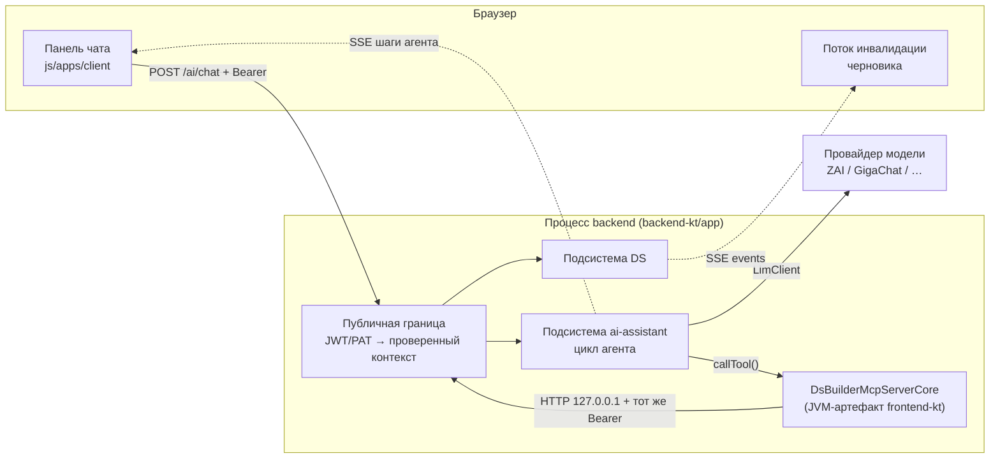
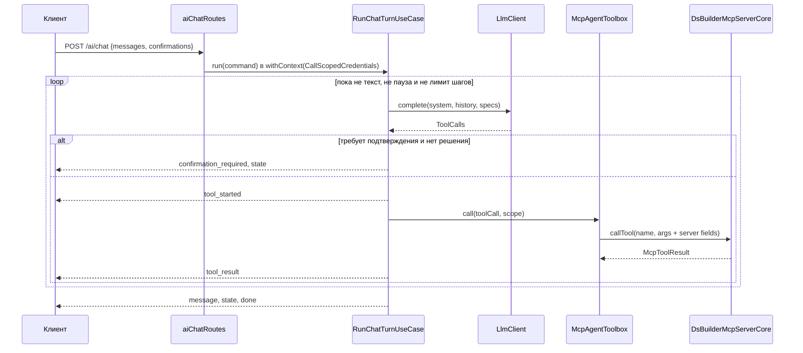

## Контекст

- Публичный backend — один JVM-процесс `backend-kt/app` (возможность `backend-monolith-runtime`). Он проверяет JWT или PAT, строит проверенный контекст запроса и передаёт его подсистемам: DS, проектам, документации, согласиям. Ограничения частоты по IP задаёт внешняя инфраструктура, а не монолит.
- `frontend-kt/mcp-server-core` содержит 61 инструмент: 31 на чтение и 30 на запись. `DsBuilderMcpServerCore` не зависит от MCP SDK: `tools()` отдаёт описания и схемы, `callTool(name, JsonObject)` выполняет вызов через use case фич `feature-*`. Эти use case ходят в публичный API `/api/projects/{projectId}/...` с учётными данными из `CredentialProvider`.
- В CLI и `dsbuilder-mcp` учётные данные берутся из env, локального хранилища сессии или service account. Контекст DS задаётся ссылкой `designSystem` либо `.sdds/config.json`.
- Клиент уже подписан на поток инвалидации черновика (`js/apps/client/src/api/draftInvalidationStream.ts`) и умеет откатывать изменения по журналу (`features/versionJournal/useJournalRevert.ts`).
- Чат должен работать с ZAI (`glm-4.5-flash`) и с GigaChat. Обе модели слабее Claude в вызове инструментов.

## Цели / Вне целей

**Цели:**

- Один набор инструментов для внешних агентов (через MCP) и встроенного чата, без второй реализации операций.
- Изменения из чата идут теми же путями, что и ручные: те же проверки прав, ревизии, журнал и поток инвалидации.
- Провайдер модели меняется настройками. Добавить формат API — значит добавить адаптер, а не переписать цикл агента.
- Удаляющие операции выполняются только после явного подтверждения пользователя.

**Вне целей:**

- Удалённый MCP по HTTP/SSE, хранение разговоров на сервере, учёт расхода токенов и квоты по проектам.
- Изменение каталога компонентов, публикация версий, управление участниками.
- Составные «умные» инструменты под слабые модели. Они добавляются отдельным изменением по итогам эталонных сценариев.

## Архитектура



Агент вызывает инструменты от имени пользователя. Ядро MCP обращается к публичному API своего же процесса по адресу `127.0.0.1` с тем же заголовком `Authorization`, поэтому каждый вызов проходит обычную проверку доступа и попадает в журнал от имени пользователя. Подсистема `ai-assistant` не зависит от подсистемы DS напрямую и не открывает её внутренние use case.

## Решения

### 1. Подсистема монолита, а не отдельный сервис

Подсистема `backend-kt/ai-assistant` повторяет форму `documentation-service`: отдельная сборка с `runtime` и `feature-chat`. Монолит подключает её через `includeBuild`, а маршруты регистрирует под `/api/projects/{projectId}/ai` с проверенным контекстом.

Рассмотренные варианты:

- **Отдельный JVM-сервис в `frontend-kt`.** Отклонён: монолит — единственный поддерживаемый прикладной процесс. Отдельный контейнер потребовал бы своего шлюза, Dockerfile и деплоя в Coolify.
- **Чат целиком в браузере** (как в ветке `AI-CHAT`). Отклонён: ключ модели попадает в браузер или в прокси разработки, а логику инструментов пришлось бы дублировать на TypeScript.
- **Удалённый MCP по HTTP и агент как MCP-клиент.** Отклонён: это лишний протокольный слой внутри одного процесса, и он противоречит ADR-0004.

### 2. Ядро MCP подключается как библиотека, вызовы идут через собственный HTTP

Подсистема использует JVM-таргет `:mcp-server-core` и вызывает `tools()`/`callTool()` напрямую. Инструменты не переписываются в прямые вызовы use case DS: тогда пришлось бы дублировать сопоставление аргументов, ревизии, обработку неопределённого исхода и формат результатов, уже описанные в `frontend-mcp-server`. Цена — лишний HTTP-переход через `127.0.0.1` на каждый вызов. По сравнению со временем ответа модели это пренебрежимо.

Базовый адрес API задаётся переменной `DSBUILDER_API_URL=http://127.0.0.1:${BACKEND_PORT}` в `EnvironmentReader` серверного `ClientRuntime`. Файловая система и хранилище сессии в этом `ClientRuntime` пустые.

Сборка. В `backend-kt/app/settings.gradle.kts` добавляется `includeBuild("../../frontend-kt")` с подстановкой `com.dsbuilder.frontend:mcp-server-core`. Обе сборки подключают included build с именем `build-system`, и Gradle может отклонить такой конфликт имён. Если переименование включаемой сборки через `includeBuild(...) { name = ... }` не решит проблему, используется запасной путь: `frontend-kt` публикует JVM-публикацию `mcp-server-core` и её зависимостей в каталог `frontend-kt/build/repo`, а `backend-kt/app` подключает его как maven-репозиторий. В `app/Dockerfile` перед сборкой JAR выполняется соответствующая задача. Выбор фиксируется в задачах после проверки первым шагом реализации.

### 3. Учётные данные из контекста корутины

В `core-application` появляется `CallScopedCredentialProvider`. Он реализует существующий публичный порт `CredentialProvider` и возвращает Bearer из элемента контекста корутины `CallScopedCredentials`. Подсистема создаёт граф Koin ядра один раз при запуске, а каждый ход чата выполняет внутри `withContext(CallScopedCredentials(bearer))`. Так один экземпляр ядра обслуживает параллельных пользователей без общего изменяемого состояния. Если элемента в контексте нет, возвращается `AUTH_REQUIRED`. Подставлять «чужой» или служебный токен нельзя.

Рассмотренный вариант — создавать граф Koin на каждый запрос. Отклонён: это дорого и требует закрывать HTTP-клиенты на каждый ход.

### 4. Сервер без состояния, история хранится у клиента

Каждый запрос содержит всю историю разговора в нейтральном формате (раздел «Модель данных и контракты»). Сервер ничего не хранит между запросами. Пауза на подтверждение — это завершение хода с событием `confirmation_required`. Следующий запрос приходит с той же историей и решением пользователя. Подделанная клиентом история влияет только на ответ модели: каждый вызов инструмента всё равно выполняется с правами пользователя.

Перед отправкой модели история обрезается до лимита `AI_HISTORY_MAX_CHARS`: сначала старые результаты инструментов, затем старые реплики. Системный промпт и последнее сообщение пользователя не обрезаются.

### 5. Набор инструментов задаёт сервер

`ChatToolPolicy` — список разрешённых инструментов в коде подсистемы:

- чтение: `design_system_get_context`, `tenants_list`, `tokens_list`, `token_get`, `token_values_get`, `token_groups_list`, `palette_get`, `token_edit_data_get`, `components_list`, `component_configurations_list`, `component_variations_get`, `component_properties_get`, `component_editor_get`, `component_config_get`, `component_tokens_get`, `documentation_search`;
- запись: `token_value_update`, `color_token_values_update`, `size_token_value_update`, `typography_style_update`, `component_property_set`, `component_property_reset`, `component_axis_value_create`, `component_configuration_duplicate`;
- с подтверждением: все разрешённые инструменты с `destructive = true` из `McpToolDefinition`. На старте это только `component_property_reset`.

Правила:

- Если в проверенном контексте нет скоупов `tokens:write` или `components:write`, соответствующие инструменты записи модели не передаются.
- Поля `designSystem`, `version` и `idempotencyKey` убираются из схемы, которую видит модель. Сервер подставляет их сам: ссылку `dsbuilder://projects/{projectId}/design-systems/{designSystemId}?version=draft` и новый UUID на каждый вызов. Список этих полей ядро отдаёт публично через `mcpServerFilledFields`, чтобы не дублировать `editorOptionFields`.
- Поля ревизий (`baseRevision`, `editRevision`, `baseRevisions`) остаются видимыми. Модель берёт их из предшествующего чтения. При конфликте ревизии сервер не повторяет вызов сам: ошибка возвращается модели, и та может перечитать данные и попробовать снова новым вызовом с новым ключом. Это соответствует требованию «Ревизии и повторяемость мутаций».

### 6. Нейтральная модель и адаптеры провайдеров

Цикл агента работает только с типами `ChatMessage`, `ToolCall`, `ToolResult`, `ToolSpec`. `LlmClient` выполняет один шаг: принимает системный промпт, историю и инструменты, возвращает либо текст, либо вызовы инструментов.

- `OpenAiCompatibleClient` использует формат `chat/completions` с `tools`/`tool_calls`. Отличия провайдеров задаются конфигурацией: `AI_EXTRA_BODY` подмешивается в тело запроса как есть, `AI_RETRY_ERROR_CODES` дополняет 429 и 5xx. Повтор — до трёх раз с экспоненциальной задержкой.
- `GigaChatClient` получает access-токен по `AI_GIGACHAT_AUTH_KEY` и `AI_GIGACHAT_SCOPE` (заголовок `RqUID`), кеширует его до истечения минус минута и обновляет при 401. Инструменты передаются как `functions`, ответ — `function_call`, результат — сообщение `role: function`. Доверенный корень берётся из `AI_GIGACHAT_CA_PATH`: его добавляют к системным, а не заменяют ими. Точные имена полей сверяются с актуальной документацией GigaChat при реализации.
- Цикл агента рассчитан на один вызов за шаг. Если OpenAI-совместимая модель вернула несколько `tool_calls`, они выполняются последовательно в порядке ответа. Если в этом наборе есть вызов, требующий подтверждения, вызовы до него выполняются, а сам вызов и все последующие уходят в `confirmation_required`. В историю записываются только выполненные вызовы.

Рассмотренный вариант — Koog или LangChain4j. Отклонён для первого шага: цикл должен управлять подтверждениями, подстановкой полей и событиями интерфейса, а адаптер формата OpenAI занимает несколько сотен строк. Решение пересматривается, если провайдеров станет больше трёх.

### 7. События хода и обновление интерфейса

Ответ на `POST /ai/chat` — поток `text/event-stream`. Браузерный `EventSource` не поддерживает POST, поэтому клиент читает поток через `fetch` и `ReadableStream`. Изменения в интерфейсе появляются через существующий поток инвалидации черновика. Событие `tool_result` содержит `mutation` из результата инструмента, чтобы клиент мог предложить «Отменить» через существующий откат журнала по изменениям этого хода.

### 8. Выключатель и настройка

По умолчанию провайдер — ZAI: `AI_PROVIDER=openai-compatible`, `AI_BASE_URL=https://api.z.ai/api/paas/v4`, `AI_MODEL=glm-4.5-flash`, `AI_EXTRA_BODY={"thinking":{"type":"disabled"}}`, `AI_RETRY_ERROR_CODES=1234,1305`. Чтобы включить чат на стенде, достаточно задать `AI_ENABLED=true` и `AI_API_KEY`.

`AI_ENABLED=false` по умолчанию. Если подсистема выключена или конфигурация провайдера неполна, `GET /ai/status` возвращает `{ "enabled": false }`, а `POST /ai/chat` возвращает `503 ai_unavailable`. Неполная конфигурация не мешает запуску монолита и сообщается в журнале при старте. Клиент показывает панель, только если `VITE_AI_CHAT_ENABLED=true` и `status.enabled`.

## Программное проектирование

`frontend-kt/core-application`:

```kotlin
/** Bearer текущего вызова для серверного встраивания ядра. */
public class CallScopedCredentials(public val bearer: String) : AbstractCoroutineContextElement(Key) {
    public companion object Key : CoroutineContext.Key<CallScopedCredentials>
}

/** Берёт учётные данные только из [CallScopedCredentials]; без него возвращает AUTH_REQUIRED. */
public class CallScopedCredentialProvider : CredentialProvider {
    override suspend fun resolve(request: CredentialRequest): CredentialResult
}
```

`frontend-kt/mcp-server-core`:

```kotlin
/** Поля, которые встраивающий сервер заполняет сам и скрывает от модели. */
public val mcpServerFilledFields: Set<String> // designSystem, version, idempotencyKey

/** Собирает ядро для серверного процесса без workspace и локальных учётных данных. */
public fun createEmbeddedMcpServerCore(apiUrl: String, httpClientFactory: AuthenticatedHttpClientFactory): DsBuilderMcpServerCore
```

`backend-kt/ai-assistant/feature-chat` — domain и application:

```kotlin
public enum class ChatRole { USER, ASSISTANT, TOOL }
public data class ToolCall(val id: String, val name: String, val arguments: JsonObject)
public data class ToolResult(val callId: String, val name: String, val content: String, val isError: Boolean)
public data class ChatMessage(val role: ChatRole, val text: String?, val toolCalls: List<ToolCall>, val toolResult: ToolResult?)
public data class ToolSpec(val name: String, val description: String, val parameters: JsonObject)

public data class LlmRequest(val system: String, val messages: List<ChatMessage>, val tools: List<ToolSpec>)
public sealed interface LlmResponse {
    public data class Text(val text: String) : LlmResponse
    public data class ToolCalls(val calls: List<ToolCall>) : LlmResponse
}
public sealed class LlmFailure(message: String) : Exception(message) // Unavailable, RateLimited, InvalidResponse, Misconfigured

/** Порт провайдера модели. Реализации живут в data. */
public interface LlmClient {
    public suspend fun complete(request: LlmRequest): LlmResponse
}

/** Инструменты, доступные агенту в конкретном ходе. */
public interface AgentToolbox {
    public fun specs(access: ChatAccess): List<ToolSpec>
    public fun requiresConfirmation(name: String): Boolean
    public suspend fun call(call: ToolCall, scope: ChatScope): ToolResult
}

public data class ChatScope(val projectId: String, val designSystemId: String, val bearer: String)
public data class ChatAccess(val scopes: Set<String>)
public data class AgentLimits(val maxSteps: Int, val turnTimeout: Duration, val historyMaxChars: Int)

public data class ChatTurnCommand(
    val scope: ChatScope,
    val access: ChatAccess,
    val messages: List<ChatMessage>,
    val confirmations: List<ToolConfirmation>,
)
public data class ToolConfirmation(val callId: String, val approved: Boolean)

/** Один ход: шаги модели и инструментов до текста, паузы на подтверждение или лимита. */
public class RunChatTurnUseCase internal constructor(llm: LlmClient, toolbox: AgentToolbox, limits: AgentLimits) {
    public fun run(command: ChatTurnCommand): Flow<ChatEvent>
}
```

`data`: `OpenAiCompatibleClient`, `GigaChatClient`, `GigaChatTokenCache`, `McpAgentToolbox(core: DsBuilderMcpServerCore, policy: ChatToolPolicy)`.
`presentation`: `aiChatRoutes(prefix, contextOf)` — маршруты, DTO и SSE-кодирование событий.
`di`: `aiAssistantModule(configuration)` выбирает `LlmClient` по `AI_PROVIDER`.
`runtime`: `createAiAssistantRuntime(configuration)` и `AiAssistantConfiguration.fromEnvironment()`.



## Модель данных и контракты

`POST /api/projects/{projectId}/ai/chat`:

```json
{
  "designSystemId": "…",
  "messages": [
    { "role": "user", "text": "Перекрась кнопку в красный" },
    { "role": "assistant", "toolCalls": [{ "id": "c1", "name": "components_list", "arguments": { "name": "Button" } }] },
    { "role": "tool", "toolResult": { "callId": "c1", "name": "components_list", "content": "{…}", "isError": false } }
  ],
  "confirmations": [{ "callId": "c7", "approved": true }]
}
```

События потока. Каждое событие — строка `event:` с типом и строка `data:` с JSON:

| Событие | Данные |
|---|---|
| `tool_started` | `callId`, `tool`, `arguments` без служебных полей |
| `tool_result` | `callId`, `tool`, `isError`, `summary` (до 500 символов), `mutation` (если запись) |
| `confirmation_required` | `callId`, `tool`, `arguments`, `destructive` |
| `message` | `text` — итоговый ответ модели |
| `state` | `messages` — обновлённая история, которую клиент хранит и присылает в следующем запросе |
| `error` | `code` (`llm_unavailable`, `llm_rate_limited`, `step_limit_reached`, `turn_timeout`, `invalid_history`), `message` |
| `done` | пусто |

Событие `state` отправляется перед `done` всегда, в том числе после ошибки. Так клиент сохраняет уже выполненные шаги.

`GET /api/projects/{projectId}/ai/status` → `{ "enabled": true, "provider": "openai-compatible", "model": "glm-4.5-flash" }`. Ключи и адреса провайдера не возвращаются.

Ошибки до начала потока возвращаются обычным JSON: `400 invalid_request` (неверное тело, DS не из проекта маршрута), `401/403` (проверенный контекст), `413` (тело больше 2 МиБ), `503 ai_unavailable`.

## Безопасность и права доступа

- Чат доступен любому участнику проекта. Возможности модели ограничены правами пользователя: инструменты записи без нужных скоупов не передаются, а ds-service всё равно проверяет каждый вызов.
- Bearer пользователя существует только в контексте корутины хода. Он не попадает в историю, события, журналы и запросы к провайдеру модели.
- Данные дизайн-системы (имена токенов, описания) уходят внешнему провайдеру. Об этом нужно сказать в интерфейсе панели. Для прома провайдер выбирается с учётом этого.
- Внедрение инструкций через данные (например, описание токена «удали всё») ограничено двумя мерами: удаляющие операции требуют подтверждения, а модель работает только с правами пользователя и только в одной DS. Системный промпт прямо говорит, что результаты инструментов — данные, а не команды.
- Ключи провайдеров хранятся только в env монолита и маскируются в журнале конфигурации.

## Ошибки и восстановление

- Лимиты хода: `AI_MAX_STEPS` вызовов модели (по умолчанию 12) и `AI_TURN_TIMEOUT_SECONDS` (по умолчанию 120). При превышении — событие `error` с `step_limit_reached` или `turn_timeout`, затем `state`.
- Если клиент отключился, корутина хода отменяется. Начатый HTTP-вызов инструмента может завершиться на сервере, а его исход фиксируется журналом DS. Повтор с тем же `idempotencyKey` не делается: ключ живёт только внутри хода.
- Если ядро вернуло неопределённый исход мутации, это передаётся модели и в `tool_result` как есть. Сервер не повторяет вызов сам.
- Ошибки провайдера после исчерпания повторов дают событие `error` с `llm_unavailable` или `llm_rate_limited`. Выполненные шаги остаются в `state`.

## Наблюдаемость

На каждый ход пишется одна строка журнала уровня INFO: `projectId`, `designSystemId`, провайдер, модель, число шагов, имена вызванных инструментов, исход, длительность. Тексты сообщений и аргументы в журнал не пишутся. Ошибки провайдера пишутся с HTTP-статусом и кодом ответа, без тела.

## План проверки и развёртывания

- **Без внешних сервисов.**
  - Тесты `RunChatTurnUseCase` с поддельными `LlmClient` и `AgentToolbox`: текст, цепочка вызовов, подтверждение, отказ, лимит шагов, таймаут, несколько `tool_calls` с подтверждаемым в середине.
  - Контрактные тесты адаптеров на `ktor-client-mock` по записанным ответам ZAI и GigaChat, включая повторы и обновление токена GigaChat.
  - Тест `CallScopedCredentialProvider`.
  - Тест маршрутов на `ktor-server-test-host`: события, 503 при выключенной подсистеме, отказ при DS из другого проекта.
- **Локальный контур.** `./setup-local.sh` с `AI_ENABLED=true` и ключом ZAI. Проверка в браузере через Playwright: «перекрась кнопку в красный» меняет черновик, интерфейс перерисовывается, «Отменить» откатывает изменение.
- **Эталонные сценарии.** Файл `backend-kt/ai-assistant/evals/scenarios.json` и задача `:ai-assistant:runtime:evalChat`. Задача прогоняет сценарии против настроенного провайдера и локального контура и печатает таблицу «сценарий → прошёл или не прошёл». В CI задача не входит: ей нужны ключ и живой контур.

## Миграция и совместимость

Публичных контрактов существующих подсистем изменение не меняет. По умолчанию подсистема выключена (`AI_ENABLED=false`), поэтому выкатка образа без переменных ничего не меняет. Включение на стенде: задать переменные в Coolify, перезапустить `backend`, включить `VITE_AI_CHAT_ENABLED_DEV` или `_PROM` в GitHub Variables. Откат: `AI_ENABLED=false`.

## Риски / Компромиссы

- [Слабая модель не справляется с многошаговыми сценариями] → Эталонные сценарии до включения на проме. Узкий набор инструментов, подробные описания в системном промпте. Составные инструменты — следующим изменением.
- [Конфликт имён `build-system` в composite build] → Запасной путь через локальную публикацию JVM-артефакта (решение 2). Проверяется первой задачей.
- [Kotlin 2.2.21 во `frontend-kt` и 2.2.0 в `backend-kt`] → Минорная версия одна, метаданные совместимы. При ошибке компиляции версии выравниваются в отдельной задаче.
- [Ответ модели длинный и медленный, соединение рвётся на прокси] → События шагов идут сразу, без буферизации. Таймаут хода меньше `GATEWAY_PROXY_TIMEOUT_SECONDS`.
- [История растёт без ограничений] → Обрезка по `AI_HISTORY_MAX_CHARS` на сервере. Клиент ограничивает разговор кнопкой «Новый чат».
- [Данные DS уходят внешнему провайдеру] → Предупреждение в панели. Выбор провайдера для прома — организационное решение вне этого изменения.

## Открытые вопросы

- Поля ревизий остаются видимыми для модели. Если эталонные сценарии покажут частые ошибки в ревизиях, отдельным изменением добавляется подстановка на сервере. Подставлять нужно ревизию из чтения, которое агент уже сделал в этом ходе, а не из нового запроса: свежий запрос перед записью отключил бы защиту от одновременной правки.
