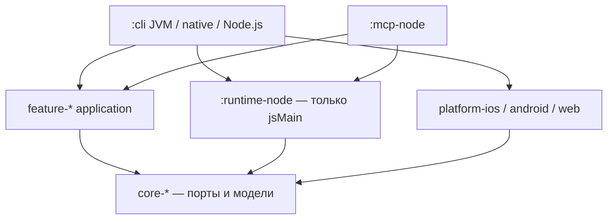

## Контекст

`:cli` содержит общее дерево Clikt-команд и отдельные JVM/macOS/Windows точки входа. Большинство `core-*`/`feature-*` уже объявляет JS-таргет, однако это не означает полноту поведения: JS-реализации архивирования документации, проверки её файлов и чтения ZIP preview-плагина являются заглушками. `:mcp-node` предоставляет собственные Node-адаптеры, но не реализует запуск генераторов, бинарную запись и файловые потоки.

Синхронный `ProcessRunner.run` используется делегатами, поиском инструментов, установщиками и сценариями генерации. `runBlocking` присутствует также в командах, согласии на аналитику и её завершении. Добавление одного Gradle-таргета не устраняет эти ограничения.

## Цели и границы

Цель — дополнительный Node.js CLI с тем же деревом команд и контрактами файлов, сети, авторизации, вывода и кодов завершения. JVM, macOS arm64/x64 и Windows x64 продолжают собираться и поставляться. Node.js CLI поддерживается на Linux, macOS и Windows; доступность Swift/Gradle/web-генератора определяется ОС и установленным инструментарием, а не вариантом запуска CLI.

В объём входят публичный npm-пакет CLI и публикация CLI вместе с web-генератором отдельными шагами существующего `publish-cli-release.yml`. В объём не входят отдельный workflow публикации npm, изменение backend API, схемы `.sdds`, форматов сессии, установка Java/Swift/Gradle из npm-пакета и замена самостоятельного `dsbuilder-mcp`. Существующие сетевые установщики по-прежнему выбирают JVM/native.

## Архитектура и решения

### Единое дерево команд и асинхронный путь

`:cli` получает `js(IR)`, `nodejs()`, CommonJS executable и Node-точку входа. Все группы и конечные команды переходят на совместимую иерархию `SuspendingCliktCommand` из уже закреплённого Clikt 5.0.3. Общие `execute`/`executeInteractive`, обработка результата, подготовка согласия и завершение аналитики становятся приостанавливаемыми. Нельзя запускать корутину из синхронного обработчика и возвращать управление до её завершения: это разрушает обработку ошибок и время жизни контекста команды.

JVM/native используют `runBlocking` только на верхней платформенной границе. Node ожидает общую корутину через цикл событий. Завершение процесса происходит после закрытия HTTP, завершения дочерних процессов, ограниченного ожидания аналитики и записи stdout/stderr. Общие тесты вызывают приостанавливаемый API через `runTest` и возвращают его результат для JS test runner.

Альтернатива с отдельным деревом Node-команд отклонена: она создаёт два набора разбора аргументов, сообщений и правил авторизации. Замена Clikt не требуется.

### Общая Node-инфраструктура

Добавляется `:runtime-node`, инфраструктурный Kotlin/JS-модуль, зависящий только от необходимых `core-*`, Ktor/Okio и платформенных API Node. Его `data` содержит реализации портов, а фабрика собирает `ClientRuntime`. Он не зависит от `:cli`, `:mcp-node`, `feature-*` и `platform-*`. Оба приложения получают адаптеры через эту фабрику и собирают собственные графы Koin. Политика согласия и аналитики CLI остаётся в `:cli`; фабрика позволяет использовать общие файловые и HTTP-адаптеры без переноса этой политики в инфраструктуру.



Зависимость CLI от `runtime-node` располагается в `jsMain`, чтобы JVM/native не запрашивали JS-вариант. Направление `presentation -> application -> domain` сохраняется; платформенные реализации живут в `data`, регистрация — в `di`. Доменные модели не меняются. Порты и сценарии уровня application получают `suspend` там, где вызывают процесс.

Альтернативы — копирование адаптеров и зависимость CLI от executable `mcp-node` — отклонены из-за расхождения поведения и обратной зависимости между приложениями.

### Асинхронные процессы и отмена

`ProcessRunner.run`, `PlatformDelegate.doctor/run`, `ToolchainInstaller.install`, поиск инструмента с вызовом процесса и соответствующие сценарии становятся `suspend`. Изменение проходит по всем вызывающим модулям, включая заглушки и тестовые реализации. Синхронные чистые операции не переводятся на `suspend` без необходимости.

Node использует асинхронный `child_process.spawn`, ожидает `close` после закрытия потоков и обрабатывает ошибку запуска. JVM и native также ожидают завершение отменяемым способом, не удерживая поток, необходимый для сетевых событий или отмены. Перенос старого блокирующего ожидания внутрь `suspend fun` сам по себе недостаточен.

Отмена передаётся из команды в сценарий и процесс. Реализация снимает обработчики, прекращает чтение, закрывает принадлежащие ей дескрипторы и останавливает непосредственно запущенный процесс; для управляемой группы дочерних процессов применяется доступный механизм ОС. После запроса штатного завершения допускается до двух секунд ожидания, затем принудительное завершение и до трёх секунд очистки. Неуправляемые отделённые процессы не считаются ресурсами CLI. `CancellationException` повторно выбрасывается после очистки и не преобразуется в `Failed`, успешный результат или повторный запуск. Отмена пользователем даёт CLI-код 130; отдельное завершение дочернего процесса сигналом сохраняет `128 + signal`.

При `inheritStdio=true` потоки наследуются, результат не содержит вывода. При захвате оба потока читаются одновременно; каждый сохраняет порядок своих данных, абсолютный порядок между stdout и stderr не гарантируется. Ошибка запуска по-прежнему содержит путь инструмента. Аргументы передаются массивом без интерполяции в оболочку. Для `.cmd`/`.bat` на Windows нужен изолированный адаптер запуска через `cmd.exe` с проверенным экранированием; обычные executable не запускаются через оболочку. В существующее требование о запуске без оболочки вносится это явное исключение.

### Файлы, архивы и терминал

Node-адаптер реализует весь `WorkspaceFileSystem`: UTF-8, бинарные чтение/запись, `BufferedSink`, директории и удаление. Сохраняются атомарная замена сессии, права согласно возможностям ОС, формат PID-блокировки и восстановление после завершённого владельца. CLI и отдельный MCP продолжают использовать одну сессию на backend; `serve` не открывает браузер.

JS-реализации документации проверяют реальные файлы и создают совместимый TAR.GZ с прежними исключениями, вложенными каталогами, бинарными данными и длинными именами. ZIP preview-плагина проверяется по тем же ограничениям размера, путей, состава, manifest/meta и контрольных сумм, что на существующих таргетах. Алгоритмы формата переиспользуются, где они независимы от среды; платформенная компрессия и I/O остаются в адаптерах. Если потребуется npm-библиотека, её точная версия фиксируется вместе с Kotlin/JS lock-файлом и включается в пакет; выбор подтверждается тестами одинаковых архивов, а не отключением проверок.

Существующее Mordant-меню остаётся общей реализацией, пока проверки Node TTY подтверждают клавиши, EOF, Ctrl+C и восстановление курсора/режима. Если потребуется Node-адаптер ввода, он подключается через `InitSelectionMenu`; публичный CLI-контракт остаётся тем же. Ввод меню выполняется между сетевыми запросами. Синхронный ввод Mordant блокирует обработку фоновых событий, поэтому его область ограничивается ожиданием пользовательского выбора; если это мешает отмене или восстановлению, граница меню и подтверждений переводится на `suspend`. В неинтерактивном режиме CLI требует явные ID без ожидания stdin.

Аналитика использует прежние разрешения/отзывы и отдельные каналы CLI/MCP, поддерживает отключение через env и ограниченное ожидание отправки. Обработчик MCP-наблюдений должен позволять приостанавливаемую проверку согласия либо получать уже безопасно подготовленный результат без `runBlocking`; ошибки аналитики не подавляют отмену основной операции. stdout `mcp serve` содержит только JSON-RPC.

## Программное проектирование

Ниже приведены изменяемые границы; модели запросов и результатов сохраняются.

```kotlin
public fun interface ProcessRunner {
    public suspend fun run(request: ProcessRequest): ProcessResult
}

public interface PlatformDelegate {
    public val toolchain: ToolchainId
    public val platforms: Set<TargetPlatform>
    public val capabilities: Set<Capability>
    public suspend fun doctor(workspace: WorkspacePaths, toolOverride: String? = null): ToolchainStatus
    public suspend fun run(invocation: DelegateInvocation): DelegateResult
}

public interface ToolchainInstaller {
    public val toolchain: ToolchainId
    public suspend fun install(request: ToolchainInstallRequest): ToolchainInstallResult
}

public class DsBuilderCli {
    public suspend fun execute(args: List<String>): CliResult
    public suspend fun executeInteractive(args: List<String>): Int
}

// Публичная фабрика инфраструктурного модуля; конфигурация CLI остаётся в приложении.
public fun createNodeClientRuntime(): ClientRuntime
```

Смена Kotlin-сигнатур несовместима на уровне исходников: все потребители внутри монорепозитория мигрируют вместе. Пользовательские команды, `.sdds`, backend DTO и файлы сессии совместимы.

## Доставка и совместимость

Пакет `@sddsjs/design-system-builder-cli` объявляет `engines.node >=22`, команду `dsbuilder` и CommonJS-точку входа. `packageCliNodeNpm` готовит пакет, `packCliNodeNpm` создаёт стабильный `dsbuilder-cli-node.tgz`, `npmPackCliNodeSmoke` устанавливает его во временный каталог вне дерева сборки. Пакет содержит все требуемые JS-файлы и объявленные зависимости; ссылки на локальные Gradle-пути недопустимы. Установка не запускает backend, вход, генераторы или автоматическую установку инструментов. При глобальной установке пользователь выбирает каталог npm и учитывает уже существующую команду `dsbuilder`; принудительное удаление чужого launcher не выполняется.

Tarball получает тот же номер из `CLI_RELEASE_TAG`, что четыре ZIP. Для новых выпусков файл и SHA-256 добавляются к комплекту GitHub Release, проверяются до публикации/Latest. `release.json` сохраняет `schemaVersion: 1` и существующие записи, добавляя необязательное поле `node` с `fileName`, `packageName`, `version`, `minNodeVersion` и `sha256`. Признак обязательной Node-поставки берётся из отслеживаемого `cli/distribution/node-package.json` исходников выбранного тега, где заданы имя пакета, файла и минимальная версия Node. Сборка и валидация используют этот дескриптор как источник истины: удаление записи `node` из удалённого манифеста нового тега не превращает его в старый выпуск. Для тега без дескриптора действует прежний контракт. Повтор уже опубликованного старого тега не дописывает Node-пакет и не пересобирает релиз. Старые установщики должны принимать расширенные метаданные и `SHA256SUMS`; это подтверждается контрактными тестами до изменения процесса выпуска.

### Публикация двух npm-пакетов в текущем workflow

Расширяется `.github/workflows/publish-cli-release.yml` с его существующими запусками по `cli-v*` и `workflow_dispatch` для выбранного тега. Новый отдельный workflow не добавляется. Оба npm-пакета готовятся из точного commit выбранного тега: `@sddsjs/design-system-builder-generator` получает версию из `js/cli/package.json`, `@sddsjs/design-system-builder-cli` — из `CLI_RELEASE_TAG`. Различие версий ожидаемо; workflow не переписывает package.json генератора и не создаёт коммиты или теги.

В build устанавливаются Node/npm и зависимости генератора через `npm ci`, явно выполняются `npm run typecheck`, `npm test`, `npm pack --dry-run` и проверка глобальной установки из `js/cli/scripts/check-global-install.sh`. Существующий `prepublishOnly` web-генератора сохраняется для локального `npm publish`, но workflow выполняет проверки явно, а запись готового tarball — с `--ignore-scripts`, чтобы npm-секрет не был доступен сценариям пакета. Для Kotlin CLI проверки `verifyCliNodeNpmPublication`/`npmPackCliNodeSmoke` явно выполняются до записи в registry; отдельный npm-обработчик, вызывающий Gradle из опубликованного пакета, не требуется. npm-пакет не содержит `private: true`, объявляет `publishConfig.access: public`, `bin.dsbuilder`, `engines.node >=22` и явный список `files`.

Готовые tarball обоих пакетов и контрольные суммы передаются через GitHub Actions artifacts без повторной упаковки в publish. Проверяется содержимое: только готовый JS CLI либо исходники/шаблоны web-генератора согласно его прежнему контракту, launcher, README, LICENSE и необходимые данные выполнения. Тесты, `.sdds`, результаты генерации, `.env`, `.npmrc`, пользовательские credentials и локальные кэши исключаются. Пользовательская установка CLI не запускает Gradle и не скачивает JVM/native CLI.

В текущем задании `publish`, после `needs: [build, smoke]`, порядок следующий:

1. Проверить выбранный тег, версии, tarball, контрольные суммы, доступ к registry и наличие `NPM_TOKEN`. Подготовить и проверить GitHub draft прежними средствами `release.py`.
2. Отдельным шагом опубликовать проверенный tarball `@sddsjs/design-system-builder-generator` через `npm publish <tarball> --access public --ignore-scripts --registry https://registry.npmjs.org` и подтвердить его доступность по точной версии.
3. Отдельным шагом опубликовать проверенный `dsbuilder-cli-node.tgz` тем же способом и подтвердить его доступность по точной версии.
4. Проверить установку обоих пакетов из registry без авторизации в изолированный prefix: версии, help CLI и генерацию минимальной темы web-генератором. Только затем выполнить существующий `release.py promote` и назначение GitHub Latest согласно прежней политике.

`NPM_TOKEN` — repository/environment secret с правом автоматической публикации обоих пакетов в `@sddsjs` согласно настройкам npm-аккаунта. `actions/setup-node` настраивает публичный registry; секрет передаётся через `NODE_AUTH_TOKEN` только шагам записи. Он не передаётся build, тестируемым генераторам или установкам проверки и не включается в artifacts, логи и `.npmrc` репозитория. Установка публичных пакетов проверяется без credentials. Секрет нужно настроить до запуска выпуска; отсутствие/непригодность — явная ошибка. Альтернатива OIDC возможна отдельным изменением конфигурации публикации; в этом решении используется один явно заданный способ авторизации. Пример передачи токена соответствует [документации setup-node](https://github.com/actions/setup-node/blob/main/docs/advanced-usage.md).

Существующая общая `concurrency.group: publish-cli-release` сериализует выпуски и повторные запуски без отмены начатой публикации. Для каждого пакета сначала проверяются целевая версия и текущий npm `latest`. Если версии нет, публикуется только версия выше текущего `latest` либо первая версия пакета. Если версия существует, сравнивается `dist.integrity` с точным проверенным tarball: совпадение означает успешный пропуск записи, несовпадение останавливает выпуск. Существование версии отличается от ошибки авторизации/сети/registry; такая ошибка не считается разрешением на публикацию. Повторный запуск не меняет теги существующих версий и не понижает `latest`.

Если генератор уже опубликован из того же содержимого с прежней версией, шаг пропускает запись и продолжает выпуск CLI. Если версия прежняя, а содержимое изменено, выпуск требует корректного подъёма версии генератора в исходниках нового тега. При изменении `js/cli` в реализации версия и package-lock.json поднимаются один раз по AGENTS.md; workflow не выполняет `npm version` самостоятельно. Локальный `npm publish` генератора остаётся поддерживаемым.

Общей транзакции npm и GitHub Releases нет. Если генератор опубликован, а публикация CLI либо последующее продвижение GitHub не удались, уже опубликованная npm-версия сохраняется; workflow завершается ошибкой, GitHub draft не продвигается, повтор сверяет integrity и продолжает с недостающей операции. После неоднозначного сетевого сбоя проверяется наличие версии и integrity, а не выполняются удаление или слепая перепубликация. npm latest мог уже измениться — ошибка GitHub не откатывает его автоматически. Для исторических тегов без дескриптора Node-поставки сохраняется прежний путь проверки/повтора GitHub Release без новых npm-шагов и требований к npm-секрету.

После выпуска пользователь устанавливает CLI через `npm install -g @sddsjs/design-system-builder-cli`, конкретную версию — через `npm install -g @sddsjs/design-system-builder-cli@X.Y.Z`. Документация также показывает `npx --yes --package=@sddsjs/design-system-builder-cli@X.Y.Z dsbuilder --help`. Web-генератор остаётся самостоятельным пакетом и устанавливается через `dsbuilder toolchain install web`; его публикация первой обеспечивает доступность инструмента к моменту выхода новых установщиков CLI.

Альтернативы с только ручной публикацией и отдельным npm-workflow отклонены: оба пакета должны выпускаться в рамках текущего процесса. Подготовка OpenSpec не разрешает фактическую публикацию пакетов или запуск выпуска сейчас.

## Риски и компромиссы

- Широкая миграция `suspend` может скрыто изменить порядок команд и обработку ошибок → единые тесты дерева команд и контрактов на всех таргетах, без фонового запуска незавершённых операций.
- Отмена и `.cmd` различаются между ОС → платформенные тесты реальных процессов, аргументов с пробелами/метасимволами и ресурсов после отмены.
- JS-заглушки могли маскировать ограничения общих тестов → проверки архивов и файлов действительно выполняются на Node; пропуск по отсутствию предпосылки не считается успехом.
- Общий runtime затрагивает установленный MCP → сохранить package smoke, протокол initialize/tools/list и блокировки между приложениями.
- Node-версии и npm-зависимости могут отличаться от среды Gradle → матрица Node 22 и 24 и установка готового tarball вне сборки, включая изолированный пользовательский каталог.
- Генераторы требуют собственных SDK → полный набор команд проверяется с управляемыми тестовыми инструментами; реальные генераторы проверяются отдельно на поддерживаемых ОС.

## План проверки и выпуска

Локально: тесты application/data/presentation, JVM/Node/native процессы и отмена, архивы и локальные файлы, авторизация с локальным сервером, MCP stdio, согласие/аналитика с подменой HTTP, установка tarball, существующие установщики и релизные валидаторы. Отдельная временная тестовая npm registry проверяет последовательность шагов публикации двух tarball, публичный доступ, остановку до записи при ошибке проверок, повтор версии, частичный сбой, защиту `latest` и глобальную установку обоих пакетов по имени/версии без пользовательского токена. Она не использует публичный registry или настоящий npm-аккаунт. Включить Node-упаковку и проверки публикации в FULL через Gradle; FAST сохраняет свой текущий состав. Требуются `tools/verify fast --change add-cli-node-target`, независимое review, `tools/verify full --change add-cli-node-target`, `frontend-kt` build/detekt/spotlessCheck, `js` npm run build, typecheck/тесты `js/cli` и сборка затронутых convention plugins. Сам ресерч не является успешной сборкой.

До архивирования внешне проверить матрицу ОС/Node, TTY, реальные генераторы и браузерный вход с установленным tarball; команды, предпосылки и измеримые результаты перечислены в tasks. Отсутствующие SDK, browser/backend или Windows-среда оставляют проверку незавершённой.

Миграция: сначала порты и все существующие реализации, затем Node runtime/CLI, архивы и терминал, после этого упаковка и доставка. Обновить ADR-0004 и архитектурные инструкции в том же изменении. После утверждения выполнять реализацию; не публиковать пакет или GitHub Release без отдельного запроса.

После отдельно разрешённого запуска workflow проверить `npm view @sddsjs/design-system-builder-cli@X.Y.Z version dist.integrity`, `npm install -g --prefix <temp> @sddsjs/design-system-builder-cli@X.Y.Z` и установку без версии в новом каталоге без npm-авторизации, затем установленный `dsbuilder --version`; сохранить версию, integrity и коды завершения. Эти наблюдения после выпуска не блокируют архивирование реализации и не требуют заранее записывать пакет в публичный registry. Также проверить скачивание tarball и прежние установщики. Откат для пользователя — явная установка прежней npm-версии либо готового JVM/native-дистрибутива без миграции файлов; переключение npm `latest` выполняется отдельно оператором, опубликованные версии не перезаписываются.
