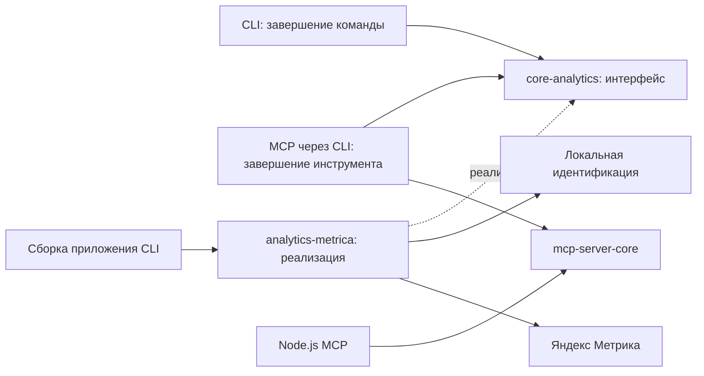

## Контекст

Ветка `feature/analytics`, база `dev`. Этот Change описывает будущую реализацию; создание артефактов не разрешает начинать кодирование.

В `frontend-kt` существуют CLI для JVM, macOS arm64/x64 и Windows x64, общий `mcp-server-core` и отдельный `mcp-node`. Обе точки запуска MCP используют общие обработчики. В текущей архитектуре `core-*` не зависят от клиентов и `feature-*`; архитектурный тест проверяет направление зависимостей именованных слоёв, но не требует их наличия в каждом модуле.

Яндекс Метрика принимает POST на `https://mc.yandex.ru/collect`; создание визита требует `pageview`, последующие цели — `event` с `ea`. `ms` является ключом записи в конкретный счётчик и отличается от OAuth для чтения и управления. Документация не даёт однозначной гарантии долговременной идентификации самостоятельно созданного `cid` и не разъясняет публикацию `ms` в дистрибутиве. Эти вопросы не считаются решёнными наличием HTTP API.

## Цели и границы

Цели: измерять посещение разделов веб-клиента, использование конечных CLI-команд и инструментов MCP, различать результаты и каналы; предоставить независимый от поставщика Kotlin-контракт для последующих клиентов; отправлять непосредственно в Метрику, без backend DS Builder.

За рамками: аналитика Node.js MCP, изменение его упаковки или распространения, собственные веб-цели и события редактирования/публикации, инструментирование Figma/Pixso/IDE, объединение людей между устройствами, аналитика каждого API-запроса, аудит, гарантированная доставка и отчёты о средней длительности операций. Будущие плагины смогут подключить контракт, но их интеграция не является задачей этого Change.

## Архитектурные решения

### Два небольших модуля

`core-analytics` содержит интерфейс `Analytics`, неизменяемые модели события и контекста, типизированные значения свойств, отключённую реализацию `NoOpAnalytics`. В нём нет счётчика, токена, `ClientID`, понятий визита или цели, Ktor, диска, сетевой очереди и зависимостей на поставщиков. Пакет: `com.dsbuilder.frontend.core.analytics`.

`analytics-metrica` реализует контракт; содержит преобразование разрешённых событий в Measurement Protocol, идентификаторы, сетевую очередь, ограничения доставки и конфигурацию поставщика. Пакет: `com.dsbuilder.frontend.analytics.metrica`. Он зависит от `core-analytics` и существующих библиотек coroutines/Ktor/serialization. Конфигурация HTTP создаётся специально для Метрики; authenticated-клиент DS Builder не используется и credentials DS Builder не пересылаются.

Модули используют плоские пакеты с `internal`-реализацией. Публичными остаются только контракты, фабрика и параметры, реально используемые при сборке приложения. Дополнительные `domain/application/data/di` не вводятся. Для публичного API соблюдаются Kotlin visibility и `api`/`implementation` правила. Koin подключается в CLI, не требуется общему API.



Стрелки к `core-analytics` обозначают зависимости клиентского кода. Конкретную реализацию выбирает сборка приложения. `mcp-server-core` не зависит от `analytics-metrica`; Node.js не получает ни транспорт аналитики, ни встроенные токены.

Общий контракт компилируется для JVM, macOS и Windows, а также Kotlin/JS как основа будущих плагинов. Включение JS-цели контракта не означает включение аналитики в `mcp-node`. Адаптер и его фактические HTTP/файловые реализации нужны только для платформ текущего CLI. JS-адаптер для плагинов отложен.

Альтернативы: `feature-analytics` неверно выражает инфраструктурное назначение; адаптер внутри `core-analytics` смешивает общий API с поставщиком; передача через backend добавляет не согласованный серверный контур. Отдельный универсальный механизм очередей не нужен до появления второй реализации.

### Веб-счётчик React SPA

`js/apps/client` использует стандартный JavaScript-счётчик Метрики с отдельным от CLI/MCP номером. Веб не подключает KMP-модули: это существующий TypeScript-клиент, а загрузка Kotlin/JS только ради счётчика не даёт полезного переиспользования. В браузер не передаются `ms`, токены CLI/MCP или OAuth. Backend DS Builder не участвует.

Конфигурация Vite: `VITE_METRICA_ENABLED=true` и положительный числовой `VITE_METRICA_COUNTER_ID`. Без включения или корректного номера скрипт не загружается. CI передаёт значения через переменные `VITE_METRICA_ENABLED_DEV`/`VITE_METRICA_COUNTER_ID_DEV` и `VITE_METRICA_ENABLED_PROM`/`VITE_METRICA_COUNTER_ID_PROM` в соответствующих заданиях развёртывания. По умолчанию локальные сборки, тесты и DEV отключены; при включении DEV использует отдельный тестовый счётчик. Публичный номер не требуется хранить как секрет, но в исходниках он не зашивается.

Скрипт загружается асинхронно, инициализация выполняется один раз с `defer: true`. Наблюдатель React Router отправляет один `hit` начального устойчивого экрана и по одному просмотру каждого следующего перехода, включая Back/Forward. Повторный рендер не создаёт просмотр; возвращение на ранее посещённый экран после другого перехода создаёт. Редиректы авторизации и старых ссылок учитываются только по конечному экрану. `basename`/`BASE_URL` поддерживаются для DEV и PROM.

URL для `hit` строится по закрытому каталогу шаблонов маршрутов: `projectId`, `designSystemId`, `tenantId`, `componentName` и прочие динамические сегменты заменяются постоянными маркерами. Заголовок берётся из каталога разделов, а не из пользовательского названия проекта. Query и hash не попадают в просмотры; смена только фильтра/query не создаёт отдельный просмотр. Неизвестный маршрут получает фиксированное имя, а не исходный путь. Собственная обёртка не передаёт реферер с секретными query/hash; внутренний реферер нормализуется теми же правилами. При входе с OAuth-параметрами загрузка счётчика откладывается до их удаления штатным потоком авторизации. Поведение самого SDK при инициализации и технических запросах проверяется в реальном браузере: одной нормализации аргумента `hit` недостаточно для утверждения, что исходный URL нигде не передаётся.

Вебвизор, карты кликов, автоматическое отслеживание ссылок/форм и автоматические цели не включаются в этом Change. Автосбор на стороне счётчика также проверяется в его настройках. Так в первом этапе нет записи содержимого редактора и произвольных действий пользователя. Ошибка загрузки, блокировщик или отсутствие `ym` не блокируют интерфейс, авторизацию, навигацию и запросы DS Builder; очередь до загрузки ограничена 32 нормализованными просмотрами, при переполнении отбрасывается самый старый. После ошибки загрузки очередь очищается, бесконечных повторов нет.

Для базовой аудитории используются «Посетители»: DAU — уникальные за день, MAU — уникальные за календарный месяц в часовом поясе счётчика. Скользящие последние 30 дней — другой явно подписанный период. MAU не получается суммой DAU, отдельные `daily_active`/`monthly_active` не отправляются. Активность означает просмотр веб-клиента, включая экран входа, а не доказанное редактирование; это браузерные посетители, а не точное число аккаунтов. Между счётчиками веба и CLI/MCP уникальные посетители не объединяются. Реальная численность месячной аудитории наблюдается после выпуска, а не блокирует архивирование.

### Точка интеграции

CLI оборачивает выполнение конечной распознанной команды и регистрирует один итог после завершения локальных и удалённых шагов. Общие `feature-*` не получают зависимости на аналитику. Измерение длительности использует монотонные часы. `ds fetch` не порождает дополнительных событий за внутренние загрузки тем и компонентов. Явный повтор команды пользователем является новой операцией; внутренние HTTP-повторы — нет.

Для MCP допускается нейтральный наблюдатель завершения вызова в `mcp-server-core`, установленный только CLI-точкой запуска. Это технический контракт наблюдения с отключённым значением по умолчанию, не интерфейс поставщика. Точка охватывает все зарегистрированные инструменты и не меняет их результаты. Ошибка самого наблюдателя изолируется. Node.js продолжает использовать значение по умолчанию, без аналитических зависимостей.

`dsbuilder mcp serve` выбирает канал `mcp`; ни запуск сервера, ни его штатное завершение не создают событие CLI. Discovery, `initialize`, `tools/list` и уведомления не отправляются.

## Программное проектирование

Ниже — значимые сигнатуры, а не готовый код реализации. Модели и фабрики получают KDoc на русском при реализации.

```kotlin
interface Analytics {
    fun track(event: AnalyticsEvent)
    suspend fun flush(timeoutMillis: Long): AnalyticsFlushResult
    fun close()
}

data class AnalyticsEvent(
    val name: String,
    val occurredAtEpochSeconds: Long,
    val properties: Map<String, AnalyticsValue>,
)

sealed interface AnalyticsValue
enum class AnalyticsFlushResult { COMPLETED, TIMED_OUT, DISABLED }

data class AnalyticsContext(
    val clientType: String,
    val clientVersion: String,
    val osFamily: String,
)

// analytics-metrica: контракты платформенных зависимостей
interface MetricaIdentityStore {
    suspend fun getOrCreateInstallationId(): String
}

interface MetricaTransport {
    suspend fun send(request: MetricaRequest): MetricaSendResult
    fun close()
}

fun createMetricaAnalytics(
    config: MetricaConfig,
    context: AnalyticsContext,
    identities: MetricaIdentityStore,
    transport: MetricaTransport,
): Analytics
```

`AnalyticsValue` ограничивается строкой, логическим значением и конечным числом; произвольные объекты и исключения не принимаются. `MetricaRequest`/`MetricaSendResult` — DTO границы адаптера, без Ktor-типов. `MetricaConfig` содержит счётчик, токен выбранного канала, разрешённый каталог событий, технический HTTPS-адрес просмотров и параметры доставки. Фабрика принимает передаваемые часы для детерминированных тестов; конкретный способ их инъекции выбирается при реализации.

`track` не ожидает сеть и не выбрасывает ошибки телеметрии в вызывающий сценарий. `flush` ждёт только события, принятые до его вызова; `COMPLETED` означает завершение попыток, а не гарантированное появление в отчётах. `close` идемпотентен, отменяет фоновые задачи и освобождает собственные ресурсы; после него события игнорируются. Отмена вызывающей корутины не поглощается.

## Каталог и семантика событий

Клиенты владеют закрытыми каталогами операций. В общий модуль не попадают имена CLI-команд и MCP-инструментов. Общая модель допускает будущие события плагинов, без их предварительного перечисления.

| Канал | Операции первого этапа |
| --- | --- |
| CLI | `init`, `status`, `auth login`, `auth status`, `auth logout` |
| CLI | `theme fetch`, `theme generate`, `theme alias list`, `theme alias set`, `theme alias unset` |
| CLI | `components fetch`, `components push`, `components generate`, `components import-api` |
| CLI | `ds fetch`, `ds generate`, `docs init`, `docs generate`, `docs publish` |
| CLI | `toolchain list`, `toolchain doctor`, `toolchain install`, `preview-plugin publish` |
| MCP | Все имена из фактического реестра `tools()` на момент реализации, с проверкой полноты каталога тестом |

Клиент формирует `cli_operation_finished` или `mcp_tool_finished`, свойства `operation` и `outcome` (`success`, `failure`, `cancelled`), а также неотрицательную `duration_ms`. Для `failure` допустима `error_category` из перечня `auth`, `permission`, `context`, `input`, `network`, `toolchain`, `internal`; неизвестные ошибки отображаются в `internal`. Тексты ошибок и стек не отправляются. `success` означает результат без ошибки всей операции; для MCP учитывается `isError`, а не только отсутствие исключения. Обработанная пользовательская отмена даёт `cancelled`; аварийное завершение и принудительное убийство процесса могут не дать события.

CLI не считает продуктивной активностью справку, версию, голую группу команд, неизвестные команды и ошибки разбора до входа в разрешённую команду. Если разрешённая команда уже началась, её локальная ошибка учитывается. Для MCP неизвестное имя инструмента не становится произвольным аналитическим именем. Не отправляются аргументы, поисковые запросы, workspace, пути файлов, URL backend, имена/ID проектов, содержимое DS, ключи, пароли и пользовательские credentials.

### Отображение в Метрику

Адаптер формирует цель `<channel>_<operation>_<outcome>`: пробел и дефис в разрешённой операции заменяются на `_`, например `cli_theme_fetch_success`, `cli_components_import_api_failure`, `mcp_documentation_search_failure`. Каталог проверяется на коллизии. Цели создаются в счётчике заранее по генерируемому из каталогов списку. Это сохраняет связь результата с конкретной операцией без неоднозначного соединения параметров визита.

Для каждого процесса перед первым событием канала отправляется технический `pageview` на контролируемый адрес `/analytics/<channel>/activity`, затем `event` с соответствующим `ea`. В долгоживущем MCP после 30 минут без зарегистрированных операций следующий вызов предваряется новым техническим просмотром; тайм-аут счётчика согласуется с этим значением. Начальный просмотр повторяется новым CLI-процессом, но не принуждает Метрику создавать отдельный визит: группировка остаётся у поставщика. Просмотр и последующее событие отправляются последовательно; при неуспешном открытии событие отбрасывается.

`params` содержит только ограниченный общий контекст: `client_type`, `client_version`, `os_family`, `schema_version`. `duration_ms` и `error_category` остаются в нейтральной модели и локальных тестах; в первой реализации не сериализуются в параметры визита. Этот Change не обещает средние длительности и пооперационные категории ошибок в отчётах: формат параметров визитов не доказан как журнал параметров каждого отдельного события.

## Идентификация, доставка и отключение

Установке `dsbuilder` назначается один стабильный числовой `cid`, сгенерированный случайно в положительном диапазоне 63-битного целого и сохранённый строкой. CLI-команды и встроенный MCP читают одно значение независимо от режима, токена и рабочего проекта. Обновление бинарника, вход/выход из аккаунта и смена режима ID не меняют. UUID и floating-point преобразования не применяются. Локальное состояние размещается в пользовательском каталоге DS Builder вне `.sdds`, с версией формата. Параллельные процессы CLI/MCP используют атомарное создание и платформенную блокировку; при повреждении/недоступности состояния аналитика текущего запуска отключается, не создаёт нового посетителя на каждый вызов и не затрагивает credentials.

MCP является режимом CLI, а не отдельной установкой. Различение операций обеспечивают префиксы целей `cli_`/`mcp_` и технические URL. При одном `cid` оба режима могут попасть в один визит, а параметр визита `client_type` — содержать оба значения; его нельзя использовать для взаимоисключающего разбиения визитов. Для популярности операций используются соответствующие цели. Отдельные токены по режимам не разделяют идентичность установки. Удаление локального состояния сбрасывает идентификацию; разные пользовательские каталоги ОС или устройства могут учитываться отдельно. Объединение с веб-счётчиком не обещается. Одна установка не равна одному человеку.

Описанное Яндексом окно истории Measurement Protocol в 21 день касается обогащения истории; его влияние на пользователей исключительно CLI/MCP пока не установлено. Локальный ID не имеет 21-дневного срока и не ротируется по времени. Поведение после длительного перерыва проверяется позже на тестовой установке как наблюдение, без ожидания 21 дня перед реализацией или архивированием. До результата не обещается точная долгосрочная возвращаемость.

Очередь хранится только в памяти, не более 128 событий; при переполнении отбрасывается новое событие. Нет дискового накопления и фонового процесса после выхода. Сетевой запрос имеет тайм-аут не более 1 секунды; CLI перед выходом ждёт отправку максимум 1500 мс. В MCP отправка асинхронна, ограниченное ожидание используется при штатном завершении. События старше 12 часов отбрасываются. Автоматических повторов после неясного сетевого результата в первой версии нет: у Measurement Protocol не подтверждён механизм дедупликации. Гарантия — одна регистрация результата локальной операции, не ровно одна доставка.

`DSBUILDER_ANALYTICS_DISABLED=1` или `DO_NOT_TRACK=1` выбирает `NoOpAnalytics` до чтения/создания аналитического состояния и HTTP. Без встроенной конфигурации обычная локальная сборка также использует `NoOpAnalytics`. В справке CLI документируются состав данных, получатель и отключение. Тесты и проверки установочных архивов не отправляют настоящую аналитику. В stdout/stderr не выводятся токены, payload или ошибки доставки; тестовый транспорт предоставляет диагностику без пользовательских данных.

## Конфигурация CI и границы доверия

Счётчик CLI/MCP отдельный от веба. CI получает `DSBUILDER_METRICA_COUNTER_ID` как переменную, `DSBUILDER_METRICA_CLI_TOKEN` и `DSBUILDER_METRICA_MCP_TOKEN` как разные секреты; технический базовый адрес — `DSBUILDER_METRICA_BASE_URL`. Сборка выпуска с включённой аналитикой требует полного набора и разных токенов. Сгенерированная конфигурация хранится только в `build`, значения не печатаются; изменение значения должно инвалидировать соответствующий результат генерации. OAuth-токен не нужен при сборке или работе приложения и в дистрибутив не включается. В проверках используются фиктивные значения.

Ключи в бинарнике считаются извлекаемыми. Отдельные токены позволяют отключить запись одного канала; их отзыв прекращает отправку старых версий с этим токеном. Секреты CI защищают журнал и репозиторий, но не обеспечивают секретность опубликованного артефакта. Значения не передаются дочерним генераторам через аргументы или окружение. Endpoint фиксирован как HTTPS `mc.yandex.ru/collect`; перенаправления на сторонние хосты отключены.

Решение о прямой отправке и распространении извлекаемого `ms` принято пользователем. Неоднозначность условий поставщика остаётся известным принятым риском, а не подтверждённым разрешением Яндекса. Ответ поддержки не требуется для реализации, архивирования или выпуска; серверный посредник в архитектуру не добавляется.

## Риски и альтернативы

- Неоднозначность условий распространения `ms` в публичном дистрибутиве → риск явно принят; подтверждение поддержки не является обязательной проверкой. Если поставщик позднее уточнит ограничения, решение пересматривается с учётом новой информации.
- Подделка событий извлечённым токеном → отдельный счётчик и отзыв по каналу; статистика не используется как аудит или подтверждение действий.
- Потери при завершении, отмене и отсутствии сети → явная ограниченная доставка, без влияния на основную команду; показатели трактуются как наблюдаемая, а не полная активность.
- Свой `cid` не обеспечивает ожидаемое распознавание повторного посетителя → отдельная внешняя проверка; долгосрочные DAU/MAU/удержание не объявляются доказанными до её результата.
- Привязка общего API к визитам Метрики → все понятия поставщика остаются в `analytics-metrica`; будущий поставщик заменяется при сборке приложения.
- Измерение каждой HTTP-операции вместо действия → отклонено: один вызов CLI/MCP может включать несколько запросов и локальные шаги.
- Полная многоуровневая архитектура и универсальная долговечная очередь → отклонены как лишние для двух небольших инфраструктурных модулей.

## План проверки и выпуска

Локально: тесты общего контракта и отключения; фиктивный HTTP и хранилище; порядок `pageview/event`; целевые имена; ошибки и тайм-ауты; гонка идентификации; отсутствие данных вне разрешённого набора; интеграционные проверки CLI/MCP с сохранением exit code, stdout и результатов; проверка отсутствия зависимостей/конфигурации аналитики в Node.js-пакете. Для веба — тесты обёртки и маршрутизации с фиктивным `ym`, начального просмотра, редиректов, Back/Forward, удаления динамических данных и поведения при отказе скрипта; тесты не обращаются к реальной Метрике. Сборки JVM/macOS/Windows, компиляция JS общего контракта, Detekt/Spotless, `cd js && npm run build`, `cd js/apps/client && npm test`, существующая проверка ESLint клиента и полный контур `tools/verify` для обоих затронутых контуров.

Внешние проверки до архивирования реализации:

1. На отдельном тестовом счётчике с Measurement Protocol и настроенными целями отправить новый самостоятельно созданный `cid`, который никогда не использовался в вебе: `pageview`, затем цель. Проверить в отчётах запись цели, канал и посетителя; сохранить время, обезличенный ID проверки и результат. Один `HTTP 200` не является доказательством отчёта.
2. Отправить CLI-цель и MCP-цель одной установки с тем же `cid` и разными токенами, затем после тайм-аута счётчика повторить обращение с тем же ID и отдельно с новым `cid`. Ожидать одного посетителя для обоих режимов установки, нового визита после тайм-аута и отдельного посетителя для другого ID. Нужен доступ к отчётам либо Logs API с отдельным OAuth-токеном, не распространяемым с приложением.
3. Проверить подстановку двух токенов на защищённом задании CI и выполнение установленного CLI/MCP. Сохранить идентификатор задания, перечень архивов и результаты без значений токенов. Публикация выпуска требует отдельного запроса.
4. На тестовой веб-сборке с отдельным счётчиком открыть начальный экран и несколько разделов, выполнить Back/Forward и редирект. В браузере проверить единственную инициализацию, отсутствие дублей просмотров и исходных динамических/авторизационных значений во всех запросах SDK, затем подтвердить просмотры в отчётах. Проверить отказ загрузки скрипта и сборку без номера счётчика. Сохранить обезличенные результаты и время проверки. Доступ к счётчику и тестовая сборка необходимы; отсутствие доступа не является успехом.

Реальные credentials сейчас не запрошены и внешние проверки не выполнены. После тестового запуска отдельно наблюдать возврат той же установки после перерыва более 21 дня: сохранить прежний локальный ID, повторно отправить просмотр/цель и сопоставить посетителя в отчётах. Это отложенное наблюдение, не блокирующий флажок задач. После выпуска наблюдать долю ошибок, различие режимов и динамику возвратов, не выдавая установки за людей. Откат: отключить встраивание конфигурации для следующей сборки либо отозвать токен проблемного режима; серверная миграция не требуется.

## Открытые вопросы

Открытых архитектурных решений для текущего объёма нет. Неоднозначность условий распространения `ms` зафиксирована как известный принятый риск; обязательного обращения в поддержку нет.

Проверки реализации, а не открытые архитектурные решения: приём собственного `cid` без веб-визита и узнавание одной установки между CLI/MCP и соседними визитами. Их доказательства нужны на тестовом счётчике.

Отложенное наблюдение: возвращаемость после перерыва более 21 дня; не блокирует реализацию/архивирование и не требует локальной смены ID.

Согласованные границы: DAU/MAU по значимому действию (редактирование, публикация) и подключение будущих плагинов — отдельные изменения; базовая аудитория по просмотрам веба входит в текущий Change. Карты кликов и Вебвизор не включаются.

## Источники исследования

- [Measurement Protocol: создание визитов и история](https://yandex.ru/dev/metrika/ru/data-import/measurement-about).
- [Приём данных: обязательные параметры и ответы](https://yandex.ru/dev/metrika/ru/data-import/measurement-upload).
- [Раздельные токены, получение и отзыв](https://yandex.ru/dev/metrika/ru/data-import/manage-protocol).
- [Клиентская и серверная отправка](https://yandex.ru/support/metrica/ru/general/measurement-protocol).
- [Условия сервиса, пункт 2.3](https://www.yandex.ru/legal/metrica_termsofuse/ru/): API-ключ назван без отдельной трактовки `ms`; не считать ни разрешением, ни доказанным запретом именно данного способа интеграции.
- [Счётчик для SPA](https://yandex.ru/support/metrica/ru/code/counter-spa-setup): `defer` и отправка просмотров через `hit`.
- [Базовые показатели](https://yandex.ru/dev/metrika/ru/stat/metrics/visits/basic): `ym:s:users` как уникальные посетители выбранного периода.
