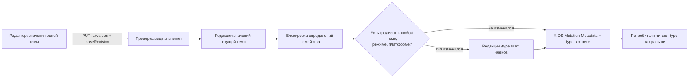

## Контекст

- **Хранение после #109.** Изменение строится поверх `feature/ds-versions` (salute-developers/design-system-builder#109):
  - `tokens` и `token_values` хранят только идентичность;
  - тип, имя и прочие поля определения живут в `token_revisions`, значение и `palette_id` — в `token_value_revisions`;
  - редакции привязаны к границам версий `design_system_versions` (`baseline`, `draft`, `published`);
  - изменения пишутся в единственный активный черновик.
- **Предметные редакции.**
  - Субъект определения — один токен (`"token"`), субъект значения — тема × токен × платформа × режим (`"token-value"`).
  - Базовая редакция значения передаётся в теле (`baseRevision`) или заголовком `X-DS-Base-Revision`. Технические редакции возвращаются в `X-DS-Mutation-Metadata`.
  - Конфликт по одному пути не блокирует запись, а даёт предупреждение.
  - `editRevision` в DTO цветового токена остался только для совместимости: сервер возвращает `0`.
- **Журнал.**
  - Вычисляется как разница редакций черновика и предыдущей границы.
  - Отмена идёт через типизированные обработчики (`TokenDraftChangeHandlers`).
  - Редакция, совпавшая с опубликованной, удаляется автоматически.
- **Различение по типу.** Его делают все потребители:
  - `ds-service`: `TokenValueRule`, `ColorTokenFamily`, палитра и превью темы, `ComponentConfigBuilder.derivedType`;
  - генератор пакета `js/cli/src/generator` по выгрузке `theme fetch`;
  - `dsbuilder theme fetch` (`TokenValueNormalizer` требует у `color` одну строку);
  - плагин Android Studio.
- **Клиент.**
  - Экран «Цвета» присылает значения всех трёх платформ с `baseRevision` каждого значения, но каждая правка затирает iOS и Android.
  - Тип входит в ключ токена и очереди автосохранения.
- **Палитра.**
  - Связи, удаление растяжки и проверка отмены (`PaletteRevertDependencyValidator`) учитывают только токены `color` и ссылку на всё значение.
  - `GET token-values` раскрывает такую ссылку по палитре на границе выбранной версии.
- **Сид.** 17 градиентных семейств, 204 определения. Настоящий градиент в web есть у 5 из них. У остальных 12 в web лежит HEX, а в iOS и Android — заглушка `linear` «белый → чёрный». Эти 12 семейств выключены.
- **Прототип.** Градиент — свойство значения режима. Редактор умеет только Linear, ссылка стопа на палитру не сохраняется. Кнопка платформы есть, но ничего не делает.

## Цели / Вне целей

**Цели:**
- значение каждой пары «тема × режим» — цвет или градиент, без выбора типа токена пользователем;
- редактор Linear / Radial / Conic с геометрией, перетаскиванием стопов и ссылками стопов на палитру;
- собственные значения iOS и Android строками в инспекторе;
- согласованность с черновиком, журналом, отменой и версиями #109;
- потребители пакета работают без изменений.

**Вне целей:**
- редактирование второго и следующих слоёв многослойного градиента: они сохраняются как есть;
- поля, которые есть только у iOS, например начальный радиус Radial: при построении он равен 0;
- выбор платформы для дерева, борда и компонента на канвасе: они показывают web;
- legacy-маршруты `db-service`.

## Решения

### 1. Тип семейства хранится, но вычисляется из значений

Тип в `token_revisions` остаётся признаком для потребителей. Пользователь его не выбирает:
- операции создания и изменения значений, запись через общие маршруты `token-values` (порт `TokenValueWritePolicy` в `core`), удаление темы и откат её создания или удаления, а также откат записи журнала о цветовом токене вычисляют тип по действующим на границе черновика значениям всех членов во всех темах;
- члены семейства выбираются по правилу имени независимо от текущего типа: после отката одного определения типы членов могут временно различаться, и пересчёт выравнивает их;
- если хотя бы одно значение — градиент, тип `gradient`, иначе `color`;
- смена типа пишется редакциями определений с путём `/type`, как перенос и переименование пишут `/name` и `/group_id`;
- перед вычислением операция блокирует технические состояния определений всех членов семейства в устойчивом порядке (`lockDraftSubjects`). Поэтому две параллельные записи в разных темах не получат противоречивый тип. Откат записи определения берёт эти блокировки до блокировки самой записи (`TokenRevertListener.prepareRevert`), в том же порядке, что и запись значений, иначе откат и параллельная запись значений семейства могли бы взаимно заблокироваться. Остаточный риск — откат переименования, переносящий определение в другое семейство: блокировки нового семейства берутся после;
- значения других тем при смене типа не переписываются (решение 11).



Альтернативы:
- **Все токены типа `color`, вид значения вычисляют потребители.** Пришлось бы менять генератор, `theme fetch`, плагин и вывод типа значения в конфигурациях компонентов, а правило «градиент где угодно» повторять в TypeScript и Kotlin. Отклонено.
- **Отдельный путь вида значения.** Он дублирует `type` и всё равно требует правок у потребителей. Отклонено.

Пакетный `PUT /tenants/{id}/token-values` тип не меняет и принимает только вид, допустимый для текущего типа, поэтому рассинхронизация через него невозможна.

### 2. Значения iOS и Android строит клиент, признак своего значения — путь редакции

- Клиент строит нативные слои из web при каждой правке и отправляет все шесть значений, как и сегодня.
- Признак своего значения хранится в предметной редакции значения: колонка `overridden` в `token_value_revisions` и `token_value_creation_baselines`, путь `/overridden`.
- Признак участвует в журнале, отмене и сжатии редакций. Сжатие сравнивает все колонки автоматически.

Альтернативы:
- **Сравнивать нативное значение с построенным из web.** Сидовые значения отличаются от построения в мелочах (позиция `0.99688`) и выглядели бы своими. Отклонено.
- **Строить нативные значения на сервере.** Разбор CSS понадобился бы ещё и в Kotlin. Отклонено.

### 3. Ссылки на палитру внутри градиента хранятся как есть

- **Хранение.** Стоп, выбранный в Library, хранит ссылку `[type.shade.step][o]` и в web-строке на месте цвета, и в `colors` нативного слоя.
- **Чтение.** `GET token-values` (по теме и общий) раскрывает такие ссылки по палитре на границе выбранной версии и отдаёт исходное значение в новом поле `sourceValue`; при ссылке на всё значение вместо него остаётся `paletteRef`. Поэтому `theme fetch` и плагин получают HEX и форму своего типа без доработок.
- **Палитра.** Связи, удаление растяжки и `PaletteRevertDependencyValidator` учитывают токены `gradient` и ссылки в стопах. Переписанные ссылки пишутся редакциями значений и видны в журнале отдельными записями, как переписанные ссылки цветов.
- **Генератор пакета.** `js/cli` собирает пакет из выгрузки `theme fetch` с уже раскрытыми цветами и не меняется.

Альтернатива — хранить HEX и подпись ступени отдельно. Тогда понадобилось бы новое поле, а градиент не следовал бы за изменением ступени. Отклонено.

### 4. Грамматика web-градиента — выход редактора

Сервер принимает три формы:
- `linear-gradient(<угол>deg, …)`, включая сидовую `45.00deg` и дробные позиции;
- `radial-gradient(<r>% <r>% at <x>% <y>%, …)`;
- `conic-gradient(from <угол>deg at <x>% <y>%, …)`.

Стопы — `#RRGGBB`, `#RRGGBBAA` или ссылка с позицией в процентах. Узкая грамматика нужна, чтобы любое принятое значение однозначно строилось для iOS и Android.

### 5. Начальный угол Conic на Android — сдвиг стопов

У слоя Android `angular` нет угла. При построении стопы сдвигаются по кругу на `A / 360`, а на шов добавляются стопы в позициях 0 и 1 с цветом градиента в точке `1 − A/360`. Вариант «всегда 0°» отклонён: он даёт заметно другой результат.

### 6. Ключ токена на клиенте — без типа

Тип меняется правкой значения. Поэтому id строки дерева, ключ очереди автосохранения, `overlay` и `confirmedValues` строятся по группе и имени семейства. Смена типа не теряет выбор, свёрнутые группы, открытый выбор цвета и неотправленные правки.

### 7. Пересечение с `add-color-token-groups` и #109

- `add-color-token-groups` архивируется в этой ветке поверх #109. Требования, которые #109 переписал (удаление токена, ревизии операций токена и палитры), группы не трогали, поэтому архив лёг без конфликтов.
- Здесь затронуты «Изменение значений цветового токена» и «Операции опубликованы в контракте ds-service»: их текст приведён к модели редакций, `editRevision` описан как совместимое поле.

### 8. Смена вида значения не предупреждает о публикации

Когда меняется вид значения опубликованного токена, токен переходит между блоками `color` и `gradient` пакета. Интерфейс об этом не предупреждает: так решила команда, в прототипе такого предупреждения тоже нет.

### 9. Цвет стопа — в отдельном окне

Щелчок по цвету стопа открывает отдельное окно выбора цвета с вкладками Custom и Library, окно градиента остаётся открытым. Отклонённый вариант — вкладки внизу окна градиента, как в прототипе.

### 10. Свои значения платформ — строками в инспекторе

Кнопка «Web» в панели инструментов убирается. У каждого значения Light и Dark раздела «Темы по умолчанию» есть «+»:
- меню iOS / Android добавляет строку платформы с подписью «↳ iOS» в колонке подписей;
- «×» убирает строку.

У полей подтем «+» нет (решение продукта): подтема показывает только строки платформ, унаследованные от режима. Состояния `-hover` и `-active` цвета со своей строкой платформы по-прежнему строятся от цвета этой платформы.

Web в меню нет: верхнее поле и есть значение web, поэтому отдельное «общее значение» хранить не нужно. Отклонённый вариант — выбор платформы в панели инструментов: он прячет разницу платформ за переключателем.

### 11. Сплошные значения платформ хранятся строкой, слой добавляет чтение

Если бы смена типа переписывала сплошные значения iOS и Android всех тем в слой `color` и обратно, одна правка давала бы в журнале запись на каждое значение каждой темы. Значения всех тем менялись бы без участия пользователя.

Поэтому сплошное значение платформы всегда хранится строкой, а `GET token-values` отдаёт его у семейства типа `gradient` слоем `[{ kind: "color", background }]`. Потребители получают форму своего типа на границе выбранной версии, а смена типа затрагивает только определения.

Отклонённый вариант — нормализация хранения во всех темах, по образцу удаления токена: она даёт шумный журнал и противоречит смыслу «правка меняет только текущую тему и режим».

### 12. Производный тип в журнале не показывается

Путь `/type` определения цветового токена производный:
- обработчик журнала `"token"` не показывает запись, у которой изменился только `/type`, и убирает `/type` из путей остальных записей;
- откат любой записи цветового токена (значения или определения) вызывает пересчёт типа семейства в той же транзакции. Поэтому тип не может разойтись со значениями после отмены;
- отдельного отката типа нет: тип всегда соответствует значениям.

## Модель данных и контракты

- **Миграция `V11__color_token_value_kind.sql`:**
  - колонка `overridden boolean NOT NULL DEFAULT false` в `token_value_revisions` и `token_value_creation_baselines`;
  - семейства-заглушки: на всех границах версий тип `color`, web — первый HEX, iOS и Android — копия web;
  - в оставшихся градиентных семействах нативные заглушки членов со сплошным web заменяются тем же HEX.

  Строки редакций правятся на месте при отключённых защитных триггерах, как в V7 (`token_revisions_touch_draft`). Черновые редакции и записи журнала не появляются.
- **Семейство в миграции.** Определяется по имени из `token_revisions`: дизайн-система, первый сегмент и имя без подгруппы и состояния.
- **`ColorTokenValueItem`:** `{ platform, mode, paletteId?, value, baseRevision?, overridden? }`.
- **Ответ `PUT …/values`:** `{ editRevision: 0, type }`. Редакции значений и определений передаются в `X-DS-Mutation-Metadata`.
- **`GET /tenants/{id}/token-values`:** новые поля `overridden` и `sourceValue?`; у градиентного семейства сплошные значения iOS и Android отдаются слоем `color`.
- **Exposed-таблицы:** колонка `overridden` в `TokenValuesTable` (`feature-tokens`) и `TenantTables` (`feature-themes`); путь в `revisionValueColumns` журнала.

## Программное проектирование

`ds-service`, `feature-themes`, пакет `com.dsbuilder.ds.themes`:

```kotlin
// domain/colortokens
enum class ColorValueKind { COLOR, GRADIENT }

/** Разбор web-градиента по грамматике решения 4; null — значение не градиент. */
object WebGradientGrammar {
    fun parse(layer: String): WebGradientLayer?
}

sealed interface WebGradientLayer {
    val stops: List<GradientStop>
    data class Linear(val angle: Double, override val stops: List<GradientStop>) : WebGradientLayer
    data class Radial(val radius: Double, val centerX: Double, val centerY: Double, override val stops: List<GradientStop>) : WebGradientLayer
    data class Conic(val from: Double, val centerX: Double, val centerY: Double, override val stops: List<GradientStop>) : WebGradientLayer
}

data class GradientStop(val color: StopColor, val position: Double)
sealed interface StopColor { data class Hex(val value: String) : StopColor; data class Ref(val reference: PaletteReference) : StopColor }

/** Вид значения, нарушение формы для платформы, приведение сплошного слоя к строке и обратно. */
object ColorValueShape {
    fun kind(platform: ThemePlatform, value: JsonElement): ColorValueKind?
    fun nativeLayerViolation(platform: ThemePlatform, value: JsonElement): String?
    fun storedForm(platform: ThemePlatform, value: JsonElement): JsonElement
    fun publishedForm(platform: ThemePlatform, value: JsonElement, type: ThemeTokenType): JsonElement
}

/** Тип семейства по действующим значениям всех тем. */
object ColorTokenFamilyType {
    fun of(values: Collection<FamilyValue>): ThemeTokenType
}

/** Все ссылки на палитру в значении, включая стопы; переписывание ссылок. */
object ValuePaletteReferences {
    fun find(value: JsonElement): List<PaletteReference>
    fun rewrite(value: JsonElement, transform: (PaletteReference) -> String): JsonElement
}

// application/colortokens
interface ColorTokenRepository {
    // существующие методы …
    fun lockFamilyDefinitions(family: ColorTokenFamily)
    fun familyValuesInDraft(designSystemId: UUID, family: ColorTokenFamily): List<FamilyValue>
    fun reviseFamilyType(family: ColorTokenFamily, type: ThemeTokenType)
}

/** Пересчёт типа после записи или отката значения; общий для use case и обработчика журнала. */
class ColorTokenFamilyTypeSync(private val repository: ColorTokenRepository) {
    fun sync(tokenId: UUID): ThemeTokenType
}
```

- `TokenValueRule` использует `ColorValueShape`.
- `UpdateColorTokenValuesUseCase` и `CreateColorTokenUseCase` после записи значений вызывают `ColorTokenFamilyTypeSync`. Обработчик отката `token-value` вызывает его для цветовых токенов.
- `GetTenantTokenValuesUseCase` раскрывает ссылки через `ValuePaletteReferences` и применяет `publishedForm`.
- Палитра (`ExposedTenantPaletteRepository`, `ThemePaletteBuilder`, `PaletteRevertDependencyValidator`) берёт типы `color` и `gradient` и ищет ссылки через `ValuePaletteReferences`.
- Превью темы берёт цвет только из сплошного значения-строки.

Клиент, `modules/colorTokens/domain`:

```ts
export type GradientType = 'linear' | 'radial' | 'conic';
export interface GradientStopModel { color: string; position: number } // color — HEX8 или ссылка
export interface GradientModel {
    type: GradientType; angle: number; from: number;
    centerX: number; centerY: number; radius: number; stops: GradientStopModel[];
}
export type ValueKind = 'color' | 'gradient';

export function valueKind(web: string[]): ValueKind | null;
export function parseWebLayer(layer: string): GradientModel | null;
export function formatWebLayer(model: GradientModel): string;
export function deriveNative(web: string[], platform: 'ios' | 'android'): unknown[] | string;
export function parseNativeLayer(layer: NativeLayer, platform: 'ios' | 'android'): GradientModel | null;
export function formatNativeLayer(model: GradientModel, platform: 'ios' | 'android'): NativeLayer;
```

- `ColorFieldValue` получает `kind`, модель первого слоя и значения платформ с признаком `overridden`. Исходное значение берётся из `sourceValue`.
- `colorTokenEditor` при правке web перестраивает нативные значения без `overridden`. Значения отправляются с `baseRevision` из `subjectRevisions`.
- `utils/gradient.ts` у legacy-экранов исправляется по позициям из одной цифры и Conic, но экран «Цвета» использует новые функции.

## Миграция и совместимость

- **Порядок развёртывания.** Сначала #109, затем `ds-service` с V11, затем клиент. До обновления клиента старый экран присылает значения без `overridden`: сервер сохраняет `false`, а градиентное значение в цветовом токене старый клиент создать не может.
- **Публичный API пакета.**
  - Публикуются только включённые токены.
  - 12 семейств-заглушек в сиде выключены, поэтому пакет дизайн-системы с сидом по умолчанию миграция не меняет.
  - Там, где такие семейства включили, они переходят из `*_gradient.json` в `*_color.json`.
  - Для включённых токенов то же происходит при каждой смене вида значения. Это отмечается в заметках к выпуску.
- **Откат.**
  - Колонка `overridden` безопасна для старого кода.
  - Правка редакций на месте затрагивает и опубликованные версии этих 12 семейств. Поэтому V11 сохраняет прежние тип и значения изменённых строк в таблицу `v11_color_token_backup` для ручного восстановления.

## Риски / Компромиссы

- **[Смена типа меняет файл и тип токена в пакете]** → это следствие утверждённого правила публикации. Предупреждения в интерфейсе нет (решение 8), смена отмечается в заметках к выпуску.
- **[V11 меняет историю опубликованных версий 12 семейств]** → это выключенные заглушки, которых нет в пакетах. Прежние строки сохраняются в `v11_color_token_backup`.
- **[Тип вычисляется по всем темам под блокировкой определений семейства]** → это сериализует только записи одного токена в разных темах. Записи разных токенов остаются параллельными.
- **[Сидовые нативные градиенты отличаются от построенных]** → они получают `overridden: false`, и первая же правка перестраивает их из web. Отличия — округление позиций.
- **[V11 правит только существующие строки редакций]** → если на какой-то границе есть web-строка, а нативная сжата как совпавшая с предыдущей границей, натив на этой границе остаётся прежним. Это касается только выключенных семейств-заглушек; вставка строк на опубликованные границы запрещена условием «без новых редакций».
- **[Сдвиг стопов на Android приближённый у шва]** → цвет шва вычисляется интерполяцией. При двух стопах результат совпадает с iOS.

## План проверки и развёртывания

- **Локально, автоматически:**
  - тесты `ds-service`: домен, use case, обработчики журнала, Flyway (число миграций `11`, отпечаток `FINAL_FINGERPRINT`), HTTP-интеграция на Testcontainers;
  - `vitest` клиента;
  - тесты `js/cli`;
  - `npm run build` клиента.
- **Внешние проверки до архивации:**
  - V11 на копии базы контура с данными #109: число семейств по типам, отсутствие нативных заглушек у цветовых, пустой журнал черновиков после миграции;
  - сценарии экрана «Цвета» и журнала в браузере на стенде.
- **После развёртывания:** сравнить сгенерированный пакет до и после для включённых градиентных токенов. В задачи это не входит.
