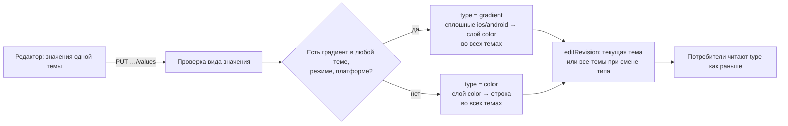

## Контекст

- **Хранение.** Значение токена хранится строкой `token_values` на (токен, тема, платформа, режим), значение — `jsonb`. Тип токена — `tokens.type` (`color`, `gradient` и другие).
- **Различение по типу.** Его делают все потребители:
  - `ds-service`: `TokenValueRule`, `ColorTokenFamily.TYPES`, палитра и превью темы, `ComponentConfigBuilder.derivedType`;
  - legacy-маршруты `theme-data` и `download-theme` в `db-service`: файлы `{platform}_{type}.json`, у не-градиентов берётся `value[0]`;
  - генератор пакета `js/cli/src/generator` (`createColorTokens`, `createGradientTokens`) по выгрузке `theme fetch`;
  - `dsbuilder theme fetch`: `TokenValueNormalizer` требует у `color` одну строку;
  - плагин Android Studio: вкладки «Цвета» и «Градиенты».
- **Клиент.** Экран «Цвета» уже присылает значения всех трёх платформ. Но каждая правка затирает iOS и Android: у цвета — тем же значением, у градиента — пересчётом `parseGradient`, который теряет Conic.
- **Палитра.** `ds-service` раскрывает ссылки на палитру при чтении `token-values`. Палитра темы, её связи и удаление растяжки работают только с токенами типа `color` и только со ссылкой на всё значение.
- **Сид.** 17 градиентных семейств, 204 определения. Настоящий градиент в web есть у 5 семейств, у остальных 12 в web лежит HEX, а в iOS и Android — заглушка `linear` «белый → чёрный».
- **Прототип.** Градиент — свойство значения режима (CSS-строка в `value` / `darkValue`). Редактор умеет только Linear, угол не меняется, ссылка стопа на палитру не сохраняется. Кнопка платформы есть, поведения нет.

## Цели / Вне целей

**Цели:**
- значение каждой пары «тема × режим» — цвет или градиент, без выбора типа токена пользователем;
- редактор Linear / Radial / Conic с геометрией, перетаскиванием стопов и ссылками стопов на палитру;
- собственные значения iOS и Android строками в инспекторе;
- потребители пакета работают без изменений.

**Вне целей:**
- редактирование второго и следующих слоёв многослойного градиента: они сохраняются как есть;
- поля, которые есть только у iOS, например начальный радиус Radial: при построении он равен 0;
- раскрытие ссылок в нативных слоях legacy-маршрута `download-theme`: сплошные цвета он сегодня тоже отдаёт ссылками;
- выбор платформы для дерева, борда и компонента на канвасе: они показывают web.

## Решения

### 1. Тип семейства хранится, но вычисляется из значений

`tokens.type` остаётся признаком для потребителей. Пользователь его не выбирает: операции цветового токена в одной транзакции вычисляют его из всех значений семейства во всех темах. Если хотя бы одно значение — градиент, тип `gradient`, иначе `color`. В семействе типа `gradient` сплошные нативные значения приводятся к слою `{ kind: "color", background }`, в семействе `color` — к строке. Web-значение цвета остаётся массивом из одной строки.



Альтернативы:
- **Все токены типа `color`, вид значения вычисляют потребители.** Пришлось бы менять `theme-data`, `download-theme`, генератор, `theme fetch`, плагин и два вывода типа значения в конфигурациях компонентов, а правило «градиент где угодно» повторять в TypeScript и Kotlin. Отклонено: это много кода в шести местах.
- **Отдельная колонка вида значения.** Это дублирует `tokens.type` и всё равно требует правок у потребителей. Отклонено.

Смена типа меняет значения других тем, поэтому увеличивает `editRevision` всех тем дизайн-системы. Операции цветового токена уже блокируют все темы дизайн-системы (`add-color-token-groups`), так что гонки при смене типа нет. Пакетный `PUT /tenants/{id}/token-values` тип не меняет и принимает только вид, допустимый для текущего типа. Поэтому рассинхронизация через него невозможна.

### 2. Значения iOS и Android строит клиент, признак своего значения хранит сервер

Клиент строит нативные слои из web при каждой правке (раздел «Программное проектирование») и отправляет все шесть значений, как и сегодня. Для пометки своего значения в `token_values` добавляется колонка `overridden boolean NOT NULL DEFAULT false`, а в `ColorTokenValueItem` — необязательное поле `overridden`.

Альтернативы:
- **Признак вычисляется сравнением нативного значения с построенным из web.** Сидовые значения отличаются от построения в мелочах, например позиция `0.99688`, и выглядели бы своими. Отклонено.
- **Сервер строит нативные значения сам.** Разбор CSS понадобился бы ещё и в Kotlin, а клиенту всё равно нужно построение для превью платформы. Отклонено: построение остаётся в одном месте, на клиенте. Сервер только проверяет форму слоёв.

### 3. Ссылки на палитру внутри градиента хранятся как есть

- **Хранение.** Стоп, выбранный в Library, хранит ссылку `[type.shade.step][o]` и в web-строке на месте цвета, и в `colors` нативного слоя.
- **Чтение.** `GET token-values` раскрывает такие ссылки по палитре темы так же, как ссылку на всё значение, и отдаёт исходное значение в `sourceValue`. Поэтому `theme fetch` и плагин получают HEX без доработок.
- **Палитра.** Связи растяжки и удаление растяжки ищут ссылки и внутри градиентов.
- **Генератор пакета.** `js/cli` собирает пакет из выгрузки `dsbuilder theme fetch`, а та читает уже раскрытые `token-values`. Поэтому генератор получает градиенты с HEX и не меняется.

Альтернатива — хранить HEX и подпись ступени отдельно. Тогда понадобилось бы новое поле, а градиент не следовал бы за изменением ступени. Отклонено.

### 4. Грамматика web-градиента — выход редактора

Сервер принимает три формы:
- `linear-gradient(<угол>deg, …)`, включая сидовую `45.00deg` и дробные позиции;
- `radial-gradient(<r>% <r>% at <x>% <y>%, …)`;
- `conic-gradient(from <угол>deg at <x>% <y>%, …)`.

Стопы — `#RRGGBB`, `#RRGGBBAA` или ссылка с позицией в процентах. Слои-цвета допускаются рядом с градиентными. Узкая грамматика нужна, чтобы любое принятое значение однозначно строилось в iOS и Android. Формы вроде `to right` сегодня тоже не строятся (`parseGradient` даёт `NaN`).

### 5. Начальный угол Conic на Android — сдвиг стопов

У слоя Android `angular` нет угла. При построении:
- стопы сдвигаются по кругу на `A / 360`;
- на шов добавляются стопы в позициях 0 и 1 с цветом градиента в точке `1 − A/360`.

Так Android визуально начинает градиент с угла `A` без изменения формата и без правок потребителей. Отказ от угла (вариант «всегда 0°») отклонён: он даёт заметно другой результат.

### 6. Ключ токена на клиенте — без типа

Тип теперь меняется правкой значения, поэтому id строки дерева и ключ токена строятся по группе и имени семейства. Переключение типа не должно терять выбор, свёрнутые группы и очередь автосохранения.

### 7. Пересечение с `add-color-token-groups`

Код групп уже в `dev`, а change `add-color-token-groups` архивируется в этой же ветке: его дельты перенесены в `openspec/specs`, и дельты этого изменения строятся на обновлённых спеках. Из требований, которые он менял, здесь затронуто только «Операции опубликованы в контракте ds-service». Остальное добавлено новыми требованиями.

### 8. Смена вида значения не предупреждает о публикации

При смене вида значения опубликованного токена интерфейс не показывает предупреждение, хотя токен переходит между блоками `color` и `gradient` пакета. Так решила команда, в прототипе такого предупреждения тоже нет.

### 9. Цвет стопа — в отдельном окне

Щелчок по цвету стопа открывает отдельное окно выбора цвета с вкладками Custom и Library, как у обычного значения; окно градиента при этом остаётся открытым. Так выбор цвета стопа не растягивает окно градиента и выглядит так же, как выбор цвета значения. Отклонённый вариант — вкладки Custom и Library внизу окна градиента, как в прототипе.

### 10. Свои значения платформ — строками в инспекторе

Кнопка «Web» в панели инструментов прототипа ничего не делает и в интерфейсе убирается. Вместо переключения всего инспектора на платформу у каждого значения Light и Dark есть «+»: меню iOS / Android добавляет под значением строку платформы с её значением (`overridden: true`), «×» убирает строку, и значение снова строится из web. Название платформы стоит в колонке подписей («↳ iOS»), а не внутри поля, чтобы не перекрывать название значения. Web в меню нет: верхнее поле и есть значение web, поэтому отдельное «общее значение» хранить не нужно. Так своё значение платформы видно рядом с web-значением, и не нужно помнить, на какой платформе открыт инспектор. Отклонённый вариант — выбор платформы в панели инструментов с пометками «как в Web» и «своё» у полей: он прячет разницу платформ за переключателем.

## Модель данных и контракты

- **Миграция `V7__color_token_value_kind.sql`:**
  - колонка `token_values.overridden`;
  - перевод семейств-заглушек в `color`: web — первый HEX, iOS и Android — копия web;
  - в оставшихся градиентных семействах нативные значения членов со сплошным web — слой `color`.
- **Семейство в миграции.** Определяется тем же регулярным выражением, что в V6: дизайн-система, первый сегмент и имя без подгруппы и состояния.
- **`ColorTokenValueItem`:** `{ platform, mode, paletteId?, value, overridden? }`.
- **Ответ `PUT …/values`:** `{ editRevision, type }`.
- **`GET /tenants/{id}/token-values`:** у значения новые поля `overridden` и `sourceValue?`.
- **`db-service`.** Колонку пишет только `ds-service`. `schema.ts` в `db-service` не меняется, как и в V6: вставки legacy-маршрутов получают значение по умолчанию.

## Программное проектирование

`ds-service`, `feature-themes`, пакет `com.dsbuilder.ds.themes`:

```kotlin
// domain/colortokens
enum class ColorValueKind { COLOR, GRADIENT }

/** Разбор web-градиента по грамматике решения 4; null — значение не градиент. */
object WebGradientGrammar {
    fun parse(layer: String): WebGradientLayer?
}

sealed interface WebGradientLayer {
    val stops: List<GradientStop>
    data class Linear(val angle: Double, override val stops: List<GradientStop>) : WebGradientLayer
    data class Radial(val radius: Double, val centerX: Double, val centerY: Double, override val stops: List<GradientStop>) : WebGradientLayer
    data class Conic(val from: Double, val centerX: Double, val centerY: Double, override val stops: List<GradientStop>) : WebGradientLayer
}

data class GradientStop(val color: StopColor, val position: Double)
sealed interface StopColor { data class Hex(val value: String) : StopColor; data class Ref(val reference: PaletteReference) : StopColor }

/** Вид значения и нарушение формы для платформы. */
object ColorValueShape {
    fun kind(platform: ThemePlatform, value: JsonElement): ColorValueKind?
    fun nativeLayerViolation(platform: ThemePlatform, value: JsonElement): String?
}

/** Тип семейства по всем значениям и приведение сплошных нативных значений к типу. */
object ColorTokenFamilyType {
    fun of(values: Collection<FamilyValue>): ThemeTokenType
    fun normalizeNative(value: JsonElement, type: ThemeTokenType): JsonElement
}

/** Все ссылки на палитру в значении, включая стопы; переписывание ссылок. */
object ValuePaletteReferences {
    fun find(value: JsonElement): List<PaletteReference>
    fun rewrite(value: JsonElement, transform: (PaletteReference) -> String): JsonElement
}

// application/colortokens
interface ColorTokenRepository {
    // существующие методы …
    fun familyValuesInDesignSystem(designSystemId: UUID, family: ColorTokenFamily): List<FamilyValue>
    fun changeFamilyType(designSystemId: UUID, family: ColorTokenFamily, type: ThemeTokenType)
    fun replaceNativeValues(changes: List<NativeValueChange>)
}
```

- `TokenValueRule` использует `ColorValueShape`.
- `UpdateColorTokenValuesUseCase` и `CreateColorTokenUseCase` после записи значений вызывают `ColorTokenFamilyType` и при смене типа нормализуют значения и увеличивают ревизии всех тем.
- Палитра (`ExposedTenantPaletteRepository`, `ThemePaletteBuilder`) берёт типы `color` и `gradient` и ищет ссылки через `ValuePaletteReferences`.
- Превью темы берёт цвет только из сплошного значения-строки.

Клиент, `modules/colorTokens/domain`:

```ts
export type GradientType = 'linear' | 'radial' | 'conic';
export interface GradientStopModel { color: string; position: number } // color — HEX8 или ссылка
export interface GradientModel {
    type: GradientType; angle: number; from: number;
    centerX: number; centerY: number; radius: number; stops: GradientStopModel[];
}
export type ValueKind = 'color' | 'gradient';

export function valueKind(web: string[]): ValueKind | null;
export function parseWebLayer(layer: string): GradientModel | null;
export function formatWebLayer(model: GradientModel): string;
export function deriveNative(web: string[], platform: 'ios' | 'android'): unknown[] | string;
export function parseNativeLayer(layer: NativeLayer, platform: 'ios' | 'android'): GradientModel | null;
export function formatNativeLayer(model: GradientModel, platform: 'ios' | 'android'): NativeLayer;
```

- `ColorFieldValue` получает `kind`, модель первого слоя и значения платформ с признаком `overridden`.
- `colorTokenEditor` при правке web перестраивает нативные значения без `overridden`.
- `utils/gradient.ts` у legacy-экранов исправляется по позициям из одной цифры и Conic, но экран «Цвета» использует новые функции.

## Миграция и совместимость

- **Порядок развёртывания:**
  1. `ds-service` с V7;
  2. клиент.

  До обновления клиента старый экран присылает `type` и шесть значений без `overridden`. Сервер принимает их, а градиентное значение в цветовом токене старый клиент создать не может.
- **Публичный API пакета.**
  - Публикуются только включённые токены: `theme fetch` отбирает их в `ThemeWritePlanBuilder`.
  - 12 семейств-заглушек в сиде выключены, поэтому пакет дизайн-системы с сидом по умолчанию миграция не меняет. Пакет меняется только там, где такие семейства кто-то включил: они переходят из `*_gradient.json` в `*_color.json`, а на iOS и Android меняют тип в коде приложения с градиента на цвет. Сейчас там нативная заглушка «белый → чёрный», которая не совпадает с web.
  - Для включённых токенов то же происходит при каждой смене вида значения. Имена переменных не меняются. Это отмечается в заметках к выпуску.
- **Откат.** Колонка `overridden` безопасна для старого кода. Смену типов 12 семейств можно откатить обратной SQL-миграцией из резервной копии `tokens.type` и нативных значений. Миграция V7 сохраняет их в таблицу `v7_color_token_backup`.

## Риски / Компромиссы

- **[Смена типа меняет файл и тип токена в пакете]** → это следствие утверждённого правила публикации. Предупреждения в интерфейсе нет (решение 8), смена отмечается в заметках к выпуску.
- **[Сидовые нативные градиенты отличаются от построенных]** → они получают `overridden: false`, и первая же правка перестраивает их из web. Отличия — округление позиций.
- **[Сдвиг стопов на Android приближённый у шва]** → цвет шва вычисляется интерполяцией. При двух стопах результат совпадает с iOS.
- **[Сиды `db-service` для локального контура остаются с типом `gradient`]** → V7 приводит данные при первом запуске `ds-service`. Сиды `ds-service` обновляются в этом изменении.

## План проверки и развёртывания

- **Локально, автоматически:**
  - `cd backend-kt && ./gradlew :ds-service:…` — тесты домена, use case, Flyway (число миграций, отпечаток) и HTTP-интеграция на Testcontainers;
  - `vitest` клиента;
  - тесты `js/cli` (`npm test`), включая прохождение градиента из выгрузки через генерацию;
  - `npm run build` клиента.
- **Внешние проверки до архивации:**
  - V7 на копии рабочей базы `ds_registry`: число семейств по типам до и после, отсутствие нативных заглушек у цветовых;
  - сценарии экрана «Цвета» в браузере на стенде.
- **После развёртывания:** сравнить сгенерированный пакет до и после для 12 семейств. В задачи это не входит.
