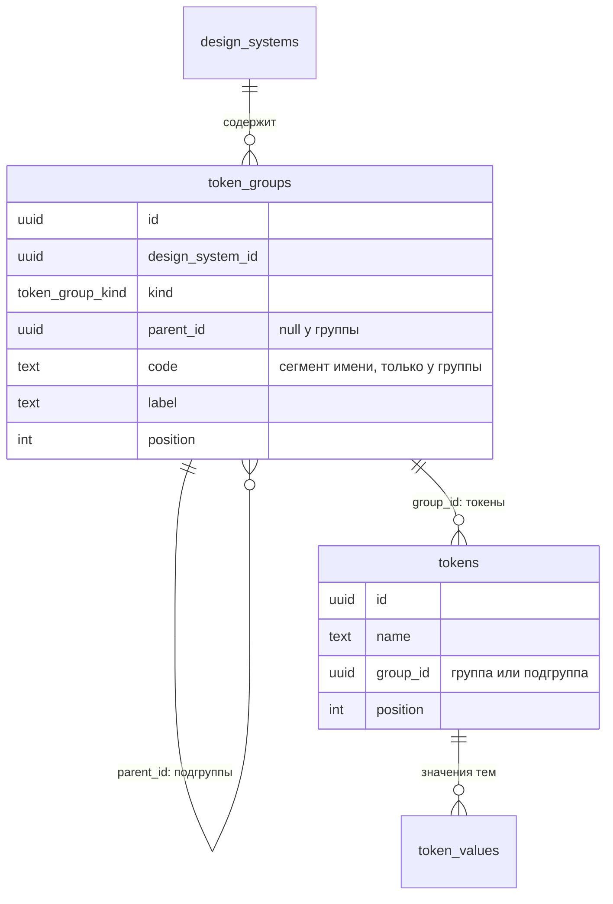
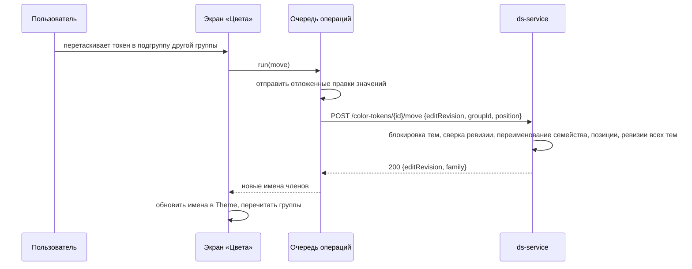

## Контекст

Экран «Цвета» (`color-tokens-editor`) группирует токены по вычисляемым признакам:

- **раздел** — первый сегмент имени (`text`, `surface`, `outline`, `background`, `overlay`, `data`); `surface.*.read-only` попадает в Technical;
- **категория** — группа палитры темы (явная привязка `tenant_palette_token_groups` или правило по умолчанию по имени) и вид Solid или Transparent по префиксу `transparent-`;
- **порядок** — индекс строки в ответе legacy `theme-data`, который выбирается без `ORDER BY`.

В `ds-service` у таблицы `tokens` нет ни группы, ни порядка (`V1__db_service_baseline.sql`, последняя миграция `V4__tenant_palette.sql`). Цветовой токен — семейство определений `<group>.<context>.<name>[-state]`, которое `ExposedColorTokenRepository` находит по совпадению имени. Контекст (`default`, `on-dark`, `on-light`, `inverse`) в имени исторически называется «subgroup». В этом изменении это слово закреплено за подгруппой токенов, а сегмент имени дальше называется **контекстом**.

Компоненты ссылаются на токены через `token_id` в `variation_property_values`, `invariant_property_values` и значениях сочетаний. Но импорт конфигураций (`ComponentConfigImporter`) дополнительно пишет имя токена текстом в `value`, а сборка (`ComponentConfigBuilder`, legacy `component-configs` в db-service) отдаёт `value ?: имя по token_id`. Пока это так, переименованный токен в компонентах остался бы под старым именем.

Генератор и сервис документации берут имена токенов из `theme-data` в момент генерации и строят из сегментов имена переменных пакета. Переименование меняет публичный API собранного пакета. Плагин `frontend-kt` читает имена в момент запроса и не затрагивается.

## Цели / Вне целей

**Цели:**

- хранимые группы и подгруппы токенов дизайн-системы с порядком; модель общая для типов токенов, включена для цветовых и градиентных;
- миграция существующих цветовых токенов без изменения того, что видит пользователь;
- атомарные операции над группами и перенос или переименование токена с сохранением идентификаторов;
- ссылки компонентов на токены, устойчивые к переименованию;
- экран «Цвета» по комментариям ревью: создание в списке, меню «+», удаление при наведении, перетаскивание, без окна «Новый токен» и поля «Группа палитры».

**Вне целей:**

- группы для форм, теней, типографики и других типов (модель допускает, интерфейс и операции — позже);
- смена кода группы, то есть массовое переименование её токенов; меняется только название;
- больше двух уровней вложенности;
- разный тип значения по режимам (цвет в Light, градиент в Dark) и отдельные значения градиента по платформам;
- ревизии на уровне токена и многопользовательский режим: остаётся общая ревизия тем.

## Решения

### Группы и подгруппы — отдельные записи у дизайн-системы

Таблица `token_groups` хранит дерево двух уровней. Токен ссылается на группу или подгруппу и хранит позицию.



- `kind` — вид токенов дерева, enum `token_group_kind` со значением `color` (цветовые и градиентные). Для других типов enum расширяется.
- `code` есть только у группы верхнего уровня. Это первый сегмент имени её токенов. Код проверяется правилом сегмента имени и после создания не меняется. Коды групп не обязаны быть уникальными: у Technical и Surfaces оба `surface`.
- `label` — название, уникальное среди соседей одного родителя.
- Все определения семейства цветового токена указывают на одну и ту же группу или подгруппу и имеют одинаковую позицию. Токен может лежать прямо в группе без подгруппы.
- Пустые группы и подгруппы хранятся.

Отвергнуто:

- группа только как сегмент имени — пустую группу не сохранить, перенос между подгруппами пришлось бы кодировать в имени, формат имён SDDS пришлось бы менять;
- группы на уровне темы, как группы палитры, — разделы и порядок общие для всех тем дизайн-системы.

### Подгруппа не входит в имя, группа — входит

Перенос токена между подгруппами одной группы не меняет имя. Перенос в группу с другим кодом заменяет первый сегмент имени у всех определений семейства. Переименование заменяет сегмент имени токена. В обоих случаях `tokens.id` сохраняются, обновляется `display_name` по правилу сида:

```text
<контекст в camelCase, без default><Группа><Имя><Состояние>
text.default.accent-hover → textAccentHover
text.on-dark.accent       → onDarkTextAccent
```

Вид Solid или Transparent остаётся частью имени (`transparent-`). Перенос токена в подгруппу «Transparent» префикс не добавляет: подгруппа — только место в списке.

### Ссылки компонентов разрешаются по `token_id`

- `ComponentConfigImporter` пишет `value = null`, если токен по имени найден, как уже делает legacy `/update` в db-service.
- Миграция V5 очищает `value` в строках значений компонентов, где `token_id` задан и `value` совпадает с именем этого токена.
- `ComponentConfigBuilder` берёт имя по `token_id`, а `value` — только для строк без токена.

После миграции legacy `component-configs` в db-service тоже отдаёт имя по `token_id`: его код не меняется.

### Операции и ревизии

Группы общие для всех тем, поэтому каждая операция над группой и перенос токена, как создание и удаление токена, блокирует все темы дизайн-системы (`FOR UPDATE OF tenants` в порядке `id`). Затем она сверяет `editRevision` текущей темы и увеличивает ревизии всех тем в той же транзакции.

| Операция | Маршрут | Права |
|---|---|---|
| Список групп | `GET /api/ds/design-systems/{designSystemId}/token-groups?kind=color` | `tokens:read` |
| Создать | `POST /api/ds/tenants/{tenantId}/token-groups` | `tenants:write`, `tokens:write` |
| Переименовать, переставить, перенести подгруппу | `PATCH /api/ds/tenants/{tenantId}/token-groups/{groupId}` | `tenants:write`, `tokens:write` |
| Удалить с токенами | `DELETE /api/ds/tenants/{tenantId}/token-groups/{groupId}` | `tenants:write`, `tokens:delete` |
| Перенести или переименовать токен | `POST /api/ds/tenants/{tenantId}/color-tokens/{tokenId}/move` | `tenants:write`, `tokens:write` |

- Удаление группы удаляет подгруппы и семейства их токенов со значениями во всех темах и привязками к группам палитры.
- Позиции после вставки, переноса и удаления пересчитываются сервером подряд с нуля.
- `GET …/tokens` дополняется полями `groupId` и `position`.
- Создание цветового токена принимает `groupId`. `paletteGroupId` становится необязательным: без него привязка к группе палитры не пишется, действует правило по умолчанию.

### Миграция V5

Миграция Flyway V5 в одной транзакции:

1. создаёт `token_group_kind`, `token_groups`, колонки `tokens.group_id` и `tokens.position`;
2. для каждой дизайн-системы с цветовыми токенами создаёт группы по разделам экрана с прежними названиями и порядком (Text & Icons → `text`, Surfaces → `surface`, Outlines → `outline`, BG → `background`, Overlays → `overlay`, Data → `data`, Technical → `surface`);
3. создаёт подгруппы так же, как сегодня вычисляется категория:
   - по правилу группы палитры по умолчанию: `accent|promo` → Accent, `positive|negative|warning|info` → Status, иначе General;
   - для Surfaces и Outlines дополнительно «/ Solid» или «/ Transparent»;
   - у BG, Overlays, Data и Technical подгруппа одна, Default;
4. раскладывает семейства по подгруппам с позициями по порядку `created_at`, затем `name`;
5. очищает дубли имени в `value` значений компонентов.

Явные привязки к группам палитры в категории не превращаются. Они появились недавно, хранятся на уровне темы и продолжают действовать на цвет.

Токены, созданные после миграции legacy-путём без группы (`group_id = null`), экран показывает в служебной подгруппе «Без группы» своей группы по коду. Перенести их можно перетаскиванием.

### Экран «Цвета»

- Дерево и борд строятся по `token-groups` и полям `groupId`, `position` токенов, а не по имени и палитре. Пустые группы и подгруппы видны в дереве, на борде пустые не выводятся.
- «Исходные» — порядок групп и позиций, «А–Я» — сортировка внутри группы или подгруппы.
- Перетаскивание:
  - токенов в любом режиме сортировки — в другую подгруппу или группу;
  - порядка внутри — только в режиме «Исходные»;
  - подгруппы — в другую группу;
  - групп — между собой.
- «+» в заголовке дерева добавляет группу. «+» у группы открывает меню «Добавить цвет», «Добавить градиент», «Добавить подгруппу». «+» у подгруппы открывает меню «Добавить цвет», «Добавить градиент». Третьего уровня нет.
- Новая группа, подгруппа или токен появляются строкой с полем ввода:
  - Enter сохраняет: группа и подгруппа — операцией создания, токен — операцией создания цветового токена;
  - Escape или пустое имя отменяют;
  - код новой группы — название в нижнем регистре через дефис, латиница и цифры;
  - начальные значения токена — значения выбранного токена той же группы, иначе `#171717` и `#F5F5F5`, как в прототипе;
  - после создания градиентного токена инспектор открывает выбор цвета в режиме Gradient.
- Переименование:
  - двойной щелчок по строке группы, подгруппы или токена, токен ещё и полем имени в инспекторе;
  - группа меняет название, токен — сегмент имени операцией переноса;
  - в инспекторе показывается предупреждение, что имя токена меняется в пакете дизайн-системы.
- Удаление:
  - кнопка удаления появляется при наведении на группу, подгруппу и токен;
  - группа и подгруппа с токенами удаляются после подтверждения с числом токенов и компонентами, где они используются;
  - пустые удаляются сразу;
  - токен — по прежнему правилу подтверждения;
  - удаление групп с токенами доступно Maintainer и Owner.
- Поле «Группа палитры» и окно «Новый токен» удаляются вместе с `NewTokenDialog`. `TokenPaletteGroupField` остаётся в разделе «Палитра».
- Операции над группами и перенос идут через ту же очередь, что и автосохранение (`autosave.run`), с общей ревизией. После успеха клиент перечитывает список групп и токенов. Значения тем не перечитываются: имена определений обновляются в `Theme` на месте.



### Программное проектирование

`ds-service`, модуль `feature-themes`, пакет `tokengroups` — рядом с `colortokens`, потому что операции используют блокировку тем и ревизии.

```kotlin
// domain
enum class TokenGroupKind { COLOR }
data class TokenGroup(
    val id: UUID, val designSystemId: UUID, val kind: TokenGroupKind,
    val parentId: UUID?, val code: String?, val label: String, val position: Int,
)
object TokenGroupRules {
    fun label(value: String): String?          // текст ошибки или null
    fun codeFromLabel(label: String): String?  // кебаб-код или null
}
object ColorTokenNaming {
    fun rename(member: String, group: String, name: String): String
    fun displayName(member: String): String
}

// application
interface TokenGroupRepository {
    fun list(designSystemId: UUID, kind: TokenGroupKind): List<TokenGroup>
    fun find(groupId: UUID): TokenGroup?
    fun insert(group: NewTokenGroup): TokenGroup
    fun update(group: TokenGroup)
    fun delete(groupId: UUID)
    fun renumber(designSystemId: UUID, parentId: UUID?)
}
class CreateTokenGroupUseCase { fun execute(command: CreateTokenGroup): DsResult<TokenGroupMutation> }
class UpdateTokenGroupUseCase { fun execute(command: UpdateTokenGroup): DsResult<TokenGroupMutation> }
class DeleteTokenGroupUseCase { fun execute(command: DeleteTokenGroup): DsResult<RevisionMutation> }
class MoveColorTokenUseCase { fun execute(command: MoveColorToken): DsResult<ColorTokenMutation> }
```

Коды ошибок: `INVALID_TOKEN_GROUP` (400) — пустое или недопустимое название, третий уровень, родитель другого вида или дизайн-системы, код группы вне правила; `TOKEN_GROUP_CONFLICT` (409) — название занято у соседей; `TOKEN_NAME_CONFLICT` (409) — новое имя члена семейства занято; `TENANT_EDIT_CONFLICT` (409); `404` — группа или токен другой дизайн-системы.

Клиент, модуль `src/modules/colorTokens`:

```ts
interface TokenGroupDto { id: string; parentId: string | null; code: string | null; label: string; position: number; kind: 'color' }
interface TokenGroupRepository {
    list(context: ColorTokenContext): Promise<TokenGroupDto[]>;
    create(context: ColorTokenContext, input: { kind: 'color'; parentId: string | null; label: string; position?: number }, editRevision: number): Promise<{ editRevision: number; value: TokenGroupDto }>;
    update(context: ColorTokenContext, groupId: string, patch: { label?: string; parentId?: string | null; position?: number }, editRevision: number): Promise<{ editRevision: number; value: TokenGroupDto }>;
    remove(context: ColorTokenContext, groupId: string, editRevision: number): Promise<{ editRevision: number }>;
}
interface ColorTokenRepository {
    // существующие create (с groupId), updateValues, delete
    move(context: ColorTokenContext, tokenId: string, input: { groupId: string; position: number; name?: string }, editRevision: number): Promise<{ editRevision: number; value: ColorTokenFamilyDto }>;
}
const buildTree: (groups: TokenGroupDto[], tokens: ColorTokenView[], options: TreeOptions) => TreeGroup[];
```

## Риски / Компромиссы

- **[Переименование меняет имена переменных в собранном пакете]** → предупреждение в инспекторе при переименовании и при переносе в группу с другим кодом; группы без смены кода меняются без последствий для пакета.
- **[Legacy `/update` в db-service создаёт токены по имени]** → клиент со старыми именами в режиме без темы мог бы восстановить токен под прежним именем. Для тем экран использует только операции `ds-service`, а legacy-путь не меняется. Риск фиксируется.
- **[Общая ревизия]** → любая операция над группой даёт конфликт параллельной правке значений в любой теме дизайн-системы, как уже создание и удаление токена.
- **[Порядок после миграции]** → `created_at` у сида почти одинаков, порядок внутри подгрупп уточняется по `name` и может отличаться от прежнего случайного. Пользователь переставляет токены перетаскиванием.
- **[Категория больше не следует за группой палитры]** → смена группы палитры в разделе «Палитра» перестаёт перекладывать токен в другую категорию экрана. Это следствие отказа от вычисляемой категории.

## План миграции

1. Выкатить `ds-service` с V5 и новыми операциями: старый клиент продолжает работать — он не читает новые поля, а создание без `groupId` кладёт токен в подгруппу «Без группы».
2. Выкатить клиент.
3. Откат клиента безопасен. Откат `ds-service` требует обратной миграции: удалить колонки и таблицу. Очищенные `value` компонентов восстанавливать не нужно, имя берётся по `token_id`.

## План проверки и развёртывания

- **Локально:** unit-тесты правил и переименования, use case с поддельными репозиториями, Testcontainers на миграцию и операции, vitest дерева и перетаскивания, FAST и FULL.
- **На локальном контуре через gateway:** миграция копии реальной БД и сравнение групп с текущим экраном; создание, переименование, перенос и удаление групп и токенов с проверкой данных во всех темах и конфигураций компонентов после переименования.
- **Вне этого изменения:** проверка собранного пакета дизайн-системы после переименования токена.

## Открытые вопросы

- Меню «+» у группы: в чате названы пункты «Добавить токен» и «Добавить группу». Здесь они разделены на «Добавить цвет», «Добавить градиент», «Добавить подгруппу», потому что тип значения задаётся при создании. Нужна проверка дизайнером.
- Нужно ли подтверждение переименования токена, используемого в опубликованной версии, или достаточно предупреждения.
