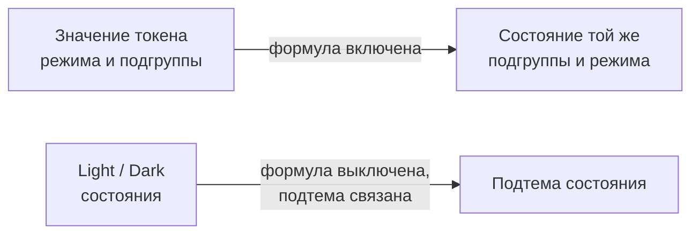

## Контекст

Цветовой токен экрана — семейство определений `<группа>.<подгруппа>.<имя>` и
`<группа>.<подгруппа>.<имя>-<состояние>` (`ColorTokenFamily`, состояния `hover`, `active`, `brightness`).
Состояния — обычные определения со значениями в каждой теме, режиме и платформе. Сейчас редактор:

- скрывает их в дереве и инспекторе;
- при правке токена пересчитывает `-hover` и `-active` формулой `getAdditionalColorValues`
  (`js/apps/client/src/utils/color.ts`), если формула для группы есть, и ставит градиенту то же значение;
  `-brightness` не пересчитывает, хотя у каждого правила `formulas.ts` есть операция `brightness` и прежний
  конструктор тем (`controllers/themeBuilder`) её применяет;
- создаёт новый токен групп `text`, `surface`, `outline`, `data` сразу с `-hover` и `-active`;
- запрещает имя токена с суффиксом состояния.

Формула живёт только в клиенте. `ds-service` формулу не знает и хранит готовые значения.

Признак `detached` значения (миграция `V24`, change `update-theme-workflow`) хранит отвязку подтемы от режимов.
Он входит в журнал путём `/detached`, переносится копией темы и откатом. У значений подгруппы `default` он
сейчас не используется.

Решение команды от 18 ноября и ответы разработчика:

- один переключатель «По формуле» на всё состояние;
- новый токен по-прежнему получает `-hover` и `-active`;
- состояние без формулы добавляется и задаётся вручную.

## Цели / Вне целей

**Цели:**

- показать состояния в дереве, открыть их в инспекторе и дать править вручную;
- добавлять недостающее состояние и удалять существующее;
- сохранить расчёт по формуле как поведение по умолчанию.

**Вне целей:**

- настройка самой формулы и расчёт формулы на сервере;
- выбор токенов состояний в библиотеке редактора компонентов (отдельная задача);
- отдельные карточки состояний на борде;
- поддержка операций в `frontend-kt`: CLI и плагин состояния не правят.

## Решения

### Ручное значение — признак `detached` значений подгруппы `default`

Состояние считается рассчитанным по формуле, если формула для него есть и ни одно значение его подгруппы
`default` (Light и Dark, все платформы) не отмечено `detached`. Переключатель «По формуле» пишет `detached` во
все значения подгруппы `default` состояния.

У подтем состояния `detached` значит то же, что у подтем токена: отвязку от Light и Dark состояния.

Признак уже есть в схеме, журнале, копии темы, откате и чтении `token-values`, поэтому миграция и новое поле
API не нужны. Состояния сидов и существующих тем получают «По формуле» включённым, как сейчас и ведёт себя
редактор.

Рассмотренные варианты:

- **колонка `formula` у определения** — признак был бы общим для всех тем, а темы настраиваются независимо.
  Кроме того, нужны миграция, журнал и откат нового поля;
- **отдельная таблица настроек состояния** — те же затраты без выигрыша.

### Значения подтем состояния



- **Формула включена:** каждое значение состояния считается от значения токена той же подгруппы и того же
  режима. Связанная подтема токена совпадает с режимом, поэтому её состояние совпадает с состоянием режима.
- **Формула выключена:** Light и Dark состояния правятся вручную. Подтемы состояния ведут себя как подтемы
  токена: связаны с Light и Dark состояния, пока их не отвяжут.
- **Включение формулы обратно:** все значения состояния пересчитываются, `detached` снимается и у
  подгруппы `default`, и у подтем.

### Добавление состояния передаёт значения каждой темы

Определения общие для дизайн-системы, а значения у каждой темы свои, и формула от токена в теме B даёт свой
цвет. Поэтому клиент:

1. читает значения токена во всех темах уже существующим `tokenRepository.loadValuesByTenant`;
2. считает состояние формулой или копирует значение токена, если формулы нет;
3. отправляет значения для каждой темы.

Сервер проверяет, что набор тем совпадает с темами дизайн-системы, и пишет значения каждой темы отдельно.

Рассмотренные варианты:

- **копировать значение текущей темы во все** — неверный hover в других темах до их правки;
- **перенести формулу в Kotlin** — отдельная большая работа, формула пока не стабильна.

### Строки состояний в дереве

- Токен с состояниями получает стрелку раскрытия. По умолчанию он свёрнут, раскрытие запоминается так же, как
  у групп.
- Дочерние строки идут в порядке Hover, Active, Brightness и показывают чип Light/Dark состояния.
- Строку состояния нельзя переименовать или перетащить: имя и место следуют за токеном. Перенос и
  переименование семейства уже затрагивают всех членов.
- Поиск находит токен, и его состояния показываются под ним.
- Фильтр проблем учитывает и значения состояний.

Адрес состояния — `tokenId` определения `<группа>.default.<имя>-<состояние>`. По этому адресу перезагрузка и
переключатель тем открывают то же состояние.

### Инспектор состояния

Это тот же `ColorTokenInspector` с переключателем «По формуле» над полями. Когда переключатель включён, поля
только для чтения. Если формулы нет, переключатель выключен и недоступен, рядом подпись «Для группы нет
формулы». `-brightness` считается своей операцией тех же правил, как в прежнем конструкторе тем. Остальное как у
инспектора токена:
блок подтем, значения платформ и блок «В других темах».

Борд и компонент на канвасе не меняются: при выбранном состоянии борд подсвечивает карточку его токена.

### Права

- **Добавление состояния:** `tenants:write` и `tokens:write`, как у создания токена.
- **Удаление состояния:** `tenants:write` и `tokens:delete`.
- **Правка значений и переключатель:** `tenants:write`, это обычная запись значений.
- **Режим только для чтения** (`versionId` или роль без права): «+», удаление и переключатель не показываются.

## Модель данных и контракты

`POST /api/design-systems/{designSystemId}/tenants/{tenantId}/color-tokens/{tokenId}/states`:

```json
{
  "editRevision": 12,
  "state": "hover",
  "tenants": [
    {
      "tenantId": "…",
      "members": [
        { "name": "text.default.accent-hover", "values": [{ "platform": "web", "mode": "light", "paletteId": null, "value": ["#…"], "detached": false }] }
      ]
    }
  ]
}
```

- `members` каждой темы содержит ровно члены `<группа>.<подгруппа>.<имя>-<state>` для подгрупп, где у
  семейства есть член без состояния, и полные значения `web`, `ios`, `android` × `light`, `dark`.
- Ответ `201` такой же, как у создания токена: `editRevision` текущей темы, семейство с новыми членами,
  подтверждённая структура и значения текущей темы.
- Ошибки:
  - `409 TOKEN_NAME_CONFLICT`, если состояние уже есть;
  - `400 INVALID_TOKEN_FAMILY` при неверном составе членов или тем;
  - `400 INVALID_TOKEN_STATE` при неизвестном `state`;
  - `404`, если токен или тема из другой дизайн-системы.

`DELETE /api/design-systems/{designSystemId}/tenants/{tenantId}/color-tokens/{tokenId}/states/{state}` с телом
`{ "editRevision": 12 }`:

- удаляет определения состояния во всех подгруппах, их значения во всех темах и привязки к палитре;
- ответ такой же, как у удаления токена;
- `404`, если состояния нет.

Обе операции увеличивают ревизии всех тем, пишут журнал через существующие редакции определений и значений и
описываются в `runtime/src/main/resources/openapi/documentation.yaml`.

## Программное проектирование

```kotlin
// application/colortokens
data class AddColorTokenState(
    val editRevision: Int,
    val state: String,
    /** Значения членов состояния по темам: tenantId → имя члена → значения. */
    val tenants: Map<UUID, Map<String, List<ColorTokenValue>>>,
)

class AddColorTokenStateUseCase(
    policy: DsAccessPolicy,
    transactions: TransactionRunner,
    tokens: ColorTokenRepository,
    typeSync: ColorTokenFamilyTypeSync,
) {
    suspend fun execute(
        context: DsRequestContext,
        tenantId: UUID,
        tokenId: UUID,
        command: AddColorTokenState,
    ): DsResult<ColorTokenMutation<StoredColorTokenFamily>>
}

class DeleteColorTokenStateUseCase(policy: DsAccessPolicy, transactions: TransactionRunner, tokens: ColorTokenRepository) {
    suspend fun execute(
        context: DsRequestContext,
        tenantId: UUID,
        tokenId: UUID,
        state: String,
        editRevision: Int,
    ): DsResult<ColorTokenMutation<Int>>
}

// domain/colortokens
fun ColorTokenFamily.stateMembers(state: String, baseSubgroups: Set<String>): Set<String>
```

`ColorTokenUseCases` получает поля `addState` и `deleteState`. `ColorTokenRepository` не расширяется: хватает
`insertDefinitions`, `insertValues` по одной теме, `placedById`, `arrange` и `deleteDefinitions`. Новые
определения встают в группе сразу после последнего члена семейства.

```ts
// js/apps/client/src/modules/colorTokens/application/colorTokenRepository.ts
addState(context: ColorTokenContext, tokenId: string, state: ColorState,
    tenants: Array<{ tenantId: string; members: ColorTokenMemberValuesDto[] }>, editRevision: number,
): Promise<ColorTokenMutationResult<ColorTokenFamilyDto>>;
deleteState(context: ColorTokenContext, tokenId: string, state: ColorState, editRevision: number): Promise<number>;

// js/apps/client/src/modules/colorTokens/domain
/** Есть ли формула у состояний токена группы [group]. */
export const hasStateFormula: (group: string) => boolean;
/** Ключ строки дерева состояния: `text.accent#hover`. */
export const stateRowId: (key: ColorTokenKey, state: ColorState) => string;

// pages/colors/colorTokenEditor.ts
addState(view: ColorTokenView, state: ColorState): Promise<void>;
deleteState(view: ColorTokenView, state: ColorState): Promise<void>;
setStateFormula(view: ColorTokenView, state: ColorState, formula: boolean): void;
```

## Риски / Компромиссы

- **Значения сидов отличаются от формулы.** Состояние сида показывается «По формуле», хотя его значение
  подбирали вручную. → Значения при открытии не меняются, пересчёт происходит только при правке токена, как и
  сейчас. Пользователь видит фактическое значение и может выключить формулу.
- **Добавление состояния при большом числе тем.** Запрос несёт значения всех тем. → Один дополнительный запрос
  чтения и линейный размер тела. Даже 20 тем дают десятки килобайт.
- **Тема создана между чтением и записью.** → Сервер сверяет набор тем с темами дизайн-системы под блокировкой
  `lock(allThemes = true)` и возвращает `400 INVALID_TOKEN_FAMILY`. Клиент перечитывает темы и повторяет запрос.
- **Компонент ссылается на удаляемое состояние.** → Подтверждение со списком компонентов, как при удалении
  токена. Удаление обратимо откатом черновика.

## План проверки и развёртывания

- **Локально:** модульные тесты домена и use case, Ktor test host маршрутов, интеграционный тест с PostgreSQL
  (добавление в двух темах, удаление, откат, журнал), тесты клиента vitest.
- **Внешняя проверка до архива:** локальный стенд `setup-local.sh`. Скриншоты:
  - дерево с раскрытыми состояниями;
  - меню «+»;
  - инспектор состояния с включённой и выключенной формулой;
  - состояние без формулы;
  - подтверждение удаления.
