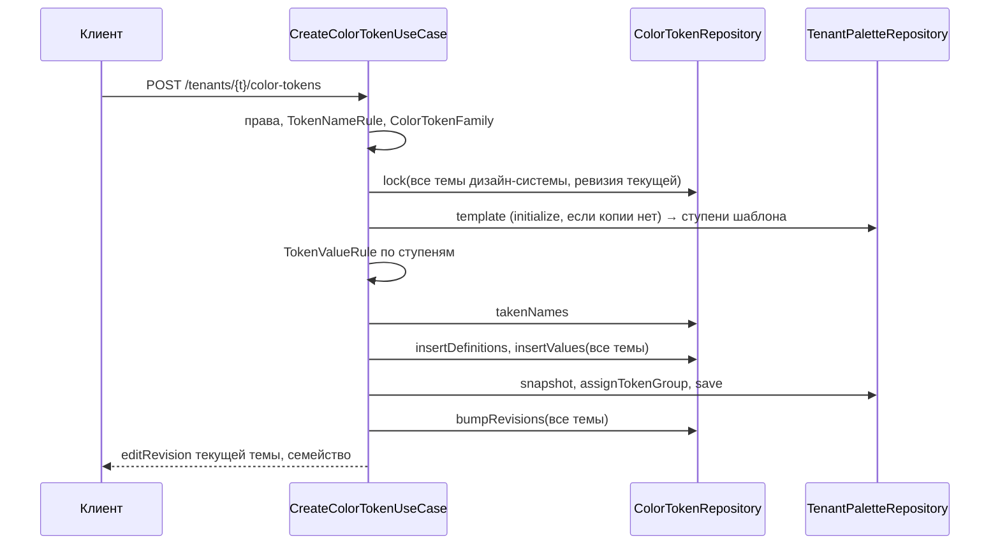

## Контекст

Значения токенов темы хранятся строками `token_values` по токену, теме, платформе и режиму; определения
токенов — общие для дизайн-системы строки `tokens`. Цветовой токен экрана редактора, например `text.accent`,
на сервере — несколько определений: `text.default.accent`, `text.on-dark.accent`, `text.on-light.accent`,
`text.inverse.accent` и их состояния `-hover` и `-active`. Существующие операции работают либо с одним
определением (`POST`, `PATCH`, `DELETE /tokens`), либо со всеми значениями темы сразу (`PUT
/tenants/{id}/token-values` удаляет и вставляет заново все платформенные значения). Формат цветовых значений
не проверяется.

Палитра темы (`theme-palette-api`) хранит копию шаблона и явные привязки токенов к группам; доступ к ней —
порт `TenantPaletteRepository` (ленивая инициализация копии, снимок `FOR SHARE OF tenants`, сохранение
состояния вместе с ревизией) и чистые `PaletteOperations`. Операции палитры и `PUT token-values` блокируют
строку темы `FOR UPDATE OF tenants` и делят одну ревизию `editRevision`. Контракт `ds-service` — статический
`openapi/documentation.yaml` с `x-permission` и группы `contracts/route-manifest.json`; операции, которых нет
в db-service, помечены `origin: ds-service`.

Ревью предложения (salute-developers/design-system-builder#106) задало целевой подход: атомарные операции
над отдельным токеном вместо пакетного сохранения темы, с общей ревизией темы на этом этапе.

## Цели / Вне целей

**Цели:**

- создание, изменение значений и удаление одного цветового токена — каждое одной транзакцией;
- изменение токена не отправляет и не перезаписывает значения других токенов;
- новый токен сразу полный во всех темах дизайн-системы;
- проверка цветовых значений на сервере.

**Вне целей:**

- пакетное сохранение изменений темы;
- ревизии отдельных токенов и многопользовательский режим: общий `editRevision` темы даёт конфликт и при
  параллельной правке разных токенов, это принятое временное ограничение;
- переименование токенов и правка метаданных существующих токенов;
- запрет удаления токена, используемого компонентами: ссылки компонентов обнуляются, как сейчас;
- доставка новых токенов в generator.

## Модель данных и контракты

Семейство токена определяется группой, именем и типом (`color` или `gradient`). Его члены — определения
`<group>.<subgroup>.<name>` и `<group>.<subgroup>.<name>-<state>`, где `subgroup` — `default`, `on-dark`,
`on-light`, `inverse`, а для `background` — `dark`, `light`, `inverse`; `state` — `hover`, `active`,
`brightness`. Обязателен член `<group>.default.<name>`. Любой `tokenId` члена адресует всё семейство.

```kotlin
@Serializable
data class CreateColorTokenRequest(
    val editRevision: Int,
    val type: String,                                  // color | gradient
    val group: String,                                 // text, surface, …
    val name: String,                                  // accent-minor
    val displayName: String? = null,
    val description: String? = null,
    val paletteGroupId: String? = null,                // группа палитры текущей темы
    val members: List<ColorTokenMemberValues>,
)

@Serializable
data class ColorTokenMemberValues(
    val name: String,                                  // полное имя без режима: text.on-dark.accent-minor-hover
    val values: List<ColorTokenValueItem>,
)

@Serializable
data class UpdateColorTokenValuesRequest(
    val editRevision: Int,
    val members: List<ColorTokenMemberValuesById>,
)

@Serializable
data class ColorTokenMemberValuesById(val tokenId: String, val values: List<ColorTokenValueItem>)

@Serializable
data class ColorTokenValueItem(
    val platform: String,                              // web | ios | android
    val mode: String,                                  // light | dark
    val paletteId: String? = null,
    val value: JsonElement,
)

@Serializable
data class DeleteColorTokenRequest(val editRevision: Int)

@Serializable
data class ColorTokenMutationResponse(val editRevision: Int, val value: ColorTokenFamilyDto)

@Serializable
data class ColorTokenFamilyDto(
    val type: String,
    val group: String,
    val name: String,
    val members: List<ColorTokenMemberDto>,
)

@Serializable
data class ColorTokenMemberDto(val tokenId: String, val name: String)

@Serializable
data class ColorTokenRevisionResponse(val editRevision: Int)
```

| Операция | Ответ | Права |
| --- | --- | --- |
| `POST /tenants/{tenantId}/color-tokens` | `201 ColorTokenMutationResponse` | `tenants:write`, `tokens:write` |
| `PUT /tenants/{tenantId}/color-tokens/{tokenId}/values` | `200 ColorTokenRevisionResponse` | `tenants:write` |
| `DELETE /tenants/{tenantId}/color-tokens/{tokenId}` | `200 ColorTokenRevisionResponse` | `tenants:write`, `tokens:delete` |

При создании и изменении у каждого переданного члена должны быть значения для `web`, `ios`, `android` в
режимах `light` и `dark`. При изменении значения переданного члена в текущей теме заменяются переданными;
члены, которых нет в запросе, не меняются.

Дубль имени при создании отсекает проверка `takenNames` под блокировкой всех тем дизайн-системы: два создания
в одной дизайн-системе выполняются по очереди. Нарушение уникальности на уровне БД отдельно не отображается,
чтобы не менять ответы `POST` и `PATCH /tokens`.

Ошибки — `ErrorResponse { error, code, message, details? }`:

| Код | Статус | Когда |
| --- | --- | --- |
| `TENANT_EDIT_CONFLICT` | 409 | ревизия текущей темы устарела; ответ несёт актуальный `editRevision` |
| `TOKEN_NAME_CONFLICT` | 409 | определение с именем члена уже есть в дизайн-системе |
| `INVALID_TOKEN_NAME` | 400 | пустое имя, префикс режима, символы вне `a-z`, `0-9`, `-`, `.`, имя токена с окончанием состояния `-hover`, `-active`, `-brightness` |
| `INVALID_TOKEN_FAMILY` | 400 | член не из семейства, нет члена `default`, неполный набор значений члена, член чужого семейства при изменении, токен из пути вне правила семейства, `paletteGroupId` у градиентного токена |
| `invalid_reference` | 400 | `paletteId` значения не найден в общей палитре (нарушение внешнего ключа) |
| `INVALID_TOKEN_VALUE` | 400 | значение не проходит проверку; `details.address` — `<tokenId или имя>:<platform>:<mode>` |
| `NotFound` | 404 | темы, токена или группы палитры нет в проекте |

Правила проверки значения цветового токена:

| Форма | Допустимо |
| --- | --- |
| строка или массив из одной строки | `#RGB`, `#RRGGBB`, `#RRGGBBAA`; `[type.shade.step]` или `[type.shade.step][o]`, где `o` от 0 до 1, а ступень есть в копии шаблона палитры темы |
| `paletteId` | `value` — `null`, `[]` или `["<o>"]` |

Для градиентного токена web-значение — массив строк, каждая — `linear-gradient(...)`, `radial-gradient(...)`,
`conic-gradient(...)` или HEX; значения `ios` и `android` — массивы объектов, их структура не проверяется.

## Программное проектирование

```kotlin
// feature-themes/domain/colortokens
data class ColorTokenFamily(val type: ThemeTokenType, val group: String, val name: String) {
    fun defaultMember(): String
    fun memberOf(definitionType: ThemeTokenType, fullName: String): Boolean
    companion object {
        val TYPES: Set<ThemeTokenType>
        fun of(type: ThemeTokenType, fullName: String): ColorTokenFamily?
    }
}
object TokenNameRule {
    fun validate(fullName: String): String?
    fun validSegment(segment: String): Boolean
}
class TokenValueRule(private val template: Map<PaletteRampRef, Map<Int, String>>) {
    fun validate(type: ThemeTokenType, platform: ThemeTokenPlatform, hasPaletteId: Boolean, value: JsonElement): String?
}

// feature-themes/application/colortokens
data class ColorTokenValue(val platform: ThemeTokenPlatform, val mode: ThemeTokenMode, val paletteId: UUID?, val value: JsonElement)
data class CreateColorToken(
    val editRevision: Int, val family: ColorTokenFamily, val displayName: String?, val description: String?,
    val paletteGroupId: String?, val members: Map<String, List<ColorTokenValue>>,
)
data class UpdateColorTokenValues(val editRevision: Int, val members: Map<UUID, List<ColorTokenValue>>)
data class StoredColorTokenFamily(val family: ColorTokenFamily, val members: Map<String, UUID>)
data class ColorTokenMutation<T>(val editRevision: Int, val value: T)

sealed interface ColorTokenLock {
    data class Locked(val designSystemId: UUID, val tenantIds: List<UUID>, val editRevision: Int) : ColorTokenLock
    data object NotFound : ColorTokenLock
    data class RevisionConflict(val editRevision: Int) : ColorTokenLock
}
sealed interface ColorTokenLookup {
    data class Found(val stored: StoredColorTokenFamily) : ColorTokenLookup
    data object OutsideFamily : ColorTokenLookup          // токен есть, но не цветовой или имя вне правила
    data object Missing : ColorTokenLookup
}

interface ColorTokenRepository {
    /** Блокирует текущую тему, а при [allThemes] — все темы её дизайн-системы в порядке `id`; сверяет ревизию. */
    suspend fun lock(projectId: ProjectId, tenantId: UUID, editRevision: Int, allThemes: Boolean): ColorTokenLock
    suspend fun family(designSystemId: UUID, tokenId: UUID): ColorTokenLookup
    suspend fun takenNames(designSystemId: UUID, names: Collection<String>): Set<String>
    suspend fun tokenTypes(tokenIds: Collection<UUID>): Map<UUID, ThemeTokenType>
    suspend fun insertDefinitions(
        designSystemId: UUID, family: ColorTokenFamily, names: List<String>, displayName: String?, description: String?,
    ): Map<String, UUID>
    suspend fun insertValues(tenantIds: Collection<UUID>, values: Map<UUID, List<ColorTokenValue>>)
    suspend fun replaceValues(tenantId: UUID, values: Map<UUID, List<ColorTokenValue>>)
    suspend fun deleteDefinitions(tokenIds: Collection<UUID>)
    suspend fun bumpRevisions(tenantIds: Collection<UUID>): Map<UUID, Int>
}

// feature-themes/application/palette — добавленный метод порта палитры
interface TenantPaletteRepository {
    /** Копия шаблона палитры темы; пустая, если тему ещё не инициализировали. */
    suspend fun template(tenantId: UUID): Map<PaletteRampRef, Map<Int, String>>
}

class CreateColorTokenUseCase(
    private val policy: DsAccessPolicy,
    private val transactions: TransactionRunner,
    private val tokens: ColorTokenRepository,
    private val palette: TenantPaletteRepository,
) {
    suspend fun execute(context: DsRequestContext, tenantId: UUID, command: CreateColorToken):
        DsResult<ColorTokenMutation<StoredColorTokenFamily>>
}

class UpdateColorTokenValuesUseCase(/* policy, transactions, tokens, palette */) {
    suspend fun execute(context: DsRequestContext, tenantId: UUID, tokenId: UUID, command: UpdateColorTokenValues): DsResult<Int>
}

class DeleteColorTokenUseCase(/* policy, transactions, tokens */) {
    suspend fun execute(context: DsRequestContext, tenantId: UUID, tokenId: UUID, editRevision: Int): DsResult<Int>
}
```

Отказ `400` с предметным кодом (`INVALID_TOKEN_NAME`, `INVALID_TOKEN_FAMILY`, `INVALID_TOKEN_VALUE`) в ядре
`ds-service` отвечает `{ error, code, message, details }`; коды проверки полей вида `invalid_*` сохраняют прежний
ответ `{ formErrors, fieldErrors }`.



## Решения

### Операции над одним токеном

Целевой подход ревью: изменение токена меняет только его значения, создание и удаление атомарны. Поэтому
каждая операция работает с семейством одного токена и не трогает строки других токенов. Отвергнуто: пакетная
операция с полной заменой значений темы — перезаписывает чужие правки и не подходит для будущего
многопользовательского режима.

### Семейство определений вместо одного определения

Пользователь редактирует токен целиком: Light, Dark, подтемы и состояния меняются вместе, а созданный токен
без подтем или состояний неполон. Сервер различает членов семейства по правилу имени и адресует семейство
любым `tokenId` его члена. Клиент сам вычисляет значения подтем и состояний и передаёт их явно: правила
наследования и расчёта состояний живут в клиенте, сервер их не повторяет.

Отвергнуто: операции над отдельным определением — создание и удаление токена потребовали бы нескольких
запросов без общей транзакции.

### Общая ревизия темы

Каждая операция сверяет и увеличивает `editRevision` текущей темы в той же транзакции, как `PUT
token-values` и операции палитры. Создание и удаление меняют строки значений остальных тем, поэтому
увеличивают и их ревизии: иначе редактор другой темы, сохраняющий данные полной заменой `PUT token-values`
(прежний сценарий публикации, другие разделы), стёр бы значения нового токена или отправил бы значения
удалённого. Темы блокируются в порядке `id`, чтобы одновременные операции не взаимоблокировались. Изменение
значений блокирует и увеличивает ревизию только текущей темы.

### Привязка к группе через палитру

Привязка нового токена записывается `PaletteOperations.assignTokenGroup` над снимком палитры, взятым после
вставки определений, и `TenantPaletteRepository.save` в той же транзакции. Так соблюдаются правила палитры:
группа принадлежит теме, токен без явной группы относится к группе по правилу имени. В других темах токен
относится к группе по умолчанию: группы у каждой темы свои.

### Значения нового токена во всех темах

Начальные значения запроса записываются во все темы дизайн-системы. Ссылка на палитру копируется как есть и
в другой теме вычисляется по её собственной палитре; ступень проверяется по копии шаблона текущей темы.

### Проверка значений

Проверка — чистое правило `TokenValueRule` в domain. Ступени берутся лёгким чтением копии шаблона
`TenantPaletteRepository.template`, без полного снимка палитры: проверка выполняется при каждом автосохранении.
Если копии нет (тема создана в обход `ds-service`), она создаётся `initialize` до проверки. Та же проверка подключается к `PUT token-values` для цветовых и градиентных токенов.
Существующие данные не перепроверяются.

### Описание в контракте

Операции добавляются в группу манифеста с `origin: ds-service` и в `documentation.yaml` с `x-permission:
tenants:write`, схемами запросов и ответов и кодами ошибок, как операции палитры темы.
`OpenApiDocumentResourceTest` проверяет совпадение операций манифеста и документа.

## Риски / Компромиссы

- [Общая ревизия даёт конфликт при параллельной правке разных токенов] → принятое ограничение этапа; клиент
  перезагружает тему и предлагает повторить правку.
- [Тема, создаваемая одновременно с токеном, может не получить его значения: создание темы не ждёт
  блокировки тем дизайн-системы и инициализирует значения по токенам, видимым до фиксации создания токена] →
  принятое ограничение: окно — доли секунды; клиент показывает такой токен неполным и даёт заполнить значения.
  Блокировка строки дизайн-системы отвергнута: порядок блокировок с `PUT token-values` грозит взаимоблокировкой.
- [Создание и удаление блокируют все темы дизайн-системы] → блокировка короткая, тем у дизайн-системы
  единицы; изменение значений блокирует только текущую тему.
- [**BREAKING** проверка значений в `PUT token-values`] → выборка некорректных значений на стенде до
  включения; ответ называет адрес значения.
- [Удаление токена обнуляет ссылки компонентов] → клиент предупреждает списком компонентов до удаления.
- [Зависимость от неслитого PR палитры salute-developers/design-system-builder#101] → ветка перебазируется
  на `feature/ds-service` после его слияния.

## Миграция и совместимость

Схема БД не меняется. `POST`, `PATCH`, `DELETE /tokens` и `PUT token-values` остаются для CLI, прежнего
клиента и других разделов редактора. Откат — отключение маршрутов; данные, созданные операциями, совместимы
с прежними операциями.

## План проверки и развёртывания

- Автоматические: `cd backend-kt/ds-service && ./gradlew test detekt spotlessCheck build` (интеграционные
  тесты на Testcontainers требуют Docker), `tools/verify fast|full --change add-color-tokens-api`.
- Внешние до архивирования: операции на локальном контуре через gateway с проверкой данных в БД, выборка
  некорректных значений на локальной БД.
- После развёртывания: выборка некорректных цветовых значений на стенде до включения проверки в `PUT
  token-values` — в плане развёртывания команды.
