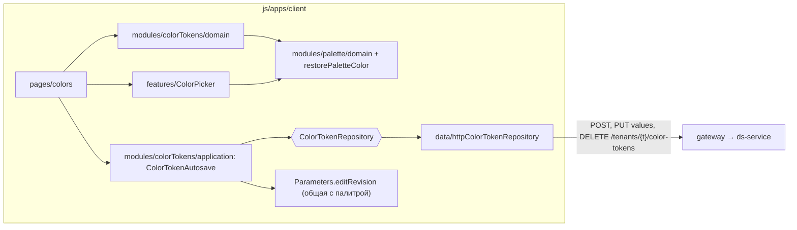

## Контекст

Раздел «Цвета» (`src/pages/colors`) собран из `Workspace`, `Menu` и `TokenColorEditor` на компонентах Plasma
и styled-components. Тема — изменяемые объекты `Theme` и `Token`; цветовой токен клиента — одно значение
режима и подгруппы с именем `<mode>.<group>.<subgroup>.<name>` и значениями трёх платформ. Значение — HEX
или ссылка на палитру `[type.shade.step][opacity]`. Ссылка вычисляется по палитре темы через
`restorePaletteColor`; группа палитры токена — явная привязка или правило по имени (`theme-palette-editor`).
Палитра по умолчанию работает с сервером (`VITE_PALETTE_SOURCE = api`) через
`draftAwarePaletteRepository`, который учитывает токены черновика (id с префиксом `draft:`): их группа —
по правилу имени, явную группу до сохранения задать нельзя.

Правки темы живут в черновике `ds_draft:<projectId>:<designSystemId>:<tenantId>`. В маршруте темы
`.../themes/:tenantId` действия сохранения нет: кнопка публикации показывается только в прежнем маршруте с
именем и версией дизайн-системы, поэтому правки цветов из маршрута tenant до сервера не доходят. Созданный в
клиенте токен существует только в черновике, удаление разрешено только таким токенам.

`add-color-tokens-api` даёт атомарные операции над одним цветовым токеном — семейством определений с общими
группой и именем: создание со значениями во всех темах и привязкой к группе палитры, замена значений
переданных членов в одной теме, удаление. Каждая операция сверяет и увеличивает общий `editRevision` темы,
тот же, что у операций палитры; клиент хранит его в параметрах дизайн-системы (`Parameters.editRevision`).

Ревью предложения (salute-developers/design-system-builder#106) задало целевой подход: автосохранение и
атомарные операции над отдельным токеном вместо черновика темы и кнопки «Сохранить».

Эталон экрана — прототип `kenymook/SDDS-Design-System`, коммит
`86c1005` (последняя правка кода экрана Color Tokens; в HEAD `6243c2b` экран тот же).

## Цели / Вне целей

**Цели:**

- экран Color Tokens с поведением и вёрсткой прототипа;
- связь токена с палитрой темы видна в дереве, на борде, в инспекторе и в выборе цвета;
- каждая правка цветового токена автоматически сохраняется на сервере операцией над этим токеном;
- создание и удаление токена — сразу, одной серверной операцией;
- видимое состояние сохранения и повтор при ошибке без потери ввода.

**Вне целей:**

- отслеживание изменений: раздел Changes, статусы правок у строк, сброс правок токена, отмена и повтор;
- переименование токена, правка описания и отображаемого имени;
- смена типа токена (цвет ↔ градиент);
- поплатформенные значения: правка, как сейчас, пишет одно значение во все платформы;
- сохранение других разделов темы (формы, типографика, компоненты): они остаются в черновике;
- ревизии отдельных токенов и многопользовательский режим;
- обмен с Figma, публикация версии дизайн-системы.

## Архитектура



Экран читает и меняет существующие объекты `Theme` через действия `actions/colors.ts` и
`actions/gradients.ts`; модель экрана в `modules/colorTokens/domain` — чистые функции, которые собирают из
`Theme` и палитры темы дерево, борд, инспектор и пары контраста. Правки цветовых токенов не пишутся в
черновик: после изменения `Theme` экран передаёт токен в `ColorTokenAutosave`, который отправляет значения
его семейства через порт `ColorTokenRepository`.

## Модель экрана

Токен экрана — пара «группа и имя» без режима и подгруппы. Соответствие с токенами клиента:

| Прототип | Клиент |
| --- | --- |
| Токен `textAccent` | `text.accent`: все режимы и подгруппы с этим именем |
| Light, Dark | `light.<group>.default.<name>`, `dark.<group>.default.<name>` |
| OnDark, OnLight, Inverse | подгруппы `on-dark`, `on-light`, `inverse`; у `background` — `dark`, `light`, `inverse` |
| Hover, Active | `-hover`, `-active`: не показываются, пересчитываются от значения |

Разделы дерева по группе: `text` → Text & Icons, `surface` → Surfaces, `outline` → Outlines,
`background` → BG, `overlay` → Overlays, `data` → Data. Токены `read-only` и их состояния показываются в
разделе Technical. Раздел Syntax прототипа не показывается: у клиента нет таких токенов. Пустые разделы не
выводятся. Градиентные токены (`*-gradient`) показываются в своём разделе отдельными строками.

Категория на борде — подпись группы палитры токена: Neutral показывается как
General, Accent и Статус как Accent и Status, пользовательские группы — своими подписями. Для Surfaces и
Outlines к категории добавляется Solid или Transparent: префикс `transparent-` и имя `clear` — Transparent,
остальное — Solid. Для BG, Overlays, Data и Technical категория — Default, как в прототипе.

## Программное проектирование

```ts
// modules/colorTokens/domain
type ColorSection = 'text' | 'surface' | 'outline' | 'background' | 'overlay' | 'data' | 'technical';
type ColorContext = 'ondark' | 'onlight' | 'inverse';
type ColorMode = 'light' | 'dark';

interface ColorTokenKey { group: string; name: string; type: 'color' | 'gradient' }
interface ColorFieldValue {
  value: string;                       // исходное значение: HEX, ссылка или градиент
  resolved: string;                    // вычисленный цвет по палитре темы
  paletteLabel: string | null;         // «Blue 500» для ссылки на палитру
  opacity: number;                     // 0..1
}
interface ColorTokenView {
  key: ColorTokenKey;
  displayName: string;
  description: string;
  section: ColorSection;
  category: string;
  paletteGroupId: string | null;
  sourceIndex: number;
  enabled: boolean;
  modes: Record<ColorMode, ColorFieldValue>;
  contexts: Record<ColorContext, { linked: boolean; values: Record<ColorMode, ColorFieldValue> }>;
  issues: ColorValueIssue[];
}
interface ColorValueIssue { mode: ColorMode | `${ColorContext}-${ColorMode}`; message: string }

function buildColorTokenViews(theme: Theme, palette: ThemePaletteModel | null): ColorTokenView[];
function sectionOf(key: ColorTokenKey): ColorSection;
function categoryOf(key: ColorTokenKey, paletteGroupLabel: string | null): string;
function inheritedContextValue(context: ColorContext, mode: ColorMode, defaults: Record<ColorMode, string>): string;
function validateColorValue(value: string, type: ColorTokenKey['type']): string | null;
function filterAndSortTree(
  views: ColorTokenView[],
  options: { query: string; sort: 'az' | 'source'; issuesOnly: boolean },
): { section: ColorSection; tokens: ColorTokenView[] }[];

interface ContrastPair {
  componentName: string; variation: string; state: string; mode: ColorMode;
  backgroundToken: string; foregroundToken: string; kind: 'text' | 'ui';
  ratio: number | null; threshold: 4.5 | 3; pass: boolean;
}
function collectContrastPairs(components: Config[], theme: Theme, token: ColorTokenKey): ContrastPair[];
function compositeOver(foreground: string, background: string): string;

interface NewColorTokenInput {
  section: ColorSection; category: string; paletteGroupId: string | null;
  name: string; light: string; dark: string;
}
function normalizeNewTokenName(input: NewColorTokenInput): { group: string; name: string } | { error: string };

// modules/colorTokens/application
interface ColorTokenMemberValues { name: string; values: { platform: Platform; mode: ColorMode; value: unknown }[] }
interface ColorTokenFamily { type: 'color' | 'gradient'; group: string; name: string; members: { tokenId: string; name: string }[] }

interface ColorTokenRepository {
  create(ctx: EditorContextKey, input: {
    type: 'color' | 'gradient'; group: string; name: string; paletteGroupId: string | null;
    members: ColorTokenMemberValues[];
  }, editRevision: number): Promise<{ editRevision: number; value: ColorTokenFamily }>;
  updateValues(ctx: EditorContextKey, tokenId: string,
    members: (ColorTokenMemberValues & { tokenId: string })[], editRevision: number): Promise<{ editRevision: number }>;
  delete(ctx: EditorContextKey, tokenId: string, editRevision: number): Promise<{ editRevision: number }>;
}
type ColorTokenOperationError =
  | { kind: 'conflict'; editRevision: number }
  | { kind: 'forbidden' }
  | { kind: 'invalid'; code: string; message: string; address?: string }
  | { kind: 'network'; message: string };

type SaveState = 'saved' | 'pending' | 'saving' | 'error';
interface ColorTokenAutosave {
  /** Ставит значения токена в очередь: повторные правки одного токена объединяются, отправка — после паузы. */
  schedule(key: ColorTokenKey, members: () => (ColorTokenMemberValues & { tokenId: string })[]): void;
  retry(key: ColorTokenKey): void;
  state(key: ColorTokenKey): { state: SaveState; error: ColorTokenOperationError | null };
  overall(): SaveState;
  flush(): Promise<void>;
}
function createColorTokenAutosave(deps: {
  repository: ColorTokenRepository;
  context: EditorContextKey;
  revision: { get(): number; set(value: number): void };
  onConflict(): Promise<void>;           // перезагрузка темы и палитры с сохранением неотправленного ввода
  delayMs?: number;                      // 400 по умолчанию
}): ColorTokenAutosave;
```

`members` содержит все определения семейства токена с вычисленными значениями подтем и состояний `-hover`
и `-active` для трёх платформ.

## Решения

### Вёрстка экрана переносится из прототипа

Как в `add-theme-palette-editor`: разметка функций `editor` (ветка `editorTab === 'colors'`),
`linkedColorTokenTree`, `groupedColorTokens`, `linkedColorTokenCanvas`, `canvasComponentExample`,
`themePreview`, `tokenInspector`, `colorInspectorField`, `colorPickerView`, `colorPickerLibraryView`,
`customTokenModal` и `scheduleTokenDeletion` повторяется React-компонентами с теми же классами; правила
`builder-ui-tokens.css` (блоки «Editor skeleton» и «Color Tokens») и `styles.css` (дерево, свотчи,
инспектор, выбор цвета, разделитель панелей, доступность) переносятся в `src/styles/color-tokens.css` под
корневым классом раздела. Если правило переопределяется позже в файле прототипа, переносится последнее.
Тексты интерфейса берутся из прототипа. Раздел отказывается от `Workspace`, как палитра, и сам ставит
`inert` на панели в режиме только чтения.

Отвергнуто: доработать текущий экран на Plasma — расходится с дизайном; подключить `styles.css` прототипа
целиком — тянет правила других экранов.

Готовность подтверждается сверкой скриншотов эталонных состояний при ширине 1440 px и 900 px. Данные
прототипа и клиента различаются, поэтому сверяются сетка, отступы, типографика, поведение поповеров и окон.

### Ошибки прототипа не переносятся

- Сортировка «А–Я» в прототипе ничего не меняет: разделы пересортировываются по исходному порядку. В
  клиенте «А–Я» сортирует по отображаемому имени внутри раздела.
- Пустой результат поиска в прототипе показывает строки-заглушки. В клиенте — пустое состояние «Ничего не
  найдено».
- Поиск во вкладке Library и мёртвые обработчики (`delete-custom-token`, угол градиента) не переносятся;
  поиск Library работает по имени растяжки.
- Значения подтем в прототипе не проверяются; в клиенте проверяются той же функцией, что Light и Dark.

### Категория — группа палитры

Прототип выводит категорию токена из пути (`.Accent.`, `.Status.`) и тем же правилом выбирает категорию
палитры. В клиенте у токена уже есть группа палитры: явная привязка или правило по имени. Категория на борде
и выбор категории в окне создания используют её, поэтому перенос токена в другую группу палитры сразу виден
на экране токенов, а пользовательские группы палитры становятся категориями. Категория, выбранная при
создании, передаётся в операцию создания как `paletteGroupId` и записывается явной привязкой в той же
транзакции, поэтому отложенных групп и токенов черновика с `draft:` id экран не создаёт.

Отвергнуто: хранить категорию в имени или отдельном поле — у токенов нет поля категории, а имя задаёт
пользователь.

### Связь подтем вычисляется по значениям

Прототип хранит признак «связь отключена» отдельно. Клиент уже вычисляет связь подтемы сравнением её
значений с ожидаемыми (OnDark — Dark, OnLight — Light, Inverse — Light и Dark наоборот) и переносит правку
Light или Dark в связанные подтемы. Этот подход сохраняется: сервер не хранит признака связи, и его
пришлось бы держать только в браузере. Ручная правка подтемы отключает связь, щелчок по переключателю
восстанавливает наследование. Подтема, вручную приведённая к унаследованному значению, считается связанной.

### Автосохранение правок токена

Каждая правка значения — ввод HEX, прозрачность, выбор в пикере (при отпускании), переключатель связи
подтемы, сброс подтем — меняет `Theme` и ставит токен в очередь `ColorTokenAutosave`. Очередь:

- объединяет правки одного токена и отправляет их через 400 мс после последней; уход со страницы или смена
  темы отправляют очередь сразу;
- отправляет операции темы по одной: следующая берёт ревизию, полученную предыдущей, поэтому собственные
  правки пользователя друг с другом не конфликтуют;
- отправляет все определения семейства токена с текущими значениями: так повтор после ошибки или конфликта
  идемпотентен;
- обновляет `Parameters.editRevision`, которым пользуются и операции палитры.

Состояние сохранения видно в панели инструментов («Сохранение…», «Сохранено», «Не сохранено · Повторить») и
у строки токена с ошибкой. При ошибке введённое значение остаётся в редакторе и в очереди; «Повторить»
отправляет его снова. При `TENANT_EDIT_CONFLICT` клиент перезагружает тему и палитру, накладывает поверх
неотправленные значения токенов и предлагает повторить; автоматической повторной отправки поверх новой
ревизии нет. При закрытии страницы с неотправленными правками браузер показывает предупреждение.

Отвергнуто: черновик темы и кнопка «Сохранить» — ревью требует автосохранения и не отправлять полное
состояние темы; адаптер на существующих `POST /tokens` и `PUT token-values` — не атомарен и заменяет все
значения темы.

### Создание и удаление — сразу на сервере

Окно «Новый токен» отправляет операцию создания с определениями всех подгрупп и состояний, значениями
Light и Dark, унаследованными подтемами и `paletteGroupId`. Пока запрос выполняется, кнопка «Создать токен»
недоступна; при ошибке окно остаётся открытым с текстом ошибки и введёнными данными. После успеха токен
добавляется в `Theme` с идентификаторами членов и выбирается.

Удаление существующего токена подтверждается окном со списком компонентов, где используется токен, и
выполняется операцией удаления сразу. Состояния «Удаление запланировано» прототипа нет: оно принадлежит
отслеживанию изменений, которое вне изменения. Кнопка удаления доступна ролям `maintainer` и `owner`:
загрузчик сохраняет `effectiveRole` проекта в параметрах дизайн-системы. Перед созданием и удалением очередь
автосохранения отправляется, чтобы операции шли по порядку.

### Цвета в прежнем черновике

Цветовые записи, оставшиеся в черновике темы до этого изменения, на сервер не попадали. При открытии темы
раздел показывает баннер «В черновике есть несохранённые правки цветов: N токенов» с действиями «Сохранить»
(записи передаются в очередь автосохранения, токены только из черновика создаются операцией создания) и
«Отбросить». После любого действия цветовые записи удаляются из черновика; записи других разделов
остаются.

### Неполные токены при загрузке

Токен, созданный прежними операциями или другими клиентами, может прийти в тему без значений. Загрузчик
перестаёт падать на таких определениях: токен показывается в дереве с отметкой «Нет значений в этой теме», а
инспектор предлагает заполнить Light и Dark значениями по умолчанию раздела; заполнение уходит
автосохранением.

### Доступность по свойствам компонентов

У конфигураций компонентов нет ролей «фон» и «текст», как в реестре прототипа. Пары строятся по
web-свойствам стилей компонента в каждой вариации и состоянии: фон — свойства `background*`, `*Background*`,
`fillColor`; передний план — `color`, `*Color` для текста и иконок; контур — `border*`, `outline*`,
`focusColor`. Если имя не распознано, используется группа токена (`surface`, `background` — фон; `text` —
передний план; `outline` — контур). Свойства без web-отображения пропускаются. Порог: текст — 4.5, иконка и
контур — 3. В отличие от прототипа, прозрачность учитывается наложением на фон, а фон с прозрачностью —
на `background.default.primary` режима.

### Градиенты

Тип токена в клиенте и на сервере определяет его имя и формат значений, поэтому переключатель Solid/Gradient
показывает тип токена и не меняет его. Градиентный токен открывает выбор цвета в режиме Gradient со
стопами, позициями и прозрачностью; цвет стопа выбирается во вкладках Custom и Library. Тип градиента —
только Linear, как в прототипе.

### Проблемы значений без отслеживания изменений

Фильтр «Только с проблемами» и отметка строки строятся проверкой текущих значений: пустое значение, не HEX
`#RGB`, `#RRGGBB`, `#RRGGBBAA`, не ссылка на существующую ступень палитры темы, не `linear-gradient(...)` для
градиента. Тексты — из `validateChange` прототипа. Статусы «изменён», «предупреждение» прототипа
относятся к отслеживанию изменений и не переносятся.

## Риски / Компромиссы

- [Общая ревизия темы даёт конфликт при параллельной правке разных токенов и операциях палитры в другой
  вкладке] → принятое ограничение этапа; перезагрузка с сохранением неотправленного ввода и повтор.
- [Цвета сохраняются сразу, а другие разделы — черновиком] → прежняя публикация полной заменой `PUT
  token-values` отправляет текущие цвета из `Theme` с ревизией, обновлённой автосохранением; устаревшая
  ревизия даёт конфликт, а не затирание.
- [Частые запросы при правке] → объединение правок токена и пауза 400 мс; пикер отправляет значение при
  отпускании.
- [Удаление токена, используемого в компонентах] → сервер обнуляет привязки; окно удаления предупреждает и
  перечисляет компоненты по загруженным конфигурациям.
- [Ветка опирается на неслитый PR палитры salute-developers/design-system-builder#101] → после его
  слияния ветка перебазируется на `feature/ds-service`; экран переиспользует резолвер, `TokenGroupSelect` и
  Library палитры, не меняя их контракт.
- [Эвристика пар контраста по именам свойств] → правило покрыто тестами на конфигурациях сидов,
  нераспознанные свойства не создают пар.
- [Прототип продолжает меняться] → эталон закреплён коммитом `86c1005`.

## План проверки и развёртывания

- Автоматические: `cd js/apps/client && npm test && npm run build && npm run lint`, `cd js && npm run build`,
  `npm run test:browser` для разметки раздела, `tools/verify fast|full --change add-color-tokens-editor`.
- Внешние до архивирования: сценарий раздела на локальном контуре с `ds-service` из `add-color-tokens-api`
  под editor, maintainer и viewer с проверкой данных на сервере, конфликт во второй вкладке, сверка
  скриншотов с прототипом.
