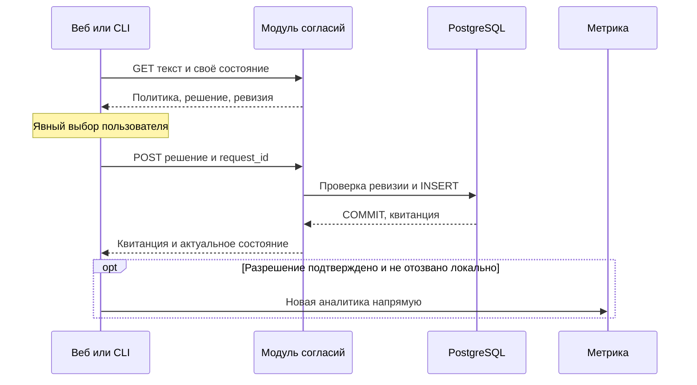

## Контекст и объём первой версии

Пользователь согласовал анонимные браузеры и установки, один модуль, одну таблицу и две операции API. Backend и клиентский поток проектируются вместе: один журнал без интерфейсов выбора ещё не завершает функцию согласий.

`backend-kt/consent-history` встраивается в существующий `backend-kt/app`. Нет отдельного процесса, брокера, кэша backend, таблицы аккаунтов, отдельной таблицы текущего состояния или Gradle-модулей на каждый слой. Обрабатывается только аналитика DS Builder, универсальный механизм произвольных назначений не строится.

## Анонимная область и локальное хранение

Клиент создаёт криптографически случайный 256-битный `consent_key` и передаёт его только нашему API по HTTPS в X-Consent-Key. Сервер хранит SHA-256 ключа. В URL, Метрику и журналы запросов исходный ключ не попадает. Ключ открывает только свою область `(subject_key_hash, client_group)`, где client_group=web|cli_mcp. Это не ClientID Метрики, не JWT и не project API key.

Веб хранит ключ, выбор, версию условий и подтверждённую квитанцию локально с пространством имён приложения и окружения. CLI/MCP используют общий файл `~/.dsbuilder/privacy/analytics-consent.json`: 0600, атомарная запись и межпроцессная блокировка. Ключ создаётся системным криптографическим генератором, не обычным Kotlin Random. Окружения DEV/PROM разделены. Удаление ключа означает новый анонимный контекст и отсутствие действующего локального согласия; согласие аккаунта автоматически на другое устройство не переносится.

Квитанция подтверждает сохранение решения от обладателя ключа. Она не устанавливает личность анонимного человека и не доказывает корректность показа текста сама по себе.

## Одна таблица

`consent.consent_history` содержит добавляемые записи:

| Поле | Назначение |
| --- | --- |
| subject_key_hash BYTEA | SHA-256 локального ключа, 32 байта |
| client_group TEXT | web либо общий cli_mcp |
| revision BIGINT | Серверная последовательность области, начиная с 1 |
| request_id UUID | Идентификатор действия для идемпотентного повтора |
| decision TEXT | granted, denied, withdrawn |
| policy_version TEXT | Версия текста |
| policy_sha256 BYTEA | Хеш канонического серверного текста |
| received_at TIMESTAMPTZ | Время сохранения по часам БД |
| app_version TEXT NULL | Ограниченная по длине версия клиента, заявленная клиентом |

Первичный ключ `(subject_key_hash, client_group, revision)` и уникальность `(subject_key_hash, client_group, request_id)`. CHECK фиксируют известные значения, размер хешей и положительную ревизию. Текущее состояние читается из последней ревизии; отдельного purpose/source или произвольных JSON-полей нет. Имена, email, IP и User-Agent в прикладную таблицу не добавляются. Служебная история миграций не считается второй прикладной таблицей.

История сохраняется для служебной проверки через БД. Публичного API истории, пагинации, экспорта или интерфейса администратора в первой версии нет. Клиентский API не изменяет и не удаляет прошлые решения. Политика хранения и удаления определяется отдельно; конкретный срок и автоматическая очистка в объём этого change не входят. Отсутствие установленного здесь срока не означает утверждение бессрочного хранения.

## Короткие уведомления

Два коротких русскоязычных уведомления — для веба и CLI/MCP — хранятся в ресурсах. Каждое уведомление целиком показывается рядом с выбором; отдельный «полный текст», страница, ссылка на него или просмотрщик в CLI не требуются. Версионируется именно показанное уведомление. Формулировки должны объяснять цель, состав данных, получателя и способ отключения; окончательная редакция согласуется отдельно. Версия однозначно определяет неизменяемые UTF-8 байты и SHA-256; использованные редакции сохраняются для проверки квитанций. Клиент не передаёт произвольный текст для хранения, сервер проверяет показанную пару версия/хеш.

Новая версия нужна при изменении условий обработки, влияющем на согласие; обычное обновление приложения само по себе не сбрасывает выбор. Grant принимается для действующего текста области. Отказ и отзыв не должны блокироваться сменой текста: для них сервер использует предыдущую редакцию, а при отсутствии истории — действующую. Активные редакции должны совпадать у реплик одного окружения. Отдельный универсальный каталог назначений и API редактора текстов не вводятся.

## Две операции API

Один путь `/api/privacy/analytics/consent` с двумя методами, без входа в аккаунт. Оба метода требуют корректный X-Consent-Key; свой ключ можно создать до авторизации и первого решения.

| Метод | Назначение |
| --- | --- |
| GET ?client_group=web|cli_mcp | Действующий текст/версия/хеш и последнее собственное решение/ревизия/analytics_allowed |
| POST | Запись решения и возврат квитанции вместе с актуальным собственным состоянием |

Для пустой области GET возвращает действующий текст, ревизию 0, отсутствие решения и analytics_allowed=false, без вставки строк. Разрешение в ответе сервера действует только для последнего granted на действующую редакцию. GET не возвращает историю; локальная квитанция нужна для повторных запусков и проверки решения.

POST содержит request_id, client_group, decision, expected_revision, необязательную app_version; для granted обязательны policy_version и policy_sha256. Серверные время, хеш субъекта и новая ревизия от клиента не принимаются. app_version ограничена 64 символами, POST — 4 КиБ. Неизвестные поля, группы, решения, ключи и UUID отклоняются. Квитанция новой записи возвращается после COMMIT.

Статусы: 201 — новая запись; 200 — GET или точный повтор; 400 — неверный DTO или формат хеша; 401 — некорректный или отсутствующий ключ; 409 — конфликт ревизии/request_id либо несовпадение grant с действующей парой версия/хеш; 413/429 — ограничения размера/частоты; 503 — недоступная БД. Ошибки не раскрывают секреты и исходные исключения. Сбой после возможного COMMIT не означает гарантированного отсутствия записи; повтор request_id устанавливает фактический результат.

## Повторы и конкуренция без отдельного механизма блокировок

Проверка existing request_id выполняется до проверки действующего grant-текста: точный повтор возвращает ту же квитанцию (received_at/revision) и свежее состояние, даже после смены политики. Другие параметры с тем же request_id дают 409.

Для нового действия expected_revision сравнивается с последней ревизией. Запись получает expected_revision+1. Уникальные ограничения таблицы завершают проверку атомарно: из двух конкурентных вставок одной следующей ревизии проходит только одна. Проигравший запрос различает точный повтор от конфликта и возвращает 200 либо 409 после чтения зафиксированного состояния. Необработанных SQL-ошибок в HTTP быть не должно. Отдельные advisory locks, таблица блокировок и распределённый координатор не требуются.

Запоздалый grant на ревизию до отзыва не меняет последнее решение. После 409 клиент обновляет состояние, а новое намеренное действие использует новый request_id. Старый ответ grant не отменяет более поздний локальный отказ/отзыв: клиент сверяет своё текущее намерение и актуальный ответ, а не только поле decision старой квитанции.

## Когда спрашивать пользователя

| Режим | Поведение при отсутствии действующего выбора |
| --- | --- |
| Веб | При первом посещении, включая страницу входа, показать неблокирующий баннер «Разрешить» / «Отказаться» с коротким уведомлением целиком |
| Интерактивный CLI | Перед первой разрешённой рабочей командой после успешного разбора аргументов; ответ по умолчанию «Нет» |
| Неинтерактивный CLI | Вопрос не задавать; без подтверждённого согласия не отправлять аналитику |
| Встроенный MCP | Вопрос не задавать и stdout не использовать; читать общий выбор CLI/MCP |
| CI или явный env opt-out | Автоматических вопросов и запросов журнала не делать, телеметрию не отправлять |

Веб доступен независимо от выбора и авторизации; баннер не блокирует вход или редактор. SDK Метрики (включая загрузку tag.js), её cookies и аналитические запросы не запускаются до разрешения и серверной квитанции.

CLI не спрашивает для help/version, голой группы, ошибок разбора или mcp serve. Отказ не меняет результат основной команды. Неинтерактивность и отсутствие ответа не превращаются в явный отказ: без решения остаётся unknown, запись denied автоматически не создаётся. Вопрос первого запуска относится к рабочей команде, а не к установке пакета или запуску генератора из CI.

Для управления выбором предусмотрены `dsbuilder analytics enable`, `disable`, `status`. Enable в интерактивном режиме показывает текст и запрашивает явное разрешение; этими командами не создаются продуктовые просмотры. Пользователь может включить аналитику CLI до запуска MCP. CI/opt-out подавляют автоматический сбор независимо от сохранённого grant; изменение env не является отзывом и не записывает withdrawn. Явные команды настройки рассматриваются как действие пользователя, но даже они не включают фактическую телеметрию при действующем CI/opt-out.

Разрешение фиксируется на браузер/установку и редакцию условий. Отказ запоминается, повторные посещения/команды на той же редакции не задают вопрос снова. Изменение условий может потребовать новый выбор; удаление локального выбора возвращает unknown. Веб предоставляет отзыв в настройках аналитики, CLI — через disable. Обмен изменениями между вкладками и файловая блокировка CLI/MCP обеспечивают общий локальный выбор.

## Включение, отказ и отзыв

При новом «Разрешить» клиент сначала получает подтверждённую сервером квитанцию и действующее состояние. Только затем разрешается отправка, если выбор всё ещё актуален локально и нет CI/opt-out. До этого просмотры/операции не отправляются и не складываются в очередь «на потом». Веб начинает с одного текущего устойчивого экрана, без воспроизведения прежних переходов. CLI может учесть результат текущей рабочей команды, если согласие было подтверждено до её начала.

Отказ сохраняется локально сразу, а на сервер отправляется как denied. Отзыв немедленно отключает отправку и очищает ожидающую очередь; завершённые запросы отменить задним числом нельзя. При недоступном сервере локальный запрет действует, pending withdrawn сохраняется и согласуется при восстановлении связи. Запоздалый grant/его ответ не переопределяет этот запрет.

Сеть или 503 при первом разрешении не создают действующий grant: приложение/команда продолжают работу с выключенной аналитикой. Сохранённое разрешение проверяется GET один раз при загрузке веб-страницы, запуске рабочей команды CLI или старте MCP. Подтверждение действует до завершения этого запуска, без TTL и фонового обновления; переходы SPA и вызовы инструментов не повторяют GET. До ответа аналитика выключена; при ошибке проверки весь запуск остаётся без аналитики, выбор не сбрасывается и повторного вопроса нет. CLI ожидает не более одной секунды. POST нового grant уже подтверждает выбор без дополнительного GET. Локальные denied/withdrawn не требуют GET для включения. Новая редакция на сервере обнаруживается при следующем запуске; локальный отзыв проверяется немедленно между вкладками и через общий файл CLI/MCP. Служебные команды, CI и opt-out не обращаются к истории автоматически.



## Размещение и программные границы

Один backend-модуль сохраняет пакеты domain/application/data/presentation/di по репозиторным правилам. Пример минимального порта (без тела методов):

```kotlin
interface ConsentHistoryStore {
    suspend fun append(scope: ConsentScope, input: ConsentInput, policy: ConsentPolicy): ConsentRecord
    suspend fun current(scope: ConsentScope): ConsentReceipt?
}
```

Приложение backend-app владеет подключением PostgreSQL, инициализацией схемы, готовностью и закрытием ресурсов. Новых серверов БД и процессов не добавляется; используется существующая база проектов с отдельным пулом до двух соединений, параметры берутся из конфигурации database проектов. Запись/чтение принадлежат модулю, предметные projects/ds модули им не импортируются. Тексты размещаются в ресурсах `dsbuilder/consent/...`; OpenAPI source of truth — `src/main/resources/openapi/documentation.yaml` нового модуля.

Gateway разрешает только GET/POST этого пути, не расширяя доступ к другим API. Ключ маскируется в логах, не считается JWT и не передаётся в другие API. CORS разрешает известные веб-origin и X-Consent-Key; native-запрос без Origin допустим. Ответы с собственным состоянием не кэшируются публично. Используются существующие ограничения размера/частоты. Роль приложения читает/добавляет строки, служебное удаление выполняется по отдельно утверждённой процедуре.

Клиенты используют существующие точки включения Analytics и веб-обёртку: новый KMP-модуль или поставщик не требуется. mcp-node остаётся без аналитики. Источник адреса журнала — существующая конфигурация backend API клиента; история не становится посредником событий Метрики. Ключ и квитанция не добавляются к просмотрам автоматически.

## Открытые решения перед реализацией

- Согласовать короткие уведомления веб/CLI-MCP и владельца редакций.
- Политику хранения и удаления определить отдельно от текущего технического проекта. Ранее предложенные 12 месяцев действия согласия, 3 года истории и 30 дней резервных копий не приняты и не являются требованиями. Автоматическое истечение согласия по календарному сроку и очистка по этим значениям не проектируются.
- Проверка кеша согласована: один раз за запуск, без TTL и повторов при ошибке.
- Привязка отдельных просмотров к квитанции не добавляется; журнал подтверждает решения в анонимной области.

Дизайн не утверждает юридическую достаточность одной квитанции без корректного текста и пользовательского действия.

Общий интерфейс AnalyticsConsent размещается в core-analytics; ClientRuntime предоставляет необязательный порт. Клиентские адаптеры создаются лениво: help/version и CI не инициализируют HTTP, файлы или адрес журнала. Транспорт CLI/MCP повторно проверяет локальный запрет непосредственно перед HTTP и отбрасывает очередь после отзыва.

## Уточнения после проверки конкуренции

Записи веб-хранилища сериализуются через Web Locks, без сети под блокировкой. Перед применением GET или квитанции сравнивается полное локальное намерение, включая pending request_id: старый ответ не перезаписывает отзыв, даже до доставки storage-события. Если безопасная межвкладочная блокировка недоступна, веб-аналитика не включается.

Секундный бюджет автоматической проверки CLI/MCP включает файловые блокировки, чтение, запись и сетевую проверку. Проверка перед отправкой также ограничена; таймаут прекращает сбор в этом запуске. Явное разрешение после неопределённого POST сначала устанавливает результат исходного request_id. Новый grant после явного конфликта требует нового выбора; ранее сохранённый pending отказ/отзыв не теряется при последующем включении.
