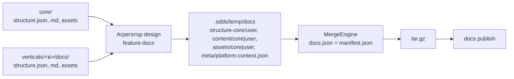

## Контекст

Документация в DS Builder собирается двумя шагами (ADR-0003). Сначала инструмент платформы раскладывает дерево
`.sdds/temp/docs`: общую документацию (`structure-core.json`, `content/core/**`), слой темы (`structure-user.json`,
`content/user/**`), картинки и `meta/platform-context.json`. Затем `dsbuilder docs generate` сливает две структуры
`MergeEngine` по `path` страницы, пишет `docs.json` и `manifest.json` и упаковывает архив. На iOS дерево собирает
`dsbuilder-ios docs aggregate` из `docs-template/swiftui-template` и `Themes/<Тема>Theme/docs/override-docs`, на Android —
Gradle-задача `documentationAggregate`. CLI вызывает их через делегат платформы.

Для `design` делегата нет: `DocsGenerationSource.selectDocsTree` получает `target == null` и берёт готовое дерево
по умолчанию, которое никто не собирает. Документацию дизайна ведут дизайнеры в репозитории
`salute-developers/sdds-design-docs`; вертикали отличаются от общей документации немногим. Идентификатор дизайн-системы
для манифеста CLI берёт из `.sdds/config.json` рабочей директории.

Сервис документации проверяет локальные ссылки markdown относительно места файла в архиве
(`DeepDocumentationValidator`): ссылка, разрешённая у автора, сломается, если файл переедет в `content/core/…`, а
картинка — в `assets/…`.

## Цели / Вне целей

**Цели:**
- `dsbuilder docs generate --platform design` из папки вертикали собирает, проверяет и упаковывает документацию без
  ручной раскладки дерева.
- Отличия вертикали описываются тем же `structure.json` с `merge` и `hidden`, что на iOS и Android.
- Ошибки раскладки находятся до публикации, а не в задаче обработки сервиса.

**Вне целей:**
- Создание раскладки и CI в `sdds-design-docs`: отдельная задача после реализации.
- Каталог версионированных шаблонов Core (открытый вопрос ADR-0003): общий слой берётся из того же репозитория.
- Маркеры подстановки (`@sample`, `@style-api`): у документации дизайна нет кода, markdown переносится как есть, кроме
  локальных ссылок.
- Изменения сервиса документации и `docs publish`.

## Решения

### Агрегация дизайна внутри `dsbuilder`, а не отдельным инструментом

Для `design` нет toolchain'а, который можно было бы вызвать делегатом, а агрегация сводится к раскладке файлов и
проверке ссылок. Отдельный скрипт в `sdds-design-docs` пришлось бы ставить в CI и поддерживать на другом языке; правило
проекта — интеграция с DS Builder живёт в общих Kotlin-модулях. Поэтому шаг выполняет `feature-docs`.

Отвергнуто: делегат `design` в реестре платформ. Спецификация `cli-platform-delegates` прямо запрещает `design` как
целевую платформу; делегат без внешнего процесса только усложнил бы реестр.

### Раскладка репозитория и поиск источников

```text
sdds-design-docs/
  core/
    structure.json
    components/button/overview.md
    assets/button-anatomy.png
  verticals/
    sdds-serv/
      .sdds/config.json          # проект и дизайн-система вертикали
      docs/                      # слой вертикали, необязателен
        structure.json
        components/button/overview.md
        assets/button-serv.png
```

Запуск — из `verticals/<вертикаль>`. Общий слой — `core/` ближайшего предка, содержащий `structure.json`; слой
вертикали — `docs/` текущей папки. Опции `--design-core` и `--design-layer` задают их явно. Отсутствие общего слоя —
ошибка, отсутствие слоя вертикали — нет: вертикаль может публиковать общую документацию как есть.

Отвергнуто: слой вертикали в репозиториях тем, как на iOS. Документацию ведут дизайнеры, а не команды тем; один
репозиторий даёт один процесс ревью и общий CI.

### Дерево совпадает с деревом iOS и Android

Агрегатор очищает `.sdds/temp/docs` и пишет:

- `structure-core.json` и `structure-user.json` — копии `structure.json` слоёв без изменений;
- `content/core/<path>` и `content/user/<path>` — markdown страниц из структуры слоя;
- `assets/core/**` и `assets/user/**` — содержимое `assets/` слоёв;
- `meta/platform-context.json` — `{"artifact": {"id": "sdds-design-docs", "version": "<--artifact-version>"},
  "platform": "design"}`.

Дальше работает существующая сборка: `MergeEngine` с `append`, `prepend`, `replace` и `hidden`, проверка
`contentRefs`, `manifest.json` и архив. Ограничения iOS (`+`-префикс для `append`, запрет `prepend`) не переносятся: они
следуют из устройства iOS-рендера, а не из модели слияния.

Картинки слоёв разделены по подкаталогам, поэтому одинаковые имена в слоях не конфликтуют, а версия общего слоя не
перекрывается молча.



### Переписывание локальных ссылок

Для каждой ссылки и картинки markdown агрегатор разрешает путь относительно исходного файла:

- внешние ссылки, якоря и `mailto:` не трогаются;
- путь в `assets/` своего слоя переписывается в относительный путь от `content/<слой>/<path>` до
  `assets/<слой>/<файл>`;
- путь на другой markdown своего слоя остаётся как есть: структура каталогов страниц в `content/<слой>/` повторяет
  исходную, а цель обязана быть страницей того же слоя;
- путь за пределы своего слоя, абсолютный путь или ссылка на отсутствующий файл — ошибка с именем страницы и ссылки.

Сервис по-прежнему проверяет ссылки сам; проверка в CLI нужна, чтобы автор увидел ошибку до публикации.

Отвергнуто: требовать от авторов ссылок вида архива (`../../../assets/core/x.png`). Такие ссылки не открываются в
предпросмотре GitHub и редакторе, а дизайнеры будут смотреть документацию именно там.

### Версия публикации

`--artifact-version` обязательна для `design`: публикация в сервисе адресуется дизайн-системой, версией и платформой,
а у документации дизайна нет своей версии дизайн-системы. Версия записывается в `meta/platform-context.json`, а
`DocsGenerateUseCase` уже берёт её оттуда вместо версии проекта. В CI это git-тег `sdds-design-docs`. Значение по
умолчанию не вводится: молча подставленная версия перезаписала бы прежнюю публикацию.

## Программное проектирование

```kotlin
// application
internal fun interface DesignDocsAggregator {
    suspend fun aggregate(request: DesignDocsRequest): DocsAggregationResult
}

internal data class DesignDocsRequest(
    val coreDir: String?,          // --design-core; null — поиск core/ у предков
    val layerDir: String?,         // --design-layer; null — docs/ рабочей директории
    val artifactVersion: String?,  // --artifact-version
)

// DocsGenerateCommand получает coreDir, layerDir, artifactVersion
public data class DocsGenerateCommand(
    public val docsDir: String? = null,
    public val outputGzipPath: String,
    public val platform: String? = null,
    public val aggregate: Boolean = true,
    public val toolOverride: String? = null,
    public val designCoreDir: String? = null,
    public val designLayerDir: String? = null,
    public val artifactVersion: String? = null,
)

// DocsGenerationSource выбирает агрегатор по платформе документации
internal class DocsGenerationSource(
    projectContextReader: DocsProjectContextReader,
    platformAggregator: DocsPlatformAggregator,
    designAggregator: DesignDocsAggregator,
)

// data
internal class FilesystemDesignDocsAggregator(
    fileSystem: WorkspaceFileSystem,
    structureReader: DocsStructureReader,
    json: Json,
) : DesignDocsAggregator

// domain: чистое переписывание ссылок, без файловой системы
internal object MarkdownLocalLinks {
    fun rewrite(markdown: String, rule: (destination: String) -> LinkRewrite): String
}

internal sealed interface LinkRewrite {
    data object Keep : LinkRewrite
    data class Replace(val destination: String) : LinkRewrite
    data class Reject(val reason: String) : LinkRewrite
}
```

`DesignDocsAggregator` возвращает тот же `DocsAggregationResult`, что агрегатор делегата: `Aggregated` с
`toolchain = "dsbuilder-design"`, `Failed` с сообщением для пользователя. `--docs-dir` и `--no-aggregate` отключают
шаг так же, как для других платформ. Опции `--design-core`, `--design-layer` и `--artifact-version` с другой платформой —
ошибка, чтобы опечатка в платформе не собрала пакет без агрегации.

`MarkdownLocalLinks` разбирает только inline-ссылки и картинки markdown (`[..](..)`, ``) и не трогает код в
fenced-блоках и `code spans`. Ссылки-определения (`[id]: url`) поддерживаются тем же правилом.

## Риски / Компромиссы

- [Самописный разбор ссылок markdown пропустит редкий синтаксис] → Сервис проверяет ссылки повторно
  (`MISSING_LOCAL_ASSET`), а тесты покрывают картинки, ссылки, определения, код в fenced-блоках и `code spans`.
- [Слой вертикали ссылается на картинку общего слоя] → Запрещено правилом «не выходить за свой слой»: вертикаль
  копирует картинку к себе. Если это станет частым, можно добавить явный префикс ссылки на общий слой.
- [Агрегатор очищает `.sdds/temp/docs`] → Каталог временный и уже перезаписывается делегатами; агрегатор удаляет только
  его.
- [Ручная сборка без `--artifact-version`] → Ошибка до любой записи с подсказкой взять git-тег.

## Открытые вопросы

- Нужен ли единый `subjects`-словарь между документацией дизайна и кодовой документацией, или договорённость
  `components.<имя>` достаточна. На сборку не влияет, только на агрегацию в портале.
