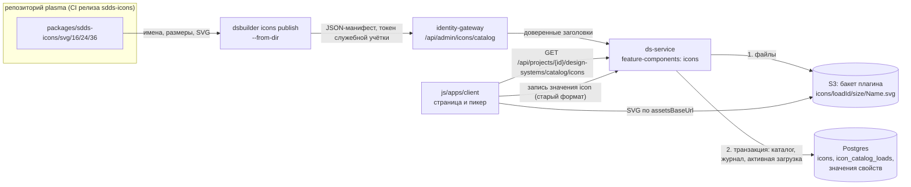
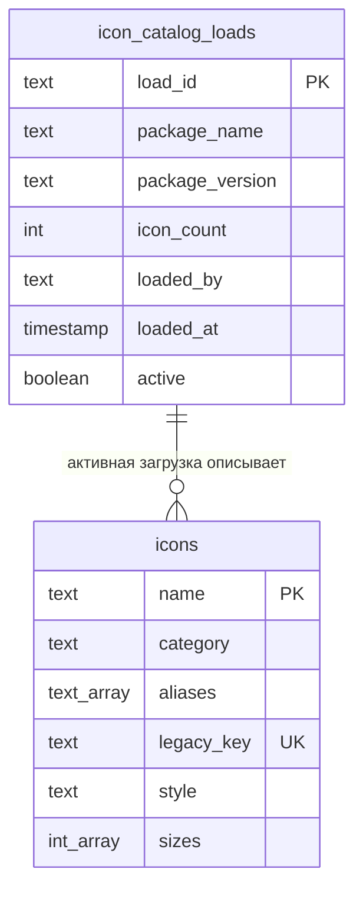
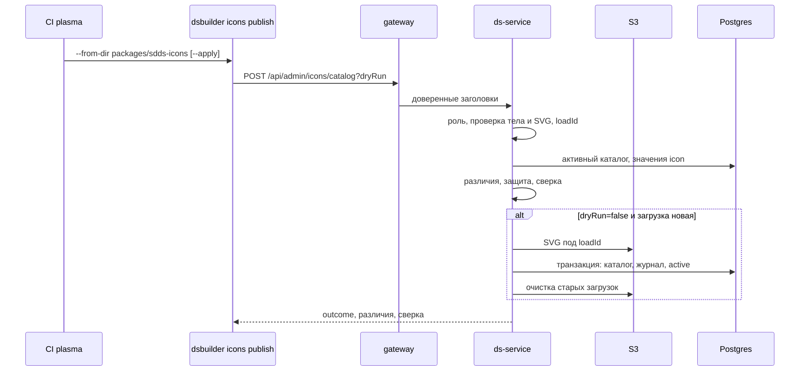

## Контекст

Свойства компонентов типа `icon` хранят строку старого формата (`disclosure.down.fill.16`: слова через точку строчными, начертание и размер внутри строки). Строка хранится в `variation_property_values.value` и `invariant_property_values.value` (таблицы с ревизиями), доходит до payload превью литералом (`compose-preview-icons`) и попадает в выгружаемые конфигурации компонентов. Каталога иконок нет, редактор показывает значение только для чтения.

Источник правды об иконках — пакет `@salutejs/sdds-icons` репозитория `salute-developers/plasma` (`packages/sdds-icons`): SVG лежат в `svg/{16,24,36}/<Name>.svg`, из них собираются web-пакет, XML-набор Android и Compose-набор. Пакет `@salutejs/plasma-icons` поддерживается только до 31.12.2026, поэтому билдер работает только с `sdds-icons`. Имена в `sdds-icons` всегда оканчиваются начертанием (`AddOutline`, `ChevronLeftOutline`, `DisclosureDownFill`). Сверка старых значений: `disclosure.down.fill.16` → `DisclosureDownFill`, `dots.horizontal.outline.24` → `DotsHorizontalOutline` разрешаются; `chevron.left.24` (старое имя без начертания) прямого соответствия не имеет, есть `ChevronLeftOutline`; такие значения попадают в отчёт сверки (см. открытые вопросы).

Образец загрузки данных в билдер есть: публикация билда плагина превью (`POST /api/admin/compose-preview/plugin-builds`): роль `compose_preview_publisher`, пробная отправка по умолчанию, файлы в S3 под неизменяемым префиксом билда, переключение активного билда транзакцией БД, очистка старых билдов, служебная учётка Keycloak в CI. Каталог иконок использует ту же схему.

## Цели / Вне целей

**Цели:**
- Каталог иконок с SVG на бэкенде, обновляемый из CI репозитория `plasma` одной атомарной операцией, поэтому каталог и изображения всегда согласованы.
- Просмотр каталога и выбор иконки в редакторе компонента.
- Проверка значений `icon` при записи и защита от удаления используемых иконок.
- Не сломать существующие конфигурации: значения остаются в старом формате.
- Поиск и фильтр по категориям и русским синонимам, как на странице документации SDDS: данные уже лежат в `<metadata>` каждого SVG.

**Вне целей:**
- Поиск иконки плагином превью по каноническому имени и изменения `plasma-android` (плагин получает значение в старом формате, как сейчас).
- Переписывание сохранённых значений на канонические имена.
- Версии каталога с выбором активного набора: откат — повторная загрузка.
- Workflow CI в репозиториях `plasma` и `plasma-android`.

## Решения

### Каталог и SVG публикуются вместе и атомарно

Клиент билдера не зависит от опубликованной библиотеки иконок: SVG берутся из хранилища билдера и принадлежат той же загрузке, что и каталог. Окна, в котором каталог новее изображений, нет. Версия пакета-источника записывается как справочная, ни одна проверка от неё не зависит.

Альтернативы: рисовать из `@salutejs/sdds-icons` в клиенте (расходится с каталогом до выпуска нового клиента); подгружать пакет по версии каталога с CDN (внешняя зависимость во время работы). Отвергнуты, потому что только хранение SVG даёт согласованность без внешних зависимостей.

### SVG в S3, каталог в Postgres

Файлы лежат в бакете плагина (публичное чтение и CORS уже настроены) под `<prefix>/icons/<loadId>/<size>/<Name>.svg`, где `<prefix>` — `DS_PLUGIN_S3_PREFIX`; ключи плагина лежат под `<prefix>/builds/`, поэтому пересечений и общей очистки нет; `loadId` — первые 12 символов sha256 канонической записи (имена, размеры, sha256 SVG). Префикс неизменяем, поэтому отдаётся с `Cache-Control: public, max-age=31536000, immutable`. Постгрес хранит каталог, журнал загрузок и признак активной. Порядок записи «сначала файлы, затем транзакция БД» тот же, что у плагина: сбой оставляет прежний каталог активным, а осиротевшие файлы убирает очистка.

Альтернатива: SVG как `text` в Postgres с отдачей через API. Атомарно и без S3, но нагружает `ds-service` отдачей тысяч файлов; выбран S3 по решению команды.

Иконки используют настройки хранилища плагина (`DS_PLUGIN_S3_*`, `DS_PLUGIN_PUBLIC_BASE_URL`): один бакет, одни учётные данные, один публичный адрес, адрес иконок — `<DS_PLUGIN_PUBLIC_BASE_URL>/icons/<loadId>`. Добавляются только `DS_ICON_KEEP_LOADS` и `DS_ICON_ORPHAN_GRACE_HOURS`. Цена: пока S3 плагина не настроен, загрузка иконок отвечает `503`; для окружения, где нужны иконки, это настройка и так обязательна.

Альтернатива: отдельный бакет и отдельные переменные `DS_ICON_S3_*`. Отвергнута: дублирует настройки, учётные данные, публичный доступ и CORS без пользы, потому что ключи уже разделены префиксами.

### Идентификатор загрузки определяется содержимым

Одинаковое содержимое даёт одинаковый `loadId`, поэтому повторный запуск CI даёт `unchanged`, а загрузка старого содержимого, файлы которого ещё не удалены, — `activated` без повторной заливки (откат). Версия пакета не входит в `loadId`.

### Соответствие старому формату

Каталог хранит для каждой иконки ключ старого формата, вычисленный при загрузке из канонического имени (разбиение по заглавным буквам, строчные, точки). Значение свойства разрешается разбором: размер — после последней точки, остальное — ключ. Ключ хранится столбцом с уникальным индексом: проверка значений и поиск использования идут по нему, а не по повторному преобразованию. Коллизия ключей отклоняет загрузку.

Альтернативы: переписать значения на канонические имена (ломает выгрузку, импорт и payload превью, потому что плагин ждёт старый формат); хранить таблицу алиасов отдельно (лишняя сущность, правило детерминировано). Отвергнуты.

Старые значения без начертания (`chevron.left.24`, имя из `plasma-icons`) в каталоге `sdds-icons` прямого соответствия не имеют (есть `ChevronLeftOutline`). Решение: такие значения не угадываются, а показываются в отчёте сверки как неразрешённые; их запись без изменения проходит, а новое значение выбирается из каталога.

Риск правила — цифры и аббревиатуры в именах (`Number1Fill`, `QrCode`): проверяется внешней проверкой на всём каталоге и локальных конфигурациях (задача 9.3): все значения из конфигураций репозитория должны разрешаться, коллизий быть не должно.

### Проверка значений при записи, а не при чтении

Операции редактора, записывающие значение `icon`, проверяют его по каталогу. Чтение, выгрузка и `components push` значения не проверяют, чтобы не ломать существующие конфигурации и конвейеры. Пока каталога нет, проверка отключена. Запись значения, равного сохранённому, проходит всегда: автосохранение других полей не должно упираться в старые данные.

### Защита используемых иконок и отчёт сверки

При загрузке сервис сравнивает удаляемые иконки и размеры с множеством значений `icon`, разрешаемых в ключи старого формата, по всем дизайн-системам; чтение значений выполняется вне границы одной дизайн-системы (операция администраторская, `ds.design_system_id` в транзакции не задаётся), поэтому условие `ds_request_matches_design_system` пропускает строки всех систем. Используемые иконки блокируют запись (`409 icons_in_use`), если не передан `allowRemovingUsed`. Тот же обход строит отчёт сверки: сколько значений разрешается в новый каталог и какие нет. Значения не меняются.

### CLI собирает манифест сам

`icons publish --from-dir` обходит `svg/{16,24,36}` пакета, читает SVG и отправляет один JSON. Для CI репозитория `plasma` это одна команда без своего скрипта, а формат манифеста остаётся внутренним контрактом билдера. Один JSON (порядка 5–8 МБ при ~4400 файлах) выбран вместо архива, потому что писать zip на всех целях Kotlin Multiplatform CLI (JVM и macOS) сложнее, а лимит 32 МиБ имеет большой запас. Режим `--from` принимает готовый манифест.

### Права: роль публикации плагина

Загрузку выполняют системный администратор и роль `compose_preview_publisher`: отдельная служебная учётка для CI репозитория `plasma` без реальной разницы в правах дала бы лишние секреты. Переименование роли вынесено из этого change.

### Размещение в `feature-components`

Каталог живёт в модуле `feature-components` (пакет иконок): ему нужны таблицы значений свойств для защиты и проверки, а feature-модули не зависят друг от друга. По той же причине в `frontend-kt` команда добавляется в `feature-components`, рядом с публикацией плагина превью.

Альтернатива: новый модуль `feature-icons` с портом чтения ссылок. Отвергнута: порт пришлось бы реализовывать в `app` поверх таблиц другого модуля, а выигрыш — только в названии.

### Категории и синонимы берутся из метаданных SVG

Каждый SVG `sdds-icons` содержит `<metadata>` с `category`, `aliases` (в том числе русскими) и `size`; сам пакет уже собирает из них `mcpData/manifest.json`. CLI читает метаданные из SVG так же, поэтому формат манифеста билдера совпадает по смыслу с манифестом пакета, но содержит и SVG. Категория и синонимы общие для размеров (пакет проверяет это у себя, CLI предупреждает о расхождении). Они участвуют в `loadId`, поэтому смена категории — новая загрузка. Фильтр категорий клиент выводит из каталога, отдельного справочника нет.

Альтернатива: читать готовый `mcpData/manifest.json`. Отвергнута: он создаётся отдельным шагом сборки пакета и не содержит SVG, а CI всё равно читает SVG.

### Клиент: SVG как маска

Страница и пикер рисуют иконку CSS-маской по адресу SVG: цвет наследуется от текста, а SVG не нужно встраивать и санитизировать на клиенте. Маска загружается браузером в режиме CORS, поэтому бакет (общий с плагином) должен отдавать `Access-Control-Allow-Origin` для адресов клиента; для плагина это уже необходимо, и проверка CORS для иконок входит в задачу 9.4.

## Архитектура



Граница доверия — gateway: он снимает внешние доверенные заголовки и передаёт роль публикации; `ds-service` проверяет роль до чтения тела. SVG приходит от доверенного издателя, но сервис дополнительно отклоняет скрипты и внешние ссылки, потому что файлы публикуются в бакете, доступном браузеру.

## Модель данных и контракты



`icons` — текущий каталог, заменяется целиком; связь с `icon_catalog_loads` логическая (активная загрузка даёт `loadId` для адресов SVG), внешнего ключа нет, потому что строки `icons` не принадлежат конкретной загрузке. Частичный уникальный индекс гарантирует не более одной активной загрузки. Начертание вычисляется при загрузке и хранится столбцом.

Манифест (`schemaVersion` = 1; в `sizes` значения — содержимое SVG):

```json
{
  "schemaVersion": 1,
  "source": { "package": "@salutejs/sdds-icons", "version": "0.14.0" },
  "icons": [
    { "name": "DisclosureDownFill", "category": "Navigation & Movement", "aliases": ["disclosure", "стрелка", "вниз"], "sizes": { "16": "<svg …>", "24": "<svg …>", "36": "<svg …>" } }
  ]
}
```

Ответ загрузки:

```json
{
  "outcome": "published",
  "dryRun": false,
  "loadId": "3fa9c01d27be",
  "counts": { "added": 12, "removed": 1, "changed": 3, "unchanged": 1430 },
  "added": ["…"], "removed": ["…"], "changed": ["…"], "truncated": false,
  "removedInUse": [{ "name": "OldFill", "sizes": [16], "references": 4 }],
  "reconciliation": { "resolved": 118, "unresolved": 2, "unresolvedValues": ["legacy.star.24"] }
}
```

Маршруты: загрузка — административный `POST /api/admin/icons/catalog` (gateway проксирует без переписывания пути, `ds-service` регистрирует его вместе с другими административными маршрутами); чтение — глобальный ресурс `GET /api/design-systems/catalog/icons`, публично `GET /api/projects/{projectId}/design-systems/catalog/icons`, как остальные глобальные ресурсы ветки `catalog`. Личный токен (PAT) со scope `components:read` может читать каталог, но не может загружать: административные операции требуют OAuth или служебной учётки.

Ответ чтения: `{ source: { package, version, loadedAt, loadId }, assetsBaseUrl, icons: [{ name, style, sizes, legacyKey, category, aliases }] }` одним документом (около 150 КБ) с `ETag`.

Ошибки записи значения: `400 unknown_icon`. Ошибки загрузки: `400 invalid_body | legacy_key_collision | unsafe_svg`, `403`, `409 icons_in_use`, `413`, `503`.

## Программное проектирование

Бэкенд (`feature-components`, пакеты `…/domain`, `…/application`, `…/data`, `…/presentation`):

```kotlin
// domain
enum class IconStyle { OUTLINE, OUTLINE_BOLD, FILL, NONE }
enum class IconSize(val px: Int) { S16(16), S24(24), S36(36) }
data class IconEntry(
    val name: String, val legacyKey: String, val style: IconStyle, val sizes: Set<IconSize>,
    val category: String?, val aliases: List<String>,
)
data class IconAsset(val name: String, val size: IconSize, val svg: String, val sha256: String)
data class IconCatalogLoadId(val value: String)
object IconNames { fun parse(raw: String): String?; fun styleOf(name: String): IconStyle; fun legacyKeyOf(name: String): String }
object LegacyIconValue { fun parse(value: String): Pair<String, IconSize>? }   // "disclosure.down.fill.16" -> ("disclosure.down.fill", S16)
object SvgSafety { fun check(svg: String): SvgIssue? }

// application
interface IconAssetStorage {
    val configured: Boolean
    suspend fun put(loadId: IconCatalogLoadId, asset: IconAsset)
    suspend fun exists(loadId: IconCatalogLoadId): Boolean
    suspend fun listLoads(): List<StoredIconLoad>
    suspend fun deleteLoad(loadId: IconCatalogLoadId)
}
interface IconCatalogRepository {
    suspend fun activeLoad(): IconCatalogLoad?
    suspend fun entries(): List<IconEntry>
    suspend fun findLoad(loadId: IconCatalogLoadId): IconCatalogLoad?
    suspend fun replaceActive(entries: List<IconEntry>, load: NewIconCatalogLoad)
    suspend fun activate(loadId: IconCatalogLoadId, entries: List<IconEntry>)
}
interface IconUsageReader {   // значения icon по всем дизайн-системам
    suspend fun usedValues(): Map<String, Int>    // значение -> число ссылок
}
class PublishIconCatalogUseCase(
    transactions: TransactionRunner, storage: IconAssetStorage, catalog: IconCatalogRepository, usage: IconUsageReader,
) { suspend fun execute(context: DsRequestContext, command: PublishIconCatalog): DsResult<PublishIconCatalogResult> }
class GetIconCatalogUseCase(catalog: IconCatalogRepository, settings: IconCatalogSettings) {
    suspend fun execute(context: DsRequestContext): DsResult<IconCatalogView>
}
class IconValueValidator(catalog: IconCatalogRepository) {
    suspend fun validate(value: String?, current: String?): IconValueCheck   // Valid | Unknown | CatalogAbsent
}
// presentation
fun Route.iconCatalogPublishRoutes(evaluator: PolicyEvaluator, publish: PublishIconCatalogUseCase, maxBodyBytes: Long)
fun Route.iconCatalogReadRoutes(evaluator: PolicyEvaluator, get: GetIconCatalogUseCase)
```

`IconValueValidator` подключается в use case записи значений свойств типа `icon` (создание и изменение значений вариации и инвариантного значения); остальные типы свойств его не используют.

CLI (`frontend-kt`, `feature-components`, `cli`):

```kotlin
// application
interface IconSourceReader { suspend fun fromDirectory(path: String): IconManifest; suspend fun fromManifest(path: String): IconManifest }
interface IconCatalogRemoteSource { suspend fun publish(manifest: IconManifest, dryRun: Boolean, allowRemovingUsed: Boolean, apiUrl: String): IconPublishResponse }
class PublishIconCatalogUseCase(reader: IconSourceReader, remote: IconCatalogRemoteSource) {
    suspend fun execute(command: PublishIconCatalogCommand): PublishIconCatalogResult
}
// :cli presentation
internal class IconsPublishCliCommand(publish: PublishIconCatalogUseCase) : CliktCommand(name = "publish")
```

Клиент (`js/apps/client`): `iconCatalogRepository.getCatalog(projectId)` (с `ETag`), `useIconCatalog`, чистые функции `filterIcons(catalog, {query, style, size})`, `toLegacyValue(icon, size)` и `fromLegacyValue(value, catalog)`, компоненты `IconMask`, `IconGrid`, `IconPicker`; `IconProp` получает признак «выбирается из каталога».

Порядок записи:



## Безопасность и права доступа

Загрузку выполняют только системный администратор и роль `compose_preview_publisher`; проверка до чтения тела. Gateway принимает на маршрут загрузки только токены пользователей и служебных учёток (личный токен PAT и прочие токены получают `401`), тело ограничено 32 МиБ. SVG проверяется на скрипты, `foreignObject`, обработчики событий и внешние ссылки, файлы пишутся без изменений. Бакет доступен на чтение анонимно и на запись только `ds-service`; CORS разрешает адреса клиента. Иконки находятся на одном origin с кодом плагина, поэтому проверка SVG на скрипты обязательна: открытый напрямую SVG со скриптом выполнился бы в этом origin. Чтение каталога требует доступа к проекту (`components:read`). Имена проходят строгую проверку и подставляются в ключи S3 и SQL только после неё и параметрами.

## Ошибки и восстановление

Запись выполняется в порядке «S3, затем транзакция БД»: сбой до коммита оставляет прежний каталог активным, повтор безопасен (`loadId` определяется содержимым), осиротевшие файлы убирает очистка по сроку. Сбой очистки не делает запись неуспешной. Откат — повторная загрузка прежнего содержимого (`activated`, если файлы ещё хранятся, иначе обычная запись). Сбой чтения каталога в клиенте не ломает остальные страницы, а пикер деградирует до показа значения строкой.

## Риски / Компромиссы

- **Правило ключа старого формата может не покрыть все имена** (цифры, аббревиатуры) → проверка на реальных данных (задача 9.3), коллизии отклоняются при загрузке, нерешаемые значения показываются отчётом сверки и не блокируют работу.
- **Каталог одним документом** → около 150 КБ при 1450 иконках; рост на порядок потребует постраничности.
- **Загрузка ~5–8 МБ одним запросом** → лимит 32 МиБ, лимит файла 64 КиБ; запись S3 выполняется последовательно или ограниченным параллелизмом (тысячи небольших объектов) — время записи измеряется внешней проверкой.
- **Плагин превью не знает иконку из каталога** (набор плагина берётся из `sdds-icons-compose` другой версии) → превью рисуется без иконки с предупреждением `unknown_icon`, как сейчас; согласование с плагином вынесено за рамки.
- **Роль с Compose-именем публикует каталог иконок** → осознанно; переименование — отдельный change.
- **Проверка при записи отклоняет значение, которого нет в каталоге** → защита от опечаток важнее; пока каталога нет, проверка выключена, а запись прежнего значения проходит.

## Миграция и совместимость

Миграция `V18__icon_catalog.sql` только добавляет таблицы; существующие значения и API чтения не меняются. Развёртывание: сначала `ds-service` и gateway, затем клиент, затем CLI и CI репозитория `plasma`. До первой загрузки страница показывает пояснение, а проверка значений выключена. Откат: клиент и CLI откатываются независимо; таблицы и бакет остаются неиспользуемыми.

## План проверки и развёртывания

Локальные автоматические проверки: сборка, `detekt`, `spotlessCheck` и тесты `backend-kt` и `frontend-kt`; `npm run build` и тесты клиента в `js`; интеграционные тесты на Postgres (Testcontainers) и тест `S3IconAssetStorage` на фейковом клиенте S3 по образцу `S3PluginBuildStorageTest`.

Внешние проверки до архивирования (задачи 9.1–9.5): на локальном стеке (`./setup-local.sh`, MinIO с бакетом плагина) загрузить реальный каталог из checkout `plasma`: без `--apply`, с `--apply`, повторно (`published` → `unchanged`), затем после удаления иконки с ссылкой проверить `409 icons_in_use`. Признаки успеха и сохраняемые доказательства описаны в задачах.

Развёртывание и CI (вне репозитория): в CI релиза `@salutejs/sdds-icons` репозитория `plasma` после публикации пакета шаг скачивает закреплённый CLI (`cli-vX.Y.Z`, как в `publish-preview-plugin.yml`) и выполняет

```bash
export DSBUILDER_CLIENT_ID=dsbuilder-preview-publisher
export DSBUILDER_CLIENT_SECRET=...   # секрет окружения CI
dsbuilder icons publish --from-dir packages/sdds-icons \
  --package-version "$VERSION" --api-url "$DSB_API_URL" --apply
```

Наблюдения после развёртывания: первая загрузка на dev-окружении — `published`; повторный запуск CI без изменений набора — `unchanged`; число иконок на странице совпадает с числом SVG в `svg/24`; в логах нет ошибок CORS при загрузке SVG из бакета.

## Открытые вопросы

- Совпадает ли правило ключа старого формата со всеми значениями, хранящимися в рабочих окружениях (не только в `local-dev`)? Закрывается отчётом сверки первой загрузки; значения старых имён без начертания (`chevron.left.24`) остаются неразрешёнными по решению выше.
- Нужен ли параллелизм при записи в S3 (тысячи объектов)? Решается измерением в задаче 9.2.
