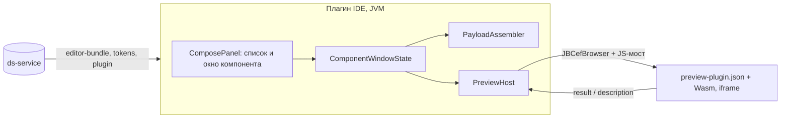

## Контекст

Плагин `:plugins:android-studio` (Compose Desktop в `ComposePanel`, `sdds-serv-compose`) сегодня
read-only и работает только с токенами. Превью компонентов существует только в веб-клиенте:
`ComposePreviewSession` грузит опубликованный Wasm-плагин (`preview-plugin.json`) в `iframe`, а
payload Preview Protocol v1 собирает TypeScript-ассемблер `js/apps/client/src/composePreview`
из «черновика» редактора, который строят веб-контроллеры `Config`/`Theme`.

## Цели / Вне целей

**Цели:** список компонентов, окно компонента с превью, смена вариации и конфигурации, копирование
кода вариации, релиз в GitHub Release.

**Вне целей:** сохранение любых изменений в DS Builder или в проект пользователя; редактирование
свойств и токенов; web-компоненты (в IDE только `compose`); автообновление через репозиторий
плагинов JetBrains; нативный рендерер на Compose Desktop (см. альтернативы).

## Решения

### Превью: тот же Wasm-плагин в JCEF

`PreviewHost` создаёт `JBCefBrowser`, загружает точку входа плагина из `pluginUrl`, полученного
у ds-service, и общается по тем же сообщениям `sdds.preview.*`, что и веб-клиент (через
`JBCefJSQuery` в одну сторону и `postMessage` внутри страницы-обёртки в другую). Манифест
проверяется теми же правилами, что в `compose-preview-plugin-loading`. Одна сессия живёт, пока
открыт раздел «Компоненты», и переиспользуется при смене компонента.

Эмбед `ComposePanel` (Compose Desktop) и `JBCefBrowser` (Swing) сочетаются через `SwingPanel`;
превью занимает область окна компонента, а все элементы управления остаются в Compose.

**Почему так.** Превью совпадает с веб-редактором, новые компоненты и правки рендерера доезжают
сами при публикации нового билда плагина, от `plasma-android` ничего нового не требуется.

**Риски.**
- JCEF есть не во всех сборках IDE: при `JBCefApp.isSupported() == false` окно компонента
  показывает состояние «Превью недоступно в этой IDE», а копирование кода продолжает работать.
- Wasm GC в JCEF сборки 243 не проверен. Первый шаг реализации — spike: загрузить production-плагин
  и получить `ready` и `success`. Провал spike возвращает нас к обсуждению рендерера, а не
  решается тихой подменой.
- Плагин грузится по сети: при недоступности адреса окно показывает ошибку с повтором.

### Сборка payload на Kotlin

`PayloadAssembler` — чистая функция `ComponentPreviewDraft -> AssemblyResult` в пакете `preview`
плагина, без зависимостей от Compose и IDE. Вход — «черновик», который строится из ответов
`editor-bundle` (экспорт конфигурации, свойства, вариации, стили, оформления) и значений токенов
выбранного tenant, включая конфигурации компонентов, на которые ссылаются вложенные стили.
Выход — JSON, валидный по каноничной схеме Preview Protocol v1.

Основной `editor-bundle` экспортирует только выбранный компонент. Его `dependencyComponents`
содержит сведения каталога, а не конфигурации зависимостей. Поэтому загрузчик черновика обходит
фактически используемые ссылки `component_style` выбранной конфигурации, включая состояния и
вложенные ссылки, и дополнительно читает `editor-bundle?platform=compose` целевых компонентов.
Цели разрешаются по именам конфигураций из полного списка Compose-компонентов текущей
дизайн-системы; `dependencyComponents` помогает поиску, но не заменяет список и экспорт цели.
Чужие дизайн-системы и платформы не используются. Выбор стилей и значений по умолчанию повторяет
правила `js/apps/client/src/controllers/componentBuilder/styleReference.ts`.

Обход хранит активный путь ссылок, обнаруживает цикл до повторного разворачивания и ограничивает
глубину тем же пределом, что TypeScript-сборщик черновика. Успешные ответы и запросы в полёте
переиспользуются по ключу `(projectId, designSystemId, componentId, platform, versionId)`;
отсутствие `versionId` означает текущий черновик. Значения токенов дополнительно разделяются по
tenant и режиму темы. Кеш живёт в текущем разделе, сбрасывается при смене контекста, выходе и
явном повторе загрузки; ошибки не сохраняются как успешные ответы. Результаты устаревшего выбора
не обновляют окно. Отсутствующая или неоднозначная цель, отказ доступа, цикл и превышение глубины
дают диагностику с путём ссылки; неполный payload не отправляется, копирование остаётся доступным.

Помимо эталонов готового черновика обязательны тесты всей цепочки «HTTP-ответы основного и
связанных компонентов → черновик → payload»: ссылка на другой компонент, транзитивная ссылка,
повторная цель, цикл, отсутствующая цель и ошибка загрузки с повтором.

Эталон поведения — TypeScript-ассемблер. Паритет проверяется golden-файлами: тесты веб-клиента
экспортируют пары «черновик → payload» (по готовым фикстурам кнопки, вложенных стилей, состояний,
alpha, ресурсов), Kotlin-тест читает те же пары и сравнивает JSON. Ассемблер не выносится в
общий модуль `frontend-kt`: единственный потребитель — плагин IDE (см. альтернативы).

### Вариация и конфигурация — состояние окна

Вариация — выбор значения по каждой оси `variations` (`variationSelections`), конфигурация —
выбор оформления компонента из `appearances`. Оба выбора меняют только состояние окна и черновик;
после смены собирается новый payload и отправляется в ту же сессию. Ничего не записывается в
ds-service и в проект пользователя, поэтому требование read-only сохраняется.

### Копирование кода вариации

Кнопка использует тот же механизм, что токены: последняя публикация дизайн-системы для платформы
`compose` (`GET /documentation/publications/active`), поиск биндинга по точному `subject`
`components.<key>` и kind `component-style`. Payload содержит `styles[]`: сначала выбирается
единственное оформление по `styles[].styleName`, соответствующее имени выбранной конфигурации
из экспорта. Затем среди его `variations[]` выбирается единственная запись, у которой `props`
совпадает с полным набором выбранных пар «имя оси → имя значения», включая значения по умолчанию.
Порядок пар не влияет на выбор; идентификаторы и подписи интерфейса не подменяют экспортные имена.

Для сопоставления `styleName`, имён осей и значений применяется одна нормализация: обрезать
краевые пробелы, убрать дефисы, подчёркивания и пробельные символы, привести регистр через
`Locale.ROOT`; прочие символы сохраняются. Например, `basic-button` совпадает с `BasicButton`,
а `m` — с `M`. Коллизия имён после нормализации, повтор оси, неполный набор пар либо несколько
подходящих оформлений/вариаций считаются неоднозначностью. Первый элемент массива и другое
оформление не используются как запасной вариант.

Копируется непустой `composeReference` найденной записи. Статусы: «Скопировано», «Нет ссылки»
(нет публикации, оформления или вариации, совпадение неоднозначно либо reference пуст), «Ошибка»
(сбой запроса). Запрос выполняется по нажатию для снимка текущей конфигурации и осей; смена
выбора до ответа отменяет копирование устаревшего результата. Проверяется пара оформлений с
одинаковыми осями и разными ссылками, нормализация имён, коллизии и отсутствие оформления.

### Данные списка компонентов

Список строится через `GET /api/design-systems/{designSystemId}/components?platform=compose`
из компонентов, привязанных к выбранной дизайн-системе, с учётом пагинации API. Основные сведения
окна берутся запросом `GET /api/design-systems/{designSystemId}/components/{componentId}/editor-bundle?platform=compose`;
конфигурации ссылочных компонентов догружаются тем же маршрутом по мере обхода. Список и окно
учитывают выбранный tenant так же, как токены. Для сегментов и поиска переиспользуются
`FilterSegment` и паттерны `TokenList`.

### Релиз

Workflow `publish-ide-plugin-release.yml` запускается на теге `idea-plugin-v<semver>` (и вручную
для существующего тега), собирает `./gradlew :plugins:android-studio:buildPlugin`, считает
`SHA256SUMS` и создаёт GitHub Release с `dsbuilder-ide-plugin-<версия>.zip`. Версия плагина
берётся из тега и подставляется в `plugin.xml`/Gradle; тег, не совпадающий с форматом, отклоняется.
Установка — «Install Plugin from Disk». Публикация в JetBrains Marketplace вне объёма.

## Альтернативы

- **Нативный рендерер на Compose Desktop.** Не принят: нужны JVM-артефакты `sandbox-*` и
  `preview-sdk-compose` из `plasma-android`, которые сегодня не публикуются, и библиотеки
  компонентов каждой дизайн-системы пришлось бы вшивать в плагин, что противоречит
  требованию независимости от дизайн-системы. Превью могло бы отличаться от веб-редактора.
- **Сборка payload в ds-service.** Не принята в этом изменении: затрагивает контракт веб-клиента
  и backend. Может стать следующим шагом, чтобы убрать второй ассемблер.
- **Вынести ассемблер в общий модуль KMP.** Откладывается до появления второго потребителя
  (по правилу `frontend-kt`: общее выносится при необходимости).

## Риски / Компромиссы

- Два ассемблера (TypeScript и Kotlin): расхождения ловятся golden-тестами, но дублирование
  остаётся до переноса сборки на сервер.
- Размер: перенос охватывает около 600 строк ассемблера и сборку «черновика» из ответа
  `editor-bundle` (в вебе её делают контроллеры). Вложенные ссылки входят в обязательный объём;
  сокращение до пилотного набора требует отдельного согласования изменения требований.

## План миграции

Worktree создан на старой базе, где маршруты начинались с `/api/ds/`. Перед реализацией нужно
актуализировать базу задачи и сверить клиенты со схемой
`backend-kt/ds-service/runtime/src/main/resources/openapi/documentation.yaml` актуальной базы.
Целевые маршруты этого Change — `/api/design-systems/{designSystemId}/components`,
`/api/design-systems/{designSystemId}/components/{componentId}/editor-bundle` и
`/api/design-systems/catalog/compose-preview/plugin`; откат к старым адресам при ошибке не предусмотрен.
Это использование существующего API, а не изменение backend в рамках задачи.

Данных и контрактов API миграция не требует. Релиз идёт новым тегом `idea-plugin-v0.1.0`
после прохождения проверок. Наблюдения после выпуска (рабочий Wasm в JCEF разных ОС,
размер архива) фиксируются в чек-листе команды, не в `tasks.md`.

## Открытые вопросы

- Нужно ли отдельно версионировать плагин от тега (сейчас версия = тег).
