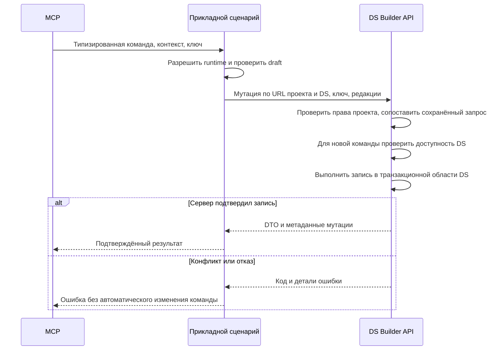

# Проектное решение

## Контекст

Зависимость — `scope-design-system-routes` (ПР #149). Реализация MCP начинается после появления его серверных и клиентских контрактов. Мотивация и границы описаны в [proposal.md](proposal.md). Общий MCP работает через `mcp-server-core` и прикладные сценарии Kotlin Multiplatform. Сервер уже предоставляет точечные мутации токенов, цветовые семейные операции и редактор конфигураций. Транспорт `AuthenticatedHttpClient` ориентирован на GET/POST, а MCP-схемы описывают преимущественно простые поля. Их нужно расширить на стороне клиента, сохранив существующие вызовы.

## Решения

### Предметные инструменты поверх существующих API

Используем отдельные имена операций с закрытыми схемами, без универсального инструмента HTTP-запросов или произвольного JSON-патча. Это сохраняет обнаружимость действий и ограничивает область записи. Составные данные передаются объектами и массивами объектов, а не JSON внутри строк. Существующие инструменты чтения и их результаты сохраняются.

Ниже пути указаны относительно `P = /api/projects/{projectId}/design-systems/{designSystemId}`. Это общая область всех чтений и записей данных DS, а не только новых MCP-tools. Все инструменты принимают необязательный `designSystem`, а мутации — `version` только со значением `draft`, обязательный `idempotencyKey` и необязательный `baseRevision` там, где сервер принимает базовую редакцию сущности. Пропущенный `version` наследует версию контекста; если она опубликованная, запись отклоняется с `READ_ONLY_VERSION`. Явный `draft` позволяет выбрать черновик той же системы. `designSystem` — существующий MCP-аргумент со ссылкой для разрешения контекста, а `designSystemId` в REST URL — обязательная область серверной операции; это разные уровни контракта.

| Инструменты | Серверный контракт и существенные аргументы |
|---|---|
| `token_create`, `token_update`, `token_delete` | POST `/tokens`, PATCH/DELETE `/tokens/{tokenId}`; определение, изменение метаданных, удаление одного определения |
| `token_value_create`, `token_value_update`, `token_value_delete` | POST `/token-values`, PATCH/DELETE `/token-values/{valueId}`; явные tokenId/tenantId/platform/mode при создании, неизменяемый ключ существующего значения |
| `color_token_create` | POST `/tenants/{tenantId}/color-tokens`; группа, имя, члены семейства и начальные значения |
| `color_token_values_update` | PUT `/tenants/{tenantId}/color-tokens/{tokenId}/values`; изменения выбранных членов и пар платформы/режима |
| `color_token_move`, `color_token_delete` | POST `…/{tokenId}/move`, DELETE `…/{tokenId}`; перенос/порядок/переименование семейства либо его удаление |
| `size_token_value_update`, `typography_style_update` | PUT `/tenants/{tenantId}/size-tokens/{tokenId}/value`, PATCH `/tenants/{tenantId}/typography-styles/{tokenId}`; согласованные параметры существующих специализированных редакторов |
| `token_group_create`, `token_group_update`, `token_group_delete` | POST/PATCH/DELETE `/tenants/{tenantId}/token-groups`; label, parentId, position, поддерживаемый kind=color |
| `component_configuration_create`, `component_configuration_duplicate` | POST `/appearances/new`, POST `/appearances/{appearanceId}/duplicate`; компонент выбранной системы, необязательное имя |
| `component_configuration_update`, `component_configuration_delete` | PATCH/DELETE `/appearances/{appearanceId}`; имя, для удаления — поддерживаемое сервером подтверждение каскада |
| `component_axis_create`, `component_axis_update`, `component_axis_delete` | POST `/appearances/{appearanceId}/axes`, PATCH `/appearance-variations/{axisId}`, DELETE `/appearances/{appearanceId}/axes/{axisId}`; имя, значения, позиция, defaultStyleId, isRoot, isColorScheme, declaredType |
| `component_axes_reorder` | POST `/appearances/{appearanceId}/axis-order`; полный список axisIds |
| `component_axis_value_create`, `component_axis_value_update`, `component_axis_value_delete` | POST `/appearances/{appearanceId}/axes/{axisId}/values`, PATCH `/appearance-variation-values/{valueId}`, DELETE `/appearances/{appearanceId}/axis-values/{valueId}` |
| `component_axis_values_reorder` | PUT `/appearances/{appearanceId}/axes/{axisId}/value-order`; полный список valueIds |
| `component_property_set`, `component_property_reset` | PUT/DELETE `/appearances/{appearanceId}/property-values`; propertyId, styleIds, states, литерал/tokenId/reference и поддерживаемые alpha/adjustment |
| `component_states_reorder` | PUT `/appearances/{appearanceId}/state-order`; propertyId, styleIds, упорядоченные наборы states |

Новые чтения `token_edit_data_get(tokenId, tenantId)` и `component_editor_get(appearanceId)` дают исходные данные и редакции для записи. Первое составляет определение токена, значения темы и, для распознаваемого цветового семейства, список его членов через существующие чтения. Второе использует GET `/appearances/{id}/editor-model`. Эти инструменты читают только черновик; опубликованные данные по-прежнему доступны существующими инструментами чтения.

Отдельные инструменты добавления и удаления состояния не нужны: состояние значения задаётся `states` у `component_property_set`, удаляется `component_property_reset`, порядок меняется `component_states_reorder`. Состояния берутся из существующей меты компонента. Мутации общего каталога не регистрируются даже для учётных данных администратора.

### Точечная и семейная запись

`token_value_update` меняет только переданное значение по ID. Проверки типа, ссылок и пересчёт типа цветового семейства остаются на сервере. `token_update` не расширяется до неявного переименования семейства: для этого есть `color_token_move`.

`color_token_values_update` принимает непустой список членов `{ tokenId, values: [{ platform, mode, value, paletteId?, overridden?, baseRevision }] }` с полным набором шести пар web/ios/android и light/dark для каждого выбранного члена. Повторяющиеся или неполные пары отклоняются до записи. Для подготовки запроса используется `token_edit_data_get`; инструмент передаёт один существующий семейный PUT без дополнения тела неизменёнными данными. Члены, отсутствующие в запросе, в PUT не включаются. Это сохраняет существующий контракт и позволяет повторять одно и то же тело без промежуточного состояния процесса.

Исходные `sourceValue`, `paletteRef`, `paletteId` и `overridden` доступны при чтении; описание поясняет передачу поддерживаемой сервером исходной формы. Вычисленный HEX не подставляется клиентом вместо ссылки. Базовая редакция каждой пары обязательна в MCP-схеме, хотя сервер допускает её отсутствие. Конфликт не запускает повторное чтение с автоматическим затиранием конкурентной записи. Семейный PUT атомарен в пределах существующей серверной транзакции.

Создание произвольного отдельного токена и создание его значений остаются отдельными вызовами. Семейное создание/удаление теней отложено; текущее правило четырёх вариантов не входит в MCP-контракт. Доступны точечные операции с отдельными определениями/значениями теней и size_token_value_update. Не вводим общий пакет мутаций и не обещаем атомарность между независимыми инструментами. Согласованная запись размеров и типографики делегируется их существующим специализированным маршрутам без воспроизведения формул наследования в MCP.

### Архитектура и граница дизайн-системы

`mcp-server-core` валидирует MCP DTO и преобразует их в типизированные команды. `feature-theme` владеет токенами и группами; `feature-components` — редактором. Прикладной сценарий разрешает runtime один раз, проверяет выбор черновика и строит URL с DS из разрешённого контекста. Общий серверный слой проверяет проект и DS; чтения и записи соблюдают эту область. HTTP-адаптеры и преобразования серверных DTO находятся в `data`, связывание — в фабриках Koin фич и средствах запуска. Фичи не зависят друг от друга; MCP SDK не проникает в `core-*`/`feature-*`.

Ссылка `designSystem` выбирает проект, DS, учётные данные и версию. HTTP-адаптер использует обязательный `designSystemId` из разрешённого контекста в пути. Входные DTO и query не содержат дублирующего выбора DS согласно зависимому change.

Серверный контекст, транзакционные проверки принадлежности, фильтрация чтений, служебные операции и порядок воспроизведения результата определены в [проектном решении границы DS](../scope-design-system-routes/design.md). Для MCP сохраняется отказ ресурсу другой системы и полный откат при отказе. Предварительный GET существования ресурса не выполняется, чтобы повтор удаления мог вернуть сохранённый результат.

Источник адресации — [карта охвата](../scope-design-system-routes/coverage.md), формы списков — [контракты списков](../scope-design-system-routes/list-contracts.md). Общую мету читаем через каталог, принадлежащие системе данные — через системные маршруты. Дополнительный системный маршрут для чистой общей меты компонента не вводится.



Отдельные вызовы чтения для подготовки команды используют существующую политику учётных данных; внутри вызова runtime не меняется. Сервер остаётся источником прав и предметных правил; локальные проверки не заменяют RBAC.

### Программное проектирование

Ниже значимые контракты; разновидности команд разделяются типизированными DTO по операциям, а не полем с произвольным маршрутом.

```kotlin
// core-network: совместимое дополнение существующего клиента.
public enum class MutationHttpMethod { POST, PUT, PATCH, DELETE }
public data class HttpMutationRequest(
    val method: MutationHttpMethod,
    val path: String,
    val body: String?,
    val idempotencyKey: String,
    val baseRevision: Long?,
    val clientId: String?,
)
public interface MutationHttpClient {
    public suspend fun execute(request: HttpMutationRequest): HttpMutationResponse
}
// Ответ содержит statusCode, тело и разрешённые метаданные;
// транспортная ошибка отделена от полученного HTTP-ответа.

// feature-theme/application
public class EditTokenUseCase internal constructor(/* порты фичи */) {
    public suspend fun execute(command: TokenEditCommand, request: RuntimeRequest): TokenEditResult
}
// feature-components/application
public class EditComponentUseCase internal constructor(/* порты фичи */) {
    public suspend fun execute(command: ComponentEditCommand, request: RuntimeRequest): ComponentEditResult
}
```

В `domain` фич живут только правила сборки изменения и модели без HTTP/MCP. `core-network` не решает, что такое семейство или конфигурация. Новое API клиента добавляется совместимо, без изменения смысла существующих GET/POST. Публичные сигнатуры и Gradle `api` соблюдают правила `frontend-kt/AGENTS.md`.

### Ревизии, повторяемость и результат

Каждая мутация требует непустой `idempotencyKey`; он передаётся серверу без пересоздания. Серверные поля совместимости `editRevision` сохраняются в DTO там, где обязательны. Доступные базовые предметные редакции передаются явно из данных чтения; свежая редакция не подменяет явно переданную устаревшую.

Результат записи содержит `context` с projectId/designSystemId/version=draft из проверенной сервером области, `data` и `mutation` с ключом, доступными серверными метаданными и признаком `metadataTruncated`. Контекст ответа обязан совпадать с DS маршрута; чужой ресурс не возвращается как успешный результат. Редакция сущности и общая редакция черновика не взаимозаменяемы. Если заголовок усечён, подтверждённые сущности перечитываются; отсутствие полного набора редакций отражается явно. Если запись уже подтверждена, последующий сбой чтения не превращается в сообщение «запись не выполнена».

Ошибки сохраняют безопасные `code`, `message`, `details`, `backendCode` и статус HTTP. Для 401/403/404 используются AUTH_REQUIRED/FORBIDDEN/NOT_FOUND; для 409 — CONFLICT с исходным серверным кодом; для предметной проверки 400/422 — VALIDATION_FAILED. Ошибки схемы инструмента выявляются до записи. Неоднозначный сетевой исход маркируется `OUTCOME_UNKNOWN`, ключ возвращается для повтора той же команды; автоматического повтора записи нет.

Тело команды детерминированно зависит от аргументов. Базовые редакции включаются в аргументы мутаций: для операций существующей сущности поддерживается `baseRevision`, для специализированных — соответствующие `baseRevisions`, для создания используются только существующие серверные поля совместимости. Отдельное чтение подготовки команды не подменяет аргументы повторного запроса; обязательной проверки существования через GET перед записью нет. Отсутствующая редакция не выдумывается и не заменяется общей редакцией черновика: используется существующее серверное поведение, а описание сообщает об этом ограничении. Повтор после перезапуска отправляет то же тело и ключ; другую команду под тем же ключом отвергает сервер. При сетевом сбое возвращается `OUTCOME_UNKNOWN`, а не утверждение об отсутствии записи.

### Область повторяемости

Используется контракт `scope-design-system-routes`. DS из URL участвует в сопоставлении команды, ключ сохраняет проектную область уникальности. Совпавший завершённый результат проверяется до существования удалённого ресурса и до базовых редакций. Ключ другой команды или другой DS даёт `IDEMPOTENCY_KEY_REUSED`. MCP передаёт исходный ключ и детерминированное тело после перезапуска.

### Серверная повторяемость специализированных записей

В `SizeTokenRoutes` для PUT `/tenants/{tenantId}/size-tokens/{tokenId}/value` и в `TypographyStyleRoutes` для PATCH `/tenants/{tenantId}/typography-styles/{tokenId}` подключается существующий механизм `repeatableThemeMutation` с кодировщиком исходного публичного ответа. Эти два маршрута сейчас передают обычный контекст и не сохраняют результат по ключу. Изменение охватывает spacing, radius и shadow через общий маршрут размеров, а также типографику.

Отпечаток строится по исходному DTO до нормализации и предметных преобразований. Проверка прав сохраняется, поиск завершённого запроса выполняется до повторной предметной записи и сравнения базовых редакций; статус, тело и метаданные фиксируются существующей транзакцией. Повтор того же ключа не перезаписывает более позднюю правку другого пользователя. Тот же ключ с другим телом возвращает существующий конфликт. Используются хранилище и область повторяемости зависимого change. Собственная миграция БД для подключения этих двух обработчиков не требуется.

## Риски и компромиссы

- Дополнительные чтения и большие ответы редактора → допустимы в первой версии; выборки ограничиваются одной системой, темой или конфигурацией.
- Подготовка семейной команды и запись разделены → передаём базовые редакции, возвращаем конфликты без неявного повтора.
- Удаление группы каскадно, глубина дерева ограничена двумя уровнями → описания инструментов явно указывают последствия и ограничения существующего API; новые подтверждения поверх интерфейса не вводятся.
- Данные редактора и вычисленные данные различаются → сохраняем отдельные инструменты и указываем назначение каждого в описании.
- Отдельный общий счётчик темы не заменяет предметные редакции → тестируем их независимость и передачу обоих контрактов совместимости.

## Совместимость, выпуск и проверка

Сначала реализуется и проверяется `scope-design-system-routes`, затем MCP-редактор использует его URL и входные DTO без дублирующего `designSystemId`. Изменения маршрутов, SQL-предикатов, жизненного цикла DS и существующих HTTP-потребителей проверяются и выпускаются в зависимом change. Новые MCP-инструменты требуют backend с поддержкой повторяемых специализированных записей.

Локально проверяются контракты HTTP-клиента, типизированные команды и преобразования, вложенные MCP-схемы, реестр инструментов, общий граф зависимостей и оба средства запуска. Backend-тесты двух специализированных обработчиков подтверждают повтор после конкурентной правки, конфликт другого тела/DS и сохранение исходного ответа. Затем выполняются FAST, независимое ревью и FULL затронутых контуров.

Внешняя проверка перед архивированием выполняется на локальном полном контуре с реализованной границей DS. Через оба средства запуска проверяются точечные и семейные записи цвета, spacing/radius/shadow/типографика, группы, конфигурации, оси, варианты, свойства, состояния и порядок. Результаты сверяются через API и интерфейс. Проверяются опубликованный контекст, устаревшая редакция, повтор удаления после перезапуска, отсутствие записи при передаче ресурса B в контексте A и отказ пользователю без права записи. Сохраняются очищенные протоколы, коды ответов и сравнения данных. Отсутствие окружения оставляет проверку незавершённой.
