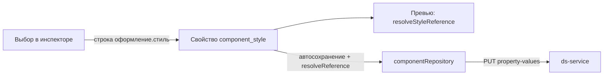

## Контекст

`StyleReferenceProp` хранит значение как строку `basic-button.xxs.default`; `resolveStyleReference`
разворачивает её в конфигурацию целевого компонента и выбранные стили по осям (используется превью).
Запись правок в `componentRepository` отправляет значение свойства как `tokenId`/`value`/`adjustment`
в `invariant-/variation-property-values` и ссылок не знает. Операция `PUT /api/projects/{projectId}/design-systems/{designSystemId}/appearances/{id}/property-values`
с `reference` уже реализована в `ds-service`.

## Цели / Вне целей

**Цели:** выбор оформления и стилей в инспекторе; запись через существующую операцию; понятные
ошибки проверки.

**Вне целей:** изменения `ds-service`, `frontend-kt`, превью; редактирование ссылок у значений с
наборами состояний сверх того, что даёт общий инспектор.

## Решения

1. **Каскад выборов.** Выбор оформления целевого компонента, затем по одному выбору на ось. Состояние
   выбора получается из строки существующим `resolveStyleReference` (общая логика с превью), а строка
   собирается обратно в порядке осей оформления. Альтернатива — плоский список всех сочетаний:
   отвергнута из-за комбинаторного роста.
   Каскад строится на общих контролах инспектора — `TokenField` (`component-token-field`) с всплывающим
   `TokenPicker` (`component-token-picker`), как выбор иконки, и выглядит как остальные поля. Подсказка поиска и
   текст пустого списка задаются `TokenField` отдельно («Найти конфигурацию», «Найти стиль»).
2. **Ограничение платформой и допустимые цели.** Каскад включается, только когда платформа
   редактируемого компонента (`Meta.getPlatform()`) равна `compose`; иначе остаётся поле для чтения.
   Целью может быть любое оформление любого compose-компонента той же дизайн-системы, кроме
   собственного оформления. Связи свойства с допустимым целевым компонентом в модели нет, поэтому
   ограничения по компоненту (например, только кнопка для стиля вложенной кнопки) вне scope;
   недопустимую ссылку отклоняет сервер.
   Строка значения несёт только имя оформления, и разворачивание берёт первое одноимённое, поэтому при
   одинаковых именах оформлений у разных компонентов предлагается только первое: остальные выбором не
   выразить.
3. **Источник данных и догрузка цели.** В `composeComponentsData` полные конфигурации есть только у
   выбранного компонента и у целей его текущих ссылок, остальные компоненты представлены индексом
   без вариаций и стилей. Список оформлений берётся из индекса, а конфигурация выбранной цели
   загружается по требованию существующим `loadComponent` сессии редактора (чтение компонента через
   `EditorSectionData`) и попадает в общий снимок. Пока идёт загрузка, оси цели показывают
   состояние загрузки; при ошибке загрузки выбор не меняется и показывается сообщение.
4. **Запись.** `saveComponentMutation` получает необязательную функцию разворачивания строки значения в `reference`
   (идентификатор целевого оформления и идентификаторы стилей; её даёт
   `DesignSystem.resolveComposeStyleReference`). Для свойства типа `component_style` репозиторий вызывает
   `PUT /api/projects/{projectId}/design-systems/{designSystemId}/appearances/{id}/property-values` с `reference`, остальные изменения идут прежним путём;
   `PropertyChange` не меняется. Удаление использует существующую операцию удаления значения.
   Отложенная правка хранится в `localStorage` и повторяется после перезагрузки: перед повтором клиент догружает
   конфигурации оформлений, на которые она ссылается (иначе ссылка не разворачивается в `reference`). Пока у конфигурации
   есть несохранённая правка, пересоздание очереди из-за смены снимка не сбрасывает основу сравнения: иначе правка стала бы
   «уже сохранённой» и на сервер не ушла бы. У сочетаний вариаций `component_style` только читается: их значения пишутся
   строкой, без `reference`.
   Применённый снимок (в том числе от догрузки цели) не пересоздаёт экземпляры компонентов с прежним содержимым
   (`keepUnchangedComponents`): иначе открытый редактор получал бы новый объект, а правка, сделанная секундой раньше на
   прежнем, пропадала бы с экрана до следующего перечитывания компонента.
5. **Группа в инспекторе и показ только заданных.** Свойства `component_style` выносятся в отдельную группу
   `Nested styles` после `Icons` (раньше они попадали в `Behaviour`, которая открывается свёрнутой). Как у
   `Additional`, группа показывает только заданные значения: пустых строк и «Показать все свойства» нет
   (`isSetOnlySection`). Ссылку у свойства, у которого значения ещё нет, из инспектора создать нельзя: так, в
   отличие от иконки (#157, где пустое свойство выбирается из каталога), у вложенного стиля нет значения по
   умолчанию, а допустимые цели модель не ограничивает. Заданные ссылки приходят из засева и импорта; создание
   новой ссылки с нуля вне scope этого изменения.
6. **Ошибки.** Коды `reference_*` из ответа `422` превращаются в понятное сообщение ошибки
   сохранения; отклонённое значение не записывается, отказ показывает существующий индикатор автосохранения.



## Программное проектирование

```ts
interface StyleReferenceChange { targetAppearanceId: string; styleIds: string[] }
const buildStyleReferenceValue: (config: Config, selections: Record<string, string>) => string;
const toStyleReferenceInput: (resolved: ResolvedStyleReference) => StyleReferenceChange | undefined;
```

## Риски / Компромиссы

- Догрузка добавляет сетевое чтение при выборе цели; повторный выбор той же цели использует кэш
  снимка.
- Строка значения и `reference` должны оставаться согласованными: сервер пересобирает текст из
  действующих имён, клиент сверяет значение после ответа.
- Неочевидно, как автосохранение выделяет изменения значения с состояниями; покрывается тестами.
