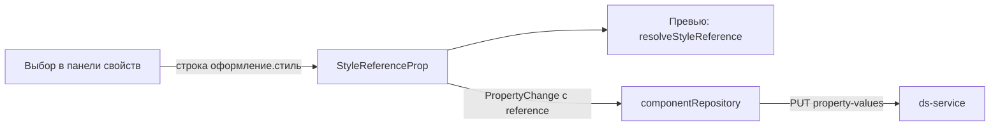

## Контекст

`StyleReferenceProp` хранит значение как строку `basic-button.xxs.default`; `resolveStyleReference`
разворачивает её в конфигурацию целевого компонента и выбранные стили по осям (используется превью).
Запись правок в `componentRepository` отправляет значение свойства как `tokenId`/`value`/`adjustment`
в `invariant-/variation-property-values` и ссылок не знает. Операция `PUT /api/ds/appearances/{id}/property-values`
с `reference` уже реализована в `ds-service`.

## Цели / Вне целей

**Цели:** выбор оформления и стилей в панели свойств; запись через существующую операцию; понятные
ошибки проверки.

**Вне целей:** изменения `ds-service`, `frontend-kt`, превью; редактирование ссылок у значений с
наборами состояний сверх того, что даёт общая панель свойств.

## Решения

1. **Каскад выборов.** Выбор оформления целевого компонента, затем по одному выбору на ось. Состояние
   выбора получается из строки существующим `resolveStyleReference` (общая логика с превью), а строка
   собирается обратно в порядке осей оформления. Альтернатива — плоский список всех сочетаний:
   отвергнута из-за комбинаторного роста.
2. **Ограничение платформой и допустимые цели.** Каскад включается, только когда платформа
   редактируемого компонента (`Meta.getPlatform()`) равна `compose`; иначе остаётся поле для чтения.
   Целью может быть любое оформление любого compose-компонента той же дизайн-системы, кроме
   собственного оформления. Связи свойства с допустимым целевым компонентом в модели нет, поэтому
   ограничения по компоненту (например, только кнопка для стиля вложенной кнопки) вне scope;
   недопустимую ссылку отклоняет сервер.
3. **Источник данных и догрузка цели.** В `composeComponentsData` полные конфигурации есть только у
   выбранного компонента и у целей его текущих ссылок, остальные компоненты представлены индексом
   без вариаций и стилей. Список оформлений берётся из индекса, а конфигурация выбранной цели
   загружается по требованию существующим чтением компонента (`componentRepository.loadComponentData`
   через `EditorSectionData`) и попадает в общий снимок. Пока идёт загрузка, оси цели показывают
   состояние загрузки; при ошибке загрузки выбор не меняется и показывается сообщение.
4. **Запись.** В `PropertyChange` добавляется необязательное поле `reference` (идентификатор целевого
   оформления и идентификаторы стилей). `componentRepository` для изменений с `reference` вызывает
   `PUT /api/ds/appearances/{id}/property-values`, остальные изменения идут прежним путём. Удаление
   использует существующую операцию удаления значения.
5. **Ошибки.** Коды `reference_*` из ответа `422` сопоставляются с сообщениями в существующем
   механизме показа ошибок автосохранения.



## Программное проектирование

```ts
interface StyleReferenceChange { targetAppearanceId: string; styleIds: string[] }
interface PropertyChange { /* ... */ reference?: StyleReferenceChange }
const buildStyleReference: (components: Meta[], appearanceId: string, selections: Record<string, string>) =>
    { value: string; reference: StyleReferenceChange } | undefined;
```

## Риски / Компромиссы

- Догрузка добавляет сетевое чтение при выборе цели; повторный выбор той же цели использует кэш
  снимка.
- Строка значения и `reference` должны оставаться согласованными: сервер пересобирает текст из
  действующих имён, клиент сверяет значение после ответа.
- Неочевидно, как автосохранение выделяет изменения значения с состояниями; покрывается тестами.
