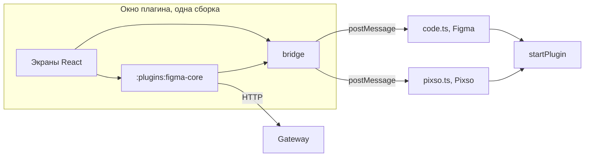
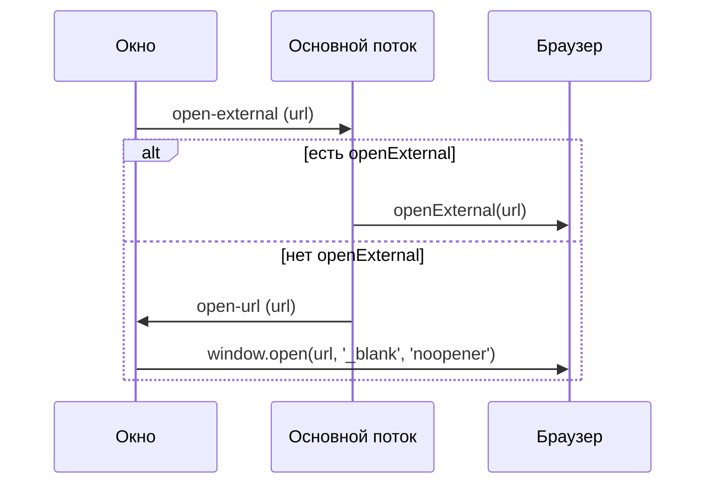

## Контекст

Плагин Figma разделён на основной поток (`src/main`) и окно на React (`src/ui`). Окно не вызывает `figma.*` и общается с
основным потоком сообщениями, а `PluginHost` уже отделяет логику команд от API редактора. Вход, сессия и запросы к gateway
лежат в `:plugins:figma-core`: окно получает их через `DsBuilderCore`, а хранилище передаёт ему мостом. Значит, модуль
зависит только от `get`, `set` и `delete` моста и про редактор не знает.

Pixso повторяет эту модель. Прототип проверен в десктопном Pixso на сборке до переноса в Kotlin: окно загружается как
`data:`-iframe с origin `null`, в API нет `openExternal`, запросы к `/auth/token` и `/api/projects` проходят через gateway
без изменений. Типы `@pixso/plugin-typings` 2.0.4 тоже не содержат `openExternal`. В окне нет `crypto.randomUUID`, но
мост уже использует счётчик. Сборка с Kotlin/JS в Pixso ещё не запускалась, это внешняя проверка этого изменения.

## Цели и границы

**Цели:**

- одна кодовая база окна для Figma и Pixso;
- одна интеграция с бэкендом: Pixso использует `:plugins:figma-core` без отдельного кода;
- тонкая точка входа Pixso;
- воспроизводимый локальный запуск в отладчике Pixso.

**Вне целей:**

- запись токенов в файл редактора;
- публикация плагина в Pixso;
- тёмная тема в Pixso: имена CSS-переменных не описаны, действуют запасные значения из `styles.css`;
- переименование `js/apps/figma-plugin` и вынос окна в отдельный пакет;
- отдельный клиент Keycloak для Pixso.

## Решения

### Вторая цель сборки в том же приложении

`npm run build:pixso` запускает обычную сборку и собирает `dist-pixso/` рядом с `dist/`. Окно собирается один раз вместе с
Kotlin-модулем и копируется, отличаются только `code.js` и манифест. Поэтому порог размера `ui.html` и проверка, что окно
не обращается к бэкенду напрямую, действуют и для Pixso.

`scripts/pack-pixso.mjs` проверяет собранный `code.js`: он должен использовать `pixso` и не должен содержать `figma`, сетевых
API и адреса gateway. Проверка смотрит результат сборки, поэтому ловит и код из `src/shared`, и неверный глобальный объект.

Альтернативы: копия приложения удваивает каждую правку; вынос общего пакета и переименование сейчас пересекаются с #148 и
этапом экспорта, их лучше сделать отдельно, когда экспорт покажет реальные границы.

### Общие Kotlin-модули без изменений

Проверка `openExternal` остаётся в основном потоке и в мосте окна, в Kotlin её не переносим. `DsBuilderCore` не открывает
браузер: экран входа получает адрес и вызывает мост. Основной поток тоже остаётся на TypeScript, как решено в
`2026-11-06-reuse-kotlin-core-in-figma-plugin`: API редактора доступен только в песочнице.

Имя модуля и клиента Keycloak содержат `figma`, но ни модуль, ни клиент от Figma не зависят. Переименование пересекается с
этапом экспорта и в это изменение не входит.



### Общий запуск основного потока

`startPlugin` принимает минимальный структурный интерфейс API редактора. Точки входа `code.ts` и `pixso.ts` только
передают свой глобальный объект.

`@pixso/plugin-typings` не подключается: он объявляет те же глобальные типы, что и `@figma/plugin-typings`. Для Pixso
достаточно `declare const pixso: EditorApi`.

Импорт Figma-сборки как есть не выбран: заявленная совместимость Pixso не описывает глобальный `figma`, а значения
`editorType` у редакторов разные.

### Браузер открывается из окна, если нет `openExternal`

Основной поток проверяет наличие метода. Если метода нет, он отправляет окну сообщение `open-url`, окно вызывает
`window.open(url, '_blank', 'noopener')`. Обработчик есть и в окне сборки Figma, поэтому окно принимает только `http` и
`https`, а `noopener` не даёт странице входа ссылку на окно плагина. Прототип вызывал `window.open` без `noopener`, итоговую
форму проверяет внешняя задача. Десктопный Pixso передаёт такие вызовы в системный браузер и возвращает `null` даже при успехе, поэтому
результат вызова не считается признаком ошибки.

Проверка метода оставляет одну сборку окна без признака редактора и сама подхватит `openExternal`, если он появится.



### Свой локальный сервер вместо `@pixso/plugin-cli`

Отладчик Pixso подключается к `ws://localhost:5201/plugin` и принимает сообщения `{ name, content }`. Скрипт
`scripts/pixso-dev.mjs` отправляет готовую сборку.

`plugin-cli dev` не подходит: он загружает окно с `http://localhost:5201`, такой origin gateway не разрешает, и добавляет
webpack ради одной команды. Готовый HTML даёт origin `null`, как в боевом режиме.

## Программное проектирование

```ts
/** Часть API редактора, нужная основному потоку. */
export interface EditorApi {
    showUI(html: string, options: { width: number; height: number; themeColors: boolean }): void;
    clientStorage: {
        getAsync(key: string): Promise<string | undefined>;
        setAsync(key: string, value: string): Promise<void>;
        deleteAsync(key: string): Promise<void>;
    };
    ui: {
        postMessage(message: MainToUi): void;
        onmessage: ((message: UiToMain, properties: { origin: string }) => void) | undefined;
    };
    openExternal?(url: string): void;
}

export const startPlugin: (editor: EditorApi, html: string) => void;

export type MainToUi =
    | { type: 'storage:result'; requestId: string; value: string | null; error?: string }
    | { type: 'open-url'; url: string };
```

## Риски и компромиссы

- [`window.open` заблокирован в веб-версии Pixso] → адрес открывается после асинхронного запроса кода, поэтому браузер может
  счесть вызов всплывающим окном. Результат вызова нельзя проверить, код на экране сохраняется. Если внешняя проверка
  покажет блокировку, окно должно показывать адрес, это потребует дополнения спецификации.
- [Сборка с Kotlin/JS не запускалась в Pixso] → движок Ktor `Js` проверен в окне Figma с тем же origin `null`, а внешние
  проверки этого изменения выполняются на итоговой сборке.
- [`clientStorage` очищается вместе с кэшем браузера] → пользователь входит заново, данные не теряются.
- [Имя `dsbuilder-figma-plugin` и папка `figma-plugin` вводят в заблуждение] → принимается до этапа выделения общего пакета.
- [Порт 5201 задан редактором] → при занятом порте команда завершается с ошибкой.

## Открытые вопросы

- Как распространять плагин в Pixso: `plugin-cli pkg` создаёт архив, но приватная публикация не описана. Решается вне этого
  изменения.
