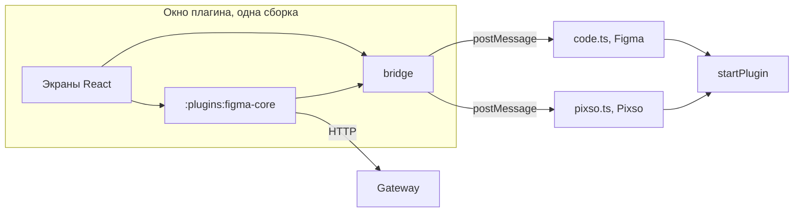
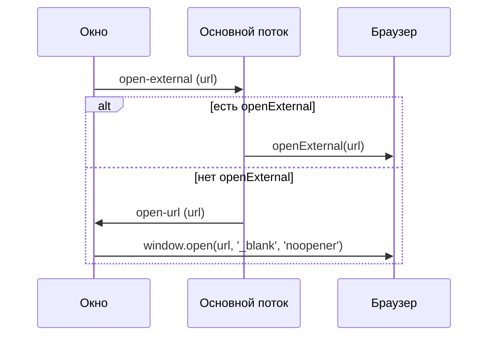

## Контекст

Плагин Figma разделён на основной поток (`src/main`) и окно на React (`src/ui`). Окно не вызывает `figma.*` и общается с
основным потоком сообщениями, а `PluginHost` уже отделяет логику команд от API редактора. Вход, сессия и запросы к gateway
лежат в `:plugins:figma-core`: окно получает их через `DsBuilderCore`, а хранилище передаёт ему мостом. Значит, модуль
зависит только от `get`, `set` и `delete` моста и про редактор не знает.

Pixso повторяет эту модель. Прототип проверен в десктопном Pixso на сборке до переноса в Kotlin: окно загружается как
`data:`-iframe с origin `null`, в API нет `openExternal`, запросы к `/auth/token` и `/api/projects` проходят через gateway
без изменений. Типы `@pixso/plugin-typings` 2.0.4 тоже не содержат `openExternal`. В окне нет `crypto.randomUUID`, но
мост уже использует счётчик. Сборка с Kotlin/JS в Pixso ещё не запускалась, это внешняя проверка этого изменения.

## Цели и границы

**Цели:**

- одна кодовая база окна для Figma и Pixso;
- одна интеграция с бэкендом: Pixso использует `:plugins:figma-core` без отдельного кода;
- тонкая точка входа Pixso;
- воспроизводимый локальный запуск в отладчике Pixso;
- экспорт темы в Pixso тем же планом и той же записью, что в Figma.

**Вне целей:**

- публикация плагина в Pixso;
- веб-версия Pixso: адрес открывается после асинхронного запроса, и браузер может заблокировать окно;
- ограничение доменов манифестом Pixso: поддержка `networkAccess` не описана, адрес gateway задаётся только сборкой;
- тёмная тема в Pixso: имена CSS-переменных не описаны, действуют запасные значения из `styles.css`;
- переименование `js/apps/figma-plugin` и вынос окна в отдельный пакет;
- отдельный клиент Keycloak для Pixso.

## Решения

### Вторая цель сборки в том же приложении

`npm run build:pixso` запускает обычную сборку и собирает `dist-pixso/` рядом с `dist/`. Окно собирается один раз вместе с
Kotlin-модулем и копируется, отличаются только `code.js` и манифест. Поэтому порог размера `ui.html` и проверка, что окно
не обращается к бэкенду напрямую, действуют и для Pixso.

`scripts/pack-pixso.mjs` проверяет собранный `code.js`: он должен использовать `pixso` и не должен содержать `figma`, сетевых
API и адреса gateway. Проверка смотрит результат сборки, поэтому ловит и код из `src/shared`, и неверный глобальный объект.

Альтернативы: копия приложения удваивает каждую правку; вынос общего пакета и переименование сейчас пересекаются с #148 и
этапом экспорта, их лучше сделать отдельно, когда экспорт покажет реальные границы.

### Общие Kotlin-модули без изменений

Проверка `openExternal` остаётся в основном потоке и в мосте окна, в Kotlin её не переносим. `DsBuilderCore` не открывает
браузер: экран входа получает адрес и вызывает мост. Основной поток тоже остаётся на TypeScript, как решено в
`2026-11-06-reuse-kotlin-core-in-figma-plugin`: API редактора доступен только в песочнице.

Имя модуля и клиента Keycloak содержат `figma`, но ни модуль, ни клиент от Figma не зависят. Переименование пересекается с
этапом экспорта и в это изменение не входит.



### Общий запуск основного потока

`startPlugin` принимает минимальный структурный интерфейс API редактора. Точки входа `code.ts` и `pixso.ts` только
передают свой глобальный объект.

`@pixso/plugin-typings` не подключается: он объявляет те же глобальные типы, что и `@figma/plugin-typings`. Для Pixso
достаточно `declare const pixso: EditorApi`.

Импорт Figma-сборки как есть не выбран: заявленная совместимость Pixso не описывает глобальный `figma`, а значения
`editorType` у редакторов разные.

### Браузер открывается из окна, если нет `openExternal`

Основной поток проверяет наличие метода. Если метода нет, он отправляет окну сообщение `open-url`, окно вызывает
`window.open(url, '_blank', 'noopener')`. Обработчик есть и в окне сборки Figma, поэтому окно принимает только `http` и
`https`, а `noopener` не даёт странице входа ссылку на окно плагина. Прототип вызывал `window.open` без `noopener`, итоговую
форму проверяет внешняя задача. Десктопный Pixso передаёт такие вызовы в системный браузер и возвращает `null` даже при успехе, поэтому
результат вызова не считается признаком ошибки.

Проверка метода оставляет одну сборку окна без признака редактора и сама подхватит `openExternal`, если он появится.



### Свой локальный сервер вместо `@pixso/plugin-cli`

Отладчик Pixso подключается к `ws://localhost:5201/plugin` и принимает сообщения `{ name, content }`. Скрипт
`scripts/pixso-dev.mjs` отправляет готовую сборку.

`plugin-cli dev` не подходит: он загружает окно с `http://localhost:5201`, такой origin gateway не разрешает, и добавляет
webpack ради одной команды. Готовый HTML даёт origin `null`, который разрешает gateway.

### Экспорт: один план, возможности редактора при записи

План строит `:plugins:figma-core`, его запись `applyExportPlan` общая. Отличия Pixso проверены пробой API в веб-Pixso
(файл в черновиках, проба создаёт и удаляет объекты) и сведены в `ExportEditor` из `src/shared/editor.ts` и переходник
`pixsoExportApi`:

| Что | Figma | Pixso по пробе | Экспорт в Pixso |
|---|---|---|---|
| Ссылка с прозрачностью | составной цвет | `Invalid variable value` | цвет по значениям плана, одна оговорка |
| Стопы градиента | `boundVariables` у стопа | привязка молча сбрасывается | план строит пару стилей `Light/…` и `Dark/…` |
| Текстовый стиль | `setBoundVariable` | метода нет | значения стиля без привязки, одна оговорка |
| Сплошной слой, цвет тени | `setBoundVariableForPaint/Effect` | работают | как в Figma |
| Чтение стилей | `getLocal*StylesAsync` | есть и синхронные | переходник читает синхронными, как в типах 2.0.4 |
| Имена переменных | уникальны в коллекции | повторы разрешены | запись сама не создаёт повторов |
| Данные плагина у переменных, коллекций, стилей | сохраняются | пропадают после перезагрузки | таблица на `pixso.root` по `id` |
| Число коллекций | по тарифу | бесплатная команда — одна | отказ с причиной «ограничено тарифом» |
| Область `FONT_WEIGHT` | есть | сохраняется как `FONT_STYLE` | принимается как есть |

Повторный экспорт находит объекты по ключу DS Builder в общих данных плагина. В Pixso эти данные у переменных, коллекций
и стилей не переживают перезагрузку, а у документа переживают, и `id` объектов стабильны. Поэтому `pixsoExportApi`
подменяет `get/setSharedPluginData` у объектов Pixso: значения живут в таблице `id → данные` на `pixso.root`. Таблица
сохраняется одним вызовом `flush` после экспорта, в том числе после отказа:

- части по 60 000 символов пишутся новым поколением, указатель `objects.head` переключается последним, прежнее поколение
  очищается — сбой посередине оставляет прежнюю таблицу;
- записи отбрасываются только для объектов, которых нет в файле: `flush` сам читает актуальные `id`, поэтому прерванный
  экспорт не теряет ключи стилей, до которых не дошёл;
- повреждённая таблица останавливает экспорт: с пустой он создал бы дубликаты всех объектов;
- ошибка `flush` добавляется в отчёт, созданное остаётся.

Запись плана и Figma об этом не знают.

Пара стилей для градиентов строится в Kotlin: этот путь планировщик уже использует, когда слои режимов несовместимы.
Окно передаёт `bindGradientStops` в `exportPlan`, планировщик не знает имени редактора. Остальные отличия касаются только
записи и решаются в основном потоке.

Цвет ссылки берётся из плана, а не из файла: план содержит значения палитры. Режим берётся тот же, у коллекции с одним
режимом — единственный; альфа цвета умножается на прозрачность ссылки в процентах. Привязка текстового стиля проверяется
по наличию метода: если Pixso его добавит, привязка заработает без правок.

Окно узнаёт редактор запросом `editor:get` и подставляет имя в кнопку и тексты отчёта. До ответа экспорт недоступен:
иначе план построился бы для Figma, а записывался в Pixso. Отказ создать коллекцию в обоих редакторах объясняется
возможным лимитом тарифа: другой причины этого отказа ни один редактор не описывает. Совет про Figma Font Installer
показывается только в Figma.

Альтернатива — отдельный план для Pixso — отклонена: отличия в плане сводятся к одному признаку, остальное — запись.

## Программное проектирование

```ts
/** Часть API редактора, нужная основному потоку. */
export interface EditorApi {
    showUI(html: string, options: { width: number; height: number; themeColors: boolean }): void;
    clientStorage: {
        getAsync(key: string): Promise<string | undefined>;
        setAsync(key: string, value: string): Promise<void>;
        deleteAsync(key: string): Promise<void>;
    };
    ui: {
        postMessage(message: MainToUi): void;
        onmessage: ((message: UiToMain, properties: { origin: string }) => void) | undefined;
    };
    openExternal?(url: string): void;
}

export interface EditorHost {
    editor: ExportEditor;
    applyExport(plan: ExportPlan): Promise<ExportReport>;
}

export const startPlugin: (editor: EditorApi, html: string, host: EditorHost) => void;

export interface ExportEditor {
    name: string;
    composedColors: boolean;
    gradientStopBindings: boolean;
}

export const applyExportPlan: (plan: ExportPlan, api: ExportFigmaApi, editor?: ExportEditor) => Promise<ExportReport>;
export type PixsoExportApi = ExportFigmaApi & { flush(): void };
export const pixsoExportApi: (pixso: PixsoDocumentApi) => PixsoExportApi;

// :plugins:figma-core
public fun exportPlan(
    projectId: String,
    designSystemId: String,
    tenantId: String,
    versionId: String?,
    themeName: String,
    platform: String,
    bindGradientStops: Boolean,
    signal: CoreSignal?,
): Promise<String>

export type MainToUi =
    | { type: 'storage:result'; requestId: string; value: string | null; error?: string }
    | { type: 'editor:result'; requestId: string; editor: ExportEditor; error?: string }
    | { type: 'open-url'; url: string };

// Член UiToMain: окно спрашивает редактор.
// | { type: 'editor:get'; requestId: string }
```

## Риски и компромиссы

- [Проба шла в веб-Pixso, а пользователи работают в десктопном] → десктоп загружает тот же веб-клиент с pixso.net; полный
  экспорт проверяется внешней задачей в десктопе. Если Pixso добавит составной цвет или привязку стопов, флаг в
  `PIXSO_EDITOR` включает их без других правок.
- [Таблица ключей живёт в документе] → копия файла переносит её вместе с объектами; если таблицу удалить, повторный экспорт
  создаст объекты заново, прежние останутся.
- [Бесплатная команда Pixso создаёт одну коллекцию] → экспорт останавливается на второй с причиной; полная проверка нужна на
  платной команде.
- [Градиент в Pixso — два стиля] → дизайнер меняет стиль при смене режима вручную, как для несовместимых градиентов в Figma.
- [Ссылки с прозрачностью в Pixso становятся цветом] → смена палитры не меняет такие значения до повторного экспорта.
- [Скачивание архива шрифтов из окна `data:` в Pixso не проверено] → проверяется внешней задачей.

- [`window.open` заблокирован в веб-версии Pixso] → адреса на экране нет, поэтому вход не завершится. Веб-версия вне целей;
  её поддержка потребует показывать адрес в окне и дополнить спецификацию.
- [Сборка с Kotlin/JS не запускалась в Pixso] → движок Ktor `Js` проверен в окне Figma с тем же origin `null`, а внешние
  проверки этого изменения выполняются на итоговой сборке.
- [`clientStorage` очищается вместе с кэшем браузера] → пользователь входит заново, данные не теряются.
- [Имя `dsbuilder-figma-plugin` и папка `figma-plugin` вводят в заблуждение] → принимается до этапа выделения общего пакета.
- [Порт 5201 задан редактором] → при занятом порте команда завершается с ошибкой.

## Открытые вопросы

- Какой origin у окна установленного плагина: проверен только запуск через отладчик. Если origin другой, понадобится изменить
  `OIDC_PLUGIN_ORIGINS`. Проверяется перед раздачей плагина.
- Как распространять плагин в Pixso: `plugin-cli pkg` создаёт архив, но приватная публикация не описана. Решается вне этого
  изменения.
