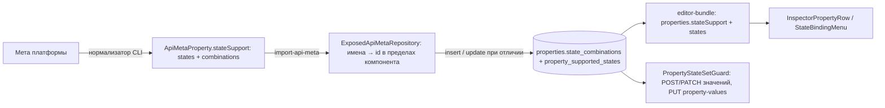
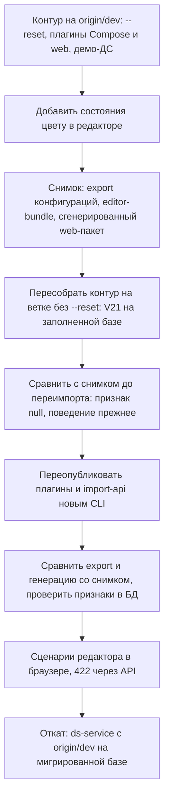

## Контекст

Значение свойства оформления уже может храниться в наборе состояний (`state_sets`), а словарь состояний `states`
различает общие состояния (`component_id IS NULL`) и состояния компонента. Но ни `ds-service`, ни редактор не знают,
в каких состояниях генератор платформы может выразить значение свойства. Редактор угадывает это по типу и имени
(`InspectorPropertyRow`: цвет без `focus`), а меню предлагает только `hovered`, `pressed`, `focused`.

Сведения разложены между метой и генераторами кода платформ:

| Платформа | Что выражает генератор | Где это знание |
|---|---|---|
| Compose | `StatefulValue` и `InteractiveColor`; состояния переводятся в `InteractiveState` (`focused`, `pressed`, `hovered`, `activated`, `selected`) или в `stateEnum` компонента, остальные имена отбрасываются (`PropertyMapper.toStateEnums`) | `PropertyMapper`, plasma-android |
| View | селекторы по `states` свойства для `color`, `dimension`, `float`, `typography`: состояния framework (`focused`, `pressed`, `hovered`, `activated`, `checked`) и привязки компонента; `stateValues` — дополнительные значения под состоянием (например, `readonly` у `valueColor` поля ввода через `valueColorReadOnly`) | `ValueStateListGenerator`, `ViewStateResolver`, plasma-android |
| SwiftUI | типы `Stateful*` (`StatefulFillStyle` читает `source.states`) и параметры с полем `state` | `StatefulFillStyleContextBuilder` и `InteractiveState`, plasma-ios |
| web | только одиночные состояния, для которых есть токен: превью отвечает `unsupported_state` на сочетание и на состояние без токена | `preview-web-plugin`, `js/cli` |

Поэтому признак — не вид вроде «только взаимодействие / любые», а явный список состояний свойства и флаг
сочетаний. Сведение к виду теряет точность: у web `Button.backgroundColor` есть токены только для `pressed` и
`hovered`, а Compose не выражает общие `disabled` и `readonly`.

Что уже есть в мете:

- собственные состояния компонента: `stateEnum` у Compose и SwiftUI, `stateSets` у View;
- какие слоты принимают значения по состояниям: перегрузки и `paramSimpleType` у Compose и SwiftUI, тип и
  `stateValues` у View, токены с `state` у web.

Не хватает одного: какие общие состояния выражает генератор платформы.

### Общие состояния базы и платформ

В базе общий словарь из семи состояний (`component_id IS NULL`, базовая миграция `V1`): `pressed`, `hovered`,
`focused`, `selected`, `activated`, `readonly`, `disabled`. Это объединение по всем платформам, а не то, что
выражает конкретный генератор.

У каждой платформы два уровня состояний:

- **общие** — генератор понимает их у любого компонента;
- **собственные** — их объявляет компонент.

Генератор разрешает имя сначала среди собственных состояний компонента, затем среди общих. Имя, которого нет ни
там, ни там, Compose отбрасывает, View считает ошибкой генерации, а iOS не может разобрать в конфигурации.

| Состояние | В общем словаре базы | Compose | View | iOS | web |
|---|---|---|---|---|---|
| `pressed` | да | ✅ | ✅ | ✅ | если у свойства есть токен |
| `hovered` | да | ✅ | ✅ | ✅ | если у свойства есть токен |
| `focused` | да | ✅ | ✅ | ✅ | если у свойства есть токен |
| `activated` | да | ✅ | ✅ | ✅ | не встречается |
| `selected` | да | ✅ | ❌ | ✅ | если у свойства есть токен |
| `readonly` | да | ❌ только собственное | ❌ только у отдельных параметров через `stateValues` | ✅ | не встречается |
| `disabled` | да | ❌ только собственное | ❌ | ❌ нет вообще | не встречается |
| `checked` | нет | ❌ только собственное | ✅ | ✅ | — |
| `indeterminate`, `error`, `inactive`, `text-inlined` | нет | ❌ только собственные | ❌ только собственные | ✅ | — |
| `collapsed` | нет | ❌ только собственное | ✅ через `sharedStates` | ✅ | — |

Откуда это знание у каждой платформы:

- **Compose.**
  - Общие — `InteractiveState` из uikit-compose (`InteractiveColor.kt`), пять имён.
  - Собственные — `stateEnum` компонента. В текущей мете это, например: `TextField` и `TextArea` — `readonly`,
    `disabled`; `Editable` — `readonly`; `DropZone` — `disabled`, `dragging-over`; `CheckBox` — `checked`,
    `indeterminate`, `error`.
  - Так `readonly` работает у `TextField` и пропадает у `Button`.
- **View.**
  - Общие — состояния Android из `AndroidState` (`focused`, `pressed`, `hovered`, `activated`, `checked`) и
    словарь `sharedStates` в корне меты. В корпусе нормализатора в нём есть `accent`, `black`, `clear`,
    `collapsed`; есть ли там `disabled` и `readonly`, по полной мете ещё не проверено.
  - Собственные — `stateSets` компонента.
  - `stateValues` — дополнительное значение конкретного параметра в состоянии, а не состояние компонента.
- **iOS.**
  - Общие — `ComponentState` генератора (совпадает с `InteractiveState` в `SDDSThemeCore`), двенадцать имён.
  - Состояния вне этого списка конфигурация iOS не выражает, поэтому `disabled` на iOS нет: недоступность задаётся
    свойствами вроде `disabledAlpha`.
  - `stateEnum` компонента выбирает часть общего списка, например `collapsed`.
- **web.**
  - Общего списка нет: у свойства ровно те состояния, для которых есть токен. В локальной мете встречаются
    `hovered`, `pressed`, `focused`, `selected`.
  - Превью и генерация выражают только одиночные состояния.

Выводы:

- только `pressed`, `hovered` и `focused` работают на всех платформах (на web — при наличии токена);
- `readonly` и `disabled` в базе общие, но как общие их понимает только iOS (`readonly`). На Compose это
  собственные состояния отдельных компонентов, на View — дополнительные значения отдельных параметров;
- `checked` и ещё пять имён у View и iOS общие, а в общем словаре базы их нет: в базе они существуют только как
  собственные состояния компонента. Если у компонента такого состояния нет, имя попадает в `unresolvedStates`
  импорта.

Поэтому меню не может предлагать весь общий словарь базы. Если зашить списки платформ в CLI, копия разойдётся с
генератором при первом новом состоянии. Поэтому общие состояния объявляет генератор меты (`interactionStates`),
собственные приходят из `stateEnum` и `stateSets`, а имя разрешается сначала у компонента, затем в общем словаре —
так же, как в генераторах.

## Цели / Вне целей

**Цели:**

- перенести признак из меты в глобальный слой компонентов и отдавать его редактору;
- сделать признак источником правды для кнопки «Добавить состояние» и списка состояний в меню;
- дать состояния свойствам любого типа, а не только цвету;
- не допустить ни одной операцией записи редактора, включая автосохранение, состояние, которое генератор платформы
  не выражает;
- разрешать состояния по идентификатору в пределах компонента, а не по имени во всём каталоге.

**Вне целей:**

- ограничение импорта конфигураций, сидов, копирования конфигурации и генерации по признаку;
- удаление уже записанных значений недопустимых состояний;
- состояния у строк пересечений стилей (их нет и сейчас).

## Решения

### Список состояний и флаг сочетаний; `NULL` — признак не задан

Признак хранится двумя частями:

- `properties.state_combinations boolean NULL` — флаг сочетаний;
- `property_supported_states (property_id, state_id)` — список с внешними ключами на `properties` (`ON DELETE
  CASCADE`) и `states`.

`NULL` во флаге означает «мета ещё не сообщила», а не «состояний нет». Миграция не может вывести признак из БД, а
пустой список всем существующим свойствам сломал бы редактору привычное добавление состояний цвету до повторного
импорта. Поэтому при `NULL` редактор и операции работают как до изменения. Отдельно от признака проверяется одно:
состояние набора общее или принадлежит компоненту свойства.

Альтернативы отклонены:

- **Вид `none` / `interaction` / `any`.** Не выражает точный список web, не исключает `disabled` и `readonly` у
  Compose и не говорит о сочетаниях.
- **Массив имён в `properties`.** Имя неоднозначно: `checked` есть у `CheckBox`, `RadioBox` и `Switch`, поэтому
  список хранит идентификаторы, разрешённые в пределах компонента.
- **Заполнение миграцией по эвристике редактора.** Эвристика ошибается в обе стороны, а миграция закрепила бы
  ошибку в данных как сведения меты.

### Общие состояния объявляет мета, правило по слотам — нормализатор

Генератор меты Compose, View и SwiftUI отдаёт `stateSupport: { interactionStates, combinations }` — общие
состояния, которые выражает генератор кода, и флаг сочетаний:

- Compose — `UikitComposeApiMetaTask`, plasma-android;
- View — `UikitApiMetaTask`, plasma-android;
- SwiftUI — генератор `ios-api-meta.json`, plasma-ios.

Список строится из того же кода, которым генератор переводит состояния конфигурации: `InteractiveState` в
`PropertyMapper` и `AndroidState` в plasma-android, `InteractiveState` в `SDDSThemeCore` в plasma-ios. Тест в
репозитории платформы проверяет, что каждое имя списка генератор переводит в код.

Форма корня меты не меняется. Корень Compose и SwiftUI — массив, и прежний CLI, а также превью, читают его
как список. Поэтому у этих платформ поле стоит у каждой записи компонента с одним значением на всю мету, а у View —
в корневом объекте рядом с `sharedStates`. Нормализаторы разбирают мету с `ignoreUnknownKeys`, так что прежний
CLI новую мету читает без ошибок.

Нормализатор складывает список свойства из `interactionStates` и того, что мета уже описывает. Правило по слотам
(таблица в спеке `cli-components`) остаётся в CLI: оно опирается на типы самой меты, а не на внутренние
перечисления генератора. Собственных списков состояний в CLI нет.

### Web — исключение: признак следует из формата меты

У web нет списка общих состояний генератора: превью применяет любое состояние, для которого у свойства есть токен,
и отвечает `unsupported_state`, если токена нет. Поле `interactionStates` для web пришлось бы заполнять списком,
заведённым в `js/cli` вручную, то есть перенести зашитое знание из нормализатора в генератор меты, заплатив за это
подъёмом версий `js/cli` и `preview-web-plugin` и зависимостью выкатки от их релиза.

Всё нужное для признака web-мета уже содержит:

- список свойства — состояния его токенов (`state`);
- `combinations: false` — у токена одно поле `state`, поэтому значение для сочетания в web-мете описать нельзя.

Это вывод из формата данных, а не знание о генераторе, — так же, как тип `StatefulValue` у Compose говорит, что
слот принимает состояния. Поэтому web-нормализатор задаёт признак при любой версии меты, `js/cli` и плагин не
меняются, а признак у web появляется при первой публикации новым CLI. Если web-превью научится сочетаниям, это
потребует нового формата меты (список состояний у токена), из которого флаг выведется так же.

Деление состояний токенов на общие и собственные в web-нормализаторе остаётся прежним (`INTERACTION_STATES`), и
`interactionStates` в манифест web не передаёт.

### Мета без поля

«Не знаем» не равно «нет». Если в мете Compose, View или SwiftUI нет `stateSupport` (мета прежнего генератора), поле
`ApiMetaProperty.stateSupport` равно `null` и не уходит в манифест, а импорт признак не меняет. Пустой список
нормализатор ставит, только когда мета с полем говорит, что слот состояний не принимает.

Нормализатор передаёт `interactionStates` в манифест отдельным полем верхнего уровня. Имя, которое не разрешается
ни в общее, ни в собственное состояние компонента, не создаёт состояния и попадает в `unresolvedStates` отчёта: так
видно расхождение меты и базы, а импорт свойства при этом не теряется.

### Таблица `states` — хранилище, мета — источник правды о поддержке

Таблица `states` остаётся: на её строки ссылаются наборы `state_sets` и через них все значения в состояниях, по
общим строкам импорт конфигураций переводит имена в идентификаторы, по ним собираются экспорт, копии и версии, а
`property_supported_states` ссылается на неё внешним ключом. Убрать общие строки значило бы завести `hovered` у
каждого компонента и перенести все существующие наборы.

Лишним оказывается закрытый список из семи имён, заведённый миграцией: он спорит с метой. Поэтому импорт меты сам
заводит общие состояния из `interactionStates`, которых в словаре нет, так же как уже заводит собственные состояния
компонента. Семь существующих строк и их фиксированные идентификаторы остаются: на них ссылаются данные. Строки не
удаляются, даже если платформа их не объявила: словарь общий для всех платформ, а что поддерживает платформа,
говорит список свойства.

### Одно правило разрешения имени: сначала общее, затем компонента

Сейчас имя состояния разрешается тремя разными способами:

| Путь | Как сейчас |
|---|---|
| импорт конфигураций (`ComponentConfigImporter.stateSet`) | сначала общее, затем компонента |
| операции редактора (`EditorSupport.stateIds`) | первое попавшееся среди общих и компонента |
| клиент (`componentRepository`) | по имени во всём каталоге, включая чужие компоненты |

Кроме того, импорт меты заводит собственное состояние компонента, даже если такое имя есть среди общих: у Compose
`TextField` есть собственные `readonly` и `disabled` рядом с общими. Такие строки — «тени» общих.

Правило становится одним для всех путей: **сначала общее, затем собственное состояние компонента**, чужие
компоненты не рассматриваются. Выбран порядок импорта конфигураций: значения, импортированные из конфигураций, уже
ссылаются на общие идентификаторы, и смена порядка изменила бы ключи существующих значений. Генераторы различают
состояния только по имени, поэтому для генерации разницы нет.

«Тени» продолжают заводиться: требование «Порядок импорта платформ не влияет на состав данных» не позволяет
пропускать собственное состояние в зависимости от того, импортирована ли раньше платформа, объявившая это имя общим.
Они безвредны: новые записи их не выбирают, бандл их не отдаёт, а правило допустимого набора сравнивает имена,
поэтому значение, когда-то записанное в «тень», остаётся допустимым и редактируемым.

### Импорт обновляет признак, как статус устаревания

Импорт аддитивен, но признак — сведения меты, а не правка пользователя, и он должен догонять код компонентов.
Поэтому признак обновляется у существующего свойства так же, как `deprecated` у алиаса: только если поле пришло в
манифесте и отличается флаг или множество разрешённых идентификаторов. Поле необязательно, чтобы прежние CLI не
сбрасывали признак. Изменения считает `stateSupportChanged`.



### Проверка на всех маршрутах записи значения

Обычное автосохранение пишет цвета, числа и другие значения через `POST`/`PATCH`
`invariant-property-values` и `variation-property-values`. Через `PUT …/appearances/{id}/property-values`
(`AppearanceEditorValueOperations`) идёт только ссылка `component_style`. Поэтому проверка выносится в один
компонент `PropertyStateSetGuard` слоя `data` и вызывается в транзакции записи каждого из этих маршрутов. На
`PATCH` проверяется набор изменяемой строки по текущему признаку: вкладка, открытая до переимпорта, не сможет
продолжать править значение в состоянии, которое мета убрала.

Не проверяются:

- импорт конфигураций и сиды: в существующих конфигурациях есть значения в состояниях, которые мета может не
  подтвердить, и отказ импорта потерял бы данные;
- копирование при дублировании конфигурации: копия повторяет источник;
- удаление и переупорядочивание: недопустимое значение должно оставаться удаляемым.

Коды ошибок разделены: `state_not_in_component` — нарушена целостность (чужое состояние), `states_not_supported` —
состояние не поддерживает генератор.

### Доступные состояния приходят бандлом, клиент работает по идентификаторам

`editor-bundle` добавляет `states` с полями `id`, `name` и `componentId`: общие состояния и собственные состояния
этого компонента без «теней». Признак свойства отдаёт `stateIds`. Сейчас `componentRepository` строит общую карту
`name → id` по всему каталогу и ищет готовый набор по склеенным именам. Из-за этого `CheckBox` может получить
`checked` другого компонента. Клиент разрешает имя по `states` бандла (сначала общее, затем компонента), ищет набор
по множеству идентификаторов и создаёт новый из них же. Имя в конфигурации и превью остаётся строкой.

### Строки состояний — тот же контрол, что у базы

В `InspectorPropertyRow` контрол базового значения уже выбирается по типу. Выбор выносится в функцию, которая
строит контрол для значения и обработчика; ей пользуются и строка свойства, и строки состояний. Тип `PropState`
расширяется до строки имени состояния: имена приходят из бандла, а не из фиксированного списка. При
`combinations: false` меню ведёт себя как выбор одного варианта.

## Программное проектирование

```kotlin
// backend-kt/ds-service, domain
data class PropertyStateSupport(val stateIds: List<UUID>, val combinations: Boolean)

data class ComponentPropertySummary(
    /* существующие поля */
    val stateSupport: PropertyStateSupport?,
)

/** Правило допустимого набора; componentStateIds — общие состояния и состояния компонента свойства. */
object StateSetRule {
    sealed interface Verdict { object Allowed : Verdict; object ForeignState : Verdict; object NotSupported : Verdict }
    fun check(support: PropertyStateSupport?, componentStateIds: Set<UUID>, set: Set<UUID>): Verdict
}

// application
data class ImportApiMeta.Property(
    val name: String,
    val type: String,
    val aliases: List<ApiMetaAlias>,
    val description: String?,
    val stateSupport: StateSupportManifest? = null,
)
data class StateSupportManifest(val states: List<String>, val combinations: Boolean)

data class ApiMetaImportReport(
    /* существующие поля */
    val stateSupportChanged: Int,
    val unresolvedStates: List<String>,
)

// data: вызывается из invariant/variation create и update и из AppearanceEditorValueOperations
class PropertyStateSetGuard {
    /** Бросает EditorRuleViolationException("state_not_in_component" | "states_not_supported", …). */
    fun requireAllowed(propertyId: UUID, stateSetId: UUID?)
}
```

```kotlin
// frontend-kt/feature-components, domain/apimeta
internal data class ApiMetaStateSupport(val states: List<String>, val combinations: Boolean)

internal data class ApiMetaProperty(
    /* существующие поля */
    /** `null` — признак не выведен: поле не уходит в манифест, и импорт не меняет признак. */
    val stateSupport: ApiMetaStateSupport? = null,
)

/** Общие состояния генератора из меты; `null` — мета прежнего генератора. */
internal data class MetaStateSupport(val interactionStates: List<String>, val combinations: Boolean)

public data class ApiMetaImportReport(
    /* существующие поля */
    public val stateSupportChanged: Int = 0,
    public val unresolvedStates: List<String> = emptyList(),
)
```


```kotlin
// plasma-android (Compose — у записи компонента, View — в корне), plasma-ios (у записи компонента)
data class MetaStateSupport(val interactionStates: List<String>, val combinations: Boolean)
```

```ts
// js/apps/client
interface StateSupport { stateIds: string[]; combinations: boolean }
interface ComponentStateOption { id: string; name: string; componentId: string | null }

interface ComponentPropertyDto { /* … */ stateSupport?: StateSupport | null }
interface ComponentEditorBundleDto { /* … */ states?: ComponentStateOption[] }
interface ComponentAPI { /* … */ stateSupport?: StateSupport | null }

/** Состояния, которые меню предлагает свойству; пусто — кнопки нет. */
function bindableStates(prop: ComponentAPI, states: ComponentStateOption[], isCombination: boolean): ComponentStateOption[];

/** Имя → id в пределах компонента: состояние компонента, затем общее. */
function resolveStateId(name: string, states: ComponentStateOption[]): string | undefined;
```

## Модель данных и контракты

- Миграция `V21__property_state_support.sql`. Номер фиксируется при реализации следующим свободным после `dev` и
  открытого PR #167: тот после перенумерации своих `V19`/`V20` займёт `V21`–`V22`. Содержимое:
  - `ALTER TABLE properties ADD COLUMN state_combinations boolean NULL`;
  - `CREATE TABLE property_supported_states (property_id uuid NOT NULL REFERENCES properties ON DELETE CASCADE,
    state_id uuid NOT NULL REFERENCES states, PRIMARY KEY (property_id, state_id))` с индексом по `state_id`.

  Значения не заполняются.
- `ImportApiMetaRequest.Property.stateSupport: { states: List<String>, combinations: Boolean }?`; пустое имя или
  отсутствие одного из полей делает тело невалидным (`valid()`).
- `ImportApiMetaResponse.stateSupportChanged: Int`, `unresolvedStates: List<String>`.
- `ComponentPropertySummaryResponse.stateSupport: { stateIds: List<String>, combinations: Boolean }?` — пишется
  всегда, в том числе `null`.
- `ComponentEditorBundleResponse.states: List<ComponentStateResponse>`.
- Ошибки `422 states_not_supported` и `422 state_not_in_component` у `POST` и `PATCH` `invariant-property-values` и
  `variation-property-values` и у `PUT …/appearances/{appearanceId}/property-values`.
- Все изменения описываются в `openapi/documentation.yaml`; маршруты не добавляются, `route-manifest.json` не
  меняется.

## Миграция и совместимость

- Новые поля ответов добавочные; клиенты, не знающие их, не ломаются. Новый CLI с прежним backend не получает
  отказа: маршрут импорта разбирает тело с `ignoreUnknownKeys = true` (`ApiMetaImportRoutes`), признак просто не
  запишется.
- Прежний CLI с новым backend не шлёт `stateSupport`, признаки не меняются.
- Новый CLI с метой прежнего генератора не шлёт `stateSupport`: поле в мете необязательное, и нормализаторы
  разбирают мету с `ignoreUnknownKeys`. Прежний CLI с метой нового генератора поле игнорирует.
- Клиент `origin/dev` с новым backend: признак не задан до переимпорта, поэтому проверка пропускает его записи, кроме
  состояния чужого компонента. Такое состояние прежний клиент может отправить по ошибке разрешения имён, и `422`
  здесь — исправление, а не регрессия.
- Порядок выкатки:
  1. backend, затем клиент;
  2. релиз CLI;
  3. релизы генераторов меты в plasma-android и plasma-ios;
  4. публикация плагинов превью в CI платформ новым CLI с новой метой.

  У web признак появляется уже на шаге 4 с прежней метой: релиз генератора не нужен. Платформы догоняют
  независимо. До импорта меты с полем редактор работает для платформы по прежней эвристике.
- Откат: столбец nullable, новая таблица ссылается на существующие, старый код их не читает. Откат приложения не
  требует отката схемы. Удаление свойства или состояния каскадом чистит `property_supported_states` по
  `property_id`. Удаление общего состояния, на которое ссылается список, блокируется внешним ключом; сейчас общие
  состояния не удаляются ни одним маршрутом.

## План проверки и развёртывания

Мета попадает в базу двумя путями, и оба проверяются: `dsbuilder components import-api` и публикация плагина превью
(`dsbuilder preview-plugin publish` → `POST /api/admin/{platform}/plugin-builds`; так её импортирует CI). Оба пути
собирают тело одной функцией `toImportRequest`, поэтому признак в теле проверяется тестом этой функции и тестом
`HttpPreviewPluginRemoteSource`.

### Локальные автоматические проверки

- `tools/verify fast` и `tools/verify full`: detekt, spotless, модульные тесты, интеграционные тесты ds-service на
  PostgreSQL (Testcontainers), сборки `frontend-kt` и `js`.
- Интеграционные тесты проверки набора проходят по каждому маршруту записи: `POST` и `PATCH` обоих видов значений
  и `PUT property-values`.
- Тесты нормализаторов на корпусах с полем `stateSupport`. Примеры из ревью:
  - Compose `Slider.thumbColor` — без `disabled` и `readonly`;
  - View `BasicButton.backgroundColor` с пустым `stateValues` — со списком;
  - SwiftUI `CheckBox.toggleIconColor` — со списком;
  - web `Button.backgroundColor` — `pressed`, `hovered`, без сочетаний, на текущей web-мете без изменений.

  Отдельно — мета Compose, View и SwiftUI без поля (признак не уходит) и записи с разными значениями (`Invalid`).
- Тесты генераторов меты в репозиториях платформ: каждое имя `interactionStates` генератор кода переводит в код.
- Тесты клиента (`vitest`) и существующий e2e-набор Playwright (`npm run test:e2e`) на локальном контуре: он
  проверяет автосохранение цвета, журнал, откат и темы, то есть то, что может задеть общий код строки свойства.

### Локальный контур: обновление с состояния dev

Проверка повторяет выкатку на заполненную базу, а не на пустую:



1. Поднять контур на `origin/dev` (`./setup-local.sh --reset` с `--components-package`), добавить в редакторе
   состояния цветовым свойствам. Снять снимок: `POST …/component-config/export` всех компонентов обеих платформ,
   `editor-bundle` нескольких компонентов, сгенерированный web-пакет.
2. Пересобрать контур на ветке без `--reset`. Ожидание: Flyway применил `V21`, `/health` готов, `flyway: true`.
3. До переимпорта: `state_combinations` у всех свойств `NULL`, `property_supported_states` пуста; export и генерация
   побайтно совпадают со снимком; редактор ведёт себя по прежнему правилу; e2e-набор проходит.
4. Сначала опубликовать плагин Compose с прежней метой (без поля): `stateSupportChanged = 0`. Затем собрать мету
   Compose генератором из локальной ветки plasma-android. Переопубликовать плагины Compose и web скриптом
   `publish-preview-plugin.sh` с JVM CLI ветки и выполнить `import-api` для web из текущей меты: у web признак
   появляется без изменения меты.

   View и SwiftUI на контуре не проверяются: файлов их меты локально нет. Их покрывают тесты генераторов меты в
   репозиториях платформ и тесты нормализаторов. Миграция проверяется на демо-данных контура, копия базы dev не
   используется. Ожидания:
   - `stateSupportChanged` ненулевой;
   - `createdStates` учитывает общие состояния из `interactionStates`, которых не было в словаре; список созданных
     имён записан;
   - `unresolvedStates` разобран: каждое имя объяснено;
   - подсчитаны «тени» (собственные состояния с именем общего) и значения, записанные в них: они остаются
     допустимыми;
   - по платформам подсчитано, сколько уже записанных значений в состояниях стали недопустимыми и у скольких
     свойств: свойство с пустым списком, состояние не из списка, сочетание при запрете сочетаний. Это масштаб
     значений, которые после выкатки станут только для чтения;
   - выборочные списки в БД верны: Compose `DropZone.paddingStart` содержит `dragging-over`, `Slider.thumbColor` — пять
     состояний взаимодействия без `disabled`, web `Button.backgroundColor` — `pressed`, `hovered` без сочетаний;
   - повторная публикация даёт `0`.
5. Export и генерация после переимпорта совпадают со снимком: признак не влияет на выгрузку.
6. В редакторе (встроенный браузер):
   - состояние `dragging-over` числовому свойству `DropZone` сохраняется и видно в превью Compose;
   - меню web `Button.backgroundColor` предлагает только `pressed` и `hovered` и не даёт выбрать оба;
   - свойство без списка — без кнопки, прежняя строка состояния только для чтения и удаляется;
   - состояние `disabled` в `TextField` записывается с общим идентификатором, а прежнее значение в «тени»
     `disabled` редактируется;
   - собственное состояние одного компонента не попадает в набор другого.

   Через API:
   - запись недопустимого набора через `POST` и `PATCH` значений и через `PUT property-values` даёт
     `422 states_not_supported`;
   - набор с состоянием чужого компонента даёт `422 state_not_in_component`;
   - удаление проходит.
7. Устаревшая вкладка: открыть редактор, переимпортировать мету с убранным состоянием (правленый файл web-меты),
   изменить значение этого состояния в открытой вкладке — автосохранение получает `422`, редактор возвращает прежнее
   значение.

### Совместимость версий

- Прежний CLI (`dsbuilder` из `PATH`) с новым backend: импорт проходит, признаки не меняются.
- Новый CLI с backend `origin/dev`: импорт проходит, поле игнорируется.
- Клиент `origin/dev` с новым backend и новый клиент с backend `origin/dev`: редактор открывается, работает
  запасное правило.

### Откат

На базе с применённой `V21` запускается ds-service из `origin/dev`. Flyway по умолчанию пропускает применённые
миграции из будущего (`ignoreMigrationPatterns = *:future`), а `ExistingDatabaseAdopter` проверяет отпечаток схемы
только при отсутствии истории Flyway, поэтому старт ожидается успешным; это проверяется на контуре, а не
предполагается. Миграция добавляет nullable-столбец без значения по умолчанию и пустую таблицу: в PostgreSQL это
изменение каталога без перезаписи `properties`.

### После выкатки

Признак на dev и проде появится по платформе только после двух условий: релиз её генератора меты и публикация её
плагина CLI с этим изменением в CI. До этого редактор для платформы работает по прежнему правилу. Наблюдение после выкатки ведётся
по чек-листу выкатки, а не задачами этого изменения:

- доля свойств с заданным признаком по платформам;
- число записанных значений, ставших недопустимыми, тем же запросом, что на контуре;
- содержимое `unresolvedStates` в логах CI;
- отсутствие всплеска `422 states_not_supported` и `state_not_in_component` в логах.

## Риски / Компромиссы

- **Изменение зависит от релизов в репозиториях платформ.** Митигация: поле в мете необязательное, платформы
  догоняют независимо, без поля сохраняется прежнее поведение. Контракт поля описан здесь и в
  `API_META_NORMALIZERS.md`, а задачи платформ вынесены в отдельный раздел.
- **Генератор меты может объявить список, который расходится с генератором кода.** Митигация: список строится из
  того же кода и закрепляется тестом в репозитории платформы.
- **В web-нормализаторе остаётся список `INTERACTION_STATES`** — копия семи общих имён базы, по которой состояния
  токенов делятся на общие и собственные. Он был до этого изменения и от него не зависит. При расхождении со
  словарём базы он даёт только «тени»: имя всё равно находит общее состояние по правилу «сначала общее».
- **Правило «какой слот принимает состояния» остаётся в CLI.** Новый тип слота, например новый `Stateful*` у iOS,
  потребует правки нормализатора. Принято: правило опирается на типы самой меты и меняется вместе с её форматом, а
  не со списком состояний.
- **View: признак по типу свойства может быть шире фактического для слотов, где генератор селектор не
  применяет.** Принято: генератор строит селекторы для всех свойств этих типов (`ViewPropertyMapperTest`), а
  лишнее состояние безопаснее отсутствия нужного.
- **Состояния генератора, которых нет в словаре базы, отбрасываются.** Например, iOS `text-inlined` у компонента
  без такого состояния. Митигация: `unresolvedStates` в отчёте и проверка на контуре.
- **Проверка `state_not_in_component` действует и при незаданном признаке.** Принято: такая запись — ошибка
  целостности, генерация её не выразит.
- **Расширение `PropState` до строки затрагивает превью и генерацию.** Превью уже получает имена состояний строками
  из ds-service; меняется только тип в клиенте, проверяется сборкой и тестами клиента.

## Открытые вопросы

- Нужно ли со временем отказаться от запасного правила для `NULL` (после того, как все платформы переимпортированы),
  решается отдельным изменением.
