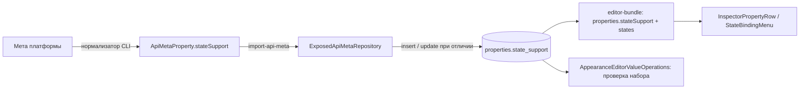
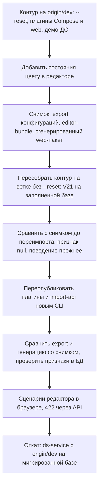

## Контекст

Значение свойства оформления уже может храниться в наборе состояний (`state_sets`), а словарь состояний `states`
различает общие состояния взаимодействия (`component_id IS NULL`) и состояния компонента. Но ни `ds-service`, ни
редактор не знают, какой слот платформы принимает значение по состояниям. Редактор угадывает это по типу и имени
(`InspectorPropertyRow`: цвет без `focus`), а меню предлагает только `hovered`, `pressed`, `focused`.

Мета платформ этот признак уже содержит, но нормализаторы CLI его отбрасывают:

| Платформа | Поле меты | Вывод |
|---|---|---|
| Compose | перегрузка `paramSimpleType` у повторов `id` | `StatefulValue` → `any`, иначе `InteractiveColor` → `interaction`, иначе `none` |
| View | `stateValues` параметра | непустой → `any`, иначе `none` |
| SwiftUI | `state` у повторов `id` | все состояния взаимодействия → `interaction`, есть иное → `any`, нет → `none` |
| web | токены с `state` | так же, как SwiftUI |

## Цели / Вне целей

**Цели:**

- перенести признак из меты в глобальный слой компонентов и отдавать его редактору;
- сделать признак источником правды для кнопки «Добавить состояние» и списка состояний в меню;
- дать состояния свойствам любого типа, а не только цвету;
- не допустить через операции редактора состояние, которое слот платформы не поддерживает.

**Вне целей:**

- изменение генераторов меты в репозиториях платформ;
- ограничение импорта конфигураций, сидов и генерации по признаку;
- удаление уже записанных значений состояний у свойств `none`;
- состояния у строк пересечений стилей (их нет и сейчас).

## Решения

### Три значения признака и `NULL`

Признак — enum `property_state_support` (`none`, `interaction`, `any`) в nullable-столбце `properties.state_support`.
Булева пометки мало: у Compose `InteractiveColor` принимает только состояния взаимодействия, а `StatefulValue` — ещё
и состояния компонента (`dragging-over` у `DropZone`). `NULL` означает «мета ещё не сообщила», а не «состояний нет»:
миграция не может вывести признак из БД, а ставить `none` всем существующим свойствам значит сломать редактору
привычное добавление состояний цвету до повторного импорта. Поэтому при `NULL` редактор и операции работают как до
изменения.

Альтернатива — заполнить признак миграцией по эвристике редактора — отклонена: эвристика ошибается в обе стороны,
и миграция закрепила бы её ошибку в данных как сведения меты.

### Признак выводит CLI, backend формат меты не знает

Правило «backend не разбирает формат меты» (`component-api-meta-import`) сохраняется: каждый нормализатор выводит
признак по своей платформе (таблица выше), а манифест несёт готовое значение `stateSupport`. Свойство сводится из
нескольких вхождений меты, поэтому признак вычисляется по всем вхождениям, а не по первому. Состояние
взаимодействия узнаётся тем же словарём и той же канонизацией, что уже есть в `WebApiMetaNormalizer`
(`INTERACTION_STATES`); словарь выносится в общий для нормализаторов объект.

### Импорт обновляет признак, как статус устаревания

Импорт аддитивен, но признак — сведения меты, а не правка пользователя, и он должен догонять код компонентов. Поэтому
признак обновляется у существующего свойства так же, как `deprecated` у алиаса: только если поле пришло в манифесте и
значение отличается. Поле необязательно, чтобы прежние CLI не сбрасывали признак. Изменения считает
`stateSupportChanged`; отдельных счётчиков на каждое значение нет, потому что дизайнеру важен сам факт перемены.



### Проверка в операциях редактора, а не в импорте

Проверка набора выполняется в `AppearanceEditorValueOperations` при записи значения с непустым набором: это граница,
через которую пишут и web-редактор, и MCP. Импорт конфигураций и сиды не проверяются: в существующих
конфигурациях есть значения в состояниях, которые мета может не подтвердить, и отказ импорта потерял бы данные.
Удаление и переупорядочивание не проверяются, чтобы недопустимое значение можно было убрать.

### Доступные состояния приходят бандлом

Чтобы меню знало состояния компонента без дополнительного запроса, `editor-bundle` добавляет `states`: общие
состояния и состояния этого компонента, в том же DTO `ComponentStateResponse`, что отдаёт каталог. Отдельный запрос к
`/catalog/states` не нужен; форма существующих маршрутов не меняется.

### Строки состояний — тот же контрол, что у базы

В `InspectorPropertyRow` контрол базового значения уже выбирается по типу. Выбор выносится в функцию, которая
строит контрол для значения и обработчика; ей пользуются и строка свойства, и строки состояний. Тип `PropState`
расширяется до строки имени состояния: имена приходят из бандла, а не из фиксированного списка.

## Программное проектирование

```kotlin
// backend-kt/ds-service, domain
enum class PropertyStateSupport { NONE, INTERACTION, ANY }

data class ComponentPropertySummary(
    /* существующие поля */
    val stateSupport: PropertyStateSupport?,
)

// application
data class ImportApiMeta.Property(
    val name: String,
    val type: String,
    val aliases: List<ApiMetaAlias>,
    val description: String?,
    val stateSupport: PropertyStateSupport? = null,
)

data class ApiMetaImportReport(/* существующие поля */ val stateSupportChanged: Int)

// domain: правило допустимого набора
object StateSupportRule {
    fun allows(support: PropertyStateSupport?, componentScoped: Boolean, empty: Boolean): Boolean
}

// data: AppearanceEditorValueOperations бросает EditorRuleViolationException("states_not_supported", …)
```

```kotlin
// frontend-kt/feature-components, domain/apimeta
internal enum class ApiMetaStateSupport { NONE, INTERACTION, ANY }

internal data class ApiMetaProperty(
    /* существующие поля */
    val stateSupport: ApiMetaStateSupport = ApiMetaStateSupport.NONE,
)

internal object InteractionStates {
    fun isInteraction(name: String): Boolean
    fun supportOf(states: Collection<String>): ApiMetaStateSupport
}

public data class ApiMetaImportReport(/* существующие поля */ public val stateSupportChanged: Int = 0)
```

```ts
// js/apps/client
type StateSupport = 'none' | 'interaction' | 'any';

interface ComponentPropertyDto { /* … */ stateSupport?: StateSupport | null }
interface ComponentEditorBundleDto { /* … */ states?: Array<{ id: string; name: string; componentId: string | null }> }
interface ComponentAPI { /* … */ stateSupport?: StateSupport | null }

/** Состояния, которые меню предлагает свойству; пусто — кнопки нет. */
function bindableStates(prop: ComponentAPI, states: ComponentStateOption[], isCombination: boolean): string[];
```

## Модель данных и контракты

- Миграция `V21__property_state_support.sql`: `CREATE TYPE property_state_support AS ENUM ('none', 'interaction',
  'any')`; `ALTER TABLE properties ADD COLUMN state_support property_state_support NULL`. Значения не заполняются.
- `ImportApiMetaRequest.Property.stateSupport: String?`; недопустимое значение делает тело невалидным (`valid()`).
- `ImportApiMetaResponse.stateSupportChanged: Int`.
- `ComponentPropertySummaryResponse.stateSupport: String?` — пишется всегда, в том числе `null`.
- `ComponentEditorBundleResponse.states: List<ComponentStateResponse>`.
- Ошибка `422 states_not_supported` у `PUT`-операции записи значения оформления.
- Все изменения описываются в `openapi/documentation.yaml`; маршруты не добавляются, `route-manifest.json` не
  меняется.

## Миграция и совместимость

- Новые поля ответов добавочные; клиенты, не знающие их, не ломаются. Новый CLI с прежним backend не получает
  отказа: маршрут импорта разбирает тело с `ignoreUnknownKeys = true` (`ApiMetaImportRoutes`), признак просто не
  запишется.
- Прежний CLI с новым backend не шлёт `stateSupport`, признаки не меняются.
- Порядок выкатки: backend, затем клиент, затем повторный `dsbuilder components import-api` по каждой платформе. До
  импорта редактор работает по прежней эвристике.
- Откат: столбец nullable и не участвует в ограничениях, откат приложения не требует отката схемы.

## План проверки и развёртывания

Мета попадает в базу двумя путями, и оба проверяются: `dsbuilder components import-api` и публикация плагина превью
(`dsbuilder preview-plugin publish` → `POST /api/admin/{platform}/plugin-builds`; так её импортирует CI). Оба пути
собирают тело одной функцией `toImportRequest`, поэтому признак в теле проверяется тестом этой функции и тестом
`HttpPreviewPluginRemoteSource`.

### Локальные автоматические проверки

- `tools/verify fast` и `tools/verify full`: detekt, spotless, модульные тесты, интеграционные тесты ds-service на
  PostgreSQL (Testcontainers), сборки `frontend-kt` и `js`.
- Тесты клиента (`vitest`) и существующий e2e-набор Playwright (`npm run test:e2e`) на локальном контуре: он
  проверяет автосохранение цвета, журнал, откат и темы, то есть то, что может задеть общий код строки свойства.

### Локальный контур: обновление с состояния dev

Проверка повторяет выкатку на заполненную базу, а не на пустую:



1. Поднять контур на `origin/dev` (`./setup-local.sh --reset` с `--components-package`), добавить в редакторе
   состояния цветовым свойствам. Снять снимок: `POST …/component-config/export` всех компонентов обеих платформ,
   `editor-bundle` нескольких компонентов, сгенерированный web-пакет.
2. Пересобрать контур на ветке без `--reset`. Ожидание: Flyway применил `V21`, `/health` готов, `flyway: true`.
3. До переимпорта: `state_support` у всех свойств `NULL`; export и генерация побайтно совпадают со снимком; редактор
   ведёт себя по прежнему правилу; e2e-набор проходит.
4. Переопубликовать плагины Compose и web скриптом `publish-preview-plugin.sh` с JVM CLI ветки и выполнить
   `import-api` для web из файла меты. View и SwiftUI на контуре не проверяются: их файлов меты локально нет, вывод
   признака для них покрыт тестами нормализаторов на корпусах. Миграция проверяется на демо-данных контура, копия
   базы dev не используется. Ожидание: ненулевой `stateSupportChanged`;
   распределение признаков по платформам в БД правдоподобно (выборочно `DropZone.paddingStart = any`, свойство только
   с `InteractiveColor` — `interaction`, `Slider.orientation = none`). Повторная публикация даёт `0`.
5. Export и генерация после переимпорта совпадают со снимком: признак не влияет на выгрузку.
6. В редакторе (встроенный браузер): состояние числовому свойству с `any`, меню `interaction` без состояний
   компонента, `none` без кнопки, но с удаляемой прежней строкой, сохранение после перезагрузки, превью Compose
   показывает значение в состоянии. Через API: запись недопустимого набора даёт `422 states_not_supported`, удаление
   проходит.

### Совместимость версий

- Прежний CLI (`dsbuilder` из `PATH`) с новым backend: импорт проходит, признаки не меняются.
- Новый CLI с backend `origin/dev`: импорт проходит, поле игнорируется.
- Клиент `origin/dev` с новым backend и новый клиент с backend `origin/dev`: редактор открывается, работает
  запасное правило.

### Откат

На базе с применённой `V21` запускается ds-service из `origin/dev`. Flyway по умолчанию пропускает применённые
миграции из будущего (`ignoreMigrationPatterns = *:future`), а `ExistingDatabaseAdopter` проверяет отпечаток схемы
только при отсутствии истории Flyway, поэтому старт ожидается успешным; это проверяется на контуре, а не
предполагается. Миграция только добавляет тип и nullable-столбец без значения по умолчанию: в PostgreSQL это
изменение каталога без перезаписи таблицы.

### После выкатки

Признак на dev и проде появится только после публикации плагинов CLI с этим изменением, то есть после релиза CLI и
обновления его версии в CI платформ. До этого редактор работает по прежнему правилу. Наблюдение после выкатки
(распределение `state_support` и отсутствие всплеска `422 states_not_supported` в логах) ведётся по чек-листу
выкатки, а не задачами этого изменения.

## Риски / Компромиссы

- [Формат `stateValues` у View не представлен в корпусе тестов] → читается как произвольный JSON и учитывается
  только факт непустоты; корпус дополняется фрагментом с `stateValues`, а живой импорт View — внешняя проверка.
- [Признак `any` у View шире фактического] → лишнее состояние компонента в меню безопаснее, чем отсутствие нужного;
  уточнение — после появления в мете перечня состояний параметра.
- [Расширение `PropState` до строки затрагивает превью и генерацию] → превью уже получает имена состояний строками
  из ds-service; меняется только тип в клиенте, проверяется сборкой и тестами клиента.

## Открытые вопросы

- Нужно ли со временем отказаться от запасного правила для `NULL` (после того, как все платформы переимпортированы),
  решается отдельным изменением.
