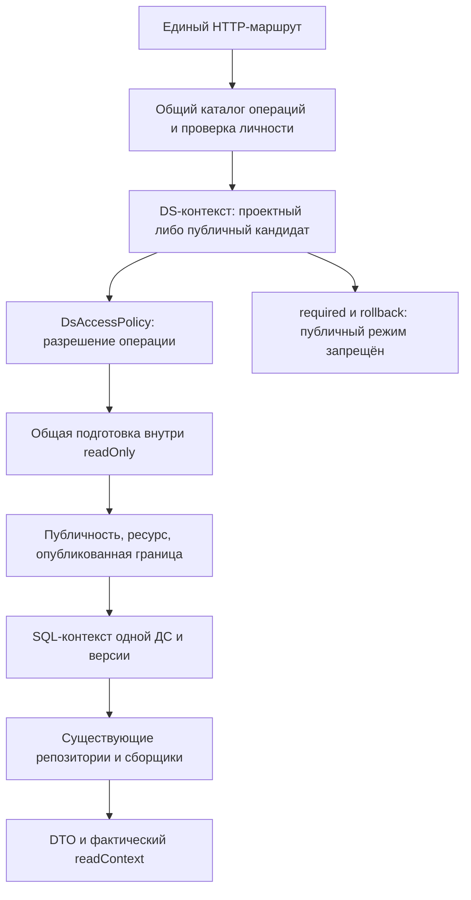

# Проектное решение

## Контекст

Мотивация и состав изменения описаны в `proposal.md`. Работа ведётся в `feature/public-ds`, worktree `.worktrees/feature-public-ds`, от `origin/dev` (`69d54e3c`). Публичным входом является Ktor-монолит `backend-kt/app`; исторические nginx-конфигурации не являются точкой реализации.

Сегодня шлюз требует доступ к проекту до предметного маршрута, `ProjectPrincipal` не представляет гостя, репозитории и транзакционный контекст проверяют проектную принадлежность. CLI/MCP разрешают ссылку без входа, но требуют PAT/OAuth до HTTP. Каталоги используют отдельный `UserSessionAccess`. `status` предварительно читает проект; MCP подставляет `draft`, а CLI-загрузки не проводят выбранную версию через все запросы.

## Цели и границы

Обеспечить одинаковый адресный доступ через веб, CLI и обе точки запуска MCP с серверным решением о правах. Каталоги проектов и ДС, сведения об участниках, документация и её поиск/связи кода, журнал предметных изменений, SSE и любые изменения остаются за пределами публичного доступа. Настоящее изменение не добавляет публичный поиск, секретные ссылки, новые сервисы или отдельное семейство публичных URL.

Глобальная модель компонентов остаётся актуальной общей метой по существующему контракту; опубликованная версия гарантирует границу системных конфигураций, токенов и тем, но не исторический снимок глобальной меты. Техническая `base` не превращается в публичную пользовательскую ДС.

## Решения

### 1. Доступность хранится отдельно от версионированного содержимого

В устойчивой записи ДС хранится `visibility` со значениями `private` / `public`, ограничением допустимых значений и значением по умолчанию `private`. Новая Flyway-миграция не меняет существующие миграции. Все существующие системы становятся приватными; `projectId = null` сохраняет своё техническое значение.

Доступность действует на все опубликованные версии и не входит в их историческую границу. Иначе возврат старой версии мог бы восстановить ранее отозванную публичность. Публикация, откат черновика и импорт файла не должны непреднамеренно менять доступность; импорт и копирование создают приватную ДС. Перенос сохраняет доступность, но прежняя ссылка с прежним проектом перестаёт работать.

`PATCH /api/projects/{projectId}/design-systems/{designSystemId}` принимает необязательное поле `visibility`; его отсутствие сохраняет значение. Право — существующее `design-systems:write`, включая действующие ограничения изменяемости проекта и технической ДС. Для изменения одной доступности опубликованная версия или существование публикаций не требуются. Ответы карточки и списка расширяются полем `visibility`.

### 2. Централизованная граница чтения внутри ds-service

Полная карта текущих операций, цепочек вызовов и исключений находится в [read-operation-map.md](read-operation-map.md). За основу взяты 91 чтение OpenAPI и реальные прикладные вызовы. Цель реализации — менять общую подготовку контекста, транзакционный вход и общие SQL-предикаты; предметные сценарии не вычисляют публичность самостоятельно.

#### Один каталог операций из существующего контракта

В source-of-truth OpenAPI добавляется расширение `x-ds-public-read`: `boundary`, `history`, `version-by-id`, `related-definitions`. Отсутствие расширения означает запрет публичного доступа. `OpenApiDocumentResource` уже загружает описание операций; он формирует один неизменяемый каталог при старте. Прикладной порт каталога не зависит от Ktor или YAML. Шлюз и вход `ds-service` получают одну реализацию через DI. Манифест и зарегистрированные маршруты проверяются против этого источника, а не содержат ещё один независимый список публичных URL.

Описатель определяет операцию, необходимое разрешение, вид чтения и извлечение целевого ресурса. Общий вход чтения до обработчиков один раз разбирает version/versionId, повторения, конфликт селекторов с учётом специальной совместимости проектного GET component-config и ID версии пути, сохраняя различие отсутствия выбора и draft. Он передаёт нормализованные метаданные через единый DS-источник контекста и mapper; это касается и старых обработчиков без modelReadContext. Для сохранения существующих сигнатур допускается внутренний адаптер метаданных, но внешние одноимённые заголовки удаляются и не являются источником разрешений. modelReadContext переиспользует результат, не разбирая выбор заново. Шлюз проверяет метод и канонический шаблон пути; неизвестный метод, несовпавшая форма или недопустимый вид отвергаются. Для глобального определения ID системы явно задан параметром и не получает доверия до предметной проверки. Шлюз не читает БД ДС и не выбирает версию.

`POST .../component-config/export` и `POST .../component-config/web-adapter` описываются как чтение границы. Импорт, включая `dryRun`, публикация, журнал, SSE, проектные каталоги, документация и административные маршруты остаются закрытыми. Имя `policy.read` или факт вызова `readOnly` не доказывают публичную доступность: существующие помощники используются и в сценариях записи/предварительной проверки.

#### Проектная RBAC остаётся прежней

`ProjectPrincipal`, `TrustedProjectPrincipalFactory`, `ProjectActorType`, роли, scopes и `PolicyEvaluator` в `authorization-core` не расширяются гостями. Новый контекст доступа принадлежит `ds-service/core`: настоящая проектная авторизация либо кандидат на публичное чтение конкретной ДС с необязательной проверенной пользовательской идентичностью. Он не создаёт фиктивный principal, роль viewer или PAT.

`DsRequestContext` сохраняет проектные конструкторы и безопасные существующие проекции через адаптер своего контекста: `projectId` берётся из проверенной проектной авторизации либо из проверяемого адреса кандидата, `globalAdmin` и `composePreviewPublisher` у публичного режима всегда ложны. Доступ к `actorId` для мутаций требует настоящего проектного principal. Совместимый DS-адаптер позволяет сохранить чтения `context.principal.globalAdmin` без подстановки фиктивного `ProjectPrincipal`; тип этого представления принадлежит только `ds-service`. Общий `PolicyEvaluator` получает исходный `ProjectPrincipal` только из проектной ветки.

`DsAccessPolicy` для проектной ветки сохраняет существующее делегирование. Для публичного кандидата он проверяет описатель операции и конкретное запрошенное разрешение чтения, но лишь допускает начало разрешения ресурса; ни одно разрешение записи не выдаётся. Сходство permission у карточки, журнала и SSE не открывает последние: обязательна допустимая операция, а не только строка `design-systems:read`.

При отсутствии `Authorization` только адресная операция из каталога получает кандидатный контекст. Неверный PAT/JWT возвращает `401`; недоступная проверка — `503`. Действующий пользователь вне проекта может читать публичную ДС после достоверного отсутствия членства, но недостаточные разрешения участника или выбранного PAT не превращаются в гостевые права.

Для шлюза добавляется узкий прикладной сценарий, использующий JwtVerifier, PersonalAccessTokenVerifier и `ProjectContextResolver`. Уже имеющихся `ProjectContextResolution.Allowed/Denied/Unavailable` достаточно для членства; `projects-service` не получает модель публичности. Порт `JwtVerificationResult` внутри `identity-gateway` расширяется состоянием недоступности: сейчас у него только Valid/Invalid, а адаптер Keycloak сводит JwkException к неверному токену. Недоступный JWKS при отсутствии необходимого проверенного ключа в кеше должен давать `503`; неверная подпись, истёкший токен или неизвестный ключ при успешно полученном JWKS — `401`. При уже доступном проверенном кеше валидная проверка сохраняется. Адаптер учитывает также вложенную причину отказа получения ключа, а не только внешнюю оболочку JWTVerificationException; недоступность не считается отсутствием членства и не даёт гостевой переход. Нельзя переиспользовать любой `GatewayAuthDecision.Forbidden` как отсутствие членства: текущая ветка OAuth преобразует в него также недоступность проверки. Эта неоднозначность устраняется внутри сценария шлюза без изменения общей RBAC.

#### Одно разрешение в каждой транзакции чтения

Оба контекстных варианта `ExposedTransactionRunner.readOnly` используют общий механизм подготовки чтения до блока с данными. В одной транзакции он проверяет текущую доступность, точный проект и ДС, вид операции, принадлежность адресного ресурса и выбирает границу. Результат — неизменяемый подготовленный контекст и безопасные метаданные. Только после этого устанавливаются `ds.design_system_id`, `ds.project_id`, `ds.version_id` и режим чтения; `ds.system_admin` остаётся ложным для публичного режима.

Для простого `readOnly(context)` целевая ДС уже известна из контекста операции. Для перегрузки с `ModelReadTarget` дополнительно проверяется соответствие ресурса пути; вызов существующего resolver не должен второй раз выбирать последнюю публикацию. Для истории публикаций выбранной единственной версии нет; для `/versions/{id}` границу задаёт ID пути, а противоречащий query-селектор даёт `400`.

Простой вариант добавляет фактический `readContext` в `DsResult`, как сейчас делает только вариант с `ModelReadTarget`. Подготовленный контекст передаётся в блок там, где логика использует `context.versionId`: для размеров/типографики достаточно небольшого перехода на перегрузку с выбранным контекстом. Три общих помощника `ComponentModelUseCaseSupport` адаптируются вместе; их многочисленные потребители сохраняют предметную логику. Делегирующий `ListTenantPaletteLinksUseCase` сохраняет метаданные результата палитры вместо создания успеха без `readContext`.

Большинство репозиториев уже учитывают `ds.version_id` через `SelectedVersionBoundary`, `ResolvedRevisionTable` и связанные выборки. Они не получают собственных проверок публичности. Однако контекст не заменяет предметную проверку связи ресурса и не фильтрует глобальную таблицу автоматически: общие `ComponentOwnership` и адаптеры связанных определений должны ограничить читаемые ID выбранной ДС/границей, до пагинации. Политику записывающих SQL-предикатов не меняем.

`required(context)` и `rollback(context)` безусловно отклоняют публичного кандидата до блока, даже при ошибочно переданном описателе. Публичные операции не используют неконтекстные транзакционные перегрузки. Все настройки транзакции явно очищаются/устанавливаются при каждом входе и повторе. Не применяется обёртка вокруг целого HTTP-запроса с открытой JDBC-транзакцией; транзакция остаётся ответственностью прикладного сценария.



Каталог разрешает только попытку чтения; окончательное разрешение и выбор данных находятся внутри транзакции `ds-service`. Альтернативы с одной проверкой шлюза, общей гостевой ролью или массовым добавлением условий в предметные сценарии отклонены из-за расширения границы доверия и дублирования правил.

### 3. Разрешение версии и ошибки

| Режим запроса | Селектор отсутствует | Явная публикация | Явный `draft` |
|---|---|---|---|
| Участник с действующим правом чтения черновика | Черновик | Указанная публикация | Черновик |
| Публичное чтение гостя или пользователя вне проекта | Последняя опубликованная | Указанная публикация | `403` |

Последняя публикация выбирается по максимальному `sequence_number` среди поддерживаемых опубликованных границ данной ДС, а не строковым сравнением версий. `versionId` продолжает работать для доступной опубликованной границы. Совместные или повторные селекторы возвращают `400`, кроме сохраняемого устаревшего параметра проектного GET component-config, описанного ниже. Приватная, удалённая ДС, неверный проект, чужой вложенный ресурс, неизвестная версия или отсутствие публикаций возвращают `404` для публичного чтения без признаков существования ресурса. Каталоги и проектные операции без входа возвращают `401`; изменение публичной ДС гостем также требует входа. Участники с недостаточными правами не получают автоматического расширения проектных полномочий.

Отсутствие селектора сохраняется в модели запроса как отдельное состояние до серверного разрешения; клиент не превращает его в `draft`. `X-DS-Read-Context` содержит фактические `designSystemId`, `version`, `versionId` и безопасный `accessMode` (`project` / `public`). Публичный ответ не содержит актуальные `draftId`, `draftRevision` или журнал черновика. В существующих DTO nullable-поля черновика равны `null`; содержимое обзора, счётчики и preview строятся из выбранной публикации, включая случай удалённой позже темы. Поле `visibility` отражает текущую настройку доступа.

Многошаговый клиент получает фактическую границу из `X-DS-Read-Context` первого разрешённого предметного ответа. Предварительная карточка не обязательна: `components fetch` начинает с экспорта и не требует `design-systems:read` сверх прежнего `components:read`; `theme fetch` может начать со списка тем, веб — с карточки. Разрешение версии выполняется в транзакции этой операции, не отдельным запросом с новыми правами. Полученный опубликованный `versionId` закрепляется во всех следующих зависимых чтениях, включая web-адаптер и обе части `ds fetch`. Список версий остаётся историей нескольких публикаций. Каждый последующий публичный запрос заново проверяет текущую доступность.

Для проектного черновика ответ содержит `version=draft`, `draftId` и `draftRevision`, но не `versionId`. Клиент продолжает через `version=draft`, не использует `draftId` как исторический селектор и не обещает неизменный снимок между запросами. При конкурентной публикации следующий запрос читает уже новый активный черновик с фактическими метаданными. Ни прежний `draftId`, ни номер только что появившейся публикации не подставляются автоматически. Независимые чтения не требуют `expectedDraftRevision` и не вводят новый серверный отказ `DRAFT_CHANGED`. Для гарантии неизменной границы пользователь явно выбирает публикацию.

#### Совместимость GET component-config

Этот маршрут — явное исключение общего разбора селекторов. Для проектного доступа прежний query `version` сохраняется как устаревшая подсказка, которая не выбирает историческую границу. Без `versionId` он читает черновик, а с `versionId` — указанную публикацию; сочетание устаревшего `version` и `versionId` остаётся допустимым. Устаревшее поле становится необязательным: одного `versionId` либо отсутствия обоих селекторов достаточно. Остальные параметры `ds/component/appearance/platform` сохраняются, принадлежность проверяется относительно ДС пути.

Для публичного доступа `version` является обычным точным селектором публикации; отсутствие обоих селекторов выбирает последнюю публикацию, `draft` запрещён, совместное указание `version/versionId` даёт `400`. Различие ограничено совместимостью этого прежнего маршрута и зафиксировано в OpenAPI; оно не переносится на остальные чтения. Новые клиенты, включая участников, продолжают опубликованное чтение через один `versionId`. Общий парсер выбирает правила по проверенному режиму доступа и описателю операции, а обработчик перестаёт безусловно требовать `version`; предметный builder не вычисляет публичность.

### 4. Общие фильтры связанных глобальных определений

Существующие `/design-systems/catalog/...` остаются проектными операциями без выбранной ДС. Для необходимых глобальных чтений добавляется необязательный контекстный параметр `designSystemId` вместе с существующим селектором `versionId`/`version`. Анонимный запрос требует явно указанную систему, проверку публичности и опубликованной границы. Компонент, свойство, зависимость или элемент палитры должны относиться к определениям, используемым этой границей; списки фильтруются этим набором. Никакой предыдущий запрос не сохраняет разрешение в соединении или процессе. Общие `ComponentOwnership.readableDs/projectReadableDs` и выборки используемых компонентов/свойств/состояний/параметров ограничиваются публичной системой и выбранной границей, а не всеми системами проекта. Общая палитра получает аналогичный адаптер связанных ID в `feature-tokens/data`. Отдельно адаптируется `ExposedComponentTemplateRepository.list`, который сейчас читает все web-компоненты напрямую, минуя `ComponentOwnership`: публичный набор ограничивается компонентами выбранной публикации, а `dependsOn` — только доступными компонентами этого набора. Отфильтровываются и сами шаблоны, и вложенные ID зависимостей; добавление шаблонов в ДС остаётся защищённым. Фильтр применяется до пагинации; изменяющие предикаты и проверки чужих ресурсов сохраняются.

Это позволяет оставить существующие маршруты общими и не вводить публичные копии API. CLI передаёт контекст при загрузке палитры; MCP — при чтении глобальной меты компонента; веб — при необходимых вспомогательных чтениях. Несвязанные определения и глобальные плагины не становятся доступными. Браузерный просмотр использует уже размещённые статические средства preview только там, где они не требуют закрытых данных; публикация и управление плагинами остаются защищёнными.

### 5. Общий режим чтения клиентов

Общий механизм получает явное требование операции: `AUTHENTICATED` либо `READ_OPTIONAL`. В режиме `READ_OPTIONAL` и политике `auto` сохраняется порядок PAT → OAuth → анонимный запрос, если источники учётных данных отсутствуют. Принудительные `pat-env`, `user-session`, служебная авторизация, ошибки обновления найденной сессии и отклонённый сервером токен не превращаются в анонимность. Режим записи по умолчанию требует авторизацию.

Анонимный транспорт не отправляет `Authorization`, не обновляет токены, не открывает браузер и не создаёт сессию. Он не выбирает другой URL. Общие контракты используются CLI, JVM/native MCP и Node MCP; остальные потребители сохраняют прежний режим по умолчанию. Новое состояние учитывается в исчерпывающих ветках типов и диагностике `credentialType` без утечки секретов.

`status` проверяет карточку выбранной ДС, не требуя `GET /api/projects/{id}`. Имя проекта берётся из безопасного ответа карточки и не используется для навигации к закрытому проекту. Публичный успех явно означает доступ к опубликованной ДС, а не авторизацию в проекте.

### 6. Ссылки, init и MCP

`dsbuilder://projects/{projectId}/design-systems/{designSystemId}` допускает отсутствие `version` и `platform`; поддерживаются прежние ссылки с параметрами. Платформа не угадывается, API URL остаётся независимым, секреты и неизвестные параметры запрещены. Без версии ссылка означает серверное разрешение при каждом новом открытии, а не навсегда закреплённую публикацию.

`init --design-system <uri>` и явные два ID создают конфигурацию локально, без проверки публичности и без сетевых запросов. Конфликт ссылки с ID отклоняется. Для ссылки с явной версией конфигурация сохраняет необязательное корневое поле `version`; без версии оно отсутствует. Старые конфигурации без поля сохраняют прежнюю совместимость. Указанная в ссылке платформа сохраняется, явный конфликт `--platform` отклоняется. `credential.type=auto` и имя окружения сохраняются без секретов и API URL.

Без полного контекста гость получает сообщение с допустимыми явными параметрами и возможностью выполнить `auth login`; меню и запросы каталогов не запускаются. При наличии выбранной авторизации интерактивный сценарий сохраняется. Получение токена для этого сценария не означает разрешения каталогов: их проверяет сервер.

MCP стартует без входа и workspace, но инструмент чтения требует ссылку либо локальный конфиг. `design_system_versions_list` также принимает явную пару ID, как сейчас. Инструменты `projects_list` и `design_systems_list` остаются авторизованными. Описания показывают две цепочки: прямой адрес для гостя и каталоги для авторизованного пользователя. Выбор не хранится между вызовами. Результат сообщает фактическую версию, которую агент может передать дальше канонической ссылкой.

### 7. Веб-просмотр и управление доступностью

Текущие маршруты ДС и тем становятся доступными для адресного чтения; страницы проектов, списков и настроек сохраняют защиту. Гостевой просмотр не загружает проект, список систем, журнал или SSE и не запускает автосохранение. Все команды изменения и ссылки на закрытые настройки скрыты. Авторизованный пользователь вне проекта видит тот же режим чтения. Участник проекта сохраняет действующий редактор.

В разделе основных настроек сразу под именем размещается поле «Доступность» с вариантами «Приватная» / «Публичная». Используется существующая форма сохранения; клиент отправляет имя и доступность через PATCH, показывает ошибку и не выдаёт неудачное сохранение за успешное. Настройка доступна по существующему `design-systems:write` и ограничениям проекта.

Пояснение: «Опубликованные версии доступны без входа по прямой ссылке. Черновик доступен только участникам проекта с соответствующими правами». Для публичной ДС действие «Скопировать ссылку» копирует веб-URL без версии. Отдельное копирование ссылки для CLI/MCP выдаёт `dsbuilder://…` без версии, не заменяя существующее копирование точной версии. Публичность можно включить до первой публикации; UI объясняет, что до публикации ссылка вернёт отсутствие опубликованных данных.

### 8. Отзыв и кеширование

Публичность проверяется при каждом новом предметном запросе в транзакции чтения. Изменение доступности не меняет историю публикаций. Публичные ответы, включая экспорт, используют `Cache-Control: no-store`; промежуточные кеши не хранят решение о доступе. Клиентские кеши разделяются по API URL, системе, версии и режиму/сессии; смена сессии и доступности сбрасывает соответствующие записи. Переиспользование старого ответа не должно выдавать новые данные после отзыва.

Уже начатое чтение может закончиться по своему транзакционному снимку. Уже загруженные или экспортированные файлы отозвать невозможно; гарантия относится к новым серверным запросам после фиксации приватности.

## Программное проектирование

Имена новых типов ориентировочные; контракты показывают границы ответственности. Серверные типы принадлежат `ds-service/core`, не `authorization-core`.

```kotlin
enum class DsPublicReadKind { BOUNDARY, HISTORY, VERSION_BY_ID, RELATED_DEFINITIONS }

sealed interface DsAccessContext
class ProjectAccess(val principal: ProjectPrincipal) : DsAccessContext
class PublicReadCandidate(
    val projectId: ProjectId,
    val designSystemId: UUID,
    val verifiedUserId: String?,
) : DsAccessContext

// application: неизменяемый описатель из общего каталога; транспортные пути остаются в presentation.
interface DsReadOperationCatalog {
    fun find(operationId: String): DsReadOperation?
}

// application: порт вызывается внутри уже начатой транзакции чтения.
interface DsReadScopeResolver {
    suspend fun resolve(
        context: DsRequestContext,
        target: ModelReadTarget?,
    ): DsResult<PreparedDsRead>
}

// core-application клиента: явный режим операции, без изменения HTTP-маршрута.
enum class CredentialRequirement { AUTHENTICATED, READ_OPTIONAL }
```

`PreparedDsRead` содержит неизменяемый выбранный `DsRequestContext`, вид операции и метаданные `ModelReadContext`; история не получает фиктивную единственную версию. Создание разрешённого контекста не является публичным конструктором произвольных полномочий: прикладной resolver проверяет его при каждом использовании. Объекты SQL-транзакции и Ktor не выходят в `application`.

Серверные `domain`-типы описывают доступность и виды доступа; `application` владеет политикой и портом подготовки, `data` реализует транзакционное разрешение и SQL-границы. `presentation` сопоставляет проверенный метод/путь описателю, разбирает селекторы и формирует DTO/заголовки. `runtime` загружает OpenAPI, `di` передаёт один каталог в `app` и предметный вход. `feature-design-systems` меняет хранение и управление доступностью; `feature-components/data` уточняет общие предикаты определения используемых сущностей. Остальные изменения предметных фич ограничены исключениями карты и тестами.

Клиентские `core-*` владеют общим разрешением доступа и версии; `feature-*` запрашивают нужный режим, не завися друг от друга. `cli` и `mcp-node` остаются представлением и точками сборки зависимостей. `ds fetch` передаёт обеим загрузкам один опубликованный `versionId` либо явный режим живого `draft`; дополнительного обязательного запроса карточки нет.

## Риски и компромиссы

- Ошибка в перечне чтений может открыть запись через POST → один каталог из OpenAPI с отказом по умолчанию, проверка полного покрытия карты и отрицательные тесты импорта, публикации и отката.
- Проверки только в HTTP оставят обход через репозиторий → транзакционная проверка системной принадлежности и версии, включая пакетные/пустые ответы и повтор соединения.
- Перемешивание публикаций и черновика → одна фактическая версия на многошаговое чтение, проверки конкурентной публикации и удаления темы в черновике.
- Глобальная мета не версионируется → сохраняем существующее ограничение и выдаём только связанные определения; не обещаем исторический снимок глобальной меты.
- Старые клиенты явно запрашивают черновик → гостевое чтение требует обновлённых клиентов; сервер не подменяет явный `draft` публикацией.
- Сохранённая, но истёкшая сессия не становится гостевой автоматически → понятная ошибка и явный `auth logout`/повторный вход, без скрытой смены режима.

## Миграция и совместимость

Сначала новая совместимая миграция и серверные контракты, затем клиенты. Старые запросы участников сохраняют черновик по умолчанию, прежние пути и формы тел; новые поля добавляются совместимо. В опубликованных ответах источником данных является граница публикации, а не актуальный черновик. Новые сервисы и настройки развёртывания не нужны. Откат выполняется предыдущей версией приложения без удаления колонки; старый сервер закрывает гостевые запросы. Возврат миграции удалением данных не требуется.

## План проверки и развёртывания

Локально: проверка покрытия всех 91 операций карты, единого каталога и запрета неописанных операций; тесты политики, сценариев, преобразователей DTO, репозиториев с реальным PostgreSQL, Ktor-маршрутов и публичного входа; тесты общего разрешения учётных данных/версии, CLI и обоих MCP; компонентные и браузерные проверки веба. Проверяется матрица private/public × гость/участник/пользователь вне проекта/PAT × отсутствующая/точная/draft-версия. Обязательны неверный токен, недоступная проверка личности, подмена заголовков, чужой ресурс, отзыв, конкурентная публикация и отсутствие публикаций. FAST, независимое review и FULL выполняются по репозиторному workflow; архитектурные тесты, политика Strictacode и файлы процесса не изменяются.

До архивирования проводится внешняя проверка на реально поднятом контуре из этого worktree: подготовить два проекта, участника и пользователя вне проекта, публичную и приватную ДС с двумя публикациями и отличающимся черновиком. Проверить через публичный порт веб в чистом профиле, собранный CLI и оба MCP по stdio. Сохранить команды запуска, HTTP-коды, фактические версии, результаты инструментов и снимки UI без токенов. Отдельно подтвердить components fetch с PAT только на components:read и чтение draft участником при конкурентной публикации. После отключения публичности новый запрос с ранее полученным versionId должен вернуть `404`, участник продолжает работать. Отсутствие БД, браузера или учётных данных не считается успешной проверкой.

После развёртывания: убедиться, что миграция оставила прежние ДС приватными и статический сервер корректно отдаёт прямые вложенные ссылки; наблюдать частоту отказов публичного чтения без записи токенов и содержимого ДС в журнал. Эти наблюдения не заменяют проверки до архивирования.
