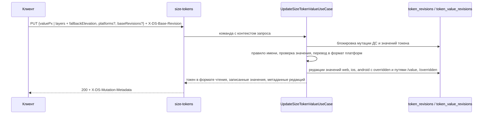

## Контекст

Радиусы, отступы и тени темы — токены типов `shape`, `spacing` и `shadow`. После версионирования дизайн-системы
(#109, `multi-user-design-system-editing`, ADR-0007) `tokens` и `token_values` хранят только устойчивую
идентичность, а предметные данные — неизменяемые редакции `token_revisions` (имя, тип, `deleted`) и
`token_value_revisions` (`value`, `deleted`) с границей версии. У каждого токена значения для `web`, `ios` и
`android` в формате своей платформы:

| Тип | Пример имени | `web` | `android` и `ios` |
|---|---|---|---|
| `shape` | `round.m` | `["0.75rem"]` | `[{ "kind": "round", "cornerRadius": 12 }]` |
| `spacing` | `spacing.4x` | `["0.5rem"]` | `[{ "value": 8 }]` |
| `shadow` | `down.soft.s` | `["0rem 0.25rem 0.875rem -0.25rem #08080814", …]` — CSS-строка на слой | `[{ "color", "offsetX", "offsetY", "blurRadius", "spreadRadius", "fallbackElevation"? }, …]` |

Что показали данные на копии рабочей базы (темы `base_default` и `test_default`):

- радиусов восемь: `round.xxs` … `round.xxl` (4–32 px) и `round.circle`; все вида `round`;
- `round.circle` записан по-разному: в `base` — `625rem` на вебе и `9999` на Android и iOS, в `test` —
  `100rem` и `0.5`. Это «полное скругление», а не число;
- отступов 15: `spacing.0x` … `spacing.60x`, `Nx` = N × 2 px, без деления на gap и inset; в обеих темах
  одинаковые;
- теней 12: `{down|up}.{soft|hard}.{s|m|l}`, у размера `s` два слоя; цвет — HEX с прозрачностью;
- `fallbackElevation` есть на Android (у `down` — 2, 4, 6 для s, m, l, у `up` — 0); на iOS его нет в
  `base` и есть в `test`;
- значения платформ совпадают, кроме `round.xxl` в `test`: 32 px на вебе и 40 на Android и iOS;
- компоненты ссылаются на радиусы и тени по `token_id` и текстом имени: `round.m` — 11 компонентов,
  16 значений; `down.hard.m` — Popover, Combobox, Range, Select, TextArea, TextField. На отступы не ссылается
  ни один компонент: отступы в конфигурациях — числа;
- вычисляемые радиусы — не токены темы, а смещение у значения свойства компонента: в `base` у Button и
  IconButton веб-параметры `buttonRadius` и `iconButtonRadius` заданы как `round.l` −2 (поправка
  платформенного параметра). Смещение бывает и в `adjustment` строки значения; после #109 оба читаются из
  редакций конфигураций компонентов на границе версии;
- все 70 токенов включены (`enabled`).

Сейчас раздел «Формы» клиента (`pages/shapes`) — прежний экран: значения по платформам, `ShadowPicker`,
создание токенов и их отключение; правки уходят общими операциями `tokens` и `PUT /tenants/{id}/token-values`
через сессию редактора #109. Журнал изменений #109 уже показывает радиусы и отступы в px, тени — по полям слоя,
и ведёт к разделу `shapes` по `?tokenId`.

## Цели / Вне целей

**Цели:**

- экран по экрану «Отступы и радиусы» прототипа SDDS Portal (`kenymook/SDDS-Design-System`, вкладка
  редактора `sizes`: `sizingTokenTree`, `cornerRadiusScaleCanvas`, `spatialScaleStrip`, инспектор
  `tokenInspector` для `group === 'sizes'`, окно `customTokenModal`, стили `.editor-sizes-workbench`);
- раздел «Тени» на классах прототипа;
- одно значение в px вместо значений по платформам;
- создание и удаление токенов, автосохранение операциями `ds-service` с проверкой значений на сервере.

**Вне целей:**

- деление отступов на gap и inset и размеры контролов из прототипа: в данных их нет;
- правка смещения вычисляемого радиуса: оно задаётся в редакторе компонента;
- правка «полного скругления» `round.circle` и выравнивание его значений между темами;
- переименование токенов, хранимые группы токенов (`add-color-token-groups`) для этих типов;
- отключение токенов (`enabled`);
- своя кнопка сброса токена или раздела и отметки изменений в дереве: отмена правок — общий журнал изменений
  #109;
- показ токена внутри компонента на холсте.

## Решения

### Правила имён

| Раздел | Тип | Правило имени |
|---|---|---|
| Радиусы | `shape` | `^round\.[a-z0-9]+(-[a-z0-9]+)*$` |
| Отступы | `spacing` | `^spacing\.[a-z0-9]+(-[a-z0-9]+)*$` |
| Тени | `shadow` | `^(down\|up)\.(soft\|hard)\.[a-z0-9]+(-[a-z0-9]+)*$` |

Токены с именем вне правила в разделе не показываются и операциями не меняются: ими по-прежнему управляют
`theme fetch` и общий `PUT token-values`. Радиус `round.circle` — «полное скругление»: показывается, но его
значение не правится.

### Тень — четыре варианта размера

Размер тени — четыре токена `down.soft.<размер>`, `down.hard.<размер>`, `up.soft.<размер>`,
`up.hard.<размер>`. Строка дерева и карточка борда — один токен; правка меняет только его. Создание и
удаление работают с размером целиком: в данных размер всегда есть во всех четырёх вариантах, и прежний экран
тоже создаёт четыре токена.

Отвергнуто: строка дерева на размер с четырьмя вариантами в инспекторе. Значения вариантов различаются, а
компоненты ссылаются на отдельный вариант (`down.hard.m`).

### Одно значение в px и перевод в формат платформ

Пользователь вводит целые px. `ds-service` пишет значение во все платформы:

| Тип | `web` | `android` | `ios` |
|---|---|---|---|
| `shape` | `"<px/16>rem"` | `{ kind: "round", cornerRadius: <px> }` | то же |
| `spacing` | `"<px/16>rem"` | `{ value: <px> }` | то же |
| `shadow`, слой | `"<x>rem <y>rem <blur>rem <spread>rem <#RRGGBBAA>"` | `{ color, offsetX, offsetY, blurRadius, spreadRadius, fallbackElevation }` | `{ color, offsetX, offsetY, blurRadius, spreadRadius }` |

Числа `rem` — без лишних нулей (`0.75rem`, `0rem`). `fallbackElevation` пишется только на Android: в первый
слой — значение поля, в остальные — `0`. Цвет пишется как `#RRGGBBAA` в верхнем регистре; при прозрачности
100 % — `#RRGGBBFF`. Для чтения в px источником служит значение `web`.

Отвергнуто: значения всех платформ в интерфейсе, как в прежнем экране. В данных они совпадают (кроме
одного радиуса в `test`), а прототип показывает одно значение.

### Своё значение платформы — как у цветов

Правило то же, что в `add-color-token-gradients`: значение `web` — основное, `ios` и `android` строятся из
него, если у платформы нет своего значения. Своё значение помечается признаком
`token_value_revisions.overridden` (колонка редакции значения, миграция `V11__token_value_overridden.sql` этого
change: `add-color-token-gradients` пока не реализован, V7–V10 заняты #109) и не
перестраивается при правке веба. Признак — предметное поле редакции: он попадает в изменённые пути
(`/overridden`), журнал, откат и опубликованные версии.

- В инспекторе справа от поля «Значение» — «+» с меню iOS / Android без уже добавленных платформ. Выбор
  добавляет под полем строку «↳ iOS» или «↳ Android» с копией значения веба; «×» убирает строку, и значение
  платформы снова строится из веба.
- У тени «+» стоит у заголовка «Слои»: строка платформы — свой набор слоёв с теми же полями.
  `fallbackElevation` остаётся одним полем Android.
- Дерево, борды и вычисляемые радиусы показывают значения веба.

В отличие от цветов, значения платформ строит `ds-service`, а не клиент: перевод px в формат платформ
тривиален и уже нужен серверу для проверки, как в типографике. Клиент передаёт только значение веба и свои
значения платформ.

Старые данные получают `overridden: false`. Если значение платформы без признака отличается от веба,
чтение отмечает `platformsDiffer`, а инспектор предупреждает, что правка выровняет платформы, и предлагает
одним действием сохранить текущие значения как свои. Так расхождение `round.xxl` в `test` (32 px на вебе,
40 на Android и iOS) не теряется молча при первой правке.

Отвергнуто: выбор платформы в панели инструментов, переключающий весь инспектор. Он прячет разницу
платформ за переключателем; у цветов этот вариант отклонён по той же причине.

### Цвет слоя тени — ступень палитры

Цвет слоя выбирается тем же выбором цвета, что в разделе «Цвета»: вкладка Custom — HEX и прозрачность, вкладка
Library — ступень палитры темы. Поле цвета повторяет `colorInspectorField` прототипа: свотч внутри поля, HEX или
название ступени и прозрачность справа.

Ссылка хранится так же, как у стопов градиента в `add-color-token-gradients`: `[type.shade.step][opacity]` на
месте цвета слоя в значениях всех платформ. `ds-service` проверяет её по палитре темы при записи и раскрывает в
HEX при чтении (`size-tokens` отдаёт `color` и `colorRef`, `token-values` — HEX и `sourceValue`), поэтому
потребители получают HEX и не меняются, а тень следует за изменением ступени. Поиск ссылок на палитру
(`ValuePaletteReferences`) расширяется на слои тени: связи и удаление растяжки и проверка отката их учитывают.
Прежний `ShadowPicker` уже позволял выбрать цвет из палитры (`[general.*]`), так что формат не новый.

Отвергнуто:
- **ссылка на цветовой токен темы.** У цветовых токенов есть режимы Light и Dark, а у теней режима нет (в
  данных `mode` у всех значений теней пустой, потребители пишут одну тень на обе темы). Ссылка на токен
  потребовала бы либо брать один режим, что неверно для тёмной темы, либо делить тени по режимам с правками
  генерации на всех платформах;
- **только HEX.** Тень не следовала бы за палитрой темы.

### Тени на борде — списком

Борд теней — список по размерам, у каждого варианта своя строка с превью на отдельной светлой плашке. Плашка
обрезает тень своим краем, поэтому крупные тени (`up.hard.m`: смещение 16, размытие 32) не заходят на соседние
строки. Отвергнуто: сетка размер × вариант с карточками на общем фоне — тени соседних карточек накладываются.

### Вычисляемые радиусы — из компонентов

В прототипе вычисляемые радиусы «−2» — отдельные токены темы только для чтения. В данных их нет среди
токенов: смещение хранится у значения свойства компонента. Поэтому раздел показывает их по ссылкам
компонентов:

- источник — токен радиуса, смещение — `adjustment` строки значения или числовая поправка платформенного
  параметра (как в экспорте конфигурации: web, затем xml, compose, ios);
- одно вычисляемое значение — пара «источник, смещение» с компонентами, платформой и параметром;
- значение — веб-значение источника плюс смещение, не меньше 0; оно пересчитывается при правке источника;
- в дереве их нет; на борде радиусов — группа «Вычисляемые», в инспекторе источника — секция
  «Вычисляемые»; оба места только для чтения.

Отвергнуто: хранить вычисляемые радиусы токенами темы, как в прототипе. Это вторая копия смещения рядом с
конфигурацией компонента, и они расходились бы.

### Проверка значений

| Поле | Правило | Текст |
|---|---|---|
| радиус, отступ | не пусто, число, целое | «Значение не может быть пустым.», «Размер должен быть числом.», «Размер должен быть целым числом.» |
| радиус | 0–1000 | «Значение должно быть в диапазоне 0–1000 px.» |
| отступ | 0–128 | «Значение должно быть в диапазоне 0–128 px.» |
| смещение X, Y и растяжение | целое, −200–200 | «Значение должно быть в диапазоне -200–200 px.» |
| размытие | целое, 0–200 | «Значение должно быть в диапазоне 0–200 px.» |
| запасная высота | целое, 0–24 | «Значение должно быть в диапазоне 0–24 px.» |
| цвет слоя | `#RRGGBB`, `#RRGGBBAA` или ссылка на ступень палитры темы | «Цвет должен быть в формате Hex.», «Ступени нет в палитре темы.» |
| слои | от 1 до 4 | «У тени должен быть хотя бы один слой.», «У тени не больше 4 слоёв.» |

Тексты и диапазоны радиуса и отступа — из прототипа; в данных максимум отступа 120 px, размытия — 112 px.
Диапазоны тени выбраны с запасом над данными. Неверное значение `ds-service` не сохраняет и отвечает
`400 INVALID_SIZE_VALUE` с полем и текстом; в прототипе неверное значение сохраняется в черновик с
пометкой, здесь ошибка показывается у поля.

### Чтение раздела одной операцией

`GET /api/ds/tenants/{tenantId}/size-tokens` отдаёт всё, что нужно экрану: радиусы, отступы и тени в px с
`tokenId`, своими значениями платформ, признаком `platformsDiffer`, компонентами, которые используют токен,
и вычисляемыми радиусами. Клиент не пересчитывает `rem` и не загружает конфигурации компонентов.

Чтение идёт на выбранной границе, как остальные чтения #109: `versionId` передаётся в контекст запроса,
транзакция только для чтения сама выбирает последние редакции на границе черновика или опубликованной версии;
при `versionId` `canEdit` равен `false`. Общего счётчика темы в ответе нет: базовые редакции значений клиент
берёт из чтения значений темы (`GET /tenants/{id}/token-values`), как раздел «Цвета».

### Использование токена в компонентах

Значение свойства компонента считается ссылкой на токен, если оно ссылается на токен через `token_id` или
равно его имени. Учитываются компоненты дизайн-системы текущей темы; значения свойств и поправки параметров
читаются из редакций конфигураций компонентов на той же границе, что и токены. Ответ содержит по токену список
`{ name, count }`, где `count` — число значений свойств. Тот же список клиент показывает в подтверждении
удаления.

### Операции изменения, создания и удаления

| Операция | Что пишет в активный черновик | Заголовки | Право |
|---|---|---|---|
| `PUT /size-tokens/{tokenId}/value` | редакции значений токена в текущей теме, пути `/value` и `/overridden` | `X-DS-Base-Revision` (необязателен) | `tenants:write` |
| `POST /size-tokens` | редакции определений и значений радиуса, отступа или четырёх вариантов тени во всех темах | `X-DS-Base-Revision`, `Idempotency-Key` (необязательны) | `tenants:write` и `tokens:write` |
| `DELETE /size-tokens/{tokenId}` | надгробия `deleted = true` токена (у тени — размера целиком) и его значений во всех темах | `X-DS-Base-Revision` (необязателен) | `tenants:write` и `tokens:delete` |

Операции повторяют адаптацию цветового токена в #109: транзакция с контекстом запроса, разделяемая блокировка
мутации дизайн-системы, блокировка изменяемых сущностей, запись редакций с явными путями и базовой редакцией,
технические редакции и предупреждения в `X-DS-Mutation-Metadata`. Общего счётчика темы нет: конкурентная
правка разных токенов или платформ проходит независимо, правка одного значения — по правилу «последняя
запись побеждает» с предупреждением. Мутация с `versionId` отклоняется `400 historical_version_read_only`.

Создание проверяет уникальность имени среди токенов, действующих в черновике, под блокировкой ключа имени
(как общее создание токена); имя удалённого в черновике токена свободно. Повтор с тем же `Idempotency-Key`
возвращает сохранённый ответ. Значения нового токена приходят от клиента: токен создаётся строкой с одним именем,
как в группах «Цветов», поэтому значение — по умолчанию раздела, а правится потом в инспекторе. Радиус получает
значение самого крупного радиуса шкалы; отступ с именем по правилу темы (`14x`) — N × 2 px, иначе самый крупный
отступ; тень копирует слои с самого крупного размера каждого варианта, чтобы сразу была видна (прежний экран
создаёт пустые слои).

Удаление логическое: опубликованные версии сохраняют токен и значения, ссылки компонентов сбрасывает общий
механизм очистки ссылок на токен в активном черновике, токен, созданный в том же черновике, исчезает целиком.
Отмена создания, правки и удаления — общий журнал изменений: обработчики журнала и отката для `token` и
`token-value` уже покрывают типы `shape`, `spacing` и `shadow`, включая частичный откат поля слоя тени. Своих
обработчиков журнала этот change не добавляет.



Отвергнуто: переиспользовать `PUT /tenants/{id}/token-values`. Он не знает правил размеров, перевода px и
своих значений платформ; на нём остаются общая сессия редактора и восстановление неподтверждённых записей, и
он MUST сохранять признак `overridden`, если запись его не меняет.

### Клиент: модуль и автосохранение по правилам #109

Модуль `modules/sizeTokens` повторяет устройство `modules/colorTokens`: домен, порт и HTTP-адаптер. Мутации идут
через общий механизм предметных мутаций редактора: базовые редакции значений из чтения значений темы,
`X-DS-Client-Id`, `Idempotency-Key` на создании, запрет мутаций при `versionId`. Очередь — одна операция на
токен после окна тишины 400 мс, новые правки во время запроса — следующим поколением, повтор с
увеличивающейся задержкой при сети и `5xx`. Неподтверждённая операция хранится в `localStorage` темы как
исходная команда `size-tokens` (тело с `platforms`, базовые редакции, ключ повторяемости) и повторяется той же
командой при следующем открытии темы. Общая запись значений токена #109 (`TokenChange`) хранит только значения
платформ без признака `overridden`, поэтому перевод в неё потерял бы добавление или удаление своего значения
платформы. Раздел сообщает состояние очереди редактору, чтобы публикация и
фоновое обновление её дождались, и перечитывает себя по сигналу SSE об изменении токенов темы — после отправки
своей очереди, не заменяя локальный ввод. Отдельного баннера прежнего черновика нет.

У экрана в прототипе нет панели инструментов (она скрыта правилами `.editor-sizes-workbench`), поэтому статус
«Сохранение…» / «Сохранено» / «Не сохранено» и «Повторить» показываются под заголовком инспектора. После ответа
клиент обновляет значения токенов в модели темы, чтобы другие разделы видели новые значения без перезагрузки.

Адресация из журнала: раздел принимает `?tokenId=` (и `versionId`) общим механизмом адресуемого токена,
выбирает токен и раскрывает его раздел дерева; при отсутствии токена на границе показывает «Точный источник
токена недоступен».

### Программное проектирование

```kotlin
/** Раздел экрана и тип токена. */
enum class SizeTokenKind { RADIUS, SPACING, SHADOW }

/** Токен радиуса или отступа в px. */
data class DimensionTokenView(
    val tokenId: UUID,
    val name: String,
    val valuePx: Int?,
    val fullRounding: Boolean,
    val platforms: Map<NativePlatform, Int>,
    val platformsDiffer: Boolean,
    val components: List<ComponentUsage>,
    val derived: List<DerivedRadius>,
)

/** Вычисляемый радиус: смещение источника у значений компонентов. */
data class DerivedRadius(val offsetPx: Int, val valuePx: Int, val usages: List<AdjustedUsage>)

/** Компонент, платформа и параметр, где задано смещение. */
data class AdjustedUsage(val component: String, val platform: String, val parameter: String?)

/** Слой тени в px. */
data class ShadowLayer(val offsetX: Int, val offsetY: Int, val blur: Int, val spread: Int, val color: String)

/** Вариант тени: направление, жёсткость, размер и слои. */
data class ShadowTokenView(
    val tokenId: UUID,
    val name: String,
    val layers: List<ShadowLayer>,
    val fallbackElevation: Int,
    val platforms: Map<NativePlatform, List<ShadowLayer>>,
    val platformsDiffer: Boolean,
    val components: List<ComponentUsage>,
)

/** iOS или Android: платформы, у которых бывает своё значение. */
enum class NativePlatform { IOS, ANDROID }

/** Новое значение токена: веб и свои значения платформ; платформы без ключа строятся из веба. */
sealed interface SizeTokenValue {
    data class Dimension(val valuePx: Int, val platforms: Map<NativePlatform, Int>) : SizeTokenValue
    data class Shadow(
        val layers: List<ShadowLayer>,
        val fallbackElevation: Int,
        val platforms: Map<NativePlatform, List<ShadowLayer>>,
    ) : SizeTokenValue
}

/** Хранилище токенов размеров темы. */
interface SizeTokenRepository {
    /** Разделяемая блокировка мутации ДС и блокировка изменяемых сущностей. */
    suspend fun lock(context: DsRequestContext, tenantId: UUID, tokenIds: List<UUID>): SizeTokenLock
    /** Токены и значения на границе контекста: черновик или опубликованная версия. */
    suspend fun tokens(context: DsRequestContext, tenantId: UUID): List<StoredSizeToken>
    /** Редакции значений с путями `/value`, `/overridden` и базовыми редакциями. */
    suspend fun writeValues(tenantId: UUID, tokenId: UUID, values: List<SizeWrittenValue>, baseRevisions: Map<ThemeTokenPlatform, Int>)
    suspend fun create(designSystemId: UUID, tokens: List<NewSizeToken>): List<CreatedToken>
    /** Надгробия определений и значений во всех темах; очистка ссылок компонентов. */
    suspend fun delete(designSystemId: UUID, tokenIds: List<UUID>)
}

/** Использование токенов в конфигурациях компонентов дизайн-системы. */
interface SizeTokenUsageRepository {
    /** Ссылки и смещения по редакциям конфигураций компонентов на границе контекста. */
    suspend fun usage(context: DsRequestContext, designSystemId: UUID): Map<String, List<ComponentUsage>>
    suspend fun adjustments(context: DsRequestContext, designSystemId: UUID): Map<String, List<Pair<Int, AdjustedUsage>>>
}

/** Перевод значения в формат платформ и обратно. */
object SizePlatformValues {
    fun write(kind: SizeTokenKind, platform: ThemeTokenPlatform, value: SizeTokenValue): JsonElement
    fun readPx(kind: SizeTokenKind, web: JsonElement): SizeTokenValue?
}

class GetSizeTokensUseCase(/* policy, transactions, repository, usage */)
class UpdateSizeTokenValueUseCase(/* policy, transactions, repository */)
class CreateSizeTokenUseCase(/* policy, transactions, repository */)
class DeleteSizeTokenUseCase(/* policy, transactions, repository */)
```

```ts
/** Порт токенов размеров в клиенте. */
export interface SizeTokenRepository {
    load(context: ThemeContext): Promise<SizeTokens>;
    /** Базовые редакции значений и ключ повторяемости приходят из общего механизма предметных мутаций. */
    updateValue(context: ThemeContext, tokenId: string, value: SizeTokenValue, mutation: SubjectMutation): Promise<UpdatedSizeToken>;
    create(context: ThemeContext, request: CreateSizeTokenRequest, mutation: SubjectMutation): Promise<CreatedSizeTokens>;
    delete(context: ThemeContext, tokenId: string, mutation: SubjectMutation): Promise<string[]>;
}
```

### Расхождения с прототипом

| Где | Прототип | Здесь | Почему |
|---|---|---|---|
| Название экрана | «Отступы и радиусы» | «Отступы, радиусы и тени» | добавлен раздел теней |
| Тени | в редакторе нет: «Тени и градиенты тема не описывает — их задаёт библиотека» | раздел «Тени»: список по размерам на отдельных плашках, слои, цвет слоя из палитры, запасная высота Android | в данных 12 теней, их используют компоненты, прежний экран их правит; документация прототипа (`site/doc-theming.html`, «Shadow Tokens») описывает тени темы той же схемой Direction / Character / Size |
| Отступы | Gap и Inset с именами None…XXL | один раздел «Отступы», имена токенов темы | в данных одна шкала `spacing.Nx` |
| Вычисляемые радиусы | токены «−2» в дереве, только для чтения | группа «Вычисляемые» на борде и секция в инспекторе источника, только для чтения; в дереве нет | в данных это смещение у значений компонентов, а не токены |
| Значения платформ | одно значение | значение веба и свои строки «↳ iOS» / «↳ Android» | правило `add-color-token-gradients` |
| Порядок строк | порядок прототипа | по значению; тени — по направлению, жёсткости, размеру | новый токен встаёт на место в шкале |
| Создание | только у цветов (окно «Новый токен») | «+» у каждого раздела открывает строку нового токена внизу раздела; значение по умолчанию, правится в инспекторе | прежний экран создаёт токены всех трёх типов; строка — как создание токена в группах «Цветов» |
| Удаление | только у цветов | кнопка в шапке инспектора; в окне — «До публикации удаление можно отменить в журнале изменений» | удаление логическое и отменяется журналом; у «Цветов» в #109 текст «нельзя отменить» устарел |
| «Связи», «Примеры компонентов» | одинаковы у всех токенов | «Влияние» со списком компонентов | реальные ссылки из конфигураций |
| Сброс токена и раздела | к опубликованной версии | кнопок нет | отмена правок — общий журнал изменений #109 |
| Фильтр в дереве | токены с проблемами черновика | нет | неверное значение не сохраняется |
| Ошибка значения | сохраняется в черновик с пометкой | у поля, сохраняется последнее верное | проверка на сервере |
| Статус сохранения | нет панели инструментов | под заголовком инспектора | панель скрыта прототипом, статус нужен |
| Шапка | Импорт, Экспорт, Сбросить, Изменения | шапка клиента | общая шапка редактора не меняется |

## Риски / Компромиссы

- [Значения платформ расходятся без признака] → чтение отмечает `platformsDiffer`, инспектор предупреждает и
  предлагает сохранить их как свои значения. В данных это один радиус в `test`.
- [Колонку `overridden` планировал и `add-color-token-gradients`] → этот change реализован раньше, поэтому
  миграция колонки (`V11__token_value_overridden.sql`) и учёт признака в начальных значениях новых тем, журнале,
  откате и пакетной записи значений перенесены сюда; из `add-color-token-gradients` колонку нужно убрать.
- [Неподтверждённая правка своего значения платформы] → раздел повторяет исходную команду `size-tokens`, а не
  общую запись значений, иначе восстановление потеряло бы признак `overridden`. Общие маршруты
  (`PUT /tenants/{id}/token-values`, правки других разделов) MUST сохранять `overridden`, если запись его не
  меняет.
- [Удаление тени уносит весь размер] → подтверждение и список компонентов считаются по четырём вариантам размера.
- [Смещение вычисляемого радиуса задано на одной платформе] → секция показывает платформу и параметр;
  значение считается по вебу источника.
- [`round.circle` записан по-разному] → значение не правится; выравнивание данных — отдельное решение.
- [`fallbackElevation` на iOS в части тем] → операция пишет iOS без него. Генератор iOS его не использует;
  если окажется, что поле нужно, правило записи меняется в одном месте.
- [Ссылки компонентов на токен в другом формате] → использование учитывает `token_id` и имя; если импорт
  конфигураций начнёт писать иначе, правило нужно будет расширить.
- [Удаление токена, на который ссылаются компоненты] → подтверждение со списком; ссылки сбрасываются в
  черновике, как у цветов; откат удаления в журнале восстанавливает токен, а ссылки компонентов
  восстанавливаются откатом их собственных изменений.
- [Журнал не группирует одно действие] → правка токена даёт отдельную запись на каждую платформу, создание —
  запись определения и записи значений; группировка — общий вопрос журнала #109, не этого change.

## Миграция и совместимость

Зависит от версионирования дизайн-системы (#109) и от колонки `token_value_revisions.overridden` из
`add-color-token-gradients`; своих миграций нет. Сначала развёртывается `ds-service` с новыми маршрутами, затем
клиент. Откат — прежний образ клиента: прежний экран продолжит работать через общие операции токенов, данные
совместимы, свои значения платформ остаются в редакциях.

## План проверки и развёртывания

- **Локально:** тесты домена (правила имён, перевод в формат платформ, проверка), use case, маршрутов и
  контракта OpenAPI в `ds-service`; тесты домена, адаптера и экрана в клиенте; `tools/verify fast` и `full`.
- **[внешняя проверка] на локальном контуре с копией рабочей базы:**
  - правка `round.m` на 14 px меняет три платформы в текущей теме и не меняет другие темы; журнал черновика
    показывает изменение, откат возвращает 12 px;
  - две вкладки правят разные токены одной темы без конфликта, вторая вкладка видит правку первой по SSE;
  - чтение опубликованной версии показывает прежние значения и не даёт править;
  - правка слоя `down.hard.m` меняет CSS-строку веба и объекты Android и iOS, `fallbackElevation` — только
    на Android;
  - своё значение Android у `round.l` сохраняется с `overridden: true` и не меняется при правке веба;
  - вычисляемый радиус `round.l` −2 у Button и IconButton совпадает с выборкой поправок из конфигураций;
  - создание радиуса, отступа и размера тени добавляет токены во все темы дизайн-системы; удаление убирает их
    из черновика, опубликованная версия их сохраняет, откат в журнале возвращает;
  - переход из журнала по `?tokenId` выбирает токен в разделе;
  - список компонентов `round.m` совпадает с выборкой из конфигураций;
  - `dsbuilder theme fetch` выгружает изменённые значения.
