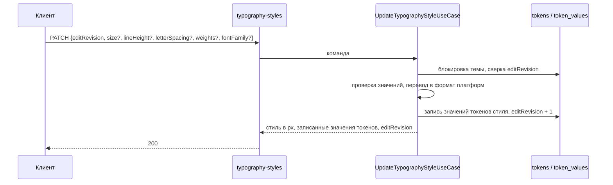

## Контекст

Типографика темы хранится в `tokens` и `token_values` как токены типа `typography`. Имя токена —
`<экран>.<группа>.<размер>.<начертание>`, например `screen-l.body.m.normal`:

- экран — `screen-s`, `screen-m`, `screen-l` (в прототипе «Мелкие», «Средние», «Крупные»);
- группа — `display`, `header`, `body`, `text`;
- начертание — `normal`, `medium`, `bold`.

У каждого токена значения для `web`, `ios` и `android` в формате своей платформы. Значение ссылается на
семейство шрифта токеном типа `fontFamily` (`fontFamilyRef: fontFamily.<name>`); семейство — имя и файлы
шрифта по весам для каждой платформы.

Что показали данные на копии рабочей базы (дизайн-системы `base` и `test`):

- у трёх начертаний одного стиля размер, высота строки, трекинг и семейство совпадают, отличается только
  вес (обычно 400 / 500 / 600);
- семейство и веса стиля одинаковы на всех трёх экранах, размеры — разные;
- значения на платформах совпадают: размер в px на вебе (`rem × 16`) равен числу на других платформах;
- состав стилей зависит от дизайн-системы: в `base` есть H6, в `test` нет; семейств в `base` четыре
  (`display`, `header`, `body`, `text`), стили используют два или четыре из них;
- конфигурации компонентов ссылаются на типографию текстом без экрана: `body.m.normal`.

Сейчас раздел «Типографика» клиента — прежний экран: правки по платформам копятся в черновике и уходят
общим `PUT /tenants/{id}/token-values`. Разделы «Палитра» и «Цвета» уже сделаны по прототипу SDDS Portal и
сохраняют правки операциями `ds-service`.

## Цели / Вне целей

**Цели:**

- экран «Типографика» по прототипу SDDS Portal (`kenymook/SDDS-Design-System`, функции `editor` для
  вкладки `fonts`, `typographyTokenTree`, `typographyScaleCanvas`, `tokenInspector`, стили
  `.editor-fonts-workbench`);
- стиль как единица редактирования вместо отдельных токенов и платформ;
- автосохранение операциями `ds-service` с проверкой значений на сервере.

**Вне целей:**

- создание, удаление, переименование стилей и групп: в прототипе набор фиксирован;
- управление шрифтами: новые семейства, файлы шрифта, проверка наличия веса;
- переопределение значения для отдельной платформы;
- отслеживание изменений, сброс к опубликованной версии, отметки изменений в дереве;
- хранимые группы токенов (`add-color-token-groups`) для типографии;
- показ стиля внутри компонента на холсте.

## Решения

### Стиль — три токена, экран — набор стилей

Стиль адресуется ключом `<группа>.<размер>` на экране; в стиль входят три токена начертаний. Операции
принимают `tokenId` любого из девяти токенов стиля (три начертания × три экрана) и по нему находят стиль и
экран. Токены типографии с именем вне правила
`^screen-(s|m|l)\.[a-z]+\.[a-z0-9]+\.(normal|medium|bold)$` в разделе не показываются и операциями не
меняются.

Отвергнуто: показывать каждый токен отдельной строкой. Дерево стало бы втрое длиннее прототипа, а
одинаковые размеры трёх начертаний пришлось бы править трижды.

### Что на какие токены пишется

| Поле | Токены | Почему |
|---|---|---|
| размер, высота строки, трекинг | три токена стиля на выбранном экране | размеры зависят от экрана |
| вес начертания | токен этого начертания на всех трёх экранах | в данных вес одинаков на экранах |
| семейство | девять токенов стиля | в данных семейство одинаково на экранах |

Отвергнуто: всё только на выбранном экране. Тогда легко получить Body M разными шрифтами на разных
экранах, хотя таких тем сейчас нет и прототип этого не предполагает.

### Одно значение в px и перевод в формат платформ

Пользователь вводит размер и высоту строки в px, трекинг в em, вес числом. `ds-service` пишет значение во
все платформы, сохраняя остальные поля значения (`fontStyle`, `style`):

| Поле | `web` | `android` | `ios` |
|---|---|---|---|
| размер | `fontSize: "<px/16>rem"` | `textSize: <px>` | `size: <px>` |
| высота строки | `lineHeight: "<px/16>rem"` | `lineHeight: <px>` | `lineHeight: <px>` |
| трекинг | `letterSpacing: "<em>em"`, ноль — `"normal"` | `letterSpacing: <em>` | `kerning: <em>` |
| вес | `fontWeight: "<вес>"` | `fontWeight: <вес>` | `weight`: 100 `thin`, 200 `ultraLight`, 300 `light`, 400 `regular`, 500 `medium`, 600 `semibold`, 700 `bold`, 800 `heavy`, 900 `black` |
| семейство | `fontFamilyRef: "fontFamily.<name>"` | то же | то же |

Число `rem` записывается без лишних нулей (`1.125rem`, не `1.1250rem`). Для чтения в px источником
служит значение `web`.

Отвергнуто: значения по платформам в интерфейсе, как в прежнем экране. В данных они совпадают, а прототип
показывает одно значение.

### Чтение стилей одной операцией

`GET /api/ds/tenants/{tenantId}/typography-styles` отдаёт всё, что нужно экрану: стили по экранам в px с
`tokenId` начертаний, семейства дизайн-системы с именем шрифта из текущей темы и компоненты, которые
используют стиль. Клиент не пересчитывает `rem` сам и не загружает конфигурации компонентов.

### Использование стиля в компонентах

Значение свойства компонента считается ссылкой на стиль, если оно равно имени начертания стиля без экрана
(`body.m.normal`), с экраном (`screen-l.body.m.normal`) или ссылается через `token_id` на любой токен стиля.
Учитываются компоненты дизайн-системы текущей темы. Ответ содержит по стилю список `{ name, count }`, где
`count` — число значений свойств по всем трём начертаниям. Использование одно для всех экранов: ссылки в
данных не содержат экрана.

### Одна операция изменения стиля

`PATCH /api/ds/tenants/{tenantId}/typography-styles/{tokenId}` принимает необязательные части: значения
экрана (`size`, `lineHeight`, `letterSpacing`), `weights` начертаний и `fontFamily`. Всё переданное
пишется в одной транзакции по правилам выше. Ревизия `editRevision` сверяется и увеличивается только у
текущей темы; значения других тем не меняются.



Отвергнуто: переиспользовать `PUT /tenants/{id}/token-values`. Он заменяет все значения темы, не
проверяет типографию и не знает о стиле.

### Проверка значений

Правила — из прототипа: размер и высота строки больше 0; трекинг от −0.2 до 1 em; вес — от 100 до 900
с шагом 100; семейство — токен `fontFamily` дизайн-системы. Неверное значение `ds-service` не сохраняет и
отвечает `400 INVALID_TYPOGRAPHY_VALUE` с полем и текстом прототипа. В прототипе неверное значение
сохраняется в черновик с пометкой; здесь черновика нет, поэтому ошибка показывается у поля.

### Клиент: модуль и автосохранение как у «Цветов»

Модуль `modules/typographyTokens` повторяет устройство `modules/colorTokens`: домен стиля, порт и
HTTP-адаптер. Очередь сохранения та же: одна операция на стиль после паузы 400 мс, операции по одной с
ревизией предыдущей, «Сохранение…» и «Сохранено» в панели инструментов, перезагрузка темы при
`409 TENANT_EDIT_CONFLICT`. После ответа клиент обновляет значения токенов в модели темы, чтобы другие
разделы видели новую типографию без перезагрузки.

### Программное проектирование

```kotlin
/** Стиль типографии на экране темы: три начертания с общими размерами. */
data class TypographyStyleView(
    val screen: TypographyScreen,
    val group: String,
    val size: String,
    val sizePx: Double,
    val lineHeightPx: Double,
    val letterSpacingEm: Double,
    val fontFamily: String,
    val variants: Map<TypographyVariant, TypographyVariantView>,
)

/** Начертание стиля: токен и вес. */
data class TypographyVariantView(val tokenId: UUID, val weight: Int)

/** Изменение стиля; null — часть не меняется. */
data class UpdateTypographyStyle(
    val editRevision: Int,
    val screenValues: TypographyScreenValues?,
    val weights: Map<TypographyVariant, Int>?,
    val fontFamily: String?,
)

/** Хранилище стилей типографии темы. */
interface TypographyStyleRepository {
    suspend fun lock(projectId: ProjectId, tenantId: UUID, editRevision: Int): TypographyStyleLock
    suspend fun styles(tenantId: UUID): List<StoredTypographyToken>
    suspend fun families(designSystemId: UUID, tenantId: UUID): List<TypographyFamily>
    suspend fun replaceValues(tenantId: UUID, values: Map<UUID, List<TenantTokenValueInput>>)
    suspend fun bumpRevision(tenantId: UUID): Int
}

/** Использование стилей в конфигурациях компонентов дизайн-системы. */
interface TypographyUsageRepository {
    suspend fun usage(designSystemId: UUID): Map<TypographyStyleKey, List<ComponentUsage>>
}

/** Перевод значений стиля в формат платформ. */
object TypographyPlatformValues {
    fun write(current: JsonObject, platform: ThemeTokenPlatform, change: TypographyTokenChange): JsonObject
}

class GetTypographyStylesUseCase(/* policy, transactions, repository, usage */) {
    suspend fun execute(context: DsRequestContext, tenantId: UUID): DsResult<TypographyStyles>
}

class UpdateTypographyStyleUseCase(/* policy, transactions, repository */) {
    suspend fun execute(
        context: DsRequestContext,
        tenantId: UUID,
        tokenId: UUID,
        command: UpdateTypographyStyle,
    ): DsResult<UpdatedTypographyStyle>
}
```

```ts
/** Порт стилей типографии в клиенте. */
export interface TypographyStyleRepository {
    load(context: ThemeContext): Promise<TypographyStyles>;
    update(context: ThemeContext, tokenId: string, change: TypographyStyleChange, editRevision: number): Promise<UpdatedTypographyStyle>;
}
```

### Расхождения с прототипом

| Где | Прототип | Здесь | Почему |
|---|---|---|---|
| Начертания | одно поле «Вес» | Regular, Medium, Bold | у стиля три токена, отличаются весом |
| Семейство | одно на тему: пять шрифтов и «Custom…» | выбор из семейств дизайн-системы | у групп разные семейства; «Custom» без файлов не соберётся |
| Состав стилей | фиксирован, H1–H6 | из токенов темы | в `test` нет H6 |
| Фильтр в дереве | стили с проблемами черновика | нет | неверное значение не сохраняется |
| Отметки «Aa» | цвет по черновым правкам | нет | отслеживания изменений нет, как в «Палитре» |
| Ошибка значения | сохраняется в черновик с пометкой | у поля, сохраняется последнее верное | проверка на сервере |
| Проверка веса | любое целое от 100 до 900 | от 100 до 900 с шагом 100 | у весов iOS нет промежуточных значений |
| Сброс стиля | только размер, если он менялся | кнопки нет | без отслеживания изменений не к чему сбрасывать |
| Влияние | заглушка; «Темы», «Токены», «Компоненты» | «Темы», «Компоненты» и список | на типографику токены не ссылаются |
| Меню семейства | обрезается полем (`overflow: hidden`) и не видно | видно | ошибка прототипа: меню вынесено на уровень блока |
| Холст | выбор: борд или компонент | только борд | показ стиля в компоненте — вне целей |
| Шапка | Импорт, Экспорт, Сбросить, Изменения | шапка клиента | общая шапка редактора не меняется |

## Риски / Компромиссы

- [Значения платформ расходятся в какой-то теме] → правка выровняет их по введённому значению; в текущих
  данных расхождений нет. Если они появятся, понадобится переопределение для платформы.
- [Токены типографии с другим правилом имени] → в разделе не видны и не меняются; ими по-прежнему
  управляет `theme fetch` и общий `PUT token-values`.
- [Ссылки компонентов на типографию в другом формате] → использование учитывает три формы ссылки; если
  импорт конфигураций начнёт писать иначе, правило нужно будет расширить.
- [Старый черновик с типографскими записями] → баннер «Сохранить» / «Отбросить», как в «Цветах»;
  записи по платформам переводятся в стиль через значения `web`; из черновика удаляются только
  сохранённые записи, при ошибке записи остаются и баннер показывается снова.

## Миграция и совместимость

Схема данных не меняется. Сначала развёртывается `ds-service` с новыми маршрутами, затем клиент. Откат —
прежний образ клиента: прежний экран продолжит работать через `PUT token-values`, данные совместимы.

## План проверки и развёртывания

- **Локально:** тесты use case, перевода в формат платформ, проверки значений, маршрутов и контракта
  OpenAPI в `ds-service`; тесты домена, адаптера и экрана в клиенте; `tools/verify fast` и `full`.
- **[внешняя проверка] на локальном контуре с копией рабочей базы:**
  - правка размера Body M на «Крупных» меняет три токена `screen-l.body.m.*` на трёх платформах и не
    меняет `screen-m` и `screen-s`;
  - правка веса Bold и семейства меняет токены на всех экранах;
  - список компонентов Body M совпадает с выборкой из конфигураций;
  - `dsbuilder theme fetch` выгружает изменённые значения.
