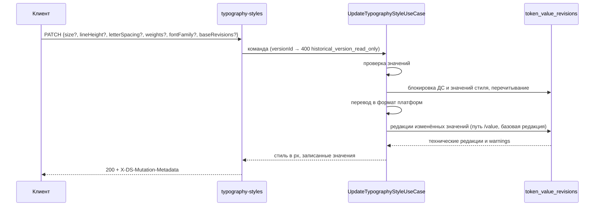

## Контекст

Типографика темы хранится как токены типа `typography`: устойчивые строки `tokens` и `token_values`, предметные
поля — в неизменяемых редакциях `token_revisions` и `token_value_revisions` по временным границам дизайн-системы
(модель `add-versioned-multi-user-editing`, ADR-0007). Имя токена —
`<экран>.<группа>.<размер>.<начертание>`, например `screen-l.body.m.normal`:

- экран — `screen-s`, `screen-m`, `screen-l` (в прототипе «Мелкие», «Средние», «Крупные»);
- группа — `display`, `header`, `body`, `text`;
- начертание — `normal`, `medium`, `bold`.

У каждого токена значения для `web`, `ios` и `android` в формате своей платформы. Значение ссылается на
семейство шрифта токеном типа `fontFamily` (`fontFamilyRef: fontFamily.<name>`); семейство — имя и файлы
шрифта по весам для каждой платформы.

Что показали данные на копии рабочей базы (дизайн-системы `base` и `test`):

- у трёх начертаний одного стиля размер, высота строки, трекинг и семейство совпадают, отличается только
  вес (обычно 400 / 500 / 600);
- семейство и веса стиля одинаковы на всех трёх экранах, размеры — разные;
- значения на платформах совпадают: размер в px на вебе (`rem × 16`) равен числу на других платформах;
- состав стилей зависит от дизайн-системы: в `base` есть H6, в `test` нет; семейств в `base` четыре
  (`display`, `header`, `body`, `text`), стили используют два или четыре из них;
- конфигурации компонентов ссылаются на типографию текстом без экрана: `body.m.normal`.

Сейчас раздел «Типографика» клиента — прежний экран: правки по платформам копятся в локальной очереди и уходят
общими маршрутами `tokens` и `token-values`. Разделы «Палитра» и «Цвета» уже сделаны по прототипу SDDS Portal и
сохраняют правки операциями `ds-service` в активный черновик; опубликованные версии читаются по `versionId`.

## Цели / Вне целей

**Цели:**

- экран «Типографика» по прототипу SDDS Portal (`kenymook/SDDS-Design-System`, функции `editor` для
  вкладки `fonts`, `typographyTokenTree`, `typographyScaleCanvas`, `tokenInspector`, стили
  `.editor-fonts-workbench`);
- стиль как единица редактирования вместо отдельных токенов и платформ;
- автосохранение операциями `ds-service` с проверкой значений на сервере.

**Вне целей:**

- создание, удаление, переименование стилей и групп: в прототипе набор фиксирован;
- управление шрифтами: новые семейства, файлы шрифта, проверка наличия веса;
- отметки изменений в дереве и сброс стиля внутри раздела: изменения значений видны в общем журнале
  черновика и откатываются его средствами;
- хранимые группы токенов (`add-color-token-groups`) для типографии;
- показ стиля внутри компонента на холсте.

## Решения

### Стиль — три токена, экран — набор стилей

Стиль адресуется ключом `<группа>.<размер>` на экране; в стиль входят три токена начертаний. Операции
принимают `tokenId` любого из девяти токенов стиля (три начертания × три экрана) и по нему находят стиль и
экран. Токены типографии с именем вне правила
`^screen-(s|m|l)\.[a-z]+\.[a-z0-9]+\.(normal|medium|bold)$` в разделе не показываются и операциями не
меняются.

Отвергнуто: показывать каждый токен отдельной строкой. Дерево стало бы втрое длиннее прототипа, а
одинаковые размеры трёх начертаний пришлось бы править трижды.

### Что на какие токены пишется

| Поле | Токены | Почему |
|---|---|---|
| размер, высота строки, трекинг | три токена стиля на выбранном экране | размеры зависят от экрана |
| вес начертания | токен этого начертания на всех трёх экранах | в данных вес одинаков на экранах |
| семейство | девять токенов стиля | в данных семейство одинаково на экранах |

Отвергнуто: всё только на выбранном экране. Тогда легко получить Body M разными шрифтами на разных
экранах, хотя таких тем сейчас нет и прототип этого не предполагает.

### Одно значение в px и перевод в формат платформ

Пользователь вводит размер и высоту строки в px, трекинг в em, вес числом. `ds-service` пишет значение во
все платформы, сохраняя остальные поля значения (`fontStyle`, `style`):

| Поле | `web` | `android` | `ios` |
|---|---|---|---|
| размер | `fontSize: "<px/16>rem"` | `textSize: <px>` | `size: <px>` |
| высота строки | `lineHeight: "<px/16>rem"` | `lineHeight: <px>` | `lineHeight: <px>` |
| трекинг | `letterSpacing: "<em>em"`, ноль — `"normal"` | `letterSpacing: <em>` | `kerning: <em>` |
| вес | `fontWeight: "<вес>"` | `fontWeight: <вес>` | `weight`: 100 `thin`, 200 `ultraLight`, 300 `light`, 400 `regular`, 500 `medium`, 600 `semibold`, 700 `bold`, 800 `heavy`, 900 `black` |
| семейство | `fontFamilyRef: "fontFamily.<name>"` | то же | то же |

Число `rem` записывается без лишних нулей (`1.125rem`, не `1.1250rem`). Для чтения в px источником
служит значение `web`.

Отвергнуто: значения по платформам в интерфейсе, как в прежнем экране. В данных они совпадают, а прототип
показывает одно значение.

### Свои значения iOS и Android

Значение платформы по умолчанию строится из веба. Своё значение задаётся у поля веса, размера, высоты строки и
трекинга по образцу `add-color-token-gradients` (#122): «+» у поля открывает выбор iOS или Android, под полем
появляется строка «↳ iOS» со своим значением, «×» снимает её. Семейство общее для платформ.

- **Признак своего значения — сравнение с вебом.** Поле платформы своё, если его значение отличается от значения
  веба. Перевод из веба для типографии точный, а в данных все платформы совпадают с вебом, поэтому сравнение не
  даёт ложных своих значений, и схема данных не меняется. Минус: значение, равное вебу, своим не закрепить.
- **Запись.** `PATCH` с `platform: "ios" | "android"` пишет размеры и веса только в эту платформу. Без `platform`
  правка пишется в веб и в платформы, у которых это поле не своё. «×» записывает платформе значение веба.
- **Чтение.** Стиль отдаёт `overrides`: по платформе только поля, которые отличаются от веба.

Отвергнуто: колонка признака `overridden` в `token_values`, как в #122. Нужна миграция, а для типографии
сравнение даёт тот же результат. Если #122 введёт колонку для всех значений, типографию стоит перевести на неё.

### Чтение стилей одной операцией

`GET /api/ds/tenants/{tenantId}/typography-styles` отдаёт всё, что нужно экрану: стили по экранам в px с
`tokenId` начертаний, семейства дизайн-системы с именем шрифта из текущей темы и компоненты, которые
используют стиль. Клиент не пересчитывает `rem` сам и не загружает конфигурации компонентов.

Чтение идёт в транзакции `readOnly(context)`: без `versionId` — на границе активного черновика, с ним — на
границе опубликованной версии (недоступная версия — `404`), `canEdit` тогда `false`. Определения и значения
разрешаются общими запросами модуля тем по последним редакциям на границе. У каждого начертания ответ отдаёт
`valueRevisions: [{ platform, valueId, revision }]` — устойчивый идентификатор значения и его техническую
редакцию; общего счётчика темы `editRevision` в ответе нет.

### Использование стиля в компонентах

Значение свойства компонента считается ссылкой на стиль, если оно равно имени начертания стиля без экрана
(`body.m.normal`), с экраном (`screen-l.body.m.normal`) или ссылается через `token_id` на любой токен стиля.
Учитываются компоненты дизайн-системы текущей темы. Ответ содержит по стилю список `{ name, count }`, где
`count` — число значений свойств по всем трём начертаниям. Использование одно для всех экранов: ссылки в
данных не содержат экрана.

Значения свойств вариаций и инвариантов, стили компонентов и токены читаются по последней редакции на той же
границе, что и стили (`ds.version_id` или активный черновик): удалённое в черновике значение не учитывается, а
опубликованная версия показывает использование на момент публикации. Запрос живёт в `data` модуля тем и повторяет
правило разрешения редакций `feature-components` (`ResolvedRevisionTable`): модули не зависят друг от друга, а
таблицы компонентов — внутренние для своего модуля.

### Одна операция изменения стиля

`PATCH /api/ds/tenants/{tenantId}/typography-styles/{tokenId}` принимает необязательные части: значения
экрана (`size`, `lineHeight`, `letterSpacing`), `weights` начертаний, `fontFamily` и базовые редакции
значений `baseRevisions: [{ tokenId, platform, baseRevision }]`. Всё переданное пишется в одной транзакции по
правилам выше только в текущей теме активного черновика.

Каждое значение токена на платформе — логическая сущность `token-value`. Операция берёт разделяемую блокировку
дизайн-системы (`lockDesignSystemMutation`), блокирует технические состояния затронутых значений в устойчивом
порядке, перечитывает их актуальное содержимое и только затем переводит изменение в формат платформ. Поэтому
параллельные правки разных полей одного значения (размер у одного пользователя, вес у другого) сливаются, а не
перезаписывают друг друга. Запись — новая редакция `token_value_revisions` черновика с путём `/value` и базовой
редакцией значения: элемент `baseRevisions` приоритетнее заголовка `X-DS-Base-Revision`. Если путь `/value`
значения изменился после базовой редакции, запись всё равно применяется («последняя запись побеждает»), а путь
попадает в `warnings` заголовка `X-DS-Mutation-Metadata`; `409` операция не возвращает. Значение, которое после
перевода не изменилось, не пишется. Технические редакции, журнал, сжатие черновика и SSE-сигнал ведут триггеры
таблиц редакций, поэтому журнал и откат значений типографии работают общими обработчиками `token-value`.



Отвергнуто: переиспользовать `PUT /tenants/{id}/token-values`. Он не проверяет типографию и не знает о стиле, а
клиенту пришлось бы самому переводить px в формат платформ. Отвергнуто: общий счётчик темы `editRevision` с
`409 TENANT_EDIT_CONFLICT`, как было до модели версий: он блокирует независимые правки разных стилей и требует
перезагрузки при любом параллельном изменении темы.

### Проверка значений

Правила — из прототипа: размер и высота строки больше 0; трекинг от −0.2 до 1 em; вес — от 100 до 900
с шагом 100; семейство — токен `fontFamily` дизайн-системы. Неверное значение `ds-service` не сохраняет и
отвечает `400 INVALID_TYPOGRAPHY_VALUE` с полем и текстом прототипа. В прототипе неверное значение
сохраняется в черновик с пометкой; здесь черновика нет, поэтому ошибка показывается у поля.

### Клиент: модуль, автосохранение и модель версий

Модуль `modules/typographyTokens` повторяет устройство `modules/colorTokens`: домен стиля, порт и
HTTP-адаптер. Очередь сохранения своя, как у «Цветов»: одна операция на стиль после паузы 400 мс, операции по
одной; состояние сохранения показывает общий индикатор черновика в шапке редактора, ошибка — баннер в
инспекторе с «Повторить». Отличия от прежней очереди «Цветов» — по модели
`add-versioned-multi-user-editing`:

- мутация оборачивается в `api/subjectMutation.ts`: он запрещает запись при `versionId`, принимает технические
  редакции из `X-DS-Mutation-Metadata` (`observeSubjectRevisions`) и отмечает подтверждённое сохранение;
- базовые редакции значений берутся в момент отправки из `api/subjectRevisions.ts`
  (`tokenValueBaseRevision`): их наполняет чтение стилей (`observeTokenValueRevisions` по `valueRevisions`),
  снимок редактора темы и метаданные предыдущих операций; правка передаёт значения стиля на всех экранах, а
  сервер использует только те, что пишет;
- состояние очереди сообщается `setDraftAutosaveActivity(context, 'typography', status)`: общий индикатор,
  публикация и отложенное перечитывание по SSE ждут подтверждения правок типографии;
- ошибка сети или `5xx` повторяется автоматически через 1 с с удвоением до 30 с, «Повторить» отправляет
  сразу; `403` и `404` ждут «Повторить»; `400 INVALID_TYPOGRAPHY_VALUE` снимает правку и показывается у поля;
- путь `typography-styles` добавлен в `api/incompleteMutationMetadata.ts`: при обрезанных метаданных (правка
  семейства пишет до 27 значений) редактор перечитывает токены темы, а за ними и стили.

После ответа клиент обновляет значения токенов в модели темы, чтобы другие разделы видели новую типографию без
перезагрузки. Когда `ThemeEditorSession` по SSE-сигналу заменяет модель темы в контексте маршрута, раздел
перечитывает стили через `reloadWhenDraftAutosaveIsIdle` — только после подтверждения всех локальных очередей,
поэтому серверное состояние не заменяет локальный ввод. Перечитывание по каждому `updated` не делается:
`rerender` вызывает и собственное сохранение раздела.

Неподтверждённые записи прежнего локального черновика (`ds_draft:…`) отправляет `ThemeEditorSession.restorePending`
общими маршрутами `tokens` и `token-values`, поэтому отдельного баннера «Сохранить» / «Отбросить» в разделе нет.
`versionId` из маршрута (`?versionId=`) передаётся чтению и делает раздел доступным только для чтения; адрес
`?tokenId=` из журнала выбирает экран и стиль через `hooks/useAddressedToken.ts`, а выбор стиля в разделе,
открытом по адресу, заменяет `tokenId` на токен `normal` выбранного стиля.

### Программное проектирование

```kotlin
/** Начертание стиля: токен, вес и технические редакции его значений. */
data class TypographyVariantView(
    val tokenId: UUID,
    val weight: Int,
    val valueRevisions: List<TypographyValueRevision>,
)

/** Техническая редакция значения токена темы на платформе. */
data class TypographyValueRevision(val platform: ThemeTokenPlatform, val valueId: UUID, val revision: Long)

/** Изменение стиля; null — часть не меняется. */
data class UpdateTypographyStyle(
    val size: Double?,
    val lineHeight: Double?,
    val letterSpacing: Double?,
    val weights: Map<TypographyVariant, Int>,
    val fontFamily: String?,
    val baseRevisions: List<TypographyBaseRevision>,
)

/** Хранилище стилей типографии темы поверх предметных редакций. */
interface TypographyStyleRepository {
    suspend fun tenant(projectId: ProjectId, tenantId: UUID): TypographyTenant?
    suspend fun lock(projectId: ProjectId, tenantId: UUID): TypographyStyleLock
    suspend fun token(designSystemId: UUID, tokenId: UUID): TypographyTokenLookup
    suspend fun styles(designSystemId: UUID, tenantId: UUID, style: TypographyStyleKey? = null): List<StoredTypographyToken>
    suspend fun lockStyle(designSystemId: UUID, tenantId: UUID, style: TypographyStyleKey): List<StoredTypographyToken>
    suspend fun families(designSystemId: UUID, tenantId: UUID): List<TypographyFamily>
    suspend fun themeCount(designSystemId: UUID): Int
    suspend fun writeValues(designSystemId: UUID, values: List<TypographyValueWrite>)
}

/** Ссылки значений свойств компонентов дизайн-системы на границе транзакции. */
interface TypographyUsageRepository {
    suspend fun references(designSystemId: UUID): List<ComponentPropertyReference>
}

/** Перевод значений стиля в формат платформ. */
object TypographyPlatformValues {
    fun write(current: JsonElement?, platform: ThemeTokenPlatform, change: TypographyTokenChange): JsonElement
}

class GetTypographyStylesUseCase(/* policy, transactions, repository, usage */) {
    /** `transactions.readOnly(context)`: граница `versionId` или активного черновика. */
    suspend fun execute(context: DsRequestContext, tenantId: UUID): DsResult<TypographyStyles>
}

class UpdateTypographyStyleUseCase(/* policy, transactions, repository, usage */) {
    /** `transactions.required(context)`: `versionId` → `400 historical_version_read_only`. */
    suspend fun execute(
        context: DsRequestContext,
        tenantId: UUID,
        tokenId: UUID,
        command: UpdateTypographyStyle,
    ): DsResult<UpdatedTypographyStyle>
}
```

`ExposedTypographyStyleRepository` читает через `currentThemeTokenRows` и `currentThemeTokenValueRows`,
блокирует значения `lockDraftSubjects(designSystemId, "token-value", ids)` и пишет `writeThemeValueRevision` с
путём `/value` и базовой редакцией значения. Маршрут отвечает `respondSuccess`, который переносит метаданные
транзакции в заголовки.

```ts
/** Порт стилей типографии в клиенте; `TypographyContext` — `EditorContextKey` с необязательным `versionId`. */
export interface TypographyStyleRepository {
    load(context: TypographyContext, signal?: AbortSignal): Promise<TypographyStyles>;
    update(
        context: TypographyContext,
        tokenId: string,
        change: TypographyStyleChange,
        values: TypographyValueAddress[],
    ): Promise<UpdatedTypographyStyle>;
}
```

### Расхождения с прототипом

| Где | Прототип | Здесь | Почему |
|---|---|---|---|
| Начертания | одно поле «Вес» | выбор начертания Regular, Medium или Bold под семейством и поле «Вес» для него | у стиля три токена, отличаются весом |
| Семейство | одно на тему: пять шрифтов и «Custom…» | выбор из семейств дизайн-системы | у групп разные семейства; «Custom» без файлов не соберётся |
| Состав стилей | фиксирован, H1–H6 | из токенов темы | в `test` нет H6 |
| Фильтр в дереве | стили с проблемами черновика | нет | неверное значение не сохраняется |
| Отметки «Aa» | цвет по черновым правкам | нет | отслеживания изменений нет, как в «Палитре» |
| Ошибка значения | сохраняется в черновик с пометкой | у поля, сохраняется последнее верное | проверка на сервере |
| Проверка веса | любое целое от 100 до 900 | от 100 до 900 с шагом 100 | у весов iOS нет промежуточных значений |
| Сброс стиля | только размер, если он менялся | кнопки нет | без отслеживания изменений не к чему сбрасывать |
| Влияние | заглушка; «Темы», «Токены», «Компоненты» | «Темы», «Компоненты» и список | на типографику токены не ссылаются |
| Меню семейства | обрезается полем (`overflow: hidden`) и не видно | видно | ошибка прототипа: меню вынесено на уровень блока |
| Холст | выбор: борд или компонент | только борд | показ стиля в компоненте — вне целей |
| Ширина борда | фиксирована под окно 1440 px (719 px), справа на широком экране пусто | на всю ширину холста, растёт колонка образца | борд не оставляет пустоту и меньше обрезает длинные образцы |
| Высота строк борда | фиксирована под значения темы по умолчанию | образец — одна строка высотой в высоту строки стиля и обрезается по ней; строка борда растёт, если высота строки больше образца прототипа | изменение высоты строки видно на борде |
| Вес образца на борде | один вес у строки | вес начертания, выбранного в инспекторе | решение дизайнера: образец меняется вместе с выбранным начертанием |
| Выделение строки борда | заливка строки и синяя полоса слева | рамка у образца: серая при наведении, синяя у выбранного | решение дизайнера: выделение по макету Figma, как в «Палитре» и «Цветах» |
| Имя шрифта на борде | колонка 64 px, «SB Sans Display» обрезается | колонка 104 px, длинное имя переносится | имя шрифта видно целиком |
| Шапка | Импорт, Экспорт, Сбросить, Изменения | шапка клиента | общая шапка редактора не меняется |
| Свои значения платформ | нет | «+» у поля, строки «↳ iOS» / «↳ Android» с «×» | значения платформ могут отличаться; как у цветов в #122 |
| Ошибка сохранения | — | баннер в инспекторе с «Повторить» | правки сохраняются сразу; «Повторить» отправляет правку, не дожидаясь автоматического повтора |

## Риски / Компромиссы

- [Значения платформ расходятся в какой-то теме] → расхождение показывается своим значением платформы и правкой
  веба не перезаписывается.
- [Токены типографии с другим правилом имени] → в разделе не видны и не меняются; ими по-прежнему
  управляет `theme fetch` и общий `PUT token-values`.
- [Ссылки компонентов на типографию в другом формате] → использование учитывает три формы ссылки; если
  импорт конфигураций начнёт писать иначе, правило нужно будет расширить.
- [Старый черновик с типографскими записями] → их отправляет общее автосохранение редактора
  (`ThemeEditorSession.restorePending`) прежними маршрутами по платформам; раздел их не переносит. У «Цветов»
  баннер прежнего черновика в модели версий остался — это несогласованность вне изменения.
- [Параллельная правка одного значения] → поля значения сливаются на сервере (перечитывание под блокировкой), а
  пересекающийся путь `/value` попадает в `warnings`; первая версия интерфейса предупреждение не показывает, как
  и для цветов.
- [Метаданные правки семейства обрезаются] → 27 значений не помещаются в 2048 байт заголовка; клиент
  перечитывает токены темы и стили, и базовые редакции снова полные.
- [Устаревшая метка в манифесте] → `contracts/route-manifest.json` оставляет у изменения стиля
  `ownershipOverride: "tenant-edit-revision"`, как у операций цветов в модели версий: поле не читает ни один
  потребитель манифеста, переименование меток всех операций темы — вне изменения.

## Миграция и совместимость

Схема данных не меняется, миграций нет: операции пишут существующие таблицы редакций модели версий. Сначала
развёртывается `ds-service` с новыми маршрутами, затем клиент. Откат — прежний образ клиента: прежний экран
продолжит работать через общие маршруты `tokens` и `token-values`, данные совместимы, а изменения стилей
остаются обычными редакциями значений в журнале черновика.

## План проверки и развёртывания

- **Локально:** тесты use case (области записи, базовые редакции, неизменные значения, отказы без записи),
  перевода в формат платформ и проверки значений; HTTP-тест на Testcontainers: чтение в px с редакциями
  значений, области записи, слияние параллельной правки с `warnings`, обрезка метаданных, отказы, чтение
  опубликованной версии и `400` записи в неё, использование по редакциям компонентов в черновике и версии,
  журнал и откат значения; контрактные счётчики OpenAPI; тесты домена, адаптера, очереди (повтор с задержкой) и
  экрана (перечитывание по новой модели темы, `versionId`, `?tokenId`) в клиенте; `tools/verify fast` и
  `full`.
- **[внешняя проверка] на локальном контуре с копией рабочей базы:**
  - правка размера Body M на «Крупных» меняет три токена `screen-l.body.m.*` на трёх платформах и не
    меняет `screen-m` и `screen-s`;
  - правка веса Bold и семейства меняет токены на всех экранах;
  - список компонентов Body M совпадает с выборкой из конфигураций;
  - `dsbuilder theme fetch` выгружает изменённые значения.
