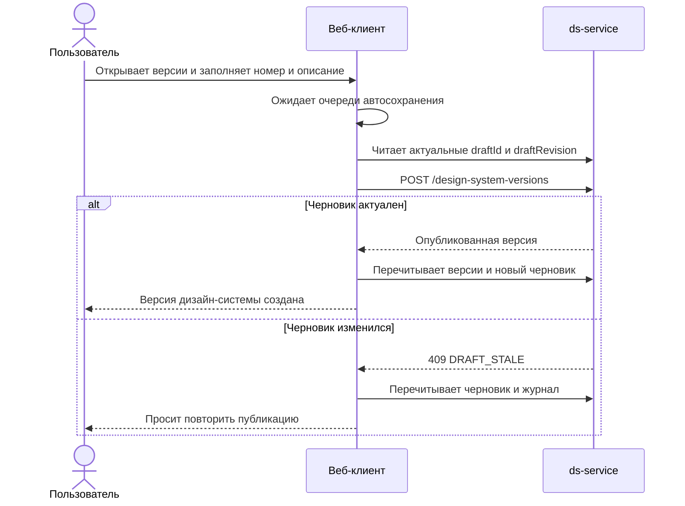

## Context

`js/apps/client` уже получает вычисляемый журнал, список опубликованных версий, умеет отменять одно изменение и
публиковать активный серверный черновик. Сейчас эти возможности собраны в компактном компоненте
`VersionJournalControls`, а публикация выполняется отдельным пошаговым окном `PublishProgress`, связанным в том числе
с публикацией npm-пакета. Новый раздел версий не должен продолжать эту связь.

Журнал и версии принадлежат дизайн-системе, а не отдельной теме. При этом существующие редакторы токенов и
компонентов открываются в контексте темы, поэтому переход к источнику должен сохранить или определить `tenantId`.
Серверный контракт уже содержит предметный тип, устойчивый идентификатор, прежнее и новое состояния, автора, время и
техническую редакцию. Новые таблицы, маршруты или поля API для этого изменения не требуются.

## Goals / Non-Goals

**Цели:**

- заменить служебное всплывающее представление полноэкранными разделами журнала и версий;
- дать понятный путь от просмотра черновика до публикации и исторического чтения;
- показывать фактические предметные изменения, автора, время и прежние и новые значения;
- открывать источник изменения с максимально возможной точностью;
- использовать существующие серверные операции журнала, отмены, версий и публикации;
- завершать публикацию дизайн-системы после создания серверной версии в `ds-service`.

**Вне целей:**

- влияние изменения на компоненты;
- проверки качества, предупреждения, квитанции проверок и принятые исключения;
- контрольные суммы, выгрузка снимка и восстановление опубликованной версии как черновика;
- новые серверные маршруты, изменение DTO, базы данных или правил конкурентной записи;
- удаление и переработка существующего кода и сервисов публикации npm-пакета; новый интерфейс их не вызывает;
- поддержка палитры, пока она не войдёт в отдельное изменение предметной модели.

## Decisions

### 1. Два полноэкранных раздела в существующей оболочке редактора

В маршруты темы добавляются `changes` и `versions`. Они используют `projectId` и `designSystemId` как область данных,
а `tenantId` — только как контекст возврата к редактору и предпросмотра. Заголовки SHALL явно говорить «Изменения
дизайн-системы» и «Версии дизайн-системы», чтобы маршрут темы не создавал отдельную модель версий Theme.

В боковой панели редактора появляются самостоятельные переходы. Компактный список версий и всплывающий журнал в
`VersionJournalControls` удаляются после переноса возможностей. Индикатор автосохранения остаётся в строке контекста.

Альтернатива — оставить журнал всплывающей панелью и добавить ещё одно окно публикации — отклонена: при длинном
списке изменений, подробностях и истории версий она создаёт несколько конкурирующих способов выполнить одну задачу.

### 2. Представление журнала строится отдельным преобразователем

Сетевой DTO не передаётся непосредственно визуальным компонентам. Отдельный преобразователь объединяет связанные
значения токена в одно действие пользователя, определяет понятные названия сущностей и полей, форматирует значения и
строит цель перехода к источнику.

Экран состоит из трёх областей:

1. фильтры и количество изменений по предметным областям;
2. группы и строки пользовательских действий;
3. подробности выбранного действия и доступные операции.

Для активного черновика показывается отмена. Для опубликованной версии тот же экран работает только для чтения с
`versionId`. После успешного автосохранения или события SSE открытый журнал перечитывается. Ответ
`DRAFT_CHANGE_STALE` также приводит к перечитыванию без автоматического повтора отмены.

Преобразователь не вычисляет влияние на компоненты и не интерпретирует данные проверок.

### 3. Переход к источнику имеет точную и секционную формы

Преобразователь возвращает одну из целей:

- точный маршрут темы, токена или компонента;
- маршрут соответствующего раздела, если верхнеуровневую сущность нельзя однозначно восстановить;
- отсутствие перехода, если предметный источник больше не существует и подходящего раздела нет.

Для `tenant` используется устойчивый `tenantId`. Для `token-value` `tenantId` и `tokenId` берутся из прежнего или
нового состояния. Для `token` сохраняется тема, из которой пользователь открыл журнал. Редакторы токенов принимают
`tokenId` в параметрах адреса и после загрузки выбирают соответствующий токен.

Для компонентных записей клиент строит индекс связей загруженной конфигурации от идентификаторов вложенных сущностей
к имени компонента. Если связь удалена или не разрешается, открывается общий раздел компонентов. Точное открытие
внутренней оси, варианта или поля не входит в этот этап.

### 4. Черновик публикации и опубликованные версии находятся на одном экране

Левая область содержит активный черновик и опубликованные версии. Центральная область показывает:

- для черновика — номер новой версии, описание и включаемые изменения;
- для опубликованной версии — номер, дату, описание и журнал относительно предыдущей опубликованной границы.

Правая область содержит краткое состояние: текущую и новую версии, количество изменений, неизменяемость публикации и
основное действие. Она не содержит сведения о пакете, контрольной сумме или проверках.

Выбор опубликованной версии не подменяет данные активного редактора. Переход к источнику из опубликованного журнала
передаёт `versionId`, а редактор открывается только для чтения.

### 5. Публикация использует актуальную серверную границу

Перед публикацией клиент ждёт завершения локальных очередей автосохранения, перечитывает `draftId` и `draftRevision`,
а затем явно вызывает существующую операцию публикации с новым ключом повторяемости. При `DRAFT_STALE` клиент
обновляет черновик и журнал и предлагает пользователю повторить действие самостоятельно.

Успешный ответ `ds-service` с созданной версией завершает публикацию дизайн-системы. Клиент сохраняет полученный DTO,
перечитывает список версий и новый пустой черновик и показывает номер созданной версии. Новый поток не вызывает
публикацию npm-пакета и не показывает её состояние. Если версия не создана, черновик остаётся доступен для повторной
попытки.



### 6. Состояние экрана не становится вторым черновиком

Фильтр, выбранная запись и введённые параметры публикации могут жить в состоянии маршрута или React-компонентов, но
предметные данные журнала и версий всегда перечитываются с сервера. Они не сохраняются в `localStorage`. После смены
дизайн-системы состояние выбора сбрасывается.

## Программное проектирование

```ts
type JournalSection = 'themes' | 'tokens' | 'components';

type JournalNavigationTarget =
    | { kind: 'entity'; pathname: string; search?: string }
    | { kind: 'section'; pathname: string; search?: string }
    | { kind: 'unavailable' };

interface JournalActionViewModel {
    key: string;
    section: JournalSection;
    title: string;
    operation: 'created' | 'updated' | 'deleted';
    actorLabel: string;
    changedAt: string;
    changedFields: Array<{ path: string; before: unknown; after: unknown }>;
    changes: DraftChangeDto[];
    navigation: JournalNavigationTarget;
    canRevert: boolean;
}

interface JournalPresenter {
    present(input: {
        changes: DraftChangeDto[];
        tokens: TokenDefinitionDto[];
        components: Meta[];
        actorLabels: Record<string, string>;
        contextTenantId: string;
        versionId?: string;
    }): JournalActionViewModel[];
}

type PublicationResult =
    | { kind: 'published'; version: DesignSystemVersionDto }
    | { kind: 'not-published'; code?: string; message: string };
```

`JournalPresenter` отвечает только за представление и навигацию. Сетевой слой продолжает владеть вызовами API,
компоненты страниц — состояниями загрузки и выбора, а существующая очередь автосохранения — ожиданием локальных
изменений перед публикацией.

## Risks / Trade-offs

- [Для некоторых удалённых вложенных записей компонента нельзя восстановить имя компонента] → показывать переход в
  общий раздел компонентов и явно не обещать точное позиционирование.
- [Журнал возвращается целиком и может быть большим] → группировать его один раз в `useMemo`, не выполнять сетевой
  запрос при выборе строки и показывать отдельное состояние `JOURNAL_LIMIT_EXCEEDED`; разбиение API на страницы не
  входит в изменение.
- [События SSE и локальное автосохранение могут вызвать несколько перечитываний] → объединять обновления через уже
  существующий механизм активности автосохранения и выполнять один запрос после завершения очереди.
- [Старый `PublishProgress` сохраняет связь с публикацией npm-пакета] → новый маршрут версий не использует этот поток;
  удаление оставшегося кода выполняется отдельными изменениями.
- [Маршрут темы может быть ошибочно воспринят как версия Theme] → в названиях, хлебных крошках и текстах всегда
  указывать дизайн-систему как владельца журнала и версий.

## Migration Plan

1. Добавить маршруты и страницы, сохранив существующие серверные вызовы.
2. Подключить новые пункты навигации и переходы из редакторов.
3. Перенести отмену, выбор исторической версии и публикацию в новые страницы.
4. Удалить `VersionJournalControls` и прежние элементы выбора версии после покрытия новых путей тестами.
5. Не подключать новый раздел версий к `PublishProgress` и операциям публикации npm-пакета; существующий код оставить
   без изменений до отдельных изменений по его удалению.

Откат клиентской поставки возвращает прежние элементы интерфейса; серверные данные и контракты не требуют миграции или
отката.
