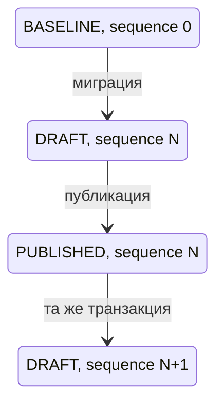
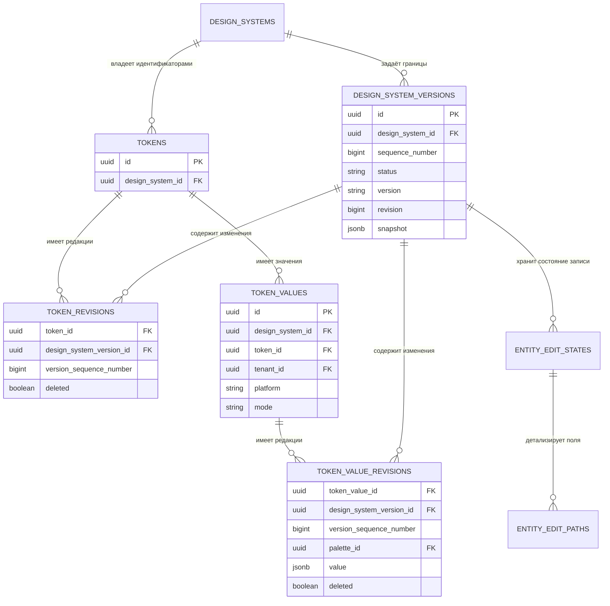
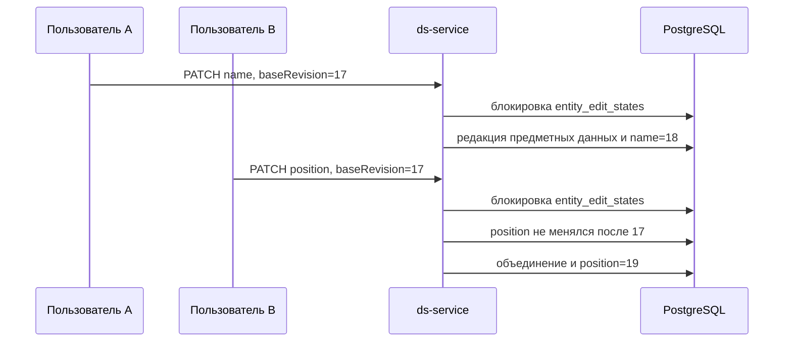

## Контекст

Решение развивает [ADR-0007](../../architecture/ADR-0007-multi-user-editing-and-change-journal.md). Сейчас
`backend-kt/ds-service` хранит версии как записи со снимком, принимает записи журнала от клиента и допускает изменение
опубликованных версий. Редактор сохраняет рабочее состояние локально, а пакетное изменение tenant использует одну
ревизию на весь tenant и возвращает конфликт для любого устаревшего запроса.

Целевая модель должна одновременно обеспечивать предметные запросы к старым версиям, экономное хранение,
автосохранение и согласование параллельных изменений. Владельцем серверной модели является только
`backend-kt/ds-service`; `js/services/db-service` не участвует в проектировании или реализации этого изменения.

## Цели и вне целей

**Цели:**

- представить черновик и публикации независимыми временными границами одной дизайн-системы;
- сохранять только изменившиеся предметные сущности без полного JSON-снимка и копирования неизменившихся строк;
- читать активный черновик и любую публикацию через предметные репозитории;
- автоматически сохранять изменения существующими предметными HTTP-методами;
- объединять параллельные изменения разных полей и обнаруживать повторную запись одного поля;
- вычислять журнал из предметных редакций и безопасно откатывать черновое изменение;
- публиковать согласованную границу и сразу создавать следующий черновик;
- сохранить направление Kotlin-слоёв `presentation -> application -> domain`, реализации хранилищ разместить в
  `data`, регистрацию зависимостей — в `di`.

**Вне целей:**

- новые предметные команды токенов или компонентов;
- предметная модель палитры;
- отдельная версия темы;
- хранение каждого промежуточного автосохранения как аудита;
- CRDT, WebSocket, SSE, присутствие пользователей и блокировка на всё время редактирования;
- преобразование, показ или восстановление прежних опубликованных версий, сохранённых в `snapshot`;
- показ предупреждений о параллельной перезаписи в первой версии интерфейса;
- перенос модели в `js/services/db-service`, `frontend-kt`, CLI или MCP.

## Решения

### Независимые временные границы

`design_system_versions` хранит независимые записи со статусом `BASELINE`, `DRAFT` или `PUBLISHED` и уникальным внутри
дизайн-системы `sequence_number`. Родительская ссылка отсутствует. Версия логически является полным состоянием, но
физически задаёт верхнюю временную границу для предметных редакций.



Для дизайн-системы существует не более одного `DRAFT`. `PUBLISHED` неизменяем. Технический `BASELINE` создаётся при
миграции существующих данных, не имеет продуктового номера и не показывается как публикация.

Существующие строки `design_system_versions` со `snapshot` остаются архивными и не преобразуются в предметные
редакции. Миграция делает `snapshot` допускающим `NULL`; новые `BASELINE`, `DRAFT` и `PUBLISHED` всегда имеют
`snapshot = NULL`. Архивные строки не получают `sequence_number`, не входят в новую временную шкалу, не возвращаются
новым списком версий и не разрешаются через предметные методы с `versionId`. Отдельный путь чтения снимков не вводится.

Альтернатива с `base_version_id` отклонена: она добавляет целостность цепочки и провоцирует рекурсивное чтение, хотя
продуктовая история остаётся линейной. Полное копирование строк отклонено из-за дублирования.

### Устойчивые сущности и предметные редакции

Каждый предметный модуль хранит устойчивый идентификатор и собственную таблицу `*_revisions`. Редакция принадлежит
версии и содержит `version_sequence_number`, изменяемые поля и `deleted`. Пара
`(design_system_version_id, version_sequence_number)` ссылается на уникальную пару в `design_system_versions`, поэтому
номер границы нельзя рассогласовать с версией.

Существующие предметные таблицы не остаются вторым хранилищем актуальных значений. После переноса данных в исходной
таблице сохраняются только идентификатор, неизменяемая принадлежность и время создания, а изменяемые поля удаляются.
Например, `token_values` сохраняет `id`, явный `design_system_id`, `token_id`, `tenant_id`, неизменяемые `platform`,
`mode` и `created_at`, а `palette_id`, `value` и признак удаления хранит только `token_value_revisions`. Двойная запись допустима лишь на время проверяемой
миграции и прекращается после переключения чтения.

`token_values` имеет уникальный ключ `(token_id, tenant_id, platform, mode)`. Платформа и режим не изменяются:
другая комбинация является другим значением. Повторное создание удалённой комбинации восстанавливает прежний
устойчивый идентификатор новой редакцией с `deleted = false`.

Каждая таблица редакций имеет `UNIQUE(stable_entity_id, design_system_version_id)`. Для защиты принадлежности версии,
устойчивой сущности и изменяемых ссылок одной дизайн-системе используются составные внешние ключи с
`design_system_id`; межсистемная ссылка отклоняется PostgreSQL.



Точная привязка к существующей схеме `ds-service`:

- `design_systems`, `tenants`, `tokens`, `token_values` сохраняют устойчивые строки и получают соответственно
  `design_system_revisions`, `tenant_revisions`, `token_revisions`, `token_value_revisions`;
- `design_system_versions` меняет модель границ, а `design_system_changes` удаляется после переключения на
  вычисляемый журнал;
- общие `components`, `component_deps`, `properties`, `variations`, `property_platform_params`,
  `property_variations`, `states`, `state_sets` не версионируются;
- принадлежащие дизайн-системе `design_system_components`, `appearances`, `styles`, `component_reuse_configs`,
  `appearance_variations`, `appearance_variation_values`, `appearance_combinations`,
  `appearance_combination_members`, `invariant_property_values`, `invariant_platform_param_adjustments`,
  `variation_property_values`, `variation_platform_param_adjustments`, `style_combinations`,
  `style_combination_members`, `component_style_references`, `component_style_reference_styles` получают одноимённые
  таблицы редакций в единственном числе перед суффиксом `_revisions`;
- `palette`, `documentation_pages` и `saved_queries` не меняются в рамках этого изменения.

Точный состав переносимых полей и полная ER-схема закреплены в ADR-0007. Для таблиц связей редакция хранит изменяемые
ссылки, порядок и признак удаления; неизменяемые ссылки принадлежности остаются в устойчивой таблице.

После изменений в `dev` платформа является обязательной частью общей сущности `components` и её идентичности
`(name, platform)`. Платформа больше не хранится в `appearances`. В `appearance_revisions` переносятся `name`,
`root_variation_id`, `color_scheme_variation_id` и признак удаления; в `appearance_variation_revisions` — `position`,
`default_style_id`, `declared_type` и признак удаления. Значение совместимого поля ответа `isColorScheme` для
исторической версии выводится из `appearance_revisions.color_scheme_variation_id`, а не хранится второй исторической
копией. Признаки `deprecated` и `deprecated_message` остаются текущими общими полями
`property_platform_params` и не входят в журнал дизайн-системы.

Существующий метод изменения оси сохраняется без нового маршрута: локальные поля оси записываются в
`appearance_variation_revisions`, а переданные `isRoot` и `isColorScheme` — в ссылки ролей
`appearance_revisions`. Запрос с обоими видами полей атомарно блокирует и изменяет две логические сущности. Удаление
оси с назначенной ролью в той же транзакции очищает ссылку роли внешнего вида.

Общий каталог API компонентов имеет отдельный жизненный цикл. Импорт API-меты остаётся дополняющим: он создаёт и
обновляет общие сведения и меняет признаки устаревания платформенных имён, но не удаляет отсутствующие элементы.
Публичные `DELETE` для `components`, `component_deps`, `properties`, `variations`, `property_platform_params`,
`property_variations` и `states` удаляются. `state_sets` уже не имеет публичного удаления. Внешние ключи от данных
конкретной дизайн-системы и их редакций к общему каталогу получают `RESTRICT` вместо каскадного удаления. Физическая
служебная очистка возможна только при отсутствии активных и исторических зависимостей и не становится публичным API.

Общие сведения не получают предметных редакций, поэтому их актуальное состояние используется и при чтении старой
версии дизайн-системы. Импорт API-меты больше не пишет в удаляемую `design_system_changes`; отдельный журнал общих
административных операций в это изменение не входит.

Для состояния на границе `S` репозиторий выбирает последнюю редакцию каждой сущности с
`version_sequence_number <= S`. Индекс начинается с предметного ключа и заканчивается
`version_sequence_number DESC`. Признак `deleted = true` исключает сущность из выбранного состояния.

Отдельное изменяемое представление актуального черновика не создаётся: оно потребовало бы синхронно обновлять два
источника одних данных. Если измерения покажут необходимость, позднее можно добавить восстанавливаемое представление
только как средство ускорения.

### Техническое состояние многопользовательского редактирования

`entity_edit_states` хранит текущую редакцию логической сущности в выбранном черновике и предоставляет строку для
транзакционной блокировки. `entity_edit_paths` хранит редакцию, автора и время последнего изменения отдельного пути.
Эти таблицы не содержат предметных значений и не являются журналом.

Для компонентной конфигурации логическая сущность совпадает с существующим ресурсом API и устойчивой строкой:
`design-system-component`, `appearance`, `style`, `component-reuse-config`, `appearance-variation`,
`appearance-variation-value`, `appearance-combination`, `appearance-combination-member`,
`invariant-property-value`, `invariant-platform-param-adjustment`, `variation-property-value`,
`variation-platform-param-adjustment`, `style-combination`, `style-combination-member`,
`component-style-reference`, `component-style-reference-style`. Изменяемыми путями являются поля соответствующей
таблицы редакций. Общая ревизия на весь компонент или appearance не создаётся.

Многострочная операция блокирует ресурсы по `(entity_type, entity_id)` и записывает их одной транзакцией, но журнал
содержит отдельное изменение каждого ресурса. Откат также выполняется для одного ресурса. Создание нельзя откатить,
если на строку уже ссылается действующий зависимый ресурс: сервер возвращает `409 REVERT_DEPENDENCY_CONFLICT` и не
выполняет автоматический каскадный откат графа.

Клиент передаёт `X-DS-Base-Revision`. Предметный запрос содержит только намеренно изменяемые поля. Если после базовой
редакции менялись другие пути, сервер объединяет изменения. Если менялся тот же путь, последняя успешно завершившаяся
запись побеждает, а ответ содержит машиночитаемое предупреждение. Первая версия интерфейса предупреждение не
показывает.



Техническое состояние не удаляется, когда предметная редакция стала равна предыдущему опубликованному состоянию:
иначе устаревший клиент снова выглядел бы актуальным. Для отката действует более строгое правило: несовпадение
редакции возвращает `409 DRAFT_CHANGE_STALE`, клиент обновляет журнал и не повторяет откат автоматически.

### Вычисляемый журнал и откат

Отдельные таблицы продуктового журнала не создаются. Кандидатами являются предметные редакции выбранной версии, а
операция определяется сравнением с предыдущей опубликованной границей или `BASELINE`:

- сущности раньше не было — `CREATE`;
- поля отличаются — `UPDATE`;
- предметная редакция содержит `deleted = true` — `DELETE`;
- состояние снова равно предыдущему — предметная редакция удаляется и в журнал не попадает.

`GET /api/ds/design-systems/{id}/changes` возвращает отличия активного черновика. Необязательный `versionId` выбирает
опубликованную версию. `POST /api/ds/design-systems/{id}/changes/{changeId}/revert` является общей точкой входа, но
передаёт выполнение типизированному обработчику соответствующего предметного модуля. `changeId` кодирует устойчивую
ссылку на логическую сущность, а не идентификатор строки общей таблицы журнала.

Группа `/api/ds/design-system-changes`, включая клиентское создание записи журнала, удаляется.

### Публикация

`POST /api/ds/design-system-versions` принимает `designSystemId`, `draftId`, `draftRevision`, продуктовый номер версии
и `changelog`. Клиент не передаёт снимок, статус или время публикации. В одной транзакции сервер:

1. блокирует активный `DRAFT`;
2. строго сравнивает переданные `draftId` и `draftRevision` с заблокированным черновиком;
3. при несовпадении возвращает `409 DRAFT_STALE` с актуальной редакцией без публикации;
4. проверяет права, номер и непустой вычисляемый журнал;
5. переводит тот же корень версии в `PUBLISHED`;
6. создаёт независимый пустой `DRAFT` со следующим `sequence_number`;
7. сохраняет результат запроса по ключу повторяемости.

Запись, завершившаяся после чтения журнала, но раньше публикации, увеличивает редакцию черновика и приводит к
`409 DRAFT_STALE`: клиент обновляет журнал, а пользователь повторяет публикацию новым запросом и ключом повторяемости.
Запись, ожидавшая уже успешно проверенную блокировку публикации, продолжает работу в новом черновике. Строгая
проверка относится только к явной публикации и не меняет правило объединения обычного автосохранения. `PATCH` и
`DELETE` опубликованной версии удаляются из публичного API.

### Повторяемость небезопасных запросов

`idempotent_requests` применяется к созданию через `POST`, импорту, публикации и откату. Ключ уникален внутри проекта.
Повтор с тем же телом возвращает сохранённый статус и ответ; повтор с другим телом отклоняется. Обычные `PATCH`, `PUT`
и `DELETE` автосохранения не создают такие записи. `project_id` не имеет внешнего ключа на другой сервис. В первой
реализации автоматическая очистка не выполняется; срок хранения определяется отдельным эксплуатационным решением.

### Изменения слоёв `ds-service`

- `presentation`: явные DTO, `versionId`, `X-DS-Base-Revision`, предупреждения и ошибки; синхронное обновление
  `src/main/resources/openapi/documentation.yaml` и контрактной проверки;
- `application`: выбор временной границы, транзакционная координация предметной записи, публикация, вычисление журнала
  и направление отката предметному обработчику;
- `domain`: идентификаторы версий и логических сущностей, состояния публикации, описание изменения и ошибки без типов
  Ktor или Exposed;
- `data`: миграции, реализации предметных хранилищ, выбор последней редакции, блокировки и индексы;
- `di`: регистрация прикладных сценариев, обработчиков отката и реализаций хранилищ.

Общий инфраструктурный механизм предоставляет работу с временной границей, техническими редакциями, признаком
удаления и блокировкой нормализованного ключа уникальности. Предметные поля, сравнение, ограничения и откат остаются в
соответствующем модуле.

## Программное проектирование

Контракты показывают распределение ответственности без привязки к Exposed или Ktor:

```kotlin
data class VersionBoundary(
    val versionId: UUID,
    val sequenceNumber: Long,
)

data class EditContext(
    val designSystemId: DesignSystemId,
    val draft: VersionBoundary,
    val actorId: UUID,
    val baseRevision: Long,
)

interface VersionBoundaryRepository {
    suspend fun activeDraft(designSystemId: DesignSystemId, lock: Boolean): VersionBoundary
    suspend fun published(versionId: UUID): VersionBoundary?
    suspend fun previousPublished(boundary: VersionBoundary): VersionBoundary
}

interface EntityEditStateRepository {
    suspend fun lock(context: EditContext, entity: LogicalEntityRef): EntityEditState
    suspend fun changedPathsSince(entity: LogicalEntityRef, revision: Long): Set<String>
    suspend fun advance(entity: LogicalEntityRef, paths: Set<String>, actorId: UUID): EntityEditState
}

interface VersionedEntityRepository<T> {
    suspend fun resolve(entityId: UUID, boundary: VersionBoundary): T?
    suspend fun writeDraft(context: EditContext, value: T)
    suspend fun removeRedundantDraftRevision(context: EditContext, entityId: UUID)
}

interface DraftChangeHandler {
    val entityType: String
    suspend fun describe(designSystemId: DesignSystemId, boundary: VersionBoundary): List<DraftChange>
    suspend fun revert(change: DraftChange, expectedRevision: Long): DraftChangeResult
}
```

Обработчик предметного изменения вызывает техническое хранилище и предметный репозиторий в одной транзакции. Общая
точка отката выбирает `DraftChangeHandler` по типу сущности, но не читает и не записывает произвольный JSON.

## Риски и компромиссы

- **Историческое чтение выбирает последнюю редакцию для каждой сущности** → добавить составные индексы, проверить планы
  запросов на объёмах, близких к рабочим, и не обходить версии рекурсивно.
- **История растёт вместе с числом фактических изменений** → не сохранять промежуточный аудит и удалять черновую
  редакцию, равную предыдущему состоянию; порядок архивирования истории вынести в отдельное решение при появлении
  измеримой потребности.
- **Уникальность относится к разрешённому состоянию, а не одной таблице** → блокировать нормализованный предметный ключ,
  повторно проверять ограничение внутри транзакции и только затем писать редакцию.
- **Палитра пока не версионируется** → историческое чтение сохраняет `palette_id`, но не гарантирует прежнее содержимое
  изменяемой записи палитры до отдельного изменения её модели.
- **Общий каталог API компонентов не версионируется** → чтение старой версии дизайн-системы использует актуальные
  названия, описания и признаки устаревания общего каталога; это осознанная граница модели, а не полная историческая
  реконструкция внешнего каталога.
- **Полиморфные технические ссылки не имеют предметного внешнего ключа** → ограничить набор `entity_type` в приложении,
  удалять технические строки только предметным обработчиком и покрыть целостность интеграционными тестами.
- **Миграция меняет способ хранения всех данных дизайн-системы** → выполнять её по предметным модулям, проверять
  количество и контрольные выборки до переключения чтения, не удалять прежние столбцы до подтверждения новой модели.
- **Правило последней записи может скрыть перезапись одного поля в интерфейсе** → сервер всегда возвращает структурное
  предупреждение; его отображение остаётся совместимым последующим улучшением клиента.

## План миграции и совместимость

1. Добавить таблицы версий, предметных редакций, технического редактирования и повторяемых запросов без переключения
   существующих чтений.
2. Создать `BASELINE` и активный `DRAFT` для каждой существующей дизайн-системы, перенести предметные данные в редакции
   границы `0` и проверить полноту.
3. Перевести предметные репозитории чтения на временные границы и сохранить прежние формы DTO без `versionId`.
4. Перевести существующие изменяющие сценарии на запись активного черновика и технические редакции.
5. Заменить каскадные внешние ключи от конфигурации дизайн-системы к общему каталогу на `RESTRICT`, удалить публичные
   операции удаления общих компонентных сущностей и отключить запись импорта API-меты в `design_system_changes`.
6. Включить вычисляемый журнал, откат и новую публикацию; удалить запись клиентского журнала и изменение публикаций.
7. Перевести редактор на серверное автосохранение и оставить в `localStorage` только неподтверждённые запросы.
8. После проверки чтения активного состояния и публикаций новой модели прекратить все записи в `snapshot`, сохранить
   прежние заполненные значения как архивные и удалить неиспользуемые таблицы журнала.

Откат развёртывания до переключения чтения выполняется возвратом приложения к прежним таблицам. После начала записи
только в предметные редакции обратный переход требует отдельной обратной миграции; поэтому переключение выполняется
только после контрольной сверки и резервного копирования PostgreSQL.

## План проверки

- модульные тесты предметного разрешения состояния, сравнения с предыдущей границей и типизированного отката;
- тесты прикладных сценариев для разных и одинаковых путей, устаревшего отката и повторяемого запроса;
- интеграционные тесты PostgreSQL для временных выборок, удаления, уникальности, запрета каскадного удаления общего
  каталога и границы публикации;
- контрактные тесты Ktor и проверка `documentation.yaml` для каждого изменённого маршрута;
- тесты веб-редактора для автосохранения, восстановления неподтверждённого запроса, журнала и режима чтения;
- `cd backend-kt/ds-service && ./gradlew build` и сборка затронутого приложения в `js/`.
