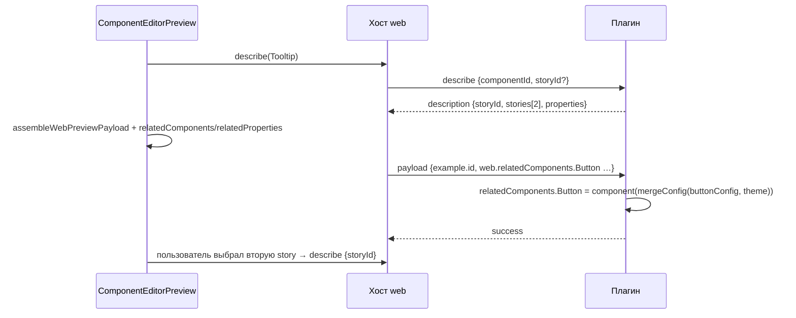

## Context

После пилота (`add-web-preview-plugin-pilot`):
- **Плагин** `js/apps/preview-web-plugin` (`plasma-new-hope` 0.386.0) рисует только `Button`.
- **Payload `WEB`:** `component.properties` — web-параметры выбранных стилей и инвариантов в виде CSS-литералов; `web` — `themeVariables`, `fontFamily`, `background`.
- **Клиент** выбирает рендерер по манифесту. React-превью остаётся запасным.

**Как React-превью работает со связанными компонентами** (`ComponentEditor.utils.ts`, `themeConfig.ts`):
- `createRelatedComponents(designSystem, config, theme, mode)` берёт текущий компонент и всех `deps[].childName`. Для каждого строит `createThemeConfig`:
  - `defaults` — стиль по умолчанию для каждой вариации;
  - `variations` — CSS-переменные по каждому стилю каждой вариации;
  - `invariants` — CSS-переменные инвариантов.

  Затем, если у компонента есть конфиг ядра, отдаёт `{ [Name]: component(mergeConfig(coreConfig, themeConfig)), [Name + 'Config']: merged }`, иначе только `[Name + 'Config']: themeConfig`. Так рисуются 16 story: `ButtonGroup`, `Drawer`, `Tooltip`, `Modal` и др.
- `createRelatedComponentVars` для зависимостей типа `compose` (в обе стороны: дочерние и родители) добавляет к `componentVars` CSS-переменные связанного компонента со стилями, совпадающими по имени вариации.

**Story:** 57 файлов, 63 записи в `componentMapper`. Некоторые файлы обслуживают несколько компонентов (`Typography` → `Body`, `Dspl`, `Heading`, `Text`; `Segment` → `SegmentGroup`, `SegmentItem`). У 16 компонентов несколько story.

**Протокол:**
- `describe` знает только `componentId`; описание содержит одну `storyId`;
- в режиме плагина выбора story нет;
- `validateDescription` клиента проверяет известные поля и лишние не отвергает.

## Goals / Non-Goals

**Goals:**
- Все компоненты `componentMapper` рисуются web-плагином так же, как React-превью, включая связанные компоненты и выбор story.
- Payload и протокол расширяются без изменения JSON-схемы и общих фикстур контракта.
- Регрессию ловит смоук-тест по всему реестру плагина.

**Non-Goals:**
- Публикация web-плагина через ds-service и S3.
- Удаление story, `useStory` и `coreTokens.ts` из клиента.
- Выравнивание версии `plasma-new-hope` у React-превью клиента.
- Полная web-семантика протокола.

## Decisions

### 1. Story копируются в плагин как есть

57 файлов из `js/apps/client/src/stories` копируются в `js/apps/preview-web-plugin/src/stories`. Каждая запись реестра — `{ stories: WebStory[], tokens?, coreConfig? }`. Порядок story такой же, как в `componentMapper`, первая — по умолчанию. Импорты ядра, иконок и вспомогательных модулей story сохраняются. Если story опирается на общий код клиента (`src/stories/fixtures` и т. п.), он копируется рядом.

Там, где story не собираются или падают на 0.386.0 из-за изменений API ядра, story правится минимально, а правка отмечается комментарием и в отчёте. В клиенте story остаются на 0.378.0 без изменений.

Альтернатива — взять story из Storybook plasma (CSF). Их аргументы и состав отличаются, и панель с превью поменялись бы. Это отдельное решение, не входит.

### 2. Связанные компоненты передаются конфигом темы в web-значениях

В корень `web` добавляются два поля:

```jsonc
"web": {
  "relatedComponents": {
    "ButtonGroup": { "defaults": { "size": "m" }, "variations": { "size": { "m": { "gap": "0.5rem" } } }, "invariants": {} },
    "Button": {
      "defaults": { "view": "default", "size": "m" },
      "variations": { "view": { "accent": { "backgroundColor": "#2A72F8FF", "backgroundColorHover": "#3F81FDFF" } } },
      "invariants": { "fontFamily": "SB Sans Text" }
    }
  },
  "relatedProperties": { "TabItem": { "paddingTop": "0.5rem" } }
}
```

- **Клиент** собирает `relatedComponents` из тех же данных и в том же обходе, что `createThemeConfig`, но до `toCSSVariables`. Обход выносится в общую утилиту рядом с `collectComponentWebValues` из пилота, `createThemeConfig` переходит на неё. `relatedProperties` строится из `createRelatedComponentVars` до `toCSSVariables`, по имени связанного компонента.
- **Плагин** переводит web-параметры в CSS-переменные ядра связанного компонента (`toCoreCssVariables(name, …)`), собирает конфиг темы через `css` из `styled-components` так же, как `themeConfig.ts`, делает `mergeConfig` с конфигом ядра (`getCoreConfig(name)` с исключением `Skeleton`) и передаёт story `relatedComponents`. `relatedProperties` переводятся в CSS-переменные и добавляются к области отрисовки после переменных компонента, в том же порядке, что `relatedVars` и `componentVars` в клиенте.

Почему конфиг темы, а не только выбранные стили: story сама выбирает стиль дочернего компонента (`<Button view="secondary">`). Плагин не знает, какие стили понадобятся, поэтому нужны все.

Альтернатива — `styles` протокола и `styleRef`. Они описывают конкретные стили для Compose-ассемблера, а не конфиг с вариациями. Отклонено.

### 3. Несколько story: `stories` в описании и `storyId` в `describe`

- **Конверт `describe`** получает необязательное поле `storyId` — это расширение, клиент без него работает как раньше.
- **Описание** получает `stories: [{ id, name }]`, где `id` равен `name` story. `storyId` описания — описываемая story.
- **Плагин** отвечает `story_not_found` на неизвестную story в `describe` и в payload.
- **Клиент:**
  - `ComposePreviewSession.describeComponent(componentId, storyId?)`;
  - `ComposePreviewFrame` передаёт `storyId` из запроса области превью;
  - `ComponentEditorPreview` в режиме плагина показывает `SelectButton` story по `description.stories`. При смене story запрашивает описание с её `storyId`, сбрасывает аргументы на значения по умолчанию новой story и отправляет payload с её `example.id`.

### 4. Смоук-тест реестра

`test/registry.smoke.test.tsx` для каждого компонента реестра и каждой его story собирает базовый payload: `properties: {}`, `relatedComponents` из записей реестра с пустыми стилями, `example.id` — id story. Затем рисует через `PreviewSurface` в jsdom и проверяет, что нет исключения и отправлен `success`. Для story с порталами и оверлеями достаточно отсутствия исключения.

Тест не сравнивает визуально. Совпадение с React-превью проверяется вручную переключателем «React | Плагин» в debug-режиме.

### Поток



## Программное проектирование

```ts
// js/apps/client/src/composePreview/types.ts
export interface WebRelatedComponent {
    defaults: Record<string, string>;
    variations: Record<string, Record<string, Record<string, string>>>;
    invariants: Record<string, string>;
}
export interface WebPreviewEnvironment {
    themeVariables: Record<string, string>; fontFamily?: string; background?: string;
    relatedComponents?: Record<string, WebRelatedComponent>;
    relatedProperties?: Record<string, Record<string, string>>;
}
export interface PreviewComponentDescription { /* … */ stories?: Array<{ id: string; name: string }> }

// js/apps/client/src/controllers/componentPreview/componentVars.ts
export function collectThemeConfigWebValues(config: Config, theme: Theme, mode: string): WebRelatedComponent;
export function collectRelatedComponentWebValues(designSystem: DesignSystem, config: Config, args: Record<string, string | boolean>, theme: Theme, mode: string): Record<string, Record<string, string>>;

// js/apps/client/src/composePreview/session.ts
describeComponent(componentId: string, storyId?: string): { requestId: string; result: Promise<PreviewComponentDescription> };

// js/apps/preview-web-plugin/src/registry.ts
export interface PreviewComponentEntry { stories: WebStory[]; tokens?: Record<string, string>; coreConfig?: unknown }
export function buildRelatedComponents(related: Record<string, WebRelatedComponent>): Record<string, unknown>;
```

## Risks / Trade-offs

- **[Риск] Story не собираются на `plasma-new-hope` 0.386.0** из-за изменений API ядра с 0.378.0. → Минимальные правки story в плагине с отметкой. Смоук-тест ловит падения отрисовки.
- **[Риск] Расхождение с React-превью у компонентов, изменившихся между 0.378 и 0.386**: `Drawer`, `Modal`, `Range`, `Select`, `TextArea`, `TextField`. → Это ожидаемо, пока клиент на 0.378. Ручное сравнение в debug-режиме; выравнивание версий — отдельный шаг.
- **[Риск] Размер payload растёт:** полные конфиги темы связанных компонентов (у `Button` десятки стилей). → Это килобайты JSON внутри страницы, без сети. Payload пересобирается только при изменении содержимого.
- **[Риск] Оверлеи (`Modal`, `Popup`, `Toast`, `Notification`, `Drawer`) ограничены размером iframe.** Так же было в React-превью внутри области 30 rem. Отдельно не решается.
- **[Риск] Бандл плагина вырос с 220 КБ до 2,8 МБ (784 КБ в gzip).** Причины: все 63 компонента в одном чанке и `@salutejs/plasma-b2c` 1.634.0, который нужен пяти story (`Checkbox`, `Radiobox`, `Divider`, `LinkButton`, `Note`) и тянет свою копию `plasma-new-hope` 0.378.0. Эти декоративные дочерние элементы рисуются кодом 0.378. → Следующий шаг — загрузка story по требованию (`import()` на компонент) и замена импортов из `plasma-b2c` компонентами ядра 0.386.
- **[Компромисс] 57 story существуют в двух местах** до публикации плагина и удаления story из клиента.

## План проверки и развёртывания

- `js/apps/preview-web-plugin`:
  - `npm test` — смоук по реестру, `relatedComponents` для `ButtonGroup`, исключения токенов для `TabItem` и `Skeleton`, `describe` со `storyId` и `story_not_found`;
  - `npx tsc -b`, `npm run build`.
- `js/apps/client`:
  - `npm test` — `relatedComponents` и `relatedProperties` совпадают с `createThemeConfig` и `createRelatedComponentVars`, `describeComponent` со `storyId`, выбор story в режиме плагина;
  - `npx tsc --noEmit`, `npm run build`.
- Мету плагина перегенерировать и сверить хеш, если меняется набор компонентов. Все 63 компонента реестра есть в мете (в ней 64: плюс `Resizable` без story), импорт не нужен.
- Ручная проверка: в debug-режиме «React | Плагин» для компонентов со связанными компонентами (`ButtonGroup`, `Tooltip`, `Drawer`) и с несколькими story (`Select`, `Skeleton`).
