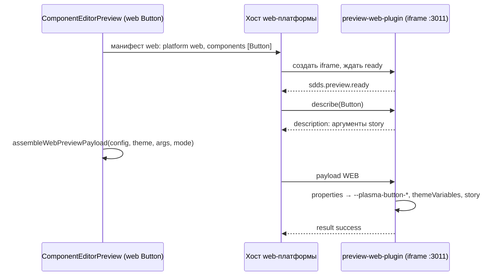

## Context

**Web-превью сейчас рисуется в клиенте** (`ComponentEditorPreview`, React-путь):

```
<StyledComponentWrapper style={{ ...componentVars, ...themeVars }}>
  <StyledStoryScope data-preview style={{ fontFamily }}>
    <Story {...storyArgsValue} relatedComponents />
```

- `componentVars` строит `createComponentVars` (`ComponentEditor.utils.ts`). Для выбранных стилей вариаций и для инвариантов `prop.getWebTokenValue(theme, themeMode)` возвращает значения по web-параметрам компонента (`backgroundColor`, `height`, `fontSize` …).
  - Значения уже разрешены в CSS: цвета темы стали литералами, размеры — `rem`, шаблоны `webTemplates` и корректировки применены.
  - Состояния `hovered` и `pressed` идут отдельными ключами `<param>Hover` и `<param>Active`.
  - Затем `toCSSVariables` по `coreTokens.ts` превращает ключ в CSS-переменную ядра (`buttonTokens.backgroundColor` → `--plasma-button-background-color`).
- `themeVars` — цвета темы выбранного режима (`--text-primary` и т. п.).
- Шрифт — имя семейства `body`, сами файлы шрифтов подключены в `index.html` клиента с `cdn-app.sberdevices.ru`.
- Story `Button` — это `component(mergeConfig(buttonConfig, {}))` из `@salutejs/plasma-new-hope/styled-components` и восемь аргументов. Стилизация идёт только CSS-переменными, `relatedComponents` не используется.

**Compose-превью** устроено так:
- Хост (`composePreview`: `ComposePreviewSession`, `ComposePreviewFrame`, `ComposePreviewHost` уровня раздела) загружает манифест, создаёт `iframe` и обменивается сообщениями `sdds.preview.*`.
- Манифест разрешает только `platform: "compose"`. Проверка окружения требует WebAssembly. Адрес у плагина один.

**Preview Protocol v1:**
- Схема принимает `platform: "WEB"`, `literal.value` — любой JSON, `properties` — свободный словарь. В корне разрешены дополнительные поля (`additionalProperties: true`).
- Но токены темы описаны безразмерными числами под Compose. В клиентском ассемблере `assembler.ts` Compose-ограничения: `missing_mapping`, `rendererPlatform: COMPOSE`.

**Публикация плагинов через ds-service** заточена под Compose:
- константа `PLATFORM = "compose"`;
- `uikitComposeVersion` и `api-meta.json` обязательны в манифесте;
- глобальный `buildId`;
- ключи S3 без платформы — очистка одной платформы удалила бы файлы другой.

В пилот публикация не входит.

## Goals / Non-Goals

**Goals:**
- Рабочий web-плагин в отдельном бандле, который по payload рисует `Button` так же, как React-превью.
- Хост клиента понимает платформу `web` и выбирает рендерер по манифесту.
- Контракт и фикстура описывают payload `WEB`. Схема не меняется, поэтому копию в plasma-android трогать не нужно.
- Локальная раздача плагина с отдельного origin.

**Non-Goals:**
- Публикация web-плагина через ds-service, S3 и CLI, а также обобщение реестра сборок. Это следующий шаг, найденные ограничения перечислены в Context.
- Компоненты, кроме `Button`; связанные компоненты (`relatedComponents`).
- Удаление `useStory`, `src/stories` и `coreTokens.ts` из клиента.
- Полная web-семантика протокола: токены темы с единицами, типографика по размерам экрана, тени, градиенты, шрифты как ассеты, состояния через `states`.

## Decisions

### 1. Плагин — отдельное приложение `js/apps/preview-web-plugin`

Это Vite и React 18 с `styled-components` 5, `@salutejs/plasma-new-hope` и `@salutejs/plasma-icons`. Версии зафиксированы такие же, как установлены в клиенте (`plasma-new-hope` 0.378.0). Своего `package.json` хватает, workspaces в `js/` нет.

Структура:
- `src/bridge.ts` — мост `postMessage`;
- `src/registry.ts` — компонент → story + токены ядра;
- `src/stories/Button.story.tsx`;
- `src/cssVariables.ts` — перенос `getCSSVariableName` и `toCSSVariables`;
- `src/render.tsx` — область отрисовки;
- `public/preview-plugin.json`.

Альтернатива — собирать плагин в plasma рядом с библиотекой, как Compose-плагин в plasma-android. Это целевое место, но для пилота нужен быстрый цикл в одном репозитории (решение пользователя). Перенос потом сведётся к переносу каталога.

### 2. Payload `WEB`: разрешённые CSS-значения по web-параметрам

Клиент знает модель дизайн-системы: стили, токены, режимы, шаблоны. Плагин знает библиотеку: имена CSS-переменных ядра, компоненты, story. Поэтому:
- `component.properties` содержит то, что сейчас уходит в `toCSSVariables`: `{ <webParam>: { base: { type: "literal", value: "<CSS>" } } }`, включая ключи `<param>Hover` и `<param>Active`;
- плагин переводит ключи в CSS-переменные ядра.

Пример:

```jsonc
{
  "protocolVersion": 1, "requestId": "…", "platform": "WEB",
  "theme": {},
  "component": {
    "id": "Button",
    "variations": { "view": "accent", "size": "m" },
    "properties": {
      "backgroundColor": { "base": { "type": "literal", "value": "#2A72F8FF" } },
      "backgroundColorHover": { "base": { "type": "literal", "value": "#3F81FDFF" } },
      "height": { "base": { "type": "literal", "value": "3rem" } }
    }
  },
  "example": { "id": "Default", "props": { "text": "Купить" } },
  "web": {
    "themeVariables": { "--text-primary": "#FFFFFFF5", "--background-primary": "#000000FF" },
    "fontFamily": "SB Sans Text",
    "background": "var(--background-primary)"
  }
}
```

Пример web-payload лежит в контракте отдельно от общих фикстур, в `fixtures/v1/web/valid/web-button.json`. Общие `fixtures/v1/valid` и `invalid` вместе со схемой копируются в plasma-android (`fingerprint.sh --sync-to`) и сверяются там по `CONTRACT.sha256`. Положить туда web-фикстуру значит хранить и проверять web-данные в Android-репозитории, который web-компоненты не собирает и не рисует, и выпускать plasma-android на каждое изменение web-формата. Это неконсистентно: каждый потребитель держит только то, что сам проверяет. Поэтому общие фикстуры описывают то, что обязаны принять или отклонить все платформы, а фикстуры одной платформы живут рядом с её потребителями. Схема у всех общая: web-payload проверяется той же `preview-payload.schema.json` тестами клиента и плагина. `CONTRACT.sha256` и копия в plasma-android при этом не меняются.

Состояния идут отдельными ключами, а не через `states`: так web-ядро и выражает их сейчас. Перенос на `states` пойдёт вместе с полной web-семантикой. Поле `web` — расширение корня, которое схема разрешает. Его смысл описывается в README контракта, проверяется фикстурой `fixtures/v1/web/valid/web-button.json` и TS-типами клиента и плагина.

Альтернативы:
- **Полная web-семантика в протоколе:** токены темы с единицами, типографика, тени и градиенты строками, `woff2`. Это меняет схему и копию в plasma-android и тянет за собой Compose-ассемблер. Слишком велико для пилота.
- **Отдавать плагину готовые CSS-переменные ядра.** Тогда знание о `buttonTokens` остаётся в клиенте, и смысл выноса теряется. Отклонено.

### 3. Хост: платформа как параметр, без нового механизма

- `types.ts`: `PreviewPlatform = 'COMPOSE' | 'WEB'`, манифест `platform: 'compose' | 'web'`.
- `manifest.ts`: `loadPreviewManifest(url, expectedPlatform)` отклоняет чужую платформу.
- `environment.ts`: проверка WebAssembly только для `compose`.
- `config.ts` и `pluginLocation.ts`: адрес web-плагина берётся из `VITE_WEB_PREVIEW_PLUGIN_URL`, без бэкенда. Адрес Compose — как сейчас.
- `ComposePreviewHostProvider` обобщается по платформе. Страница раздела монтирует по провайдеру на каждую платформу с доступным плагином. Слои с `iframe` независимы, у каждого своя сессия.
- `ComposePreviewSession` и `ComposePreviewFrame` от платформы не зависят. Меняются только тексты ошибок: «Compose preview» → «плагин превью».

Новые имена (`PreviewPlugin*`) вводятся там, где тип становится общим. Остальное переименовывается позже, чтобы не раздувать изменение.

### 4. Выбор рендерера для web-компонента

`ComponentEditorPreview` для web-компонента:
- если задан адрес web-плагина, манифест совместим и содержит имя компонента, рисует через слот хоста web-платформы;
- иначе рисует React-превью, как сейчас.

Панель аргументов story в режиме плагина строится по ответу `describe`, как у Compose. Значения аргументов уходят в `example.props`, только отличные от значений по умолчанию. Вариации остаются в панели как сейчас и уходят в `component.variations`.

В debug-режиме (`localStorage.debug_mode`) для поддержанного web-компонента есть переключатель «React | Плагин», чтобы сравнивать рендеры.

### 5. Сборка web-payload — отдельная функция рядом с React-путём

`composePreview/webPayload.ts` — `assembleWebPreviewPayload({ config, theme, args, themeMode, storyId, storyProps })`. Она переиспользует обход `createComponentVars`, но без `toCSSVariables`: вариации по `args`, затем инварианты, в том же порядке перекрытия. `web.themeVariables` берётся из `createThemeVars`, `fontFamily` — из `theme.getTokenValue('body', 'fontFamily', 'web')`, фон — из выбора «На фоне». Общий обход выносится в утилиту, чтобы React-путь и payload не разошлись.

### 6. Отрисовка в плагине повторяет React-обёртку

Область отрисовки в плагине — блок на всю высоту окна. В нём:
- `background` из `web.background`;
- CSS-переменные из `web.themeVariables` и из `component.properties` после отображения в имена ядра;
- `font-family` из `web.fontFamily`.

Внутри story получает `{...example.props, ...component.variations}`: имена стилей так же, как `storyArgsValue` сейчас. Шрифты SB Sans подключаются в `index.html` плагина теми же ссылками, что в клиенте. `success` отправляется после коммита рендера (`useEffect` после `flushSync`/`requestAnimationFrame`). Исключение рендера ловит error boundary, и плагин отвечает `render_crashed`.

### 7. Story `Button` копируется в плагин, в клиенте остаётся запасной

Плагин — источник story для нового пути. Клиентская `Button.story` остаётся до появления публикации web-плагина через бэкенд: пока плагин раздаётся только локально, без неё на стендах web `Button` остался бы без превью. Удаление story из клиента — шаг после публикации.

Альтернатива — удалить story из клиента сразу. На DEV и PROM у `Button` пропало бы превью, отклонено.

### 7а. Мета едет в плагине, как у Compose

Глобальный слой web-компонентов в ds-service строится из API-меты. Её генерирует `js/cli` (`generate:api-meta`) из своей версии `plasma-new-hope` (0.384.0-dev.0), а рендер плагина шёл на 0.378.0. Так мета и рендер разъезжаются. Кроме того, в 0.378.0 ещё нет JSDoc-разметки стилей: мета из неё содержит 3 компонента из 64.

Решение: плагин переведён на `@salutejs/plasma-new-hope` 0.386.0 (последний стабильный). `public/api-meta.json` генерируется генератором `js/cli`, запущенным из каталога плагина, то есть из его версии пакета. В манифесте лежат `plasmaNewHopeVersion` и `apiMetaSha256`, их сверяет тест манифеста.

Пока публикации web-плагина через ds-service нет, «публикация» меты выполнена вручную: `dsbuilder components import-api --platform react --from js/apps/preview-web-plugin/public/api-meta.json --apply` на локальном контуре. Добавилось 18 свойств и 23 платформенных имени, удалений нет. При будущей публикации web-плагина импорт меты из архива делает бэкенд, как для Compose.

Следствия:
- клиентское React-превью остаётся на `latest` клиента (0.378.0), поэтому сравнение «React | Плагин» в debug-режиме может различаться в компонентах, которые менялись между версиями. `Button` в мете 0.384 и 0.386 одинаков;
- `bootstrap-base.sh` при `setup-local.sh --reset` по-прежнему импортирует мету `js/cli` (0.384), и ручной импорт после сброса нужно повторить.

### 8. Локальная раздача

- Сервис `preview-web-plugin` в `js/docker-compose.dev.yml` раздаёт **собранный** бандл: `npm run build`, затем `npm run preview` на порту `3011` с CORS. Так плагин загружается так же, как будет из S3: один JS около 220 КБ (75 КБ в gzip). Dev-сервер Vite отдавал зависимости без отсечения лишнего и минификации: `plasma-icons` 10,4 МБ, `plasma-new-hope` 3,5 МБ и сотни модулей подсветки синтаксиса. Загрузка в `iframe` занимала секунды.
- `npm run dev` (Vite dev-сервер на том же порту) остаётся для работы над самим плагином. После правки кода плагина в режиме сборки сервис перезапускается.
- Клиенту по умолчанию `VITE_WEB_PREVIEW_PLUGIN_URL=http://localhost:3011/`.
- Web-плагин прогревается при входе в раздел компонентов, если у ДС есть web-компоненты (`preload`), как Compose-плагин.

`localhost:3011` — другой origin, поэтому `iframe` с `sandbox="allow-scripts allow-same-origin"` не видит `localStorage` клиента.

### Поток



## Программное проектирование

```ts
// js/apps/client/src/composePreview/types.ts
export type PreviewPlatform = 'COMPOSE' | 'WEB';
export type PreviewPluginPlatform = 'compose' | 'web';
export interface WebPreviewEnvironment { themeVariables: Record<string, string>; fontFamily?: string; background?: string }
export interface WebPreviewPayload extends PreviewPayload { platform: 'WEB'; web: WebPreviewEnvironment }

// js/apps/client/src/composePreview/manifest.ts
export function loadComposePreviewManifest(url: string, platform?: PreviewPluginPlatform /* 'compose' по умолчанию */): Promise<LoadedPreviewPlugin>;

// js/apps/client/src/composePreview/config.ts
export const getWebPreviewPluginUrl: () => string | undefined;

// js/apps/client/src/composePreview/webPayload.ts
export function assembleWebPreviewPayload(input: {
    config: Config; theme: Theme; args: Record<string, string | boolean>; themeMode: string;
    storyId: string; storyProps: Record<string, unknown>; background: string;
}): Omit<WebPreviewPayload, 'requestId'>;

// js/apps/client/src/composePreview/ComposePreviewHost.tsx
export function ComposePreviewHostProvider(props: { platform?: PreviewPluginPlatform; pluginUrl?: string; scope?: string; preload?: boolean; children: ReactNode }): JSX.Element;

// js/apps/preview-web-plugin/src
export interface PreviewComponentEntry {
    story: WebStory;               // { name, args: StoryArg[], render(props) }
    tokens?: Record<string, string>; // объект <component>Tokens ядра
}
export const registry: Record<string, PreviewComponentEntry>;
export function toCoreCssVariables(componentName: string, properties: Record<string, string>): Record<string, string>;
export function describeStory(componentId: string, story: WebStory): PreviewComponentDescription;
export function startBridge(window: Window): void;
```

## Risks / Trade-offs

- **[Риск] Рендер в плагине отличается от React-превью.** Причины: глобальные стили клиента, `App.css`, тема `plasma_infra` в `index.tsx`, которые сейчас частично попадают в превью. → Тест в плагине сверяет CSS-переменные для фикстурного payload с `createComponentVars`. Ручная проверка — сравнение в debug-режиме через «React | Плагин».
- **[Риск] Расхождение версий `plasma-new-hope`.** В клиенте `latest`, в плагине версия зафиксирована. → Пилот фиксирует версию, совпадающую с установленной в клиенте. Выравнивание версий — часть шага публикации.
- **[Риск] Поле `web` вне схемы** не проверяется схемой. → Его проверяют TS-типы, валидация в плагине (`invalid_payload`) и фикстура. Вынос в схему — вместе с полной web-семантикой.
- **[Компромисс] Story `Button` существует в двух местах до публикации плагина.** Риск их рассинхронизации принимается на время пилота.
- **[Компромисс] Хост монтирует по провайдеру на платформу:** два `iframe` в разделе, если доступны оба плагина. Web-плагин лёгкий (React-бандл), Compose прогревается как сейчас.

## План проверки и развёртывания

- `js/apps/preview-web-plugin`:
  - `npm test` — мост (ready, describe, payload → success, `component_not_found`, `invalid_payload`, `render_crashed`), отображение в CSS-переменные ядра, describe по story;
  - `npx tsc --noEmit`;
  - `npm run build` — в сборке есть манифест и `index.html`.
- `js/apps/client`:
  - `npm test` — сборка web-payload совпадает с `createComponentVars` и проходит схему, манифест web, выбор рендерера, отсутствие Wasm-проверки для web;
  - `npx tsc --noEmit`, `npm run build`.
- Контракт: тест схемы принимает `web-button.json`.
- Ручная проверка на локальном контуре: web `Button` рисуется плагином. Переключатель «React | Плагин» в debug-режиме даёт визуально одинаковый результат, а смена стилей, режима и аргументов story отражается в превью.
- Развёртывание: без переменной `VITE_WEB_PREVIEW_PLUGIN_URL` на стендах поведение не меняется. В deploy workflow переменная не добавляется до шага публикации.
