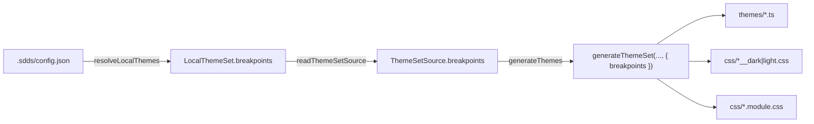

## Контекст

Типографика web-темы адаптивная: у неё есть значения для корня (`:root`) и три набора для экранов
`screenS`, `screenM`, `screenL` — по тегам токенов `screen-s`, `screen-m`, `screen-l`. Генератор
в `js/cli/src/generator/themeBuilder` оборачивает каждый набор в медиазапрос по константе
`webBreakpoints` (`types/constants.ts`) через `getMediaQuery` из `@salutejs/plasma-tokens-utils`.
Константа используется в трёх генераторах: `generateThemes` (`themes/*.ts`), `generateCSSThemes`
(`css/*__dark|light.css`), `generateCSSModuleThemes` (`css/*.module.css`).

`.sdds/config.json` читают две стороны:

- `js/cli/src/local-theme-source.ts` — мягко, неизвестные ключи игнорируются;
- `frontend-kt/core-workspace` (`ProjectConfigCodec`) — строго, `ignoreUnknownKeys = false`: config
  с новым ключом сейчас не прочитается ни одной командой `dsbuilder`, включая `theme generate`,
  который запускает web-генератор через `platform-web`.

## Цели / Вне целей

**Цели:**

- задать брейкпоинты типографики в `.sdds/config.json` и получить их во всех файлах темы;
- генерировать медиазапросы только для экранов, описанных в config;
- не пропустить сетку без начала или конца;
- без ключа получать тот же результат, что и до изменения;
- не сломать `dsbuilder` на config с новым ключом и не терять ключ при перезаписи config.

**Вне целей:**

- брейкпоинты в редакторе клиента и на бэкенде — значение живёт только в локальном проекте;
- экраны сверх `screenS`, `screenM`, `screenL`: данных типографики для них нет;
- разные брейкпоинты для разных тем одной дизайн-системы;
- брейкпоинты в компонентах и на нативных платформах;
- изменение файла токенов `tokens/index.ts`: в нём остаются JS-ссылки на переменные без медиазапросов.

## Решения

### Формат — массив экранов, `from` — минимальная ширина, `to` — максимальная

```json
"breakpoints": [
  { "name": "screenS", "to": 959 },
  { "name": "screenM", "from": 960, "to": 1280 },
  { "name": "screenL", "from": 1281 }
]
```

`name` — один из наборов типографики: `screenS`, `screenM`, `screenL`. Границы — в пикселях,
включительно:

| Заданы | Медиазапрос | Диапазон ширины |
|---|---|---|
| только `to` | `@media (max-width: <to>px)` | до `to` |
| `from` и `to` | `@media (min-width: <from>px) and (max-width: <to>px)` | от `from` до `to` |
| только `from` | `@media (min-width: <from>px)` | от `from` и шире |

Отсутствующая граница — это отсутствующий ключ или `null`.

`getMediaQuery` из `plasma-tokens-utils` трактует одиночные границы наоборот: только `from` даёт
`max-width`, только `to` — `min-width` (в plasma над функцией стоит TODO об этом). Первая версия
формата повторяла этот смысл, и `{ "name": "screenS", "from": 959 }` читалось как «от 959», хотя
означало «до 959». Поэтому в config смысл прямой, а перевод в аргументы `getMediaQuery` делает одна
функция генератора с пометкой `INFO`. Константа `webBreakpoints` записана в том же прямом смысле.

### Генерируются только описанные экраны

Массив целиком определяет медиазапросы темы: экран, которого нет в массиве, в темах не выводится,
значения по умолчанию к частичному массиву не подмешиваются. Без ключа `breakpoints` берётся
`webBreakpoints` — три экрана, как раньше. Пустой массив — ошибка: типографика осталась бы без размеров.

### Согласованность — у сетки есть начало и конец

Массив задаёт экраны по возрастанию ширины:

- у первого экрана нет нижней границы (только `to`), у последнего — верхней (только `from`);
- у экранов между ними заданы обе границы и `from ≤ to`;
- имена не повторяются и идут в порядке `screenS`, `screenM`, `screenL` (экран можно пропустить).

Единственный экран не имеет границ вовсе: его типографика выводится в селекторе темы без
медиазапроса.

Стыковка соседних экранов (начало следующего на 1 px больше конца предыдущего) не проверяется:
пользователь счёл такую проверку слишком жёсткой. Разрыв или пересечение диапазонов — ответственность
команды, которая задаёт сетку.

Кроме этого ошибкой считаются: `breakpoints` не массив, элемент не объект, неизвестное `name`,
граница не целое неотрицательное число. Сообщение называет путь к config и номер элемента.

### Проверка — в `js/cli`, до записи файлов

Массив разбирается в `resolveLocalThemes` вместе с остальным config, то есть до очистки каталога
результата. Это единственное место, которое знает смысл значения.

### Передача в генератор

Брейкпоинты — свойство проекта, а не темы: одинаковы для всех тем набора и для `--tenant`.



Три генератора получают список экранов и строят блоки в его порядке через общую функцию, вместо
трёх строк на `screenS`/`screenM`/`screenL`. Попутно `themes/*.ts` и `css/*__dark|light.css` начинают
учитывать обе границы у `screenS`, как уже делает `css/*.module.css`. Для значений по умолчанию
результат побайтно совпадает с прежним.

### Kotlin — поле хранится как есть

`ProjectConfig` получает необязательное поле `breakpoints: JsonArray?`. `frontend-kt` значение не
интерпретирует: смысл и проверка принадлежат web-генератору, а типизация в Kotlin дала бы второе
место правды и роняла бы команды, которым брейкпоинты не нужны (`status`, `components fetch`).

Поле не записывается, когда не задано (`@EncodeDefault(NEVER)`), чтобы `init` и `theme fetch`
не добавляли `"breakpoints": null` во все config. Обновления config идут через `copy(...)`,
поэтому заданное значение сохраняется.

## Программное проектирование

```ts
// js/cli/src/generator/themeBuilder/types/constants.ts
export type ScreenName = 'screenS' | 'screenM' | 'screenL';
export interface Breakpoint { name: ScreenName; from?: number; to?: number }
export const webBreakpoints: Breakpoint[];

// js/cli/src/local-theme-source.ts
export interface LocalThemeSet { /* ... */ breakpoints: Breakpoint[] }
export function parseBreakpoints(value: unknown, configPath: string): Breakpoint[];

// js/cli/src/theme-source.ts
export interface ThemeSetSource { /* ... */ breakpoints: Breakpoint[] }

// js/cli/src/generator/themeBuilder/generate.ts
export const generateThemeSet: (
    themeSources: ThemeSource[],
    srcDir?: string,
    options?: { defaultThemeName?: string; breakpoints?: Breakpoint[] },
) => Promise<void>;

// js/cli/src/generator/themeBuilder/utils/theme.ts
export const getTypographyBreakpoints: (
    typography: TokensContent['typographyTokens'],
    breakpoints: Breakpoint[],
    selector?: string,
) => string[];
```

```kotlin
// frontend-kt/core-workspace: ProjectConfig
@EncodeDefault(EncodeDefault.Mode.NEVER)
public val breakpoints: JsonArray? = null
```

## Риски / Компромиссы

- [Перевод в аргументы `getMediaQuery` легко сломать правкой генератора] → одна функция с пометкой
  `INFO` и тесты на медиазапросы во всех трёх видах файлов темы.
- [Kotlin не проверяет значение, ошибка всплывает только при генерации] → сообщение генератора
  называет config и элемент; `dsbuilder theme generate` показывает вывод генератора.
- [Старый `dsbuilder` без поля упадёт на config с `breakpoints`] → обновить CLI; ключ необязательный,
  проекты без него не затронуты.
