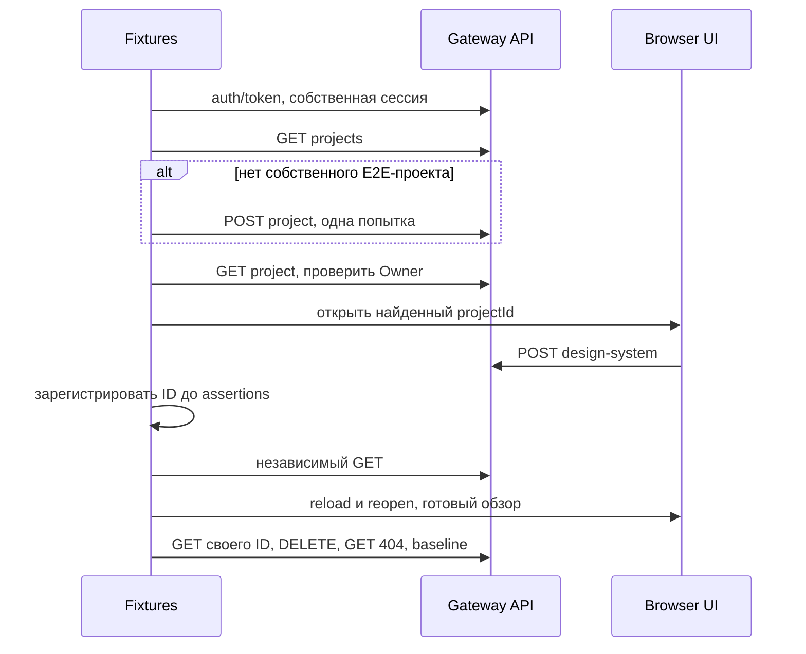

# Проектное решение: простой фундамент UI E2E

## Единый основной запуск после cleanup

По уточнению05.11.2026 основной CLI всегда готовит сборку, кроме явного
--external-ui. Удалён флаг --built-ui и переключатель DSB_E2E_BUILT_UI;
единственный выбор альтернативного источника UI — DSB_E2E_EXTERNAL_UI,
который wrapper задаёт из аргумента, а не доверяет оставшемуся env.
`test:e2e:built` — алиас обычного запуска. Metadata-команды по-прежнему
не читают dotenv, не авторизуются и не запускают сборку/preview.
Сборка/сессия используют4173; default3002 сохраняется только для external.
Compose Preview smoke, Docker dev, безопасность очистки и пользовательские
проверки не меняются. Пользователь подтвердил100/100 на собранном UI;
это повторения десяти сценариев до обновления dev, не оценка покрытия релиза.
06.11.2026 после merge dev пользователь выполнил текущие десять сценариев:
сохранённый product-report подтверждает10 passed,0 skipped,0 unexpected,0 flaky.
Ожидание изменения Light/Dark-превью удалено пользователем из Jira T768;
согласованный объём сценария полностью покрыт.

## Собранный UI для локального E2E

По запросу05.11.2026 добавляется режим собранного UI, ставший основным в `test:e2e`; `test:e2e:built` сохранён как алиас. CLI сохраняет
Product-режим и передаёт обычные параметры Playwright, а публичные параметры
Vite берёт из того же E2E dotenv/process env, что API-fixtures. Только origin
Client меняется на localhost4173; storageState создаётся для него штатно.

WebServer Playwright выполняет существующий `npm run build`, затем локальный
`vite preview` со строгим портом4173. HTTP-готовность проверяется после сборки,
бюджет запуска120s отделён от UI90s и мутаций15s. Занятый порт не переиспользуется;
native lifecycle завершает только запущенный им preview после набора. Dev3002,
backend, проект и исходные ДС не останавливаются. Сервер получает `dist`, без
HMR и выдачи отдельных /src-модулей. Внешние API и браузерный CORS сохраняются.

В сборку передаются только API URL/clientId и публичные флаги: палитраapi,
компоненты включены по умолчанию как в dev, плагины выбираются backend, если
пользователь явно не задал process env. Credentials не экспортируются в VITE_*.
`--list`/`--help` не читают dotenv, не собирают UI и не запускают сервер.

Запуск на существующем UI доступен явно через `test:e2e:external`. На первом шаге
не добавляются API timeout/retry, reload для восстановления или новые проверки
продукта. Короткий прогон проверяет интеграцию режима; пользовательский повтор50
нужен для сравнения с47/50 dev-режима. API-зависания могут остаться и не считаются
исправленными одним переключением источника UI. Backend/frontend-kt, зависимости,
Docker и защищённые gates не затрагиваются.

## Исправления по ревью 05.11.2026

Ресурсные fixtures createdSystem/systemData получают собственный timeout250s:
подготовка до70s + подтверждение мутации до60s + четыре GET до20s + DELETE30s + запас10s.
Session получает общий slot30s: вход10s + logout10s + запас10s. Native fixture slot разделяется подготовкой и очисткой; расчёт учитывает обе фазы. UI/test budget90s,
ответы мутаций15s, workers1/retries0 сохраняются. Это бюджеты отдельных native
fixtures, а не увеличение общего таймаута сценария.

PendingMutation.run регистрирует observer до действия, ждёт оба клиентских
Promise через allSettled и сохраняет одну исходную ошибку или обе в AggregateError.
Полный ответ по-прежнему подтверждается отдельно до DELETE; allSettled не
подменяет этот барьер. Защита применяется к созданию Theme T768, публикации T660,
переименованию T547 и дубликату T555. URL сравнивается по origin/pathname/методу.
Автоматических повторов мутаций и recovery через reload/goTo нет.

T521 дополнен переходом валидное имя/enabled → ControlOrMeta+A/Backspace →
пустое поле/disabled, с проверкой отсутствия POST. В Playwright MCP переход
подтверждён, форма отменена без создания проекта.

PageReadiness отслеживает только API GET, исключая долгоживущие events-потоки.
При исходной ошибке загрузки каталога/формы/журнала/версий/редактора прикладывает
page-readiness JSON: этап, pathname, видимые status/alert и pending/failed GET
с длительностями. Query, headers, request/response bodies и credentials не
сохраняются. Исходная ошибка остаётся прежней; helper не повторяет запросы,
не увеличивает ожидание и не маскирует зависшую загрузку успешной навигацией.

Сохранённые traces ревью показывают незавершённые GET tokens/ДС/тем/проекта,
а не нарушение15s POST. В backend нет однозначно сопоставленных завершений
некоторых этих чтений; точная причина зависания пока не доказана. Исправления
fixture не объявляются исправлением transport/backend. Общий проект запускается
последовательно между процессами; параллельность требует отдельной изоляции.

## Раздельное ожидание POST и очистки T768

По прямому согласованию пользователя PendingMutation сохраняет один observer
реального POST и его завершения тела. Проверка ответа ограничена15s и остаётся
ошибкой после превышения. Наблюдение продолжается до60s от регистрации;
createdSystem до любых GET/DELETE очистки ждёт этот результат. После завершённого
ответа выполняется прежний Owner/ID/project/nontechnical/baseline cleanup.

Если полный ответ не подтверждён до60s либо соединение оборвалось, cleanup
выдаёт отдельную ошибку с известным ID и пропускает DELETE, сохраняя исходную
ошибку теста. Запросы не повторяются, страница не обновляется для восстановления.
Без регистрации мутации остальные сценарии продолжают прежнюю очистку.
Глобальные таймауты, backend/config и лимит15s не меняются. Серия3 запусков T768
разрешена для диагностики известного SLA-сбоя; при другой ошибке или неподтверждённой
очистке серия прекращается. Каждому запуску сохраняются отдельные report/trace.

## Ожидание редактора и ответы API в T768

После создания клиент открывает `/overview`; вложенный redirect на `/colors`
монтируется только после загрузки темы в Main. T768 SHALL ждать видимый
`Text & Icons` до30s перед точной проверкой URL; после reload используется то же
ожидание. Ожидание завершается сразу при готовности. POST остаётся15s, без
повторной отправки, принудительной навигации, reload для восстановления и sleep.

Фильтры ответов в theme-creation.spec.ts сравнивают метод, origin и pathname,
поэтому дополнительные query-параметры не приводят к пропуску нужного ответа.
Для GET после reload отдельно проверяется отсутствие versionId: историческая
версия не должна выдаваться за чтение текущего черновика. Статусы и данные,
точный URL редактора и прежние проверки сохраняются. Новая общая инфраструктура
не вводится; остальные сценарии и глобальные таймауты не меняются.

## VER-UI на текущей версии

Согласованы T792/T660/T657 без переноса PR144. `fixtures/versions.ts` расширяет
fixture тем и получает отдельную ДС. `VersionsApi` читает свежие draftId и
draftRevision и публикует подготовку одним POST с Idempotency-Key. Общий HTTP
helper получает необязательный ключ повторяемости и PATCH; мутации не повторяются.

Исходная тема публикуется в0.1.0. Одно переименование темы образует непустой
черновик T660, который публикуется через UI с пустыми примечаниями. T657
получает вторую публикацию через API и новое имя темы в активном черновике.
Историческая запись и текущая тема заведомо различаются. Не нужны новые
fixtures палитры/типографики/размеров, второй аккаунт или изменение продукта.

`JournalPage` и `VersionsPage` содержат подтверждённые Playwright MCP локаторы.
Проверки ждут конечного содержимого (пустого журнала, конкретной записи,
готовности кнопки), а не только появления контейнера. Выбор historyVersionId
не должен менять versionId; возврат проверяет имя текущей темы и доступность
редактирования. У каждого теста собственные данные, очистка родительской ДС
удаляет её темы и версии. Lifecycle сессии/logout сохраняется.

## Объединение T551/T556 в T768

По актуальному экспорту Zephyr от 03.11.2026 и прямому запросу пользователя
оба прежних тела объединяются в один тест T768 без изменения assertions. Сначала
выполняется прежняя проверка невалидных HEX с восстановлением, отменой и reload
пустого списка. Затем прежний положительный поток открывает новую форму и создаёт
Custom Theme с GET/reload. Это сохраняет существующие проверки; непрерывное
создание в той же форме сразу после исправления ошибки не добавляется. T555 и
остальные сценарии не меняются. Один тест использует одну временную ДС и cleanup.

## Уточнение границ T768 (прежний T551)

По прямому запросу пользователя положительная часть T768 подтверждает видимость и точные значения
четырёх HEX-полей формы. API `preview` карточки темы и CSS/переключение Light/Dark
не проверяются этим сценарием. Неиспользуемые локаторы превью удаляются из
CreateThemePage. POST 201, ID/принадлежность темы, `colorConfig.customPalette`,
независимый GET, reload и cleanup сохраняются. Лимит ответа POST остаётся 15s;
общая правка readiness и backend-изменения в это уточнение не входят.

## Формы и клавиатура: следующий блок

Каталог проектов отслеживает переход от открытого дочернего окна к закрытому и
возвращает фокус на свою основную ссылку «Создать проект» через ref. При первом
обычном открытии каталога и фоновых обновлениях фокус не меняется. Если каталог
временно не готов, восстановление выполняется после появления ссылки.

T521/T523/T566 используют небольшую страницу каталога/диалога и отдельную fixture.
Наблюдение POST проектов хранит только счётчик, а не Request с Authorization.
Эти тесты не создают проекты и не используют fixture временной ДС. T566 проверяет
реальные Tab/Shift+Tab и восстановление фокуса продуктом без искусственного focus
из теста. T768/T555 используют отдельную ДС текущей API-fixture. `ThemesApi`
содержит подготовку темы и независимые чтения; `CreateThemePage` — локаторы и
заполнение формы. Успешный POST, ошибка 409, UI и сохранённые данные проверяются
в сценариях. Список тем содержит только идентичность; палитра проверяется GET
отдельной темы. Все дочерние темы очищаются вместе с зарегистрированной ДС,
поэтому отдельный механизм регистрации/удаления tenantId не нужен.

Прежний пилот и T547 сохраняются. Новый scope и порядок проверок подтверждены
пользователем: только затронутые тесты, финальный Strictacode без изменения baseline.

## Первое расширение: переименование ДС

Редакция 03.11.2026 добавляет PLASMABLDR-T547 без изменения пользовательского потока
пилота. Отдельная fixture расширяет существующую: через `DesignSystemApi.create`
получает исходный DTO, проверяет минимальную идентичность и отсутствие ID в baseline,
регистрирует ID и только затем проверяет полный DTO. `DesignSystemSettingsPage`
содержит подтверждённые через Playwright MCP семантические локаторы настроек.
Составной Steps-слой для одного нового потока не добавляется.

Сценарий проверяет реальный PATCH, независимый GET, reload со свежим GET, обновлённое
имя в настройках/каталоге и неизменный набор ID. Cleanup отдельной fixture проверяет
Owner и неизменяемую принадлежность объекта по ID/projectId/isTechnical; переименование
не блокирует удаление только своей временной ДС. Исходные системы сверяются с baseline.
Общий проект не удаляется/не архивируется, стенд не останавливается. Результат POST
без подтверждённой идентичности не разрешает повтор или поиск для удаления по имени.

Types/discovery не читают credentials. Этап T547 содержал пилот и T547;
после объединения T551/T556 и добавления T792/T660/T657 текущий набор
содержит десять сценариев: пилот, шесть PROJ-UI и три VER-UI.
Первичная проверка UI для этого этапа выполняется браузером Playwright MCP вместо
ARTEMIS по явному уточнению пользователя. Policy, baseline и пороги Strictacode
сохраняются. Отдельный большой набор инфраструктурных тестов не вводится.

## Контекст и границы

Пилот даёт один исполняемый lifecycle создания дизайн-системы и слои для последующих
тестов. По запросу от 28.10.2026 ручной projectId исключён; локальные credentials
размещаются внутри клиента и автоматически читаются. Пользователь один раз заполняет
учётную запись, затем запускает npm run test:e2e на готовом стенде.

CI, автоматический запуск стека, миграции/seed, создание пользователей, параллельность,
постоянные журналы/lock/recovery остаются за рамками. API продукта не меняются.

## Ответственности

| Слой | Ответственность |
|---|---|
| config | Environment и Credentials; чтение приватного dotenv. |
| pages | Семантические локаторы, действия и готовность страницы без API/секретов. |
| steps | Составные UI-действия, наблюдение ответа до действия, native test.step. |
| helpers | Собственная сессия, выделенный проект, технические GET/DELETE и уникальные данные. |
| fixtures | Зависимости, baseline, ранняя регистрация и finally. |
| e2e | Пользовательский сценарий и assertions результата. |

Один playwright.config.ts раздельно выбирает Product и прежний Compose smoke.
Обёртка CLI только передаёт режим/аргументы. BasePage, пустые будущие страницы,
свой движок ошибок/отчётов и обязательный infrastructure unit-набор не нужны.

## Локальные настройки

Шаблон js/apps/client/e2e.env.example содержит пустые username/password, локальные
адреса и разрешение мутаций тестового стенда. Его копия .env.e2e.local читается
относительно environment.ts независимо от cwd. Реальный файл исключён из Git;
публичный e2e.env.example не использует запрещённый префикс .env.*. Credentials не печатаются.

Приоритет: process env → явно указанный DSB_E2E_CREDENTIALS_FILE либо стандартный
.env.e2e.local. При отсутствии стандартного файла можно использовать только env;
ошибка чтения явного файла не игнорируется. Файлы разбираются через parseEnv без shell.

Обязательны DSB_E2E_USERNAME, DSB_E2E_PASSWORD и DSB_E2E_ALLOW_MUTATIONS=true.
Основной Client использует http://localhost:4173/. DSB_E2E_CLIENT_BASE_URL относится
к external-режиму с default http://localhost:3002/. Пустые Gateway/clientId используют
http://localhost:8080/ и dsbuilder-api; непустые значения проходят прежнюю проверку URL. ProjectId больше
не является настройкой. DSB_E2E_PROJECT_NAME необязателен, default — E2E Automation.
Remote требует HTTPS, loopback допускает HTTP. TLS verification не отключается.
Types/--list не читают dotenv, не авторизуются и не подготавливают проект.

## Проект без ручного ID

После получения собственной сессии helper делает GET /api/projects и выбирает
только active-проект с точным именем, ownerUserId=sub и effectiveRole=owner.
System admin не подходит. Одно совпадение переиспользуется; при нуле выполняется
один POST /api/projects с именем/описанием. Несколько совпадений дают отказ без мутаций;
произвольный первый проект не выбирается. Чужие/архивные проекты не меняются.

Полученный ID подтверждается защищённым GET и актуальными правами, затем передаётся
API/PageObject через fixtures. Локальное чтение JWT не заменяет проверку Gateway.
POST не повторяется при неоднозначном результате. Проект сохраняется между запусками,
не удаляется и не архивируется: это постоянный выделенный контейнер для тестовых систем.
При потерянном ответе следующий запуск может найти его через API, без журнала.

Это расширяет прежнюю границу «проект подготовлен вручную» ровно одной предметной
операцией подготовки. Docker/bootstrap, глобальные блокировки и менеджер ресурсов
не возвращаются. Одна функция соответствует фактической потребности.

## UI, данные и очистка

Нативные запросы/CORS сохраняются без route.fetch/fulfill. Семантические локаторы
и состояние «Тем пока нет» подтверждают завершение обзора. Наблюдение ответа
устанавливается до действия; sleep/networkidle/координаты не служат критерием успеха.

POST 201 проверяется и регистрирует ID/имя/projectId до последующих assertions,
в том числе при ошибке click. Проверяются независимый GET, reload со свежим GET,
готовое пустое состояние и reopen того же ID. API cleanup не считается UI-удалением.

Cleanup использует свежий GET Owner/своего объекта, подтверждает принадлежность и
отсутствие ID в baseline, делает одну попытку DELETE, затем GET 404 и сверяет
исходные системы. Единственная точка очистки — finally штатной fixture; явного cleanup в spec и кеша Promise нет.
Исходное падение и ошибка cleanup сохраняются в нативном отчёте. Технический HTTP helper
использует встроенный Node fetch: Playwright APIRequestContext записывал Authorization при сетевом сбое в автоматический шаг HTML до обработки ошибки. Один HTTP helper сохраняет ограниченные таймауты, проверку статусов/TLS, запрещает redirect. По прямому согласованию пользователя только технический GET повторяется один раз при timeout/сбросе соединения, в общем бюджете20s с двумя попытками до10s, включая тело. HTTP-ошибки/JSON/assertions не повторяются; POST/DELETE/авторизация сохраняют одну попытку. Нативный stdout/stderr показывает безопасную диагностику попыток и восстановление GET без заголовков, query или тела. В assertions авторизации передаются только типы и булевы признаки. Отдельный API-контекст и его dispose больше не нужны; logout собственной сессии остаётся в teardown.

Один worker и последовательные запуски на одном E2E-проекте; это не глобальный mutex.
После убийства процесса finally не гарантирован; известные ID разбираются вручную.
Неизвестный результат POST не разрешает автоматическое удаление по одному имени.

## Проверка и риски

Types/list, существующие клиентские тесты/сборка и Node 22.16/22.20 сохраняются.
Для этой редакции проверяются отсутствие ручного projectId, auto dotenv/ignore,
первое создание проекта, повторное использование и отказ admin/неоднозначного выбора.
Нужны полный Windows E2E и macOS прогон общих исходников. Нативные screenshot/trace
хранятся в закрытых игнорируемых артефактах; trace может содержать сессию.

FAST → независимое review → FULL следуют общему процессу. Gates с миграциями используют
только отдельно согласованную disposable БД. Недоступные сервисы/зависимости/macOS
не считаются PASS. Tests остаются в анализе Strictacode: policy возвращена к исходной, baseline/пороги/protected files не меняются. Упрощение выражается в декларативных assertions контрактов, одном finally cleanup и удалении обёрток одного действия. Нативный Promise.allSettled по-прежнему завершает наблюдение ответа до teardown и сохраняет обе ошибки действия/ответа; код не переносится ради исключения из анализа. Форматирование соответствует существующему js/.prettierrc, без искусственного добавления строк.
