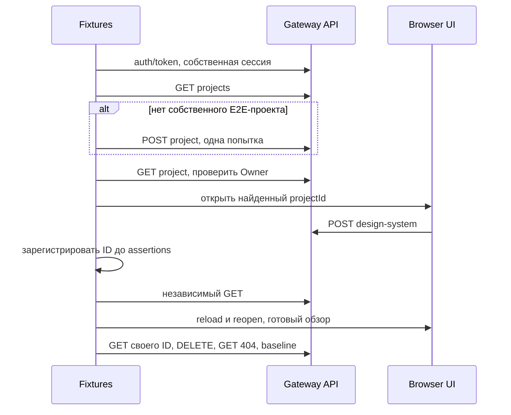

# Проектное решение: простой фундамент UI E2E

## Контекст и границы

Пилот даёт один исполняемый lifecycle создания дизайн-системы и слои для последующих
тестов. По запросу от 28.10.2026 ручной projectId исключён; локальные credentials
размещаются внутри клиента и автоматически читаются. Пользователь один раз заполняет
учётную запись, затем запускает npm run test:e2e на готовом стенде.

CI, автоматический запуск стека, миграции/seed, создание пользователей, параллельность,
постоянные журналы/lock/recovery остаются за рамками. API продукта не меняются.

## Ответственности

| Слой | Ответственность |
|---|---|
| config | Environment и Credentials; чтение приватного dotenv. |
| pages | Семантические локаторы, действия и готовность страницы без API/секретов. |
| steps | Составные UI-действия, наблюдение ответа до действия, native test.step. |
| helpers | Собственная сессия, выделенный проект, технические GET/DELETE и уникальные данные. |
| fixtures | Зависимости, baseline, ранняя регистрация и finally. |
| e2e | Пользовательский сценарий и assertions результата. |

Один playwright.config.ts раздельно выбирает Product и прежний Compose smoke.
Обёртка CLI только передаёт режим/аргументы. BasePage, пустые будущие страницы,
свой движок ошибок/отчётов и обязательный infrastructure unit-набор не нужны.

## Локальные настройки

Шаблон js/apps/client/e2e.env.example содержит пустые username/password, локальные
адреса и разрешение мутаций тестового стенда. Его копия .env.e2e.local читается
относительно environment.ts независимо от cwd. Реальный файл исключён из Git;
публичный e2e.env.example не использует запрещённый префикс .env.*. Credentials не печатаются.

Приоритет: process env → явно указанный DSB_E2E_CREDENTIALS_FILE либо стандартный
.env.e2e.local. При отсутствии стандартного файла можно использовать только env;
ошибка чтения явного файла не игнорируется. Файлы разбираются через parseEnv без shell.

Обязательны DSB_E2E_USERNAME, DSB_E2E_PASSWORD и DSB_E2E_ALLOW_MUTATIONS=true.
Пустые/отсутствующие DSB_E2E_CLIENT_BASE_URL, DSB_E2E_GATEWAY_BASE_URL и DSB_E2E_CLIENT_ID
используют http://localhost:3002/, http://localhost:8080/ и dsbuilder-api соответственно.
Непустые значения переопределяют defaults с прежней проверкой URL. ProjectId больше
не является настройкой. DSB_E2E_PROJECT_NAME необязателен, default — E2E Automation.
Remote требует HTTPS, loopback допускает HTTP. TLS verification не отключается.
Types/--list не читают dotenv, не авторизуются и не подготавливают проект.

## Проект без ручного ID

После получения собственной сессии helper делает GET /api/projects и выбирает
только active-проект с точным именем, ownerUserId=sub и effectiveRole=owner.
System admin не подходит. Одно совпадение переиспользуется; при нуле выполняется
один POST /api/projects с именем/описанием. Несколько совпадений дают отказ без мутаций;
произвольный первый проект не выбирается. Чужие/архивные проекты не меняются.

Полученный ID подтверждается защищённым GET и актуальными правами, затем передаётся
API/PageObject через fixtures. Локальное чтение JWT не заменяет проверку Gateway.
POST не повторяется при неоднозначном результате. Проект сохраняется между запусками,
не удаляется и не архивируется: это постоянный выделенный контейнер для тестовых систем.
При потерянном ответе следующий запуск может найти его через API, без журнала.

Это расширяет прежнюю границу «проект подготовлен вручную» ровно одной предметной
операцией подготовки. Docker/bootstrap, глобальные блокировки и менеджер ресурсов
не возвращаются. Одна функция соответствует фактической потребности.

## UI, данные и очистка

Нативные запросы/CORS сохраняются без route.fetch/fulfill. Семантические локаторы
и состояние «Тем пока нет» подтверждают завершение обзора. Наблюдение ответа
устанавливается до действия; sleep/networkidle/координаты не служат критерием успеха.

POST 201 проверяется и регистрирует ID/имя/projectId до последующих assertions,
в том числе при ошибке click. Проверяются независимый GET, reload со свежим GET,
готовое пустое состояние и reopen того же ID. API cleanup не считается UI-удалением.

Cleanup использует свежий GET Owner/своего объекта, подтверждает принадлежность и
отсутствие ID в baseline, делает одну попытку DELETE, затем GET 404 и сверяет
исходные системы. Единственная точка очистки — finally штатной fixture; явного cleanup в spec и кеша Promise нет.
Исходное падение и ошибка cleanup сохраняются в нативном отчёте. Технический HTTP helper
использует встроенный Node fetch: Playwright APIRequestContext записывал Authorization при сетевом сбое в автоматический шаг HTML до обработки ошибки. Один HTTP helper сохраняет ограниченные таймауты, проверку статусов/TLS, запрещает redirect и не повторяет запросы. В assertions авторизации передаются только типы и булевы признаки. Отдельный API-контекст и его dispose больше не нужны; logout собственной сессии остаётся в teardown.

Один worker и последовательные запуски на одном E2E-проекте; это не глобальный mutex.
После убийства процесса finally не гарантирован; известные ID разбираются вручную.
Неизвестный результат POST не разрешает автоматическое удаление по одному имени.

## Проверка и риски

Types/list, существующие клиентские тесты/сборка и Node 22.16/22.20 сохраняются.
Для этой редакции проверяются отсутствие ручного projectId, auto dotenv/ignore,
первое создание проекта, повторное использование и отказ admin/неоднозначного выбора.
Нужны полный Windows E2E и macOS прогон общих исходников. Нативные screenshot/trace
хранятся в закрытых игнорируемых артефактах; trace может содержать сессию.

FAST → независимое review → FULL следуют общему процессу. Gates с миграциями используют
только отдельно согласованную disposable БД. Недоступные сервисы/зависимости/macOS
не считаются PASS. Tests остаются в анализе Strictacode: policy возвращена к исходной, baseline/пороги/protected files не меняются. Упрощение выражается в декларативных assertions контрактов, одном finally cleanup и удалении обёрток одного действия. Нативный Promise.allSettled по-прежнему завершает наблюдение ответа до teardown и сохраняет обе ошибки действия/ответа; код не переносится ради исключения из анализа. Форматирование соответствует существующему js/.prettierrc, без искусственного добавления строк.
