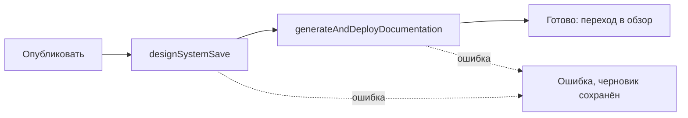

## Контекст

Сейчас код генерации живёт в `js/services/generator/app` и используется двумя способами:

- HTTP-сервис на Fastify (`generate-download`, `generate-publish`) — его вызывает веб-клиент через шлюз
  `/api/projects/{id}/generator`, а `generate-publish` отправляет архив в `js/services/publisher`, который
  публикует пакет в npm;
- `js/cli` подключает модули генератора через `createRequire('../../services/generator/app/*.ts')`, берёт
  `pacote` из `node_modules` генератора и собирает пакет во временном каталоге
  `services/generator/result-cli-*`, потому что скрипт `lint` пакета вызывает `../node_modules/.bin/eslint`.

Генератор — CommonJS (`module: commonjs`, `__dirname`), `js/cli` — ES-модули (`"type": "module"`,
`NodeNext`, импорты с расширением `.ts`), запускается через `tsx`. Генерация документации
(`documentation-generator`) ставит пакет `${NPM_PACKAGE_SCOPE}/<name>` из npm и от generator и publisher
напрямую не зависит.

## Цели / Вне целей

**Цели:**

- удалить `js/services/publisher` и HTTP-часть `js/services/generator` из кода, сборки, CI, деплоя, шлюза и
  документации;
- сделать код генерации частью `js/cli` с обычными ES-импортами и собственными зависимостями `js/cli`;
- сохранить результат `generate:theme`, `generate:components`, `generate:ds` (исходники и `.tgz`) без
  изменений;
- оставить в веб-клиенте сохранение дизайн-системы и генерацию документации из окна «Опубликовать».

**Вне целей:**

- рефакторинг логики генератора, изменение формата сгенерированного пакета;
- новый способ публикации пакета в npm (через CLI или иначе);
- изменения `backend-kt/project-publisher` и `documentation-generator`;
- переименование кнопки «Опубликовать» и перестройка сценария клиента.

## Решения

### Расположение кода в `js/cli`

```text
js/cli/src/
├── generator/
│   ├── componentBuilder/   # модель компонента (Meta, Config)
│   ├── themeBuilder/       # generate(), generateThemeSet()
│   ├── creators/           # файлы компонентов, package.json пакета
│   ├── constants/          # заготовка пакета: rollup, babel, .eslintrc.js, tsconfig — копируется как есть
│   ├── templates/          # манифесты component.json и шаблоны обёрток — копируются как есть
│   ├── types/
│   ├── utils/
│   └── generate.ts         # generateBaseFileStructure, generateComponentsFiles, generateThemeFiles
├── package-output.ts
└── ...
```

Переносится только то, что нужно локальной генерации. Не переносятся `index.ts` (Fastify), `routes/`,
`cli.ts` (`plasma-ds-generate`, читал дизайн-систему из db-service), `generateDesignSystem` с выгрузкой
в zip/tgz, `addFolderToZip`, `getThemeData`, однотемный `generate` с `generateThemeFiles` (CLI пишет темы
через `generateThemeSet`), загрузка темы с GitHub `readTheme`, `DB_SERVICE_URL`, `PUBLISHER_URL`,
`GENERATE_ROOT_DIR` и зависимости `fastify`, `@fastify/cors`, `jszip`, `commander`, `swagger-typescript-types`. История файлов
сохраняется через `git mv`.

Альтернатива — оставить генератор отдельным пакетом и подключать как зависимость `file:` — отклонена:
пользователь просит нативные импорты, а отдельный пакет сохранил бы второй `package.json` и сборку.

### Перевод на ES-модули

- относительные импорты получают расширение `.ts` (`./creators/index.ts`), как в остальном `js/cli`;
- `__dirname` заменяется на `import.meta.dirname` (Node 22);
- импорты CommonJS-пакетов (`fs-extra`, `pacote`, `@salutejs/plasma-tokens-utils`, включая глубокий путь
  `lib/generators/generateFile`) проверяются запуском под `tsx`; при необходимости путь получает `.js`;
- `createRequire` для генератора в `package-output.ts`, `components.ts`, `ds.ts`, `generate-theme.ts`,
  `theme.test.ts` заменяется статическим `import`. Проверка `NPM_PACKAGE_SCOPE` при импорте `utils`
  сохраняется: скрипты по-прежнему загружают `js/.env` через `--env-file-if-exists`.

`tsconfig.json` `js/cli` исключает `src/generator/templates` и `src/generator/constants`: это файлы
сгенерированного пакета, а не код CLI, и они проверяются сборкой пакета.

### Зависимости и временный каталог сборки

pacote запускает у собираемого пакета только `prepare` (`npm run build`) и не устанавливает его
зависимости: babel, rollup, tsc, пресеты, `react`, `styled-components` и `@salutejs/plasma-new-hope`
скрипты пакета находят через `node_modules` выше по дереву. Раньше это был `node_modules` генератора,
теперь — `js/cli`. Поэтому в `devDependencies` `js/cli` переходят:

- зависимости кода генератора: `fs-extra`, `pacote`, `@salutejs/plasma-tokens-utils`;
- инструменты сборки пакета из прежних `devDependencies` генератора: `@babel/cli` и пресеты/плагины из
  `constants/babel.config.js`, `rollup` и плагины из `constants/rollup.config.mjs`, `react`, `react-dom`,
  `styled-components`, `@types/react` с прежними точными версиями;
- `eslint` и плагины flat-конфига шага `lint`;
- прежние `overrides`: `plasma-colors` для `plasma-tokens-utils`, `marked` и заглушка
  `react-syntax-highlighter` (без неё linaria падает на `refractor`).

Шаг `lint` пакета на деле использовал flat-конфиг `services/generator/eslint.config.js`, найденный вверх
по дереву, а `constants/.eslintrc.js` ESLint 9 игнорирует. Конфиг переносится в заготовку пакета как
`constants/eslint.config.mjs`: в архив он не попадает (поле `files`), а после переноса ESLint не
подхватит `js/eslint.config.js` с другими правилами. `typescript-eslint` берётся последней 8.x,
совместимой с TypeScript 5.9 из `js/cli`.

Временный каталог пакета создаётся как `js/cli/result-*`. Скрипт `lint` пакета продолжает ссылаться на
`../node_modules/.bin/eslint`, который теперь указывает на `js/cli/node_modules`. Шаблон `result-*`
добавляется в `js/cli/.gitignore`.

Типы пакета (`.d.ts`) теперь строятся по `@salutejs/plasma-new-hope` из `js/cli` — той же версии, по
которой CLI строит маппинги web-параметров, — а не по версии `latest`, установленной в генераторе.

Альтернатива — собирать пакет в системном каталоге временных файлов и передавать путь к eslint явно —
отклонена: меняет `createPackageJSON` и формат пакета ради вопроса расположения.

### Веб-клиент



`PublishProgress` оставляет стадии `saving`, `documenting`, `success`, `error`. Удаляются `generateDownload`,
`generatePublish`, `longPollNpm` и `PublishResult` из `Main.utils.ts`, если других потребителей нет, кнопки
download/publish в `Debug.tsx`, блок npm на экране успеха (версия, имя пакета, команда установки,
«Открыть в npm»): новая версия в npm больше не появляется, и показывать её было бы неверно. Хелперы
`getNpmPackageName`/`getNpmInstallCommand`/`getNpmPackageUrl` удаляются, если остаются без использования.
Черновик по-прежнему очищается только после успешного завершения.

### Шлюз, деплой, CI

- `nginx.local.conf` и `nginx.prod.conf.template`: удаляются upstream `generator_service_api`,
  `publisher_service_api` и location `/api/projects/{id}/generator`, `/api/projects/{id}/publisher`;
  запросы на эти пути получают обычный ответ шлюза на неизвестный маршрут.
- `docker-compose.prod.yml`: удаляются сервисы `generator`, `publisher`, их зависимости в `depends_on` и
  переменные `GENERATOR_SERVICE_UPSTREAM_*`, `PUBLISHER_SERVICE_UPSTREAM_*` из окружения и списка `envsubst`
  шлюза.
- `publish-backend-images.yml`: из матрицы убираются образы `generator` и `publisher`.
- `validate-js.yml`: убираются путь генератора в ESLint, шаг `Publisher syntax` и сборка `generator`.
- `js/docker-compose.dev.yml`, `js/setup-docker.sh`, `js/package.json`: удаляются сервисы и скрипты
  `dev:generator`, `dev:publisher`, `build:generator`.

### Strictacode для `js/cli`

`tools/verify full` сравнивает метрики `javascript-cli` с baseline с нулевым допуском по SCORE, DENSITY и
RP. Прогон на копии с перенесённым кодом даёт ухудшение: score 23 → 24–25, density 12.56 → ~13.8,
RP 38 → 39. Исключение `templates` и `constants` (не код CLI) метрики не исправляет. Код не новый: до
переноса он не входил ни в один анализируемый контур.

Решение: исключить `src/generator/templates` и `src/generator/constants` через `loader.exclude` в
`js/cli/.strictacode.yml` и после переноса пересчитать baseline `javascript-cli`
(`tools/strictacode baseline javascript-cli js/cli`). Обе правки относятся к защищённой области
`strictacode-policy`; утверждение этого Change даёт на них разрешение. Рефакторинг генератора ради
метрик не входит в задачу.

## Риски / Компромиссы

- [Документация строится по опубликованному пакету] → `documentation-generator` ставит
  `${scope}/<name>` из npm. Для существующих дизайн-систем документация будет собираться по последней
  опубликованной версии, для новой дизайн-системы без пакета в npm генерация документации завершится
  ошибкой. Окно покажет ошибку; новый способ публикации — отдельная задача.
- [Поведение ESM отличается от CommonJS] → импорты CommonJS-пакетов и `import.meta.dirname` проверяются
  тестами `npm run test:cli` и полной сборкой `generate:ds --package` до и после переноса со сравнением
  исходников результата.
- [Остатки на стендах] → после деплоя Coolify перестанет поднимать `generator` и `publisher`, но старые
  контейнеры и переменная npm-токена на стендах могут остаться; их удаляют вручную.
- [Web-runner `project-publisher`] → экспериментальный `backend-kt/project-publisher` запускает внешний образ
  `plasma/web-runner` с флагами удалённого `plasma-ds-generate`; из этого репозитория такой образ больше не
  собрать. Сервис не входит в production, его web-сценарий пересматривается отдельно.
- [Пересчёт baseline скрывает ухудшение] → baseline пересчитывается один раз, сразу после переноса, без
  других изменений в `js/cli`, и это видно в diff.

## План миграции

1. Перенос кода и переключение `js/cli`; проверка, что результат генерации совпадает с прежним.
2. Удаление сервисов, клиентских вызовов, конфигурации шлюза, compose и CI одним PR в `dev`.
3. После деплоя на DEV убедиться, что gateway стартует без upstream `generator`/`publisher`, и удалить
   оставшиеся контейнеры и переменные на стенде. Откат — revert PR и повторный деплой: образы прошлого
   тега в registry остаются.
