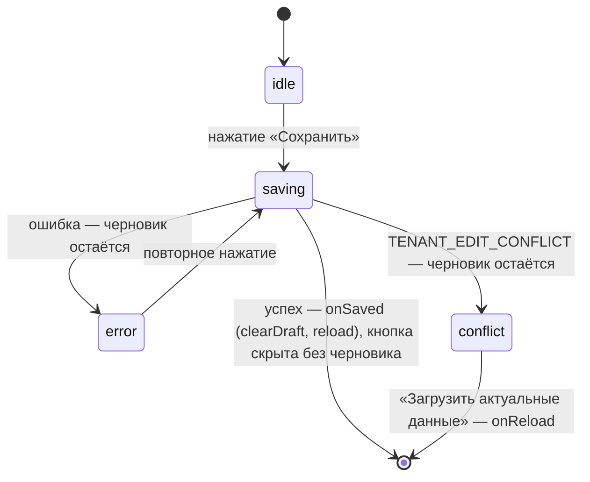

## Контекст

В редакторе кнопка «Опубликовать» (`pages/Main.tsx`) видна, когда есть локальный черновик
(`hasDraft`), дизайн-система не только для чтения и окно не открыто. Она открывает окно
`PublishProgress` со страницей `PUBLISH_PROGRESS`. Окно вызывает `designSystemSave`, затем
`generateAndDeployDocumentation`, очищает черновик и по кнопке «Перейти в обзор» закрывается,
переключает панель на «Цвета» и перезагружает данные (`reload`). Других способов сохранить тему и
компоненты у обычного пользователя нет: аналогичная кнопка есть только на странице Debug.

## Цели / Вне целей

**Цели:**

- сохранять дизайн-систему кнопкой «Сохранить» в редакторе, без окна;
- не запускать генерацию документации при сохранении;
- при конфликте редактирования сохранить черновик и предложить загрузить актуальные данные.

**Вне целей:**

- изменения API сохранения, черновиков и генерации документации;
- автосохранение и сохранение по сочетанию клавиш;
- страница Debug: её действия «Сохранить тему и компоненты» и «Опубликовать документацию» остаются.

## Решения

### Кнопка сохранения вместо окна

Новый компонент `SaveDesignSystemButton` лежит в `features/SaveDesignSystemButton` (папка с `index.ts` и
`*.styles.ts`, как остальные фичи). Фичи не импортируют `pages`, поэтому само сохранение компонент
получает пропом `save`: `Main.tsx` передаёт `designSystemSave` из `Main.utils.ts`, а в `onSaved` очищает
черновик и вызывает `reload`. В фиче остаются состояния кнопки и распознавание конфликта. Кнопка стоит
на прежнем месте.

Условие видимости исправляется. Прежнее брало `designSystemName`/`designSystemVersion` из URL, а редактор
открывается только по маршруту темы `projects/:projectId/design-systems/:designSystemId/themes/:tenantId`,
где этих параметров нет. Поэтому кнопка «Опубликовать» не показывалась ни разу. Теперь черновик ищется по
имени и версии загруженной ДС. При активном контексте tenant ключ черновика всё равно строится по
`projectId:designSystemId:tenantId`, а в старом контексте по имени и версии.

Раньше окно перекрывало редактор, теперь во время сохранения редактор доступен. Если черновик изменился,
пока шёл запрос, эти правки в запрос не попали. Поэтому `Main` перед отправкой снимает снимок черновика
вместе с ключом (`takeDraftSnapshot`), а после успеха вызывает `clearDraftIfUnchanged`. Черновик удаляется,
только если по этому ключу он не изменился. Иначе черновик остаётся, `reload` применяет его поверх
сохранённого, и кнопка остаётся видна. Ключ фиксируется при отправке: если за время запроса пользователь
открыл другой tenant, его черновик не затрагивается.



- `saving`: текст «Сохраняем…», повторные нажатия игнорируются.
- `error`: рядом с кнопкой сообщение с причиной (`role="alert"`), кнопка доступна для повтора.
- `conflict`: кнопка «Сохранить» скрывается, потому что повтор отправил бы ту же устаревшую ревизию.
  Остаются сообщение «Тема уже изменена в другой сессии. Черновик сохранён.» и действие
  «Загрузить актуальные данные», которое вызывает `reload`. Автоматического слияния и повторной
  отправки нет, как требует `tenant-aware-theme-editor`.
- Успех определяется так же, как в окне: ответ с `editRevision` или `success`. После успеха `Main`
  очищает черновик и вызывает `reload`; без черновика кнопка скрывается. Переключения панели на «Цвета»,
  которое делало окно, больше нет: пользователь остаётся там, где редактировал.

Конфликт распознаётся по ответу `409` с кодом `TENANT_EDIT_CONFLICT` (как в Debug) и по тексту ошибки
с этим кодом (как в окне), чтобы не зависеть от того, как `designSystemSave` пробрасывает ошибку.

Альтернатива — оставить окно и убрать из него шаг документации — отклонена: окно с условным прогрессом
ради одного запроса не даёт пользователю ничего, кроме лишнего шага.

### Программное проектирование

```ts
export type SaveResult = { editRevision: number } | { success?: boolean } | null | undefined;

interface SaveDesignSystemButtonProps {
    /** Сохраняет дизайн-систему; в редакторе темы — значения токенов выбранного tenant. */
    save: () => Promise<SaveResult>;
    /** После успешного сохранения: очистка черновика и перезагрузка данных редактора. */
    onSaved: () => void;
    /** Действие при конфликте редактирования: загрузка актуальных данных. */
    onReload: () => void;
}

type SaveState =
    | { status: 'idle' }
    | { status: 'saving' }
    | { status: 'error'; message: string }
    | { status: 'conflict' };

export const SaveDesignSystemButton: (props: SaveDesignSystemButtonProps) => JSX.Element;
```

### Что удаляется

`popup/PublishProgress` целиком, его экспорт из `popup/index.ts`, `PUBLISH_PROGRESS` из
`popupContentPages`, `onDesignSystemPublish` и `onPublishComplete` в `Main.tsx`.

## Риски / Компромиссы

- [Документация перестаёт обновляться при сохранении] → это намеренно: документацию строят вручную
  действием на странице Debug.
- [В редакторе темы сохраняются только значения токенов] → ветка tenant в `designSystemSave` отправляет
  `PUT …/tenants/{id}/token-values`. Конфигурации компонентов там не отправляются, а `reload` после
  сохранения сбрасывает несохранённые правки компонентов в памяти. Так было и с окном публикации; это
  изменение поведение не меняет, сохранение компонентов — отдельная задача.
- [Пользователи привыкли к «Опубликовать»] → кнопка остаётся на том же месте с понятным названием.
