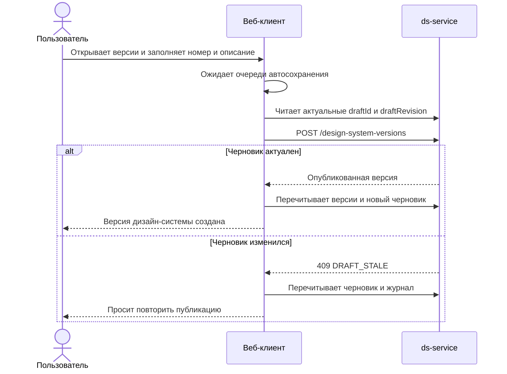

## Context

`js/apps/client` уже получает вычисляемый журнал, список опубликованных версий, умеет отменять одно изменение и
публиковать активный серверный черновик. Сейчас эти возможности собраны в компактном компоненте
`VersionJournalControls`, а публикация выполняется отдельным пошаговым окном `PublishProgress`, связанным в том числе
с публикацией npm-пакета. Новый раздел версий не должен продолжать эту связь.

Журнал и версии принадлежат дизайн-системе, а не отдельной теме. При этом существующие редакторы токенов и
компонентов открываются в контексте темы, поэтому переход к источнику должен сохранить или определить `tenantId`.
Серверный контракт уже содержит предметный тип, устойчивый идентификатор, прежнее и новое состояния, автора, время и
техническую редакцию. Новые таблицы и маршруты не требуются. Для отмены параметра существующая операция
`revert` получает необязательное поле `paths`.

## Goals / Non-Goals

**Цели:**

- заменить служебное всплывающее представление полноэкранными разделами журнала и версий;
- дать понятный путь от просмотра черновика до публикации и исторического чтения;
- показывать фактические предметные изменения, автора, время и прежние и новые значения;
- открывать источник изменения с максимально возможной точностью;
- использовать существующие серверные операции журнала, отмены, версий и публикации;
- завершать публикацию дизайн-системы после создания серверной версии в `ds-service`.

**Вне целей:**

- влияние изменения на компоненты;
- проверки качества, предупреждения, квитанции проверок и принятые исключения;
- контрольные суммы, выгрузка снимка и восстановление опубликованной версии как черновика;
- новые серверные маршруты, изменение базы данных или правил конкурентной записи;
- удаление и переработка существующего кода и сервисов публикации npm-пакета; новый интерфейс их не вызывает;
- поддержка палитры, пока она не войдёт в отдельное изменение предметной модели.

## Decisions

### 1. Два полноэкранных раздела в существующей оболочке редактора

В маршруты темы добавляются `changes` и `versions`. Они используют `projectId` и `designSystemId` как область данных,
а `tenantId` — только как контекст возврата к редактору и предпросмотра. Заголовки SHALL явно говорить «Изменения
дизайн-системы» и «Версии дизайн-системы», чтобы маршрут темы не создавал отдельную модель версий Theme.

В боковой панели редактора появляются самостоятельные переходы с иконками прототипа. Всплывающий журнал в
`VersionJournalControls` удаляется после переноса возможностей. Рядом с настройками в строке контекста остаётся
выпадающий селектор версии, выполненный существующим `StyledSelect`. Настройки темы перенесены последним пунктом
в боковую панель, журнал расположен под разделителем. Выбранная кнопка боковой панели имеет серый фон и рамку,
без синей заливки. В верхней панели находится акцентная кнопка «Изменения · N»: число отделено средней точкой
и не имеет отдельного фона. Загрузка данных журнала общая для этой кнопки и самого экрана. Только селектор меняет `versionId` и границу чтения
всего редактора. При нуле изменений кнопка показывает только «Изменения», без числа и разделительной точки.
Индикатор автосохранения показывается только при выбранном активном черновике с правом записи.
Отдельная надпись «Режим просмотра» в верхней панели отсутствует: выбранная версия видна в самом селекторе.
Активный черновик подписан в селекторе просто «Черновик». Кнопка и меню селектора имеют ширину по содержимому,
без фиксированных 144/224 px, с ограничением размером окна. Вместо текста «Сохранено» показывается дискета:
зелёная галочка в углу означает успех, красный крестик — ошибку. При наведении или фокусе открывается
явная подсказка в портале поверх интерфейса, а не только браузерный `title`.
В ней доступно «Последнее сохранение — ЧЧ:ММ:СС» со временем успешного ответа
автосохранения текущей сессии. Загрузка страницы не считается сохранением; пока подтверждённого времени нет,
подсказка сообщает «Нет несохранённых изменений». Время привязано к контексту темы, не переносится с другой
темы и не записывается в localStorage. Ожидание и сохранение имеют свои иконки и доступные названия,
при ошибке время последнего успеха сохраняется и тоже показывается, вместе с сообщением об ошибке.
Нажатие на дискету с ошибкой повторяет сохранение. Если успеха ещё не было, время обозначается неизвестным.
Область статуса — 24×24 px с отступами 2 px, рисунок — 20×20 px. Цвет дискеты приглушённый,
как у иконок rail (`--builder-text-tertiary`); фон зелёной отметки сохранён, белая галочка уменьшена.

Настройки темы — дочерний маршрут `settings` редактора `Main`, а не отдельная страница вне его оболочки.
Они сохраняют rail, верхнюю панель и контекст темы при переходе и выборе подразделов настроек.
При выборе раздела в rail текущая рабочая область сразу заменяется нейтральным индикатором до фиксации
нового маршрута. Отложенный переход React Router не оставляет предыдущий раздел в качестве промежуточного
кадра; оболочка не размонтируется. Искусственных задержек или принудительной перезагрузки редактора нет.
`ThemeSettingsPage`, `SettingsFrame` и состояния загрузки/ошибки используют встроенное представление без
повторного `BuilderShell`. Самостоятельные настройки проекта и дизайн-системы остаются в своей оболочке.
Прямой адрес настроек с `versionId` не предоставляет мутации активного черновика.
Хлебные крошки сохраняют иерархию «Проект / Дизайн-система / Тема / Текущий раздел».
Последний элемент — название раздела редактора: цветовые токены, типографика, размеры и радиусы, компоненты,
журнал изменений, версии или настройки темы. Вложенное имя компонента не подменяет название раздела.
Ссылка на тему открывает её редактор цветов с сохранением выбранного `versionId`.

Альтернатива — оставить журнал всплывающей панелью и добавить ещё одно окно публикации — отклонена: при длинном
списке изменений, подробностях и истории версий она создаёт несколько конкурирующих способов выполнить одну задачу.

### 2. Представление журнала строится отдельным преобразователем

Сетевой DTO не передаётся непосредственно визуальным компонентам. Отдельный преобразователь сохраняет отдельные
записи платформ, определяет понятные названия сущностей и полей, форматирует значения и
строит цель перехода к источнику.
Заголовки токенов имеют формат «Тип: Имя» без кавычек и префикса операции: «Цвет: inverseDataYellowActive»,
«Типографика: DisplayL B», «Радиус: roundL». Используются также типы «Градиент», «Тень», «Размер»,
«Семейство шрифтов»; неизвестный тип обозначается «Токен». Вид операции остаётся отдельным полем записи.

Экран состоит из трёх областей:

1. фильтры и количество изменений по предметным областям;
2. группы и строки пользовательских действий;
3. подробности выбранного действия и доступные операции.

Для активного черновика показывается отмена. Для опубликованной версии тот же экран работает только для чтения с
`versionId`. После успешного автосохранения или события SSE открытый журнал перечитывается. Ответ
`DRAFT_CHANGE_STALE` также приводит к перечитыванию без автоматического повтора отмены.

Преобразователь раскрывает JSON-объекты в отдельные изменённые поля, подставляет русские названия и скрывает служебные
пути и идентификаторы. Значения цветов сопровождаются образцами. Каждая платформа значения токена показывается
отдельной записью с подписью Web, iOS или Android; отмена затрагивает только выбранную платформу.
Платформа находится в подзаголовке рядом с изменёнными параметрами, а не в заголовке записи;
в составе версии и подробностях она также показывается отдельно от названия изменения.
Режимы подписываются «Светлый режим» и «Темный режим», а не «светлая/тёмная тема».
В подробностях заголовок «Изменение» и подпись параметра расположены компактно; основной отступ
находится под подписью параметра, перед блоком «Было / Стало».
Заголовок журнала не содержит счётчика: общее число записей показано в пункте «Все изменения».
Компактные серые счётчики фильтров выровнены по правому краю и скрыты при нуле.
Подпись общего количества использует склонение слова «изменение».
Заголовок «Область» отсутствует: меню начинается с «Все изменения». Подпись «По источнику» и названия пунктов
имеют одинаковый горизонтальный отступ. Фон и видимая рамка есть только у выбранной кнопки rail;
остальные остаются без фона и видимой рамки, в том числе при наведении. Прозрачная рамка сохраняет размеры кнопок.
Рамка выбранной кнопки использует цвет контура прототипа `--builder-outline-transparent` (`#ffffff1a`),
а не сплошной `--builder-outline-primary`, сливающийся с серой заливкой.
Цвет SVG-изображений rail задаётся одинаковым серым CSS-фильтром в обычном и выбранном состояниях,
как в `builder-ui-tokens.css`, подключаемом после `styles.css` прототипа. Синий фильтр не используется.
Это необходимо, поскольку исходные SVG содержат фиксированный `fill`. Встроенные иконки используют
цвет текста кнопки: третичный (`#b6b7b9`) для обычного состояния и основной (`#f3f3f3`) для выбранного.
Кнопка «Изменения» использует существующий класс `primary`, поскольку общий стиль кнопок верхней панели
иначе перекрывает её фон.

Каждый изменённый параметр значения токена показывается отдельной строкой: например, `Font size · Web`
и `Line height · Web`. Строка содержит одно сравнение и собственную отмену; счётчики считают такие строки.
Ключ строки состоит из серверного `changeId` и пути параметра в формате JSON Pointer. Это представление
вычисляемой разницы, не новые записи базы данных. Создание и удаление значения остаются целыми записями.

Существующий `POST /api/ds/design-systems/{id}/changes/{changeId}/revert` принимает необязательное тело
`{"paths":["/value/fontSize"]}`. Отсутствующее тело, `{}` и пустой `paths` сохраняют отмену всей записи.
Непустой набор поддерживается только для изменённого `token-value`; максимум 32 пути длиной до 256 символов.
Сервер проверяет выбранные пути по разнице текущего состояния с серверным основанием сравнения, включая
начальные значения новой темы. Клиент не передаёт восстанавливаемое значение. Неизвестный, неизменённый
или неподдерживаемый путь возвращает `400 invalid_revert_paths` без записи.

После существующей предметной блокировки и проверки редакции предметный обработчик токенов восстанавливает
только выбранный параметр. Строки Web-теней разбираются в `offsetX`, `offsetY`, `blur`, `spread`, `color`
и собираются обратно в платформенный формат с сохранением остальных параметров. Существующая замена
черновой редакции через удаление/вставку сохраняет работу триггеров, технической редакции, автора и SSE.
Учёт соседних изменений не очищается. Выбранные пути включаются в отпечаток повторяемого запроса;
пустой набор сохраняет прежний отпечаток. При устаревшей редакции возвращается `DRAFT_CHANGE_STALE`
с перечитыванием журнала без автоматического повтора.
Ответ журнала содержит явный признак `parameterRevertSupported` для изменённых значений токенов.
Без значения `true` клиент показывает строки, но не разрешает частичную отмену и не отправляет её запрос:
старый сервер игнорировал тело `revert`, что иначе могло бы отменить соседние параметры целиком.

Добавление, удаление и обнаруженная перестановка слоёв остаются одной структурной записью без превью
первого параметра; её подробности показывают весь состав изменения. Частичный откат по индексу такого
массива запрещён. Пока у слоёв нет устойчивых идентификаторов, позиция используется только при неизменном
составе и порядке; перенос распознаётся по перемещению совпадающих элементов. Полностью изменённые элементы
без идентификаторов сравниваются позиционно — восстановить намерение перестановки из двух состояний нельзя.

Преобразователь не вычисляет влияние на компоненты и не интерпретирует данные проверок.

Источники в боковой панели разделяют палитру, цветовые токены, типографику, размеры и радиусы, темы и компоненты.
Пункт палитры не расширяет предметный объём изменения: до появления её журнала в отдельном изменении он остаётся
пустым. Массивы слоёв раскрываются с подписями «Слой 1», «Слой 2», например «Слой 1 · Размытие»; размеры восстанавливаются в числа,
вводимые пользователем, а не платформенные строки с `rem`. Для параметров типографики используются английские
подписи (`Font size`, `Line height`, `Font weight`) и названия начертаний. Ссылки на цвета `general` и `additional`
разрешаются существующим средством палитры и получают цветовой образец.
Палитровые ссылки показываются без квадратных скобок, например `general.orange.250`, в одну строку с многоточием
при нехватке места. Полная подпись доступна при наведении, а исходная ссылка используется для разрешения цвета.
Отмена доступна в строке и в подробностях;
они используют одно состояние выполнения и блокируют повторный запуск. Значения занимают свободное пространство
строки и переносятся целиком при недостатке ширины.

После уточнения макета сравнение занимает около 30% строки (на 20% больше прежней четверти),
а выделение и полоса выбора принадлежат всей строке, включая область кнопки отмены. Перечитывание журнала того же
контекста сохраняет подтверждённые строки до ответа сервера и заменяет их за одно обновление. Загрузка другого
контекста, темы или версии не показывает прежние строки. При ошибке фонового запроса сохранённые строки остаются
видимыми вместе с сообщением об ошибке. Для скалярных токенов перед сравнением снимается старое обёртывание массивом
из одного элемента, как при загрузке редактора; `['1rem']` и `'1.0625rem'` отображаются как `16 → 17`.

### 3. Переход к источнику имеет точную и секционную формы

Преобразователь возвращает одну из целей:

- точный маршрут темы, токена или компонента;
- маршрут соответствующего раздела, если верхнеуровневую сущность нельзя однозначно восстановить;
- отсутствие перехода, если предметный источник больше не существует и подходящего раздела нет.

Для `tenant` используется устойчивый `tenantId`. Для `token-value` `tenantId` и `tokenId` берутся из прежнего или
нового состояния. Для `token` сохраняется тема, из которой пользователь открыл журнал. Редакторы токенов принимают
`tokenId` в параметрах адреса и после загрузки выбирают соответствующий токен.

Для компонентных записей клиент строит индекс связей загруженной конфигурации от идентификаторов вложенных сущностей
к имени компонента. Если связь удалена или не разрешается, открывается общий раздел компонентов. Точное открытие
внутренней оси, варианта или поля не входит в этот этап.

### 4. Черновик публикации и опубликованные версии находятся на одном экране

Левая область содержит активный черновик и опубликованные версии. Центральная область показывает:

Черновик представлен одним пунктом «Черновик публикации», без отдельного заголовка секции и дублирующего
«Активный черновик». Справа показывается такой же серый счётчик, как в фильтрах журнала, без нулевого значения.
При выборе опубликованной истории этот счётчик продолжает показывать количество изменений активного черновика,
а не выбранной версии. По возможности используются уже загруженные данные черновика из оболочки редактора.

- для черновика — номер новой версии, описание и включаемые изменения;
- для опубликованной версии — номер, дату, описание и журнал относительно предыдущей опубликованной границы.

Правая область содержит краткое состояние: текущую и новую версии, количество изменений, неизменяемость публикации и
основное действие. Она не содержит сведения о пакете, контрольной сумме или проверках.

Выбор опубликованной версии в этом разделе меняет только `historyVersionId` и не подменяет данные активного редактора.
Выбор записи состава открывает её подробности внутри истории. Для загрузки этой версии в предметные редакторы
пользователь использует селектор верхней панели. `versionId` остаётся независимым параметром; изменение
`historyVersionId` не пересоздаёт контекст и не вызывает перезагрузку редактора. Переход к источнику из отдельного
раздела журнала сохраняет уже выбранную границу редактора.

### 5. Публикация использует актуальную серверную границу

Перед публикацией клиент ждёт завершения локальных очередей автосохранения, перечитывает `draftId` и `draftRevision`,
а затем явно вызывает существующую операцию публикации с новым ключом повторяемости. При `DRAFT_STALE` клиент
обновляет черновик и журнал и предлагает пользователю повторить действие самостоятельно.

Примечания к версии необязательны. Клиент допускает пустую строку; серверный запрос `CreateDesignSystemVersionRequest`
использует для отсутствующего `changelog` значение `""`, а проверка непустого текста удаляется из маршрута публикации.
OpenAPI снимает обязательность поля и его `minLength: 1`. Формат номера, права, непустой журнал и проверка актуальности
черновика продолжают действовать. Миграция не нужна: пустая строка допустима в существующем текстовом поле.

Успешный ответ `ds-service` с созданной версией завершает публикацию дизайн-системы. Клиент сохраняет полученный DTO,
перечитывает список версий и новый пустой черновик и показывает номер созданной версии. Новый поток не вызывает
публикацию npm-пакета и не показывает её состояние. Если версия не создана, черновик остаётся доступен для повторной
попытки.



### 6. Состояние экрана не становится вторым черновиком

Фильтр, выбранная запись и введённые параметры публикации могут жить в состоянии маршрута или React-компонентов, но
предметные данные журнала и версий всегда перечитываются с сервера. Они не сохраняются в `localStorage`. После смены
дизайн-системы состояние выбора сбрасывается.

### 7. Подготовка токенов и изолированных тестовых баз не требует тысяч последовательных обращений

При создании ДС сервер назначает UUID определениям токенов и записывает устойчивые сущности и начальные редакции
пакетами до 250 элементов в существующей транзакции. Получение сгенерированных строк для каждого токена не требуется.
Состав канонических определений, устранение повторов по имени, начальная граница, значения по умолчанию БД,
ограничения, триггеры и повторяемость создания сохраняются. Ошибка любого пакета откатывает всю операцию.
Клиент не получает ответственности за назначение идентификаторов; новые API и миграции не нужны.

Поведенческие PostgreSQL-тесты используют один временный сервер и неизменяемую базу-шаблон с применёнными Flyway
миграциями. Каждый сценарий получает отдельную БД-копию с собственными таблицами и данными; после завершения
она удаляется. Не используются общая изменяемая схема, очистка таблиц между сценариями или рабочая база разработчика.
Тесты обновления, отката и принятия схемы продолжают поднимать чистые контейнеры и выполнять реальные миграции.
Отдельные проверки доказывают изоляцию данных и атомарность пакетной инициализации. Лимиты времени, состав FAST/FULL
и защищённые правила проверок не меняются.

### 8. Предметные сетевые операции не зависят от общего репозитория редактора

Запросы токенов, компонентов и журнала с версиями разделены на независимые модули. Первичная загрузка редактора
объединяет их результаты, но не служит посредником для последующих предметных запросов. Редакторы, журнал и
селектор версий обращаются только к нужным операциям. Общие DTO, настройки исторического чтения, режим отправки
при закрытии страницы и вычисление следующего номера версии определяются в одном месте.

Это внутренний рефакторинг клиента: маршруты, тела и заголовки HTTP-запросов, порядок компонентных мутаций,
ограничение параллельной загрузки, очереди автосохранения и сохранение локальных неподтверждённых изменений
не меняются. Существующее окно публикации npm-пакета получает операции из узкого модуля версий; сам процесс
публикации пакета остаётся без изменений до отдельного изменения.

Очередью автосохранения токенов, восстановлением неподтверждённых запросов, предметными редакциями и подпиской
SSE владеет `ThemeEditorSession` одного открытого черновика. React-хук создаёт и закрывает сессию вместе со своим
сигналом отмены и обновляет состояние интерфейса; исторический режим сессию не создаёт. Жизненный цикл загрузки
списка версий общий для верхнего селектора и истории: отмена старого запроса, повтор и изоляция контекстов
реализованы в `useVersionList`, а выбор версии редактора и версии истории остаётся независимым.

По отдельному разрешению разработчика повторяющиеся операции существующей таблицы цветовых формул
переиспользуют одни чистые функции. Диапазоны, порядок правил и точные арифметические выражения сохранены.
Проверка сопоставляет отпечаток прежней полной таблицы и результаты каждой операции на контрольных числах,
включая отрицательный ноль, бесконечности и `NaN`. Правила Strictacode и его базовые показатели не меняются.

## Программное проектирование

После локальной отмены клиент явно перечитывает затронутые подтверждённые данные через `ThemeEditorSession`,
а затем обновляет журнал. Токены и параметры темы не требуют повторной загрузки компонентов или размонтирования
оболочки. Обновления после отмены и SSE выполняются последовательно; чтение ждёт завершения локальных очередей
и не применяется, если во время запроса появились новые неподтверждённые изменения. Переход к источнику
недоступен до завершения обновления. При ошибке повторяется только чтение, а не успешная операция отмены.

Одна временная граница журнала используется совместно оболочкой и разделом версий. Начальная загрузка журнала
ожидает предметный контекст редактора. Сетевой слой объединяет только одновременно выполняемые чтения
с одинаковыми адресом, параметрами, телом экспорта и пользователем; готовые ответы не кешируются.
Подтверждённая запись отделяет последующие чтения от запросов прежнего состояния. Каждый владелец имеет свой
сигнал отмены, общий запрос прекращается при отсутствии владельцев, а смена сессии отменяет старые запросы.
Планировщик допускает начальный пакет до четырёх чтений и пополняет бюджет со скоростью восемь чтений
в секунду; отменённые ожидания не оставляют будущих задержек.
Это не ограничивает отправку мутаций или работу SSE и не меняет защиту шлюза. Только временные ответы
429/503 для этих чтений повторяются максимум два раза с паузами 500/1000 мс; мутации автоматически не повторяются.

```ts
type JournalSection = 'themes' | 'tokens' | 'components';

type JournalNavigationTarget =
    | { kind: 'entity'; pathname: string; search?: string }
    | { kind: 'section'; pathname: string; search?: string }
    | { kind: 'unavailable' };

interface JournalActionViewModel {
    key: string;
    section: JournalSection;
    title: string;
    platformLabel?: string;
    revertPaths?: string[];
    structural?: boolean;
    operation: 'created' | 'updated' | 'deleted';
    actorLabel: string;
    changedAt: string;
    changedFields: Array<{ path: string; label: string; before: string | number | boolean | null | undefined; after: string | number | boolean | null | undefined }>;
    changes: DraftChangeDto[];
    navigation: JournalNavigationTarget;
    canRevert: boolean;
}

interface JournalPresenter {
    present(input: {
        changes: DraftChangeDto[];
        tokens: TokenDefinitionDto[];
        components: Meta[];
        actorLabels: Record<string, string>;
        contextTenantId: string;
        versionId?: string;
    }): JournalActionViewModel[];
}

type PublicationResult =
    | { kind: 'published'; version: DesignSystemVersionDto }
    | { kind: 'not-published'; code?: string; message: string };
```

`JournalPresenter` отвечает только за представление и навигацию. Сетевой слой продолжает владеть вызовами API,
компоненты страниц — состояниями загрузки и выбора, а существующая очередь автосохранения — ожиданием локальных
изменений перед публикацией.

## Risks / Trade-offs

- [Для некоторых удалённых вложенных записей компонента нельзя восстановить имя компонента] → показывать переход в
  общий раздел компонентов и явно не обещать точное позиционирование.
- [Журнал возвращается целиком и может быть большим] → группировать его один раз в `useMemo`, не выполнять сетевой
  запрос при выборе строки и показывать отдельное состояние `JOURNAL_LIMIT_EXCEEDED`; разбиение API на страницы не
  входит в изменение.
- [События SSE и локальное автосохранение могут вызвать несколько перечитываний] → объединять обновления через уже
  существующий механизм активности автосохранения и выполнять один запрос после завершения очереди.
- [Старый `PublishProgress` сохраняет связь с публикацией npm-пакета] → новый маршрут версий не использует этот поток;
  удаление оставшегося кода выполняется отдельными изменениями.
- [Маршрут темы может быть ошибочно воспринят как версия Theme] → в названиях, хлебных крошках и текстах всегда
  указывать дизайн-систему как владельца журнала и версий.

## Migration Plan

1. Добавить маршруты и страницы, сохранив существующие серверные вызовы.
2. Подключить новые пункты навигации и переходы из редакторов.
3. Перенести отмену, выбор исторической версии и публикацию в новые страницы.
4. Удалить `VersionJournalControls` и прежние элементы выбора версии после покрытия новых путей тестами.
5. Не подключать новый раздел версий к `PublishProgress` и операциям публикации npm-пакета; существующий код оставить
   без изменений до отдельных изменений по его удалению.

Откат клиентской поставки возвращает прежние элементы интерфейса; серверные данные и контракты не требуют миграции или
отката.
