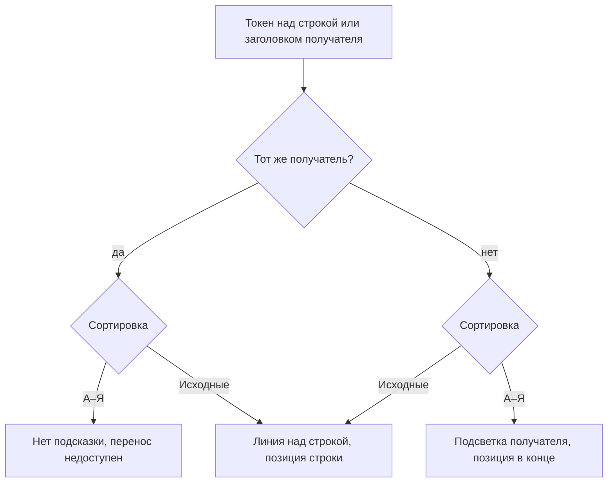

## Context

Перетаскивание в дереве цветовых токенов реализовано в `pages/colors/ui/ColorTokenTree.tsx`. Обработчик
`tokenTarget` при наведении считает место вставки по хранимому порядку получателя (`position`) и показывает линию
`.token-tree-drop` над строкой, на которую наведён курсор. Это верно для режима «Исходные», где дерево выводит
токены в хранимом порядке. В режиме «А–Я», который включён по умолчанию, дерево выводит токены по алфавиту, поэтому
линия стоит над одним токеном, а позиция считается от другого, и после переноса токен оказывается в третьем месте —
на своей алфавитной позиции.

Сервер, контракт переноса (`groupId` и позиция в хранимом порядке) и построение дерева (`buildTree`) не меняются.

## Goals / Non-Goals

**Goals:**

- Подсказка при перетаскивании показывает то, что получится после переноса, в обоих режимах сортировки.
- В режиме «А–Я» позиция вставки не зависит от строки под курсором.

**Non-Goals:**

- Перестановка внутри группы в режиме «А–Я»: она остаётся недоступной.
- Подсветка при перетаскивании групп и подгрупп: их порядок от сортировки токенов не зависит.
- Изменение API переноса и порядка хранения.

## Decisions

### Вид подсказки зависит от сортировки

Место вставки (`Drop`) получает вид подсказки: линия над строкой или подсветка получателя. В режиме «Исходные»
поведение прежнее. В режиме «А–Я» при наведении на любую строку или заголовок чужого получателя подсказка — подсветка
получателя, а `targetId` — идентификатор самого получателя, поэтому смена строки под курсором внутри одного
получателя не перерисовывает подсказку.

### Подсвечивается заголовок и собственные строки получателя

Подсветка ставится классом на строку заголовка получателя и на строки его собственных токенов. Подгруппы группы не
подсвечиваются: токен, брошенный на заголовок группы, встаёт в саму группу, и подсветка подгрупп обещала бы другое.

Альтернатива — рамка вокруг всего блока группы. Отклонена: блок группы включает подгруппы, и рамка вводила бы в
заблуждение так же, как сейчас линия.

### Позиция в режиме «А–Я» — конец хранимого порядка

В режиме «А–Я» клиент отправляет позицию, равную числу токенов получателя без переносимого. На экране токен встаёт
на алфавитное место, а в режиме «Исходные» — в конец, что совпадает с добавлением нового токена.

Альтернатива — вставлять в хранимый порядок на алфавитную позицию. Отклонена: хранимый порядок получателя может быть
не алфавитным, тогда «алфавитная позиция» в нём не определена, а результат был бы неочевиден в режиме «Исходные».

### Позиция считается по всем токенам получателя

Поиск и фильтр «Только токены с ошибками» скрывают часть токенов, поэтому дерево получает все токены отдельно и
считает позицию по ним, а не по видимым строкам. Иначе при поиске токен в режиме «А–Я» вставал бы в середину
хранимого порядка, а в режиме «Исходные» — не под линию.

## Risks / Trade-offs

- [Пользователь в режиме «А–Я» ожидает поставить токен на конкретное место] → подсветка целиком показывает, что
  место выбирает алфавит; для ручного порядка есть режим «Исходные».
- [Проверки в jsdom не видят настоящей раскладки и перекрытий] → внешняя проверка в браузере на стенде.
