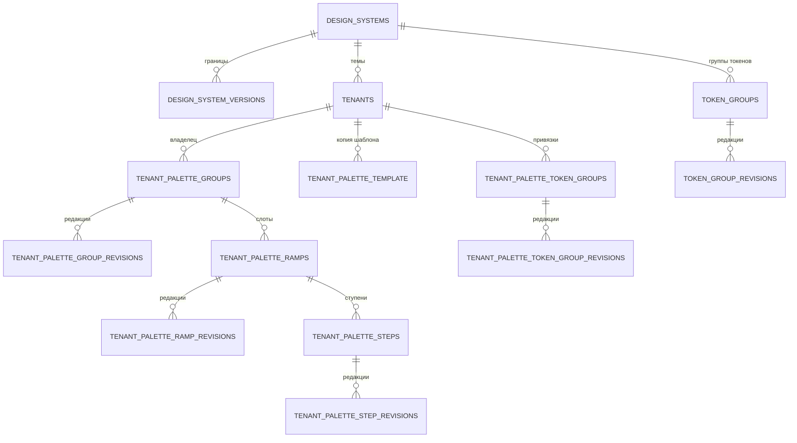

## Контекст

Git-ребейс на `dev` завершён, но новые операции палитры/цветов ещё используют поля старой модели.
Миграции ветки версий V4–V7 пересекаются с вошедшими в `dev` V4–V6. В `dev` также появился новый экран
цветов, группы токенов и Compose-превью, а npm-публикация удалена. Их нельзя отменить выбором нашей стороны.
Разработчик явно расширил область версий и журнала на палитру.

## Цели и границы

Сохранить обе части продукта: новые предметные возможности `dev` и уже реализованные версии,
автосохранение, журнал, частичную отмену, SSE и внешний вид журнала. Не вводить новую систему публикации,
новые маршруты отмены, снимок всей ДС, отдельный журнал или новую общую таблицу предметных данных.
`db-service` и генерация пакетов не перерабатываются.

## Решения

### Предметные таблицы редакций палитры и групп

Используется тот же подход, что в ADR-0007: устойчивые идентификаторы и принадлежность в существующих
таблицах, изменяемые поля — только в соответствующих `*_revisions`. Для составных ключей вводится
серверный UUID; прежняя естественная уникальность сохраняется. Все редакции имеют идентификатор ДС,
границу версии, номер границы и признак удаления. Активное и историческое чтение разрешают последнюю
редакцию на выбранной границе, без обхода цепочки родителей и копирования всей ДС при публикации.

| Устойчивая сущность | Таблица редакций | Изменяемые данные |
| --- | --- | --- |
| `tenant_palette_groups` | `tenant_palette_group_revisions` | Подпись и порядок |
| `tenant_palette_ramps` | `tenant_palette_ramp_revisions` | Источник, происхождение, опорный цвет, признаки растяжки |
| `tenant_palette_steps` | `tenant_palette_step_revisions` | Значение правки ступени |
| `tenant_palette_token_groups` | `tenant_palette_token_group_revisions` | Явная группа токена |
| `token_groups` | `token_group_revisions` | Название, код, родитель, порядок |

Общая `palette` служит шаблоном только для новых тем. `tenant_palette_template` — неизменяемая копия
шаблона внутри темы: она создаётся один раз, не меняется вслед за общей палитрой и сохраняется,
пока нужна активным или историческим данным темы. Для неё не вводятся ни таблица редакций,
ни дополнительный UUID вместо существующего составного ключа. Редактирование палитры темы
меняет настройки растяжек и правки ступеней, а не эту копию. Это разделение подтверждено разработчиком.

У токенов `group_id` и `position` относятся к `token_revisions`, а не к устойчивой строке `tokens`.
Группы палитры темы и группы токенов ДС — разные сущности, не объединяются.
Полный JSON палитры или ДС не используется как источник версионного хранения. Альтернатива с общим
JSON-снимком отвергнута: она дублирует неизменённые данные и мешает адресной отмене ступени.

Копия шаблона неизменяема и не требует редакций. Каждая таблица редакций связана также с `DESIGN_SYSTEM_VERSIONS`; на компактной схеме повторяющиеся
линии опущены. В ADR эта модель добавляется к существующей единой ER-схеме, без второй общей схемы.

### Операции, редакции и журнал

Новые цветовые и групповые ручки сохраняют предметный смысл и атомарность, но не пишут изменяемые поля
в устойчивые таблицы и не удаляют опубликованные данные. Транзакция получает доверенный контекст,
проверяет историческую границу, владельца и права, согласует редакции затронутых сущностей и сохраняет
все последствия одной операции либо ничего. Определения семейств, значения платформ/режимов,
переименования и перемещения используют существующие редакции токенов и значений.

Заголовки редакций, повторяемость запросов и технические метаданные применяются и к новым операциям.
Поле `editRevision` в прежних телах/ответах не возвращает общую блокировку темы: клиент переводится
на предметные редакции. Совместимость и ошибки отсутствующих заголовков явно фиксируются в OpenAPI
и тестах; новые маршруты для этого не вводятся. Разные токены не конфликтуют только из-за общей темы.

Заголовок технических редакций ограничен 2048 байтами UTF-8, чтобы массовое создание семейства
в нескольких темах не превысило стандартный буфер nginx и не превратило уже сохранённую операцию
в ответ 502. При превышении передаётся корректный начальный фрагмент массива и признак
`X-DS-Mutation-Metadata-Truncated: true`. Клиент не повторяет сохранение: после подтверждения всех
локальных очередей перечитывает нужную область данных. Оба заголовка доступны браузеру через CORS.

Журнал по-прежнему вычисляется как разница с последней публикацией. Для палитры регистрируются
предметные обработчики тех же таблиц редакций. Правка одной ступени показывается одной записью
палитры. Если у ссылающихся токенов изменился только вычисленный цвет, а сохранённые значения и ссылки
остались прежними, отдельные записи токенов не создаются. Отмена ступени возвращает прежнее разрешение
цветов без самостоятельной записи каждого зависимого токена. Это поведение подтверждено разработчиком.
Ступени видны и отменяются независимо, структурные
изменения растяжек/групп учитывают зависимости. Отмена через существующий
`/design-systems/{id}/changes/{changeId}/revert` восстанавливает только выбранную сущность и не разрушает
ссылки и соседние правки; при зависимостях возвращает существующую предметную ошибку. Первичная
инициализация палитры новой темы не создаёт сотни строк журнала вместо одной записи создания темы.

Перестроение растяжки от опорного цвета представляется одной составной записью: параметры расчёта
и рассчитанные ступени. Несколько перестроений сводятся к итоговому отличию от публикации.
Рассчитанные значения определяются существующим предметным алгоритмом по неизменяемой копии шаблона
и опорному цвету; промежуточная история действий и дополнительные таблицы не вводятся.
Ручные цвета, отличающиеся от расчёта, видны отдельными записями ступеней. Отмена ручного цвета
возвращает расчёт текущей растяжки, а отмена перестроения возвращает опубликованные параметры и цвета,
сохраняя независимые ручные отклонения. Ручная правка даже опорной ступени не изменяет параметры
расчёта всей растяжки; это правило одинаково на сервере и клиенте.

Общая отмена блокирует растяжку перед её ступенями и выполняется одной транзакцией. Отмена ступени
использует тот же порядок блокировок. Непрозрачная редакция составной записи учитывает дочерние
цвета: устаревший запрос получает существующий отказ `DRAFT_CHANGE_STALE`, а не частичный откат.
В ответе журнала `steps` — только вычисляемое представление цветов для сравнения, не новая копия
данных в БД. Интерфейс показывает название растяжки и группы, опорный цвет и две компактные палитры
«Было» / «Стало», без `origin`, `slot_type`, `slot_shade`, UUID и служебного значения `rebuild`.

Если удаление растяжки переписывает сохранённые ссылки токенов на другую растяжку или HEX,
это реальные предметные изменения. Они показываются отдельными записями токенов и отменяются
независимо от удаления растяжки. Отмена удаления восстанавливает растяжку, но не возвращает ссылки
автоматически. Восстановление ссылки на отсутствующую растяжку отклоняется проверкой зависимостей:
сначала пользователь восстанавливает растяжку, затем при необходимости отменяет изменения ссылок.
Все отмены сравниваются с последней публикацией, а не с промежуточным состоянием перед удалением.
Связанные группы отмены, дополнительные записи истории операций и сохранение состояния
непосредственно перед удалением не вводятся. Выбран вариант независимых записей.

### Чтение редактора и SSE

Отмена по-прежнему использует прежний `changeId` и маршрут. Предметный адрес находится среди
существующих `entity_edit_states` активного черновика; новый журнал или таблица соответствий не нужны.
После проверки принадлежности и получения блокировок вычисляется отличие только этой сущности.
Предметные политики адресно читают нужного родителя (например, создание темы для начального значения
токена), поэтому правила скрытия и локальная точка сравнения сохраняются без двух полных проходов
по журналу ДС. Рассчитанные ступени отменяются пакетно с сохранением исторических редакций и ручных цветов.

После любой локальной отмены клиент перечитывает соответствующую предметную область без специальных
веток для палитры. Данные редактора и журнал обновляются параллельно после подтверждения очередей;
одновременные чтения определений объединяются существующим механизмом чтения. Обновление сохраняет
актуальные значения, определения и редакции токенов, включая переписанные ссылки. Публикация, проверки прав, актуальности и
целостности не упрощаются ради скорости. Новых публичных маршрутов и миграций не вводится.

Палитровые чтения используют общий координатор чтения редактора: одновременные запросы
объединяются, начало ограничивается существующим темпом, временный отказ чтения повторяется
ограниченно. Для предметных команд ответ `503` допускает не более двух повторов с тем же
ключом повторяемости, телом и базовой редакцией; команды без ключа и предметные ошибки не
повторяются. Ожидание прекращается при отмене запроса или смене сессии. Обновление токенов
авторизации принадлежит начавшей его сессии: поздний ответ не сохраняет и не очищает токены
после нового входа или выхода и не сбрасывает новое ожидающее обновление. Это общий механизм
клиента, не отдельное исключение для палитры; ограничения gateway не меняются.

Ошибочно повторно сериализованный цвет (`\"#108E26\"` внутри строкового значения) раскрывается
только как допустимый HEX или ссылка палитры. Произвольные строки, имена шрифтов и объекты не меняются.
Правило применяется при отображении, загрузке и сохранении цвета, а также при серверной отмене
параметра цвета. Существующие записи БД массово не переписываются.
Нативная ссылка палитры в квадратных скобках остаётся строкой и не разбирается как JSON-массив
при отмене параметра, в том числе внутри слоя градиента.

Первичная раскладка цветовых определений по группам записывается в исходное состояние новой ДС
до создания первого черновика, вместе с определениями токенов. Создание первой темы не должно
превращать эту раскладку в пользовательские перемещения и отдельные записи журнала.

Верхний селектор определяет `versionId` для токенов, палитры, групп и конфигураций Web/Compose.
История в разделе версий не меняет эту границу. Исторические цвета разрешаются по палитре той же версии;
исторические GET не создают недостающую палитру и не выполняют иных записей.

Новый клиент цветов/палитры сохраняет свой внешний вид и предметные операции. Он подключается к
существующей координации автосохранения, отмены и SSE, а не создаёт вторую независимую модель данных.
Обновление палитры и связанных цветов выполняется после подтверждения операции без размонтирования
редактора и не затирает локальные неподтверждённые значения. Индикатор сохранения и публикация
учитывают эти очереди. Compose читает конфигурации выбранной версии из `ds-service`, не из legacy API.

### Слои и ответственность

- `domain`: существующие чистые правила палитры, ссылок, семейств и порядка сохраняются.
- `application`: права, граница версии, транзакции и координация предметных операций.
- `data`: разрешение редакций, адресная запись, блокировки, обработчики журнала и целостность ссылок.
- `presentation`: существующие DTO/маршруты, заголовки и метаданные; без утечки моделей Exposed.
- `di`: регистрация репозиториев и обработчиков.
- React: представление и выбор раздела; сессия редактора владеет обновлением подтверждённых данных.

## Миграция и совместимость

Вошедшие в `dev` V1–V6 не переписываются. Ещё не слитые миграции ветки версий и палитры объединяются
в одну V7 (`V7__version_design_system_state.sql`). Она выполняет подготовку, перенос данных,
включение ограничений, SSE и перевод палитры/групп одной транзакцией PostgreSQL.
Порядок: создание редакций и перенос данных, обновление читателей/писателей, удаление дублируемых
изменяемых полей. Существующие UUID и связи сохраняются. Миграция не выдумывает историю до внедрения.

Проверяются чистая установка и обновление базы актуального `dev`. Уже применённая локальная цепочка
прежней незавершённой ветки — другой путь: её рабочие данные не сбрасываются и история Flyway не
переписывается автоматически. 20 октября разработчик разрешил разовый сброс именно локальной
`ds_registry` для запуска через `setup-local.sh`; это действие не добавляется в сервис или обычный
сценарий развёртывания. Для `dev`/`prod` поддерживается сохраняющий данные переход с V6,
проверяемый на заполненной базе, а несовместимая история остаётся ошибкой проверки Flyway.

## Риски и стоимость

- Больше предметных таблиц и обработчиков → один существующий механизм редакций и общие ограничения,
  но явные предметные значения, без универсальной записи произвольного JSON.
- Удаление растяжки/группы меняет ссылки → атомарная операция и проверки зависимостей при отмене.
- Старые HTTP-тесты пишут прежние колонки → сохранить смысл проверок и переписать подготовку данных,
  не удалять сценарии и не поднимать лимиты ради прохождения.
- Объединение UI может потерять детали → сохранить тесты обеих веток и дополнить переходами
  источник → новый редактор, исторический Web/Compose и палитра.

## Проверка

Локально: миграционные и PostgreSQL-тесты, тесты HTTP/прав/повторяемости/конкурентности/отмены,
клиентские тесты обеих веток и сборка, FAST, свежий независимый ревьюер и FULL.
Пороги и базовые показатели Strictacode не меняются в этом изменении. Прежнее исключение по OP
не означает успешного прохождения нового FULL.

Внешне: в выделенной тестовой ДС изменить ступень палитры, проверить обновление цвета во второй
сессии, опубликовать, изменить/удалить растяжку и отменить; проверить прежние значения и Compose
в историческом режиме. Не изменять существующие рабочие ДС и не сбрасывать базу ради проверки.

## Продолжение после ревью PR #109, 21 октября 2026 года

По указанию разработчика исправления продолжаются в этом же Change без создания нового
и без повторного архивирования. Состояние проверок от 20 октября не подтверждает ещё
не реализованные исправления от 21 октября.

Выбран вариант устранения общей изменяемой строки черновика, а не понижение изоляции
или последовательное выполнение всех записей. Проектная детализация находится в
[дополнении](review-followup-design.md): независимые технические отметки транзакций,
вычисляемая редакция состояния, отдельная идентичность SSE-событий и барьер публикации
до получения снимка транзакции. После согласования это дополнение заменяет прежнее
увеличение `design_system_versions.revision` на каждой обычной записи; остальные
предметные и исторические гарантии данного design сохраняются.

История замечаний, их валидация и решения сохранены в [review-history.md](review-history.md).
Оставшиеся исправления PR восстанавливают существующие требования целостности и
автосохранения; они не объявляются выполненными выбором новой модели уведомлений.
