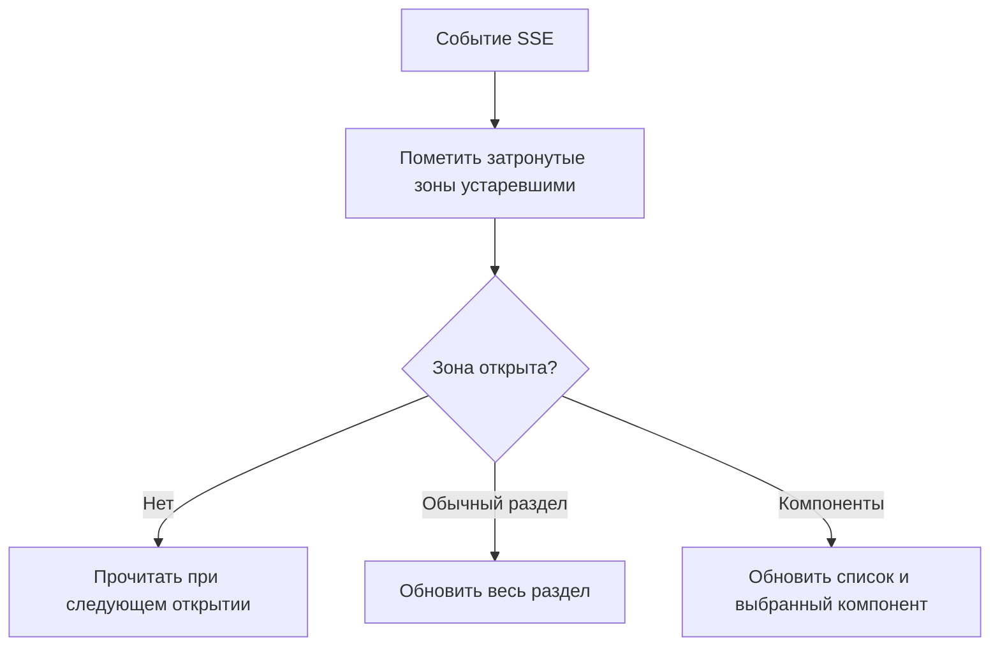

# Ленивое чтение по разделам редактора

## Согласованная модель

21 октября 2026 года разработчик выбрал простую модель в существующем Change
`integrate-palette-versioning-after-rebase`: обычный раздел читает все свои данные
при открытии, компоненты — список при входе и все данные конкретного компонента
при его выборе. Эта редакция заменяет предыдущий проект мелких адресных ресурсов.
Реализация дополнения не начата.

Не вводятся отдельная ленивость оформлений, осей, стилей, платформ, режимов или токенов,
универсальный граф потребителей и новый публичный формат SSE. Загрузка кода разделов,
разделение JS-бандлов, изменение UI, повышение лимитов gateway и миграции не требуются.

## Причина

Сейчас `loadThemeEditor` независимо от раздела ждёт токены всей темы, палитру и все
настроенные Web/Compose-компоненты. Для компонентов отдельно читаются свойства, оси
и стили. Обновление `all` в `ThemeEditorSession` повторяет общую загрузку.
В [замечании PR](https://github.com/salute-developers/design-system-builder/pull/109#issuecomment-6319008126)
ревьюер измерил около 345 чтений и 38 секунд открытия темы. Это его замер, не наш.
У цветов нет предметной зависимости от загрузки всех конфигураций компонентов.

## Единицы загрузки

| Зона | Когда и что загружается |
| --- | --- |
| Оболочка | Общие названия, права, выбранная тема/версия, курсор и лёгкие данные навигации/счётчика |
| Цвета | При открытии — все определения, группы и значения цветовых/градиентных токенов раздела, все его платформы/режимы и палитровые данные для разрешения цветов |
| Палитра | При открытии — все данные раздела палитры выбранной темы/версии |
| Типографика | При открытии — все типографические данные и шрифты этого раздела |
| Размеры и радиусы | При открытии — все данные типов токенов данного раздела |
| Журнал | При открытии — журнал с данными его представления |
| Версии | При открытии раздела или селектора — список версий и необходимые данные выбранного представления |
| Настройки темы | При открытии — поля настроек темы |
| Компоненты: список | При входе — краткий список доступных Web/Compose-компонентов без их конфигураций |
| Компоненты: выбранный | При выборе — все данные этого компонента выбранной платформы: API-мета, оформления, конфигурации, оси, стили и данные редактирования/превью |

«Все данные раздела» не означает все данные темы. Открытие цветов не читает типографику,
размеры или конфигурации компонентов; переход в компоненты не читает конфигурации всего списка.
Прямой URL выбранного компонента загружает оболочку, список и данные именно этого компонента.
Оформления/оси/стили уже выбранного компонента не требуют нового отдельного жизненного цикла.

Общие данные, действительно используемые несколькими разделами, например палитра для
разрешения цвета, могут переиспользоваться. Сведения об использовании токена читаются
существующим предметным серверным способом, а не обходом конфигураций всего каталога.
Для превью вложенного компонента допустима необходимая зависимость, но не предзагрузка
всех компонентов. Это не требует универсального клиентского графа зависимостей.

## Состояние и повторное использование

В сессии редактора хранится состояние каждой зоны: не загружена, загружается, актуальна,
устарела, ошибка. У компонентов отдельно хранятся список и результаты по выбранным UUID
компонентов и платформам. Пустой результат не равен отсутствию загрузки.

Данные разделяются по авторизационной сессии, проекту, ДС, теме и `versionId` либо черновику.
Возврат к актуальной зоне переиспользует результат. Смена версии/темы не подставляет прежние
данные; поздний ответ отменённого или устаревшего чтения не заменяет новый результат.
Если инвалидация пришла во время чтения, она не теряется при завершении этого чтения.
Одновременные одинаковые запросы объединяются существующим `readEditor`.

Не нужен универсальный `EditorResourceStore` с произвольными адресами и потребителями:
достаточно явного состояния разделов, списка и компонентных данных в текущей сессии.
Кэш хранит подтверждённое состояние только в памяти, не второй локальный черновик;
он освобождается при закрытии редактора и сбрасывается при смене авторизации.
Незагруженные разделы не считаются пустыми, повреждёнными или требующими сохранения.

Оболочка и активный раздел показывают собственные состояния загрузки/ошибки. Ошибка
компонента не скрывает rail и не мешает открыть цвета. Наличие пункта компонентов не
определяется по уже загруженным конфигурациям. Счётчик тулбара не загружает полный журнал.

## SSE и локальные изменения

Существующие области SSE переводятся в признаки устаревания соответствующих зон:

| Сигнал | Что помечается устаревшим |
| --- | --- |
| `theme-tokens` | Токенные разделы, палитра и данные превью, зависящие от токенов |
| `component-configurations` | Список компонентов и ранее загруженные компоненты |
| `theme-metadata` | Метаданные темы, настройки и зависящие от них разделы |
| `design-system` | Оболочка/граница и связанные зоны |
| `all`, неизвестная область, восстановление после пропуска | Все зоны соответствующего черновика, но без чтения их всех |

Из-за нынешней крупности областей несколько скрытых разделов могут стать устаревшими
одновременно. Это допустимо: запросы выполняются только для открытого раздела целиком,
а для компонентов — списка и выбранного компонента, не всех конфигураций.
Скрытая устаревшая зона перечитывается при следующем открытии. Пульс SSE не вызывает чтений.

Лёгкие общие потребители, например счётчик, обновляются отдельно. Изменение токена или
конфигурации также инвалидирует представление журнала и счётчик; скрытый журнал при этом
не загружается. Если открыт журнал/история, их фактические зависимости учитываются явно.
Сверка курсора не снимает отложенное устаревание скрытых разделов. Повторные события
объединяются, UUID служит устранению повторов, а не упорядочиванию.

Ответ чтения не затирает неподтверждённый ввод. Обновление зоны согласуется с её очередями;
ошибка независимой очереди другого раздела не блокирует чтение. Уход из раздела не теряет
его правки и не исключает их из общего индикатора сохранения и барьера публикации.
Локальные записи и частичный revert используют то же устаревание, независимо от SSE-эха.
Повтор после ошибки чтения не повторяет уже сохранённые команды отмены.

Публикация меняет контекст черновика, но не загружает все разделы. Исторические данные
`versionId` не перечитываются по событиям черновика; проверки прав сохраняются.

## Серверные границы

Переиспользуются существующие чтения, когда они уже дают нужный срез. Необходимые
дополнения ограничиваются границами согласованной модели:

- Чтение определений/значений токенов по типам раздела, без загрузки всей темы и фильтрации
  в браузере. Не нужны новые фильтры ради ленивого чтения каждого токена/платформы/режима.
- Краткий индекс компонентов выбранной ДС/версии, без построения их конфигураций.
- Чтение всех данных выбранного компонента: данные могут объединяться сервером, чтобы
  не сохранять HTTP N+1 по осям и стилям внутри одного компонента. Отдельный API оформления
  и пакетное чтение всех компонентов не требуются.
- Лёгкие сведения для навигации и точного счётчика по тем же правилам, что журнал,
  без передачи полного журнала и конфигураций в оболочку.

Изменённые read-only контракты фиксируются в OpenAPI и HTTP-тестах; формат полных экспортов
для CLI/генераторов сохраняется. Каждый срез проверяет доверенный проект, принадлежность,
права и `versionId`. Историческое чтение не создаёт данные. Новых таблиц, миграций,
формата SSE и изменений gateway не предполагается. Kotlin-границы слоёв сохраняются.

## Проверка

- Вход в каждый раздел читает целиком только его данные и общие необходимые сведения.
  При открытии цветов компонентных чтений нет, даже при большом настроенном каталоге.
- Вход в компоненты читает список; выбор A читает все данные A, не B…N. Переключение
  оформления внутри A использует уже полученные данные. Возврат использует актуальный кэш.
- SSE для скрытой зоны не вызывает её чтения; для открытого раздела даёт одно объединённое
  обновление целого раздела. В компонентах не перечитываются все конфигурации.
- Проверяются all/неизвестная область, восстановление, публикация, поздние ответы,
  локальные правки и частичный revert, точность счётчика, права и исторические Web/Compose.
- После реализации — целевые тесты, весь клиентский набор, свежий независимый обзор,
  FULL без FAST и измерения в собственной непустой ДС: запросы, объём и время готовности.
  Рабочие ДС и глобальный каталог не меняются. Малый локальный набор не доказывает устранение
  38 секунд: масштабный автоматический сценарий должен воспроизводить размер каталога
  из замечания. Пороги и защищённые проверки не меняются.

Мелкая загрузка по отдельным токенам, платформам, оформлениям и универсальный граф ресурсов
отложены: их можно рассматривать отдельно лишь при подтверждённой тяжести самого раздела.
