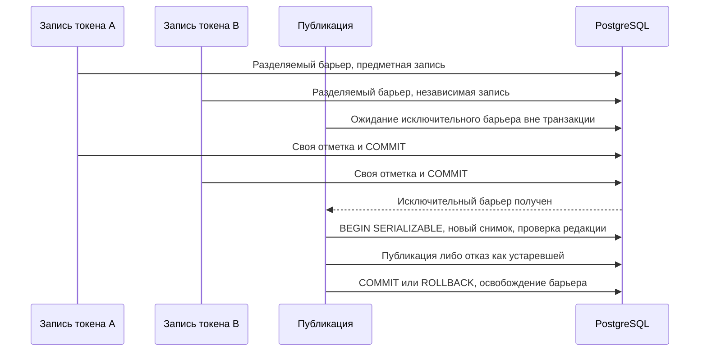

# Дополнение к проектному решению после ревью PR #109

Часть текущего Change `integrate-palette-versioning-after-rebase`, а не новый Change.
Подготовлено 21 октября 2026 года. Выбор варианта 2 подтверждён пользователем;
детали подтверждены пользователем и реализованы в текущем рабочем дереве; итоговые проверки выполнены.
История разбора замечаний находится в `review-history.md`.

## Контекст

`bump_design_system_draft_revision` обновляет строку черновика один раз за изменяющую
транзакцию. Все обычные записи выполняются в `SERIALIZABLE`; поэтому даже независимые
предметные строки конкурируют за этот `UPDATE`. Три повтора скрывают часть ошибок,
но не устраняют общую точку конкуренции.

Сейчас `draftRevision` одновременно используется для проверки публикации и упорядочения
SSE. Эти обязанности разделяются. Предметная история остаётся в `*_revisions`,
конкурентные параметры — в `entity_edit_states`/`entity_edit_paths`.

## Цели и границы

- Обычные независимые записи не изменяют одну общую строку и не читают общий агрегат отметок.
- Сохраняются `SERIALIZABLE`, предметные блокировки, идемпотентность и права.
- Публикация не пропускает запись, завершившуюся во время ожидания барьера.
- SSE не теряет области изменений из-за перестановки, повторов или потери уведомления.
- Не вводятся второй пользовательский журнал, снимок ДС, очередь всех записей или новый сервис.
- Этот документ не объявляет устранёнными остальные замечания PR #109 и не подменяет их проверки.

## Решения

### Независимая отметка транзакции

Новая таблица `draft_transaction_markers` содержит `id` (UUID), `design_system_version_id`,
`design_system_id`, объединённые `scopes`, `actor_id`, `client_id` и `created_at`.
В ней нет значений токенов, параметров компонентов и ссылок на пользовательские записи журнала.
Индекс по границе обеспечивает подсчёт без чтения предметных таблиц.

Одна фактически изменяющая транзакция создаёт одну отметку на затронутый черновик.
Все области собираются до отложенной финализации. Запись отметки и `NOTIFY` происходят
в той же транзакции, что предметная запись; откат отменяет всё. Повтор ранее завершённого
идемпотентного запроса не создаёт отметку. Создание технического состояния блокировки
без предметной правки также не создаёт отметку.

UUID не является номером очереди. В пути обычной записи запрещены `COUNT`, `MAX`,
обновление общей версии и блокировка общей строки счётчика. Прямые разрешённые SQL-записи
в предметные редакции проходят тот же триггерный механизм, а не только HTTP-обёртку.

### Вычисляемая редакция состояния

Для активного черновика `draftRevision = сохранённое основание + COUNT(его отметок)`
в одном согласованном снимке PostgreSQL. Основание — прежнее `design_system_versions.revision`
на момент перехода. Оно не меняется при обычном сохранении. Для новой границы основание равно нулю.

Отметки активного черновика не удаляются при отмене пользовательского изменения: редакция
показывает факт нового подтверждённого состояния, даже когда пользователь вернул прежнее значение.
При публикации вычисленный итог записывается в публикуемую границу; её отметки могут быть удалены
в той же транзакции. Для опубликованной границы читается сохранённый итог, не сумма с отметками.
Таким образом активный подсчёт не растёт вместе со всей историей ДС.

`draftId` и числовой `draftRevision` остаются в DTO чтения, запросе публикации и ошибке
устаревшего черновика. Они не становятся курсором отдельного SSE-события. Сервер и клиент
проверяют диапазон точного представления числа; переполнение не округляется незаметно.

### Барьер публикации до снимка транзакции

Обычная запись сохраняет разделяемую транзакционную advisory-блокировку ДС и проверяет
активную границу. Публикация получает исключительную **сессионную** advisory-блокировку
того же ключа до начала своей `SERIALIZABLE`-транзакции, на том же выделенном соединении.
После получения блокировки начинается новая транзакция и читаются граница и подсчёт отметок.

Это важно: прежний `SELECT pg_advisory_xact_lock(...)` внутри уже начатой строгой транзакции
может ждать с устаревшим снимком. После удаления общего `UPDATE` нельзя рассчитывать,
что обновление строки счётчика само вызовет повтор такого снимка.

Предварительная проверка прав и доступности ДС выполняется до ожидания блокировки.
Внутри защищённой транзакции принадлежность и права, активная граница, редакция, уникальность
версии и непустота черновика проверяются заново. При несовпадении возвращается существующая
ошибка устаревшего черновика без публикации.

Соединение удерживается только публикацией. Ожидание ограничено; отмена запроса прекращает
ожидание. Блокировка освобождается в `finally` после фиксации или отката. Если освобождение
не подтверждено, физическое соединение удаляется из пула, а не возвращается с сессионной
блокировкой. Исключительная блокировка внутри того же сеанса не захватывается повторно:
парность захвата/освобождения проверяется тестом. Обычные сохранения не используют этот режим.



Параллельность относится к предметной работе A и B. Публикация остаётся редким
исключительным переходом, а не общей очередью обычного автосохранения.

### SSE без ложного порядка редакций

Внутреннее PostgreSQL-уведомление ссылается на UUID отметки. Публичное событие
`draft-invalidated` содержит `eventId`, `designSystemId`, `draftId`, `actorId`, `clientId`,
`changedAt` и объединённые `scopes`. Оно **не содержит `draftRevision`**:
значение, рассчитанное внутри изменяющей транзакции, не охватывало бы чужие поздние фиксации.
SSE `id` соответствует `eventId`, не числовому порядку.

Клиент обрабатывает каждое неизвестное событие независимо от сравнения UUID. Повторы UUID
допускается игнорировать в ограниченном по памяти наборе. Области объединяются перед чтением.
Собственное событие подавляется только при совпадении доверенного автора и `clientId`;
оно не продвигает курсор, полученный из предметного чтения.

После каждого подключения и восстановления `LISTEN` сервер выполняет сверку активного
черновика. При отличии от заявленного клиентом состояния посылается `draft-reconciled`
с новым `eventId`, текущими `draftId`/`draftRevision` и `scopes: [all]`. Такое событие
никогда не подавляется как собственное. Начальная подписка на сигналы устанавливается
до чтения курсора; служебный `LISTEN` подтверждается до сверки. Дубликат безопаснее пропуска.

Переполнение внутреннего буфера **не может молча отбрасывать узкую область**:
оно превращается в сигнал обязательной полной сверки затронутым подписчикам. Ограниченный
буфер уведомлений не является хранилищем истории. Пульс SSE не выполняет запросов к БД.
Сверки одного восстановления объединяются по проекту/ДС внутри экземпляра сервиса.
Курсор не кэшируется бессрочно и не читается отдельным запросом на каждого получателя
каждого обычного события.

Клиент не переносит редакцию события в объект предметных данных как доказательство их
обновления. При чтении после аннулирования он также получает текущий курсор; публикация
в любом случае перепроверяет его на сервере. Если изменение попало между раздельными
HTTP-чтениями, следующее событие вызывает ещё одно чтение, а устаревшая публикация отклоняется.

### Слои и программные контракты

- `domain`: смысл курсора и идентичность сигнала; без JDBC и PostgreSQL-типов.
- `application`: отдельный порт транзакции публикации, проверки прав и координация.
- `data`: отметки, подсчёт, режим соединения/блокировки, PostgreSQL-подписка.
- `presentation`: два явных DTO событий, валидация входа и авторизованный SSE.
- `di`: подключение порта публикации к существующему пулу соединений.
- React: обработка сигналов, объединение областей и получение курсора чтением.

Существенный новый порт (окончательные имена согласуются с кодом при реализации):

```kotlin
interface PublicationTransactionRunner {
    suspend fun <T> required(
        context: DsRequestContext,
        designSystemId: UUID,
        block: suspend () -> DsResult<T>,
    ): DsResult<T>
}
```

Порт не экспортирует наружу JDBC-соединение или блокировку. Обычный `TransactionRunner`
не меняет уровень изоляции и не получает скрытую сериализацию по всей ДС.

## Альтернативы

- `READ COMMITTED` с общим счётчиком: требует отдельного доказательства всех межстрочных
  инвариантов и оставляет общую запись; не выбран.
- `MAX` от sequence/времени/локальных ревизий: не доказывает отсутствие пропущенной фиксации;
  технические редакции разных сущностей несопоставимы; не выбран.
- Последовательное выполнение всех записей ДС: лишает предметные блокировки смысла; не выбрано.
- Новый внешний брокер или журнал предметных операций: избыточен для аннулирования данных.

## Миграция и совместимость

Добавляется следующая свободная Flyway-миграция после V7; существующие контрольные суммы
не переписываются. Основания прежних границ и опубликованные данные сохраняются.
Миграция переключает финализацию на отметки атомарно. Чистая установка и обновление с V7
проверяются на изолированных заполненных базах, без сброса рабочего локального контура.

Форма SSE меняется несовместимо; это явно отражается в OpenAPI и тестах. Выпуск до слияния
PR #109 выполняется согласованно: остановка старых экземпляров `ds-service`, миграция,
запуск новой версии и обновление клиента. Старые открытые страницы должны перезагрузиться;
ошибочное событие не принимается как подтверждённый курсор. Смешанный выпуск старого и нового
протокола без отдельного переходного адаптера не поддерживается. Откат требует согласованной
версии клиента и сервера; запуск старого сервера поверх переключённой схемы не является откатом.
Автоматические `repair`, сброс данных и возврат V7 не выполняются.

## Риски и проверка

- Стоимость `COUNT` растёт с числом транзакций активного черновика → индекс, подсчёт только
  при чтении/публикации и сворачивание при публикации; измерить на 10 000 и 100 000 отметок.
- Сессионная блокировка может остаться в пуле → проверка отмены, ошибки COMMIT, исключения
  тела и отказа освобождения; соединение с неподтверждённым освобождением не переиспользуется.
- Удаление горячей строки не устраняет все конфликты `SERIALIZABLE` → не обещать их отсутствие
  для пересекающихся предметных инвариантов; отдельно доказать независимый сценарий без повторов.
- Потеря узкого события → явная полная сверка при переполнении и восстановлении соединения.

Автоматически: детерминированные барьеры двух PostgreSQL-транзакций в `SERIALIZABLE`,
обратный порядок завершения, откат, идемпотентный повтор, пакетная запись, отмена,
ожидающая публикация и запись после публикации; SSE/HTTP/React-тесты; FULL без отдельного FAST
по указанию разработчика. Защищённые проверки, пороги и базовые показатели не меняются.

До завершения: внешняя проверка двух сессий в собственной тестовой ДС, сохранения разных
токенов, разрыва SSE и публикации; сохранить запросы и конечное состояние. Рабочие ДС не меняются.

Основания для анализа гонок: [изоляция PostgreSQL 16](https://www.postgresql.org/docs/16/transaction-iso.html),
[правило запуска LISTEN](https://www.postgresql.org/docs/16/sql-listen.html),
[транзакционность NOTIFY](https://www.postgresql.org/docs/16/sql-notify.html).

## Открытые вопросы

Продуктовых развилок нет. Решение, включая несовместимую форму SSE и согласованный выпуск,
подтверждено пользователем. Измеримые результаты и оставшиеся проверки фиксируются в
`review-history.md`; этот документ сам по себе не заменяет проверку выбранного подхода.
