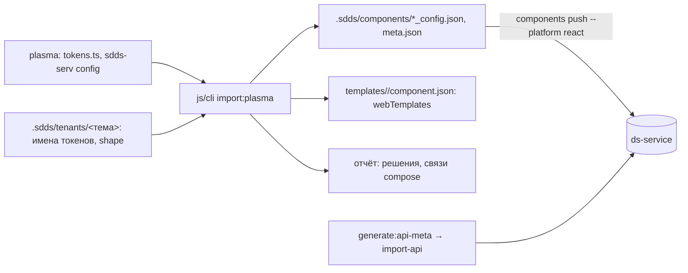

## Контекст

`import-plasma-component.ts` (1366 строк) состоит из четырёх частей: разбор источников plasma
(`readCoreTokens`, `parseConfig`, `readCoreDefaults`, `mergeDefaults`, `detectCoreExports`,
`readWrapper*`, `readIndexReexports`), классификация значений в модель (`classify`: цвета по
токенам темы, группы типографики, радиусы по токенам формы, шаблоны многозначных значений,
инварианты из `disabled`/`readOnly`), запись результата (`emitSeeds` → папка сида,
`writeComponentManifest` → манифест генератора, патч `component_deps.ts`) и отчёт. От db-service
зависит только запись и два источника: `seeds/prod/tokens.ts` даёт имена и типы токенов базовой
темы, `token_values/shape.ts` — пиксели токенов формы для сверки радиусов.

Пакет `.sdds/components`, который пишет `dsbuilder components fetch` и читает `push`: `meta.json`
со списком `{componentName, styleName, config}` и файл native-конфига на пару «компонент, стиль»:
`props` (инварианты), `bindings` (вариации с `values` и `defaultValue`), `variations` (записи
`{id, binding, props}`); значение — `{type, value | default, adjustment?, states?}`. Это тот же
формат, который кодек CLI переводит в общий формат импорта.

Локальные данные темы после `dsbuilder theme fetch`: `.sdds/tenants/<тема>/meta.json` с токенами
(`name`, `type`) и файлы значений по платформам, из `web` берутся значения `shape`.

## Цели / Вне целей

**Цели:** инструмент работает без db-service и его сидов; результат заливается штатным `push`;
правила приведения и отчёт не меняются; скилл `add-component` описывает рабочую цепочку.

**Вне целей:** чтение шаблонов генератором из манифеста (отдельный change, сейчас генератор берёт
их из `web-adapter.json`); клиентские стори и `coreTokensByComponent` (как и раньше, руками по
отчёту); перенос самих сидов и сидера (уходят с db-service); составные компоненты с плоскими
соседними конфигами (`X.clear.config.ts`), как и раньше, в отчёт.

## Решения

- **Выход — native-формат пакета, не сид и не общий формат.** `push` принимает именно пакет
  `.sdds/components`, и этот же формат пишет `fetch`: импортированный компонент после `push` и
  `fetch` возвращается в том же виде, круг замкнут. Преобразование из внутренних структур
  инструмента (`Prop`, `Row`, `AppearanceInput`) прямое: вариации → `bindings` с `values` в порядке
  появления и `defaultValue` из дефолтов; значения стиля → запись `variations` с одной парой
  `binding`; инварианты → `props`; цвет и градиент в `default`, остальное в `value`; радиус как
  `shape` со ссылкой на токен только при точном совпадении значения с токеном формы (смещение `adjustment` инструмент не вычисляет, как и раньше); `disabled`/`readOnly` в
  инварианты, как раньше. Сочетаний стилей инструмент не производил и не производит.
- **Один файл на appearance, составной компонент — несколько компонентов пакета.** `--dir` для
  Tabs даёт `tabs_horizontal_config.json`, `tabs_vertical_config.json`, `tab_item_*`, как их
  пишет `fetch`; имя файла и `componentName` в `meta.json` — kebab-case от имени компонента, как
  у `fetch`. Пакет дописывается: записи того же компонента заменяются, чужие остаются, поэтому
  `push` одного нового компонента не трогает остальные. Без `--apply` файлы не пишутся.
- **Имена токенов темы из `.sdds/tenants`.** `readBaseThemeTokens` и `readShapeTokenPx` читают
  `meta.json` и web-значения `shape` выбранной темы (`--theme`, иначе единственная тема в
  `.sdds/tenants`, иначе `base_default`). Инструмент требует `dsbuilder theme fetch` до запуска и
  говорит об этом явно, если темы нет.
- **Шаблоны — в манифест генератора.** Поле `webTemplates: { <свойство>: { <параметр>: шаблон } }`
  в `templates/<X>/component.json`. Это единственное место, которое переживёт удаление db-service
  и согласуется с решением вести шаблоны на уровне генератора; `web-adapter` для нового компонента
  шаблонов не отдаст, и генератор до своего change соберёт такие параметры без шаблона. Это
  осознанный разрыв, он записан в скилле.
- **Связи компонентов через API, а не файл.** `component_deps.ts` исчезает вместе с сидами, а
  `components push` связи не заводит. Инструмент печатает в отчёте связи `compose` составного
  компонента; скилл заводит их `POST /api/projects/{id}/ds/component-deps` с идентификаторами из
  `GET /ds/components`. Инструмент остаётся офлайновым, как и был.
- **Глобальный слой — `import-api`, типы свойств — его.** Компоненты, свойства, их типы и
  web-параметры заводит `components import-api --platform react` по `web-api-meta.json` из
  `generate:api-meta`. Инструмент по-прежнему решает `shape` против `dimension` для радиуса, но
  `push` тип глобального слоя не меняет и пишет значение под ним, поэтому при наличии
  `.sdds/web/web-api-meta.json` инструмент сверяет типы сам и выносит расхождения в «ТРЕБУЕТ
  РЕШЕНИЯ»; радиус закрывается токеном через `--shape=<prop>=<round.x>`. Поле `properties` сида (типы, `params.web`,
  `variations`) больше не пишется: привязку свойств к панелям вариаций импорт выводит из значений.
- **Повторный импорт без `--remove`.** Раньше инструмент отказывался писать поверх папки сида.
  Пакет — рабочая директория, а не источник истины, поэтому `--apply` перезаписывает записи
  компонента; `--remove` остаётся для удаления из пакета.
- **Тесты.** Разбор и классификация покрываются фикстурами из plasma в `src/*.test.ts`
  (`node:test`): конфиг с цветами, типографикой, радиусом, шаблоном и `disabled`; запись пакета
  проверяется на временной директории: `meta.json`, файл конфига, манифест с `webTemplates`,
  повторная запись заменяет запись компонента.

## Риски / Компромиссы

- [Шаблоны нового компонента не видны генератору до его change] → записаны в манифест, скилл
  предупреждает; для `base` ничего не меняется.
- [Тип `shape` из сверки радиуса не совпадает с `@styleType` меты] → при выгруженной мете
  инструмент сообщает об этом до записи, решение — `--shape`; без меты это увидит только `push`
  (`Property type mismatches`), и значение уже записано под типом слоя.
- [Нет локальной темы] → инструмент останавливается с подсказкой `dsbuilder theme fetch`.
- [`.sdds` в `js/cli` содержит пакет `base` целиком] → инструмент дописывает только свой
  компонент; `push` зовётся с `--from` на ту же директорию и платформой `react`, и импорт
  перезаписывает только appearance компонентов пакета.

## План миграции

Один PR: перенос инструмента, удаление из db-service, скилл и документация. Проверка на одном
компоненте через полный круг на локальном контуре. Откат — revert.
