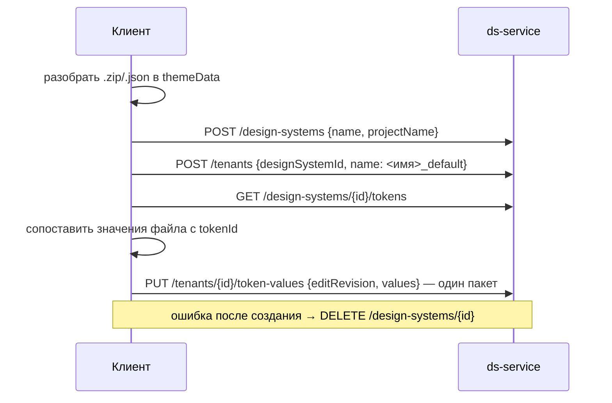

## Context

Отладочный импорт разбирает файл темы на клиенте (`utils/importDesignSystem.ts`) в `ThemeSource { meta, variations }` и отправляет его в legacy-маршрут db-service. В ds-service уже есть всё нужное для импорта существующими ручками: создание дизайн-системы с общим набором определений, создание темы со значениями по умолчанию и пакетное сохранение значений темы `PUT /tenants/{id}/token-values` одной транзакцией (PR #109). Редактор собирает `themeData` темы из `GET /design-systems/{id}/tokens` и `GET /tenants/{id}/token-values` (`tokenRepository.loadTokenData`).

## Goals / Non-Goals

**Goals:** импорт в проект из адреса страницы одним пакетным запросом значений; экспорт в формат, который принимает импорт; кнопки для владельца проекта.

**Non-Goals:** изменения бэкенда и политики прав; серверная проверка «только владелец»; создание определений токенов, которых нет в наборе; компонентные настройки; изменения db-service.

## Decisions

### 1. Импорт — клиентская цепочка существующих ручек

Значения пакета адресуются `tokenId + platform + mode`: префикс `light.`/`dark.` в имени снимается. Пакет дополняет значения по умолчанию созданной темы, а не заменяет их, поэтому токены набора без значений в файле остаются рабочими. Пустая строка, пустой массив и `null` — заглушки редактора, они не отправляются.

Альтернатива — серверная ручка импорта. Отвергнута: задача решается существующими ручками без изменения бэкенда.

### 2. Токены, которых нет в наборе, пропускаются

Пакетной ручки для определений нет, а поштучное создание противоречит требованию одного пакетного запроса. Значения таких токенов не записываются, после импорта форма показывает их список и предлагает открыть дизайн-систему.

### 3. Экспорт берёт `themeData` редактора

Пункт «Экспортировать» в меню «три точки» карточки дизайн-системы выбирает тему `<имя>_default`, а без неё — первую тему (`GET /design-systems/{id}/tenants`), вызывает `tokenRepository.loadTokenData` и сохраняет `themeData` с именем дизайн-системы в `meta.name`. Пункт показывается владельцу, если у дизайн-системы есть темы. Ссылки на палитру сохраняются как `[type.shade.saturation]`, поэтому файл без изменений принимается импортом.

### 4. Видимость — по роли проекта

`designSystems:import` и `designSystems:export` добавлены в клиентскую таблицу `permissions.ts` только для `owner`. Системный администратор видит кнопки, потому что projects-service отдаёт ему `effectiveRole = owner`.

**Принятое ограничение (решение пользователя от 2026-10-21, «пока так и надо»).** Ограничение «только владелец» действует только в интерфейсе. Сервер проверяет права самих ручек: `POST /design-systems` — `design-systems:write`, `POST /tenants` и `PUT /tenants/{id}/token-values` — `tenants:write`. Поэтому:

| Роль | Кнопки импорта | Прямые запросы к ручкам |
|---|---|---|
| `owner`, `system_admin` | есть | проходят |
| `maintainer` | нет | проходят |
| `editor`, `viewer` | нет | `POST /design-systems` отклоняется (`403`) |

Чтобы закрыть импорт для `maintainer` на сервере, понадобится отдельная серверная проверка роли в ds-service — это отдельная задача.

## Risks / Trade-offs

- [Ограничение «только владелец» только в интерфейсе] → `maintainer` может повторить ту же цепочку запросов сам; принято, ручки по-прежнему требуют `design-systems:write` и `tenants:write`.
- [Пакетное сохранение полного набора медленное: около минуты на 7 400 значений в локальном контуре] → форма показывает «Импортируем…»; лимит gateway 300 секунд. Ускорение — на стороне `PUT token-values`.
- [Откат удалением не атомарен] → если удаление тоже не прошло, система остаётся в проекте с дефолтной темой; ошибка показывается пользователю.
