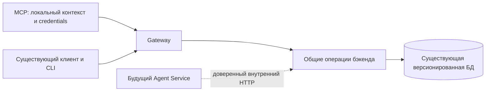

# Проектное решение

## Контекст и зависимости

Это первый из двух этапов чтения, заменяющих `unify-read-tools-and-pkce`. Второй — `add-composite-read-tools`; PKCE вынесен в независимый `use-pkce-for-cli-mcp`. Мотивация — в proposal.md. Существующее `versionId` уже выбирает опубликованную границу, отсутствие — черновик. Текущие HTTP-массивы и объекты сохраняются.

Архитектурный источник — предоставленный разработчиком `agent-architecture-handoff.md`. MCP остаётся внешним gateway-клиентом; будущий Agent Service использует внутренний HTTP и доверенный контекст. Source of truth БД — JS db-service; сведения документа о localStorage не подменяют фактическую серверную модель черновиков.

## Архитектура



Сохраняются presentation → application → domain, инфраструктура в data, сборка в di. Общий селектор и метаданные транзакции доступны нескольким feature-модулям через core без feature-to-feature зависимостей. У каждого нового или изменённого UseCase единственный публичный метод `execute`; общие механизмы — сервисы и порты. SDK MCP не попадает в feature/core.

Проверки доступа и связей переиспользуются. DS версионируемого ресурса определяется существующими связями токена, темы или appearance; глобальная мета компонента не определяет единственную DS. Обязательный новый `designSystemId` во все маршруты по ID не вводится. Не добавляется отдельная политика запрета доступного ресурса другой DS только из-за локального контекста MCP. Для предметных запросов, где DS уже является аргументом, сохраняются существующие проверки связи. Доверенный проект, scopes и actor не берутся из аргументов LLM будущего Agent Service.

## Выбор версии

Необязательный `version` принимает `draft` либо точный `major.minor.patch`, без диапазонов и latest. Аргумент MCP перекрывает версию URI/контекста, отсутствие означает draft. `versionId` сохраняется; одновременно два селектора и повтор одного параметра — `INVALID_QUERY`. Номер разрешается бэкендом внутри доступной DS; в маршруте по ID — внутри DS ресурса по существующим связям. Неизвестная, чужая либо архивная snapshot-версия не переключает чтение на черновик и даёт `NOT_FOUND`.

Разрешение и чтение выполняются одной read-only транзакцией с подходящей изоляцией. Отдельный запрос read-context перед данными не используется для подтверждения редакции. `expectedDraftRevision` не вводится.

## HTTP-метаданные без изменения тела

Все существующие массивы и объекты остаются на своих местах. Новых `/read-context`, `/version`, `/page`, параметра view или обёртки `{context,data}` не требуется.

`X-DS-Read-Context` — компактный JSON только с безопасными фактическими метаданными: для черновика `designSystemId, version=draft, draftId, draftRevision`; для публикации `designSystemId, version, versionId`. История версий содержит только `designSystemId`: она не является чтением одной версии. Метаданные формируются в транзакции данных, не содержат credentials, внутренних URL, локальных путей или заголовков авторизации.

Kotlin HTTP-адаптер сохраняет эти метаданные в нейтральной транспортной модели без Ktor-типов в feature/application. Gateway пропускает и открывает через CORS `X-DS-Read-Context`, `X-DS-Page-Limit`, `X-DS-Next-Cursor` в local/prod. Клиентские ответы MCP могут иметь context/items/nextCursor; это не формат HTTP API. `design_system_get_context` сохраняет безопасные локальные данные и настроенный публичный API URL, но предметные ответы не получают внутренние адреса.

## Необязательная пагинация модели

Без `limit/cursor` возвращается полный прежний список. Первая страница запрашивается явным `limit` 1..200. `cursor` включает постраничный режим; без limit он использует 50. MCP всегда передаёт явный limit, по умолчанию 50. Нецелый/неположительный/слишком большой limit — `400 INVALID_QUERY`; ответ страницы — `200`, тот же массив. `X-DS-Page-Limit` подтверждает ограничение; `X-DS-Next-Cursor` отсутствует в конце и при полном чтении. Total count не добавляется.

Cursor непрозрачен, привязан к проекту, виду списка, DS, границе версии, фильтрам и порядку, но не к размеру страницы. Изменение размера допустимо. Сортировка детерминированная: для версий sequenceNumber DESC с ID, для остальных выборок устойчивый предметный ключ с ID. Привязка проверяется сервером; авторизация выполняется заново, cursor не доказывает доступ.

Черновик между страницами может изменяться; snapshot-обещания и DRAFT_CHANGED нет. Обычная смена draftRevision не инвалидирует cursor; при публикации и смене draftId старое продолжение возвращает INVALID_QUERY. Для неизменного обхода выбирается публикация. Позиция продолжения не должна требовать существования последней строки: удаление элемента черновика не превращает cursor в ошибочный. Фильтры применяются до ограничения и по возможности в БД. Журнал требует отдельной проверки стоимости вычисления и действующего предела 10000: разрезание полного результата не снимает предел и не должно скрывать его ошибку.

## Предметные маршруты и инструменты этапа

Обозначение `V` — общий выбор версии; `L` — необязательные limit/cursor. Все tools имеют необязательный designSystem URI и существующую credential policy.

| № итогового реестра | Tool | Существующий маршрут относительно DS | Доработка |
|---|---|---|---|
| 1 | design_system_get_context | GET /design-systems/{id} | Метаданные из существующего DS и заголовка; локальные данные добавляет MCP |
| 2 | project_get_status | GET /api/projects/{id} + GET /design-systems/{id} | Без выбора версии, без изменения поведения |
| 3 | design_system_versions_list | GET /design-system-versions/by-design-system/{id} | L; публикации новой модели, sequenceNumber DESC |
| 4 | design_system_version_get | GET /design-system-versions/by-design-system/{id}; GET /design-system-versions/{versionId}; GET /design-systems/{id} | Точный серверный фильтр version в списке; метаданные draft из DS |
| 5 | design_system_changes_list | GET /design-systems/{id}/changes | V, L; журнал выбранной границы, без произвольного diff |
| 6 | tenants_list | GET /design-systems/{id}/tenants | V, name, query, L |
| 7 | tokens_list | GET /design-systems/{id}/tokens | V, type, name, query, groupId, L |
| 8 | token_get | GET /tokens/{id} | V; существующая проверка ресурса |
| 9 | token_values_get | GET /tokens/{id}/values | V; tenantId/mode/platform сохраняются |
| 10 | token_groups_list | GET /design-systems/{id}/token-groups | V, kind=color, parentId, L |
| 11 | palette_get | GET /tenants/{tenantId}/palette | V, groupId/type/shade; shade требует type |
| 12 | components_list | GET /design-systems/{id}/components | V, name, query, platform, L |
| 13 | component_get | GET /components/{id} | Мета компонента; существующая проверка ресурса, без выбора конфигурации и версии |
| 14 | component_styles_get | GET /design-systems/{id}/components/{componentId}/styles | V, name, L |
| 15 | component_variations_get | GET /appearances/{appearanceId}/variations | V; обязательный appearanceId вместо componentId; существующие оси, значения и defaults |

### Мета компонента и вариации конфигурации

`component_get(componentId)` сохраняет чтение меты через `GET /api/ds/components/{id}`: id, name, description, platform, createdAt, updatedAt. Список конфигураций в ответ не добавляется, appearance не выбирается. Tool не получает параметр version и не передаёт унаследованную версию URI как версию глобальной меты. Для этого ответа не требуется X-DS-Read-Context одной DS/публикации. Старый HTTP-контракт, включая versionId и проверки доступа, сохраняется.

`component_variations_get(appearanceId, version?)` использует `GET /api/ds/appearances/{id}/variations`. Обязательный appearanceId однозначно адресует конфигурацию; componentId больше не является аргументом этого tool. DS определяется сервером по существующей связи appearance, без поиска DS по глобальному компоненту и без нового обязательного designSystemId. Неявный выбор единственной или default-конфигурации не выполняется. Разрешение контекста и credentials остаётся прежним; локальная DS MCP не подменяет фактическую DS appearance и не вводит дополнительный запрет чтения доступного ID-ресурса.

Явный version перекрывает версию URI/контекста; при отсутствии выбора читается draft. Общий селектор разрешает номер внутри DS appearance. Проверки существования appearance, доступа, версии и чтение осей выполняются в одной read-only транзакции. Неизвестная или недоступная конфигурация, её отсутствие на выбранной границе либо версия другой DS дают NOT_FOUND без перехода на draft. Существующая конфигурация без осей возвращает пустой массив.

Сохраняется существующий массив AppearanceVariationAxisResponse: id объявления оси, appearanceId, variationId определения, position, defaultStyleId, isRoot, isColorScheme, declaredType, даты и values с имеющимися ID, styleId, порядком, authoredId и displayName. Новые вычисления значений, декартовы комбинации и свойства конфигурации не добавляются. Параметр include=values,defaults не нужен: эти данные уже входят в ответ. MCP адаптирует DTO и X-DS-Read-Context без локальной сборки конфигурации. Серверные изменения ограничены общим выбором version, метаданными чтения и необходимыми проверками существующего маршрута; новые маршруты, проекции и модель хранения не требуются.

`GET /components/{id}/variations` не используется MCP в целевой схеме. Удаление или изменение этого маршрута принадлежит другому Change. `component_styles_get` продолжает использовать прежний маршрут с componentId.

Точный name и подстрочный query несовместимы. parentId означает непосредственных детей; без него возвращаются все группы с parentId. Неуказанные tenant/platform/mode не выбираются неявно. `design_system_version_get` адаптирует точную серверную выборку одного номера, а не ищет UUID в полном каталоге. Отсутствие точной версии даёт NOT_FOUND; список с обычным отсутствующим name может быть пустым.

Платформы токенов остаются web/android/ios, компонентов web/compose/xml/ios; типы токенов color/gradient/typography/fontFamily/spacing/shape/shadow; mode light/dark. Платформы документации не затрагиваются.

На этапе доступны ровно 22 имени: перечисленные 15 и прежние component_config_get, documentation_search, documentation_fetch, documentation_get_navigation, documentation_get_page, code_binding_search, code_binding_get. Эти семь инструментов сохраняют текущие схемы и поведение до следующего Change. Не заявляется уже завершённый перенос их старых вычислений на сервер. Новые шесть имён — №3,4,5,6,10,11.

## Программное проектирование

```kotlin
interface ModelReadSelectionResolver {
    suspend fun resolve(context: TrustedReadContext, selection: VersionSelection): ReadSelectionResult
}
interface ReadPageRepository<T> {
    suspend fun read(selection: ResolvedReadSelection, query: ReadPageQuery): ReadPage<T>
}
```

Это роли прикладных контрактов без зависимости от HTTP или MCP. Новые сценарии имеют отдельные UseCase.execute, а не многометодный UseCase.

## Совместимость и проверки

Сначала выпускаются аддитивные серверные параметры и заголовки, затем MCP с новой версией пакета; откат MCP не требует отката сервера или повторного входа. `theme fetch` сохраняет прежние полные GET, `components fetch` — полный component-config/export без пагинации. Не требуется общая обёртка/обход страниц в web/admin. Авторизация и формат сессии не меняются.

Проверяются отсутствие изменений старых тел, полная загрузка более 200 токенов/компонентов и 50 тем, историческое чтение, фильтры до страницы, несовместимые cursor, удаление строки и смена черновика. Метаданные и данные проверяются при конкурентной записи. Риски: ограничение только в памяти вместо БД → проверка запросов; потеря заголовков → HTTP/CORS тест; ложное обещание неизменного draft → явный контракт и тест.

FAST → независимое read-only review → FULL для затронутых контуров; затем внешняя проверка двух launcher с PostgreSQL, scopes/чужими ресурсами и упаковкой Node. Отсутствующее окружение не считается успехом. Реализация, архивирование и публикация не входят в текущее обновление OpenSpec.
