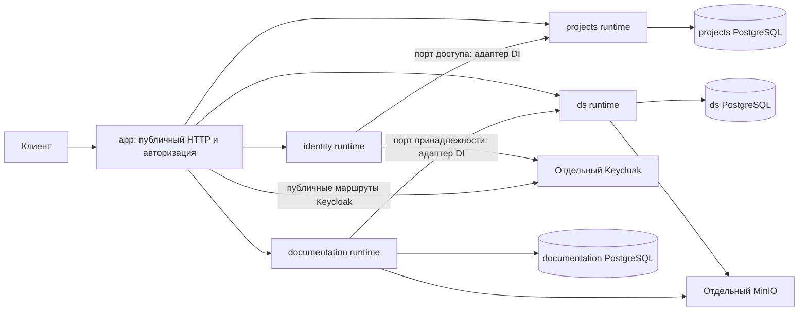

# Устройство монолитной сборки backend

## Контекст

Мотивация и границы изменения описаны в `proposal.md`. Сейчас четыре самостоятельных Ktor-приложения устанавливают плагины и DI, инициализируют свои БД и ресурсы; nginx формирует публичные пути и доверенный контекст через auth-helper. `project-publisher` существует отдельно и исключён из решения.

Исходные точки исследования: `backend-kt/settings.gradle.kts`, четыре `app/Application.kt`, `identity-gateway/gateway/nginx.local.conf` и production-конфигурация nginx, `docker-compose.local.yml`, `start-local.sh`. В ds и documentation совпадают пути `db/migration`, номера V1/V2 и путь OpenAPI. Настройки JSON различаются. Простое подключение всех прежних `Application.module()` создаёт конфликты плагинов, DI, ресурсов и маршрутов.

## Цели и границы

Поддерживать только монолитный Docker-запуск, сохраняя границы проектов и бизнес-модулей для будущего выделения сервисов. Монолит получает один сетевой сервер, единый граф DI и жизненный цикл. Предметные правила, DTO, схема данных и границы транзакций сохраняются.

Не меняются nginx и его конфигурации, publisher, правила веток, тегов и авторизации публикации production-образов, клиентские API `frontend-kt`/`js`. Не вводятся общая БД, общая межбазовая транзакция и автоматическое переключение production на монолит. TLS может завершаться существующей внешней инфраструктурой; nginx не является зависимостью монолитного контура.

## Решения

### Структура модулей и Gradle

Сохраняется composite build, чтобы не переносить весь backend в новый единый многопроектный граф. Добавляется отдельная included build `backend-kt/app` с исполняемым корневым проектом. В каждой из четырёх существующих сборок добавляется библиотечный модуль `:runtime`.

```text
backend-kt/
  app/                           отдельная сборка, один исполняемый проект
    src/main/kotlin/com/dsbuilder/app/
      presentation/              публичные маршруты и защита входа
      data/                      адаптеры вызовов внутри процесса, прокси Keycloak
      di/                        единый граф и выбор реализаций
    src/main/resources/          application.yaml, logback.xml
    Dockerfile
  identity-gateway/
    app/                         прежняя точка запуска auth-helper
    runtime/                     сборка аутентификации без запуска сервера
    feature-auth/                существующие сценарии и порты
    gateway/                     nginx без изменений
  projects-service/
    app/                         прежняя точка запуска
    runtime/                     конфигурация, подключение БД, маршруты и DI
    core/, feature-projects/     существующие модули
  ds-service/
    app/                         прежняя точка запуска
    runtime/                     конфигурация, миграции, ресурсы, маршруты и DI
    core/, feature-*/            существующие модули
  documentation-service/
    app/                         прежняя точка запуска
    runtime/                     конфигурация, ресурсы, маршруты и обработчики
    feature-*/                   существующие модули
  runtime-contracts/             общие контракты жизненного цикла без бизнес-логики
  authorization-core/            существующая общая политика
  project-publisher/             без изменений и вне зависимостей монолита
  docker-compose.local.yml       единственный локальный монолитный контур
```

Имена `runtime` описывают библиотечную сборку подсистемы, а не отдельный процесс. Они не устанавливают глобальные плагины, не запускают EngineMain, не открывают порт и не создают глобальный Koin. Исходные app сервисов сохраняются и должны компилироваться, но их Docker-развёртывание не входит в поддерживаемый контур. Не требуется развивать для них отдельный эксплуатационный цикл. Монолит подключает четыре runtime и адаптеры внутри процесса. `app -> runtime -> feature/core`; обратные зависимости и зависимости runtime от другого исполняемого app запрещены.

Для composite-зависимостей используются уникальные координаты вида `com.dsbuilder.projects:runtime`, `com.dsbuilder.ds:runtime`, `com.dsbuilder.documentation:runtime`, `com.dsbuilder.identity:runtime`; та же уникальность обеспечивается для транзитивно используемых core/feature-модулей. Каждый включаемый продукт объявляется один раз с явным сопоставлением зависимостей, без зависимости от совпадающего имени `app` или `core`. Внешняя публикация библиотек в Maven не нужна. Каталог версий и build-system остаются общими. Корневые проверки включают новую сборку.

Альтернатива — уплощение всех сборок — увеличивает область рефакторинга и риск нарушения прежнего запуска. Подключение готовых исполняемых app или нескольких серверов в одном процессе отклонено: оно оставляет конфликты и внутренний HTTP.



Стрелки между подсистемами показывают вызовы прикладных интерфейсов через адаптеры, а не прямые зависимости доменных моделей или доступ к чужим таблицам.

### Слои и взаимодействие

Сохраняются `presentation -> application -> domain`, реализации в `data`, связывание в `di`. Для взаимодействия проектов открывается минимальный прикладной контракт, а не весь набор классов подсистемы. Потребитель определяет нужный результат; поставщик предоставляет публичный прикладной интерфейс к существующему сценарию. Связывающий адаптер отображает их модели и результаты.

| Взаимодействие | Контракт потребителя | Публичный контракт поставщика |
|---|---|---|
| Авторизация → projects | `ProjectContextResolver` | Проверка доступа пользователя к заданному проекту с результатом разрешения, отказа или недоступности |
| Авторизация → projects | `ProjectAccessKeyVerifier` | Проверка ключа с идентификаторами ключа/проекта и областями доступа либо результатом отказа/недоступности |
| Документация → ds | `DesignSystemOwnershipVerifier` | Проверка принадлежности и доступности дизайн-системы для проверенного участника с результатом `OWNED`, `NOT_FOUND`, `FORBIDDEN` или `UNAVAILABLE` |

Сейчас auth-порты и часть нужных сценариев projects имеют видимость `internal`. Публичными становятся только потребительские интерфейсы, необходимые внешнему адаптеру, прикладные интерфейсы поставщиков и минимальные типы их запросов/результатов. Реализации поставщиков делегируют существующим сценариям внутри своего модуля. Конкретные use case, repository, таблицы и инфраструктурные классы не открываются только ради сборки монолита. Если сигнатура раскрывает слишком широкую внутреннюю модель, вводится узкая модель прикладного контракта и явное отображение вместо публикации всего домена.

Потребительские порты принадлежат `application` соответствующей фичи auth или документации; предоставляемые интерфейсы и модели принадлежат `application` фичи projects или ds. Общая сборка `runtime-contracts` не содержит бизнес-контрактов. Реализации и регистрация DI остаются внутри подсистемы. Публичная сигнатура не может ссылаться на `internal`-тип: публичной становится вся необходимая цепочка типов сигнатуры, но только она.

Монолитные адаптеры в `app/data` реализуют потребительские порты и вызывают публичные прикладные интерфейсы поставщиков. `app/di` соединяет их через DI, runtime поставщика связывает публичный интерфейс с закрытой реализацией. Сборка app явно объявляет зависимости на модули-владельцы используемых интерфейсов и моделей: нельзя рассчитывать на их доступность через транзитивные Gradle `implementation` зависимости runtime. Runtime не зависит от чужого runtime, feature-модули не приобретают зависимости друг от друга. Только связывающий адаптер знает обе стороны и отображает типы и ошибки.

Существующие HTTP-адаптеры сохраняются как задел для будущего выделения сервисов; их поведение служит исходным контрактом для локальных адаптеров. Замена реализации через DI в будущем не должна требовать изменения бизнес-правил потребителя. Сейчас эксплуатируется только монолит, отдельный HTTP-контур не вводится. Domain/application не импортируют Ktor, Koin, Exposed или реализации соседней подсистемы. Не создаётся общий универсальный CRUD-интерфейс. Вызов прикладного интерфейса сохраняет проверки прав и не предоставляет прямой доступ к repository или таблицам поставщика.

Проверки завершённости: app компилируется как отдельный модуль без friend-доступа к `internal`; публичные сигнатуры не раскрывают внутренние типы; адаптеры сохраняют результаты прежнего HTTP-контракта, включая отказ и недоступность. Открытие Kotlin-интерфейсов не добавляет публичных HTTP-маршрутов.

Результаты `OWNED`, `NOT_FOUND`, `FORBIDDEN`, `UNAVAILABLE`, отозванные ключи, отсутствие членства и ограничения областей доступа сохраняют прежний смысл. Вызов внутри процесса не наследует чужую транзакцию; каждый сценарий обращается к своей БД. Доступ к Exposed всегда связан с конкретной БД. Проверка исходников в `backend-kt/app` требует `db = ownedDatabase` при вызовах Exposed `transaction`, `newSuspendedTransaction` и `suspendTransaction`; она отклоняет пропуск БД, `db = null`, псевдонимы без явной БД и импорты `transactions.*`. Проверка входит в обычные тесты, защищённые архитектурные тесты и Detekt-правила не меняются. Транзакции разных подсистем не вкладываются друг в друга.

### Программное проектирование

Ниже показана форма новых контрактов сборки; конкретные типы конфигурации принадлежат своим runtime. Это не новый общий интерфейс бизнес-операций.

```kotlin
interface RuntimeHandle : AutoCloseable {
    suspend fun readiness(): RuntimeReadiness
    suspend fun stop(gracePeriod: Duration)
    override fun close()
}

data class RuntimeReadiness(
    val ready: Boolean,
    val checks: Map<String, Boolean>,
)

interface TrustedActorProvider {
    suspend fun requireUser(call: ApplicationCall): UserActor
    suspend fun requireProject(call: ApplicationCall, projectId: String): ProjectActor
}
```

`stop(gracePeriod)` отменяет работу, ограниченно ожидает завершения и вызывает `close()`. `close()` идемпотентно освобождает ресурсы без ожидания задач и пригоден для отката неполной инициализации. В серверных событиях отмена и закрытие блокирующих JDBC/S3 начинаются до ожидания HTTP-соединений. Диагностика оставляет `Map<String, Boolean>`: БД и S3 документации представлены разными признаками, подробные исключения не выдаются публично.

`RuntimeHandle` — контракт управления инфраструктурой из самостоятельной included build `backend-kt/runtime-contracts`; она не содержит бизнес-типов, Ktor или Koin. Пример `TrustedActorProvider` описывает отдельный контракт presentation-модуля, регистрирующего маршруты: интерфейс принадлежит этому модулю-потребителю, а не app или runtime-contracts. `ApplicationCall` допустим на этой границе presentation; `UserActor` и `ProjectActor` обозначают существующие типы контекста соответствующей подсистемы и не импортируются из app. Для другого модуля маршрутов используется его собственный минимальный контракт с его типами, без общего доменного интерфейса на весь backend.

App реализует потребительский интерфейс адаптером, который получает проверенный контекст из атрибутов конкретного запроса и отображает его в типы подсистемы. Интерфейс и необходимые типы его сигнатур публичны. Runtime принимает этот интерфейс либо функцию с типами модуля-потребителя и передаёт её при регистрации маршрутов. Направление зависимостей: `app -> runtime -> модуль маршрутов`, а адаптер app также явно зависит от модуля-владельца контракта. Ни интерфейс, ни типы app не используются в публичных сигнатурах runtime; зависимости `runtime -> app` и friend-доступа не возникает.

Runtime предоставляет функции создания ресурсов из конфигурации своей подсистемы, регистрации Koin-модулей и маршрутов. Projects сохраняет отдельный `ApplicationConfig`; полная замена этой конфигурации типизированным объектом не требуется. Регистрация маршрутов принимает префикс и источник контекста через контракт модуля-потребителя: сохранённая точка запуска сервиса при необходимости использует адаптер доверенных заголовков, монолит — адаптер проверенных атрибутов запроса. Публичный запрос не может устанавливать эти атрибуты. Сохранение такого адаптера не вводит второй поддерживаемый Docker-контур. Методы регистрации и точные имена типов уточняются при реализации без изменения владельцев контрактов и направления зависимостей.

### Публичная точка входа без nginx

Конфигурации nginx сохраняются как исторический снимок поведения до перехода, а не как развиваемый контракт монолита. Актуальные требования публичного входа поддерживаются в OpenSpec и проверяются тестами приложения. Матрица `app/contracts/gateway-contract.json` фиксирует исходное поведение; проверка хеша подтверждает неизменность снимка и не доказывает соответствие поведения приложения.

Новый app регистрирует только публичные пути; внутренние `/projects`, `/api/ds`, `/documentation`, `/internal/**` и `/_auth_*` не подключаются как обходные маршруты. Функции регистрации принимают публичные префиксы вместо проксирования запросов на собственный порт. Проект определяется из публичного пути до выполнения операции. Разбор кодирования, завершающего слеша и нормализации проверяется на обход авторизации.

Проверки JWT, ключей, глобальных ролей, членства и областей доступа переиспользуются из feature-auth и существующих сценариев. Все входящие служебные `X-*` игнорируются для определения полномочий. Отдельно сохраняется роль публикации Compose preview plugin; административные операции не принимают ключ проекта. Запреты неизвестных, устаревших и закрытых маршрутов сохраняются.

Перед реализацией фиксируется проверяемая матрица поведения локального и production nginx: маршрут, метод, авторизация, перенаправление, лимиты, CORS, таймауты, заголовки и ошибки. Файлы nginx не генерируются и не редактируются. У монолита одна модель конфигурации через env; локальные и production-настройки являются наборами значений, а не отдельными режимами поведения кода. Тесты читают существующий nginx как контрольный источник; исполняемое приложение от его файлов не зависит.

Для локального набора настроек уже установлены: общий лимит 2 MiB, 16 MiB для ds и импорта API-меты, 64 MiB для архива плагина, 101 MiB для документации. Исторические IP-лимиты nginx (частота и число соединений) не переносятся в приложение; ими управляет внешняя инфраструктура. Таймауты — 10 с установления внешнего соединения, 300 с чтения/записи, 120 с для публикации плагина. Статус превышения размера тела — 413. Потоковые лимиты проверяют фактически прочитанные байты, а не только Content-Length. Распаковочные ограничения документации остаются прежними.

JSON-настройки сохраняются по подсистемам: общий ContentNegotiation не должен незаметно менять строгую проверку документации или допустимость неизвестных полей проектов. Используются явные сериализаторы/преобразование DTO или настройки уровня маршрута. `ContentNegotiation` устанавливается на уровне маршрутов. `StatusPages` устанавливается один раз на всё приложение: обработчики типизированных исключений повтора идемпотентного запроса и неверного тела, затем общий обработчик технической ошибки с безопасным ответом 500. Предметные отказы подсистем отображаются их presentation-модулями до общего обработчика; отмена корутины пробрасывается. Проверки сохраняют прежние DTO и ответы ошибок, отдельные обработчики StatusPages на маршрутах не устанавливаются.

Прокси Keycloak обслуживает только фиксированные маршруты и настроенный upstream. Сохраняются `/auth/token`, `/auth/logout`, `/auth/account`, `/auth/**`, `/realms/**`, `/resources/**` и `/admin/**` согласно набору настроек, включая точечные запреты регистрации и приоритет точных маршрутов. Проксирование сохраняет методы, query, cookies, несколько Set-Cookie, редиректы и публичный issuer. Hop-by-hop заголовки удаляются; недоверенные forwarded-заголовки не используются как полномочия или произвольный адрес назначения. Адрес клиента и публичный адрес берутся из соединения/конфигурации; входящие forwarded-заголовки не определяют адрес клиента или публичный origin при проксировании в Keycloak. Корректность браузерных редиректов проверяется с реальным Keycloak.

### Изоляция конфигурации, подключений и памяти

Projects сохраняет существующие ключи `database.url`, `database.username` и `database.password`, но получает отдельный `ApplicationConfig` из `dsbuilder/projects/defaults.yaml`, не общий `application.environment.config`. Auth также получает собственный объект конфигурации. Это устраняет коллизии без полной переделки конфигурационной модели; тест проверяет разные конфигурации при одинаковых именах ключей.

Projects, DS и documentation владеют отдельными ограниченными Hikari-пулами по 10 подключений по умолчанию с ожиданием получения соединения 5000 мс. Объект Exposed для публикации DS использует тот же пул DS, не создавая ещё один. При расчёте лимита PostgreSQL суммируются размеры пулов всех экземпляров приложения, соединение DS `LISTEN` и служебный запас; если серверы PostgreSQL разные, бюджет считается для каждого отдельно. Соединение не удерживается на всё время SSE или работы с архивом/S3.

Docker-образ задаёт `JAVA_TOOL_OPTIONS=-XX:MaxRAMPercentage=60.0`; оба Compose ограничивают app через `BACKEND_MEMORY_LIMIT` (по умолчанию `2g`). При лимите 2 GiB heap получает около 1,2 GiB, оставшаяся память предназначена для metaspace, стеков, прямых буферов и прочих расходов процесса. `JAVA_TOOL_OPTIONS` и `BACKEND_MEMORY_LIMIT` переопределяются окружением. При запуске без Compose оператор задаёт лимит средствами инфраструктуры либо явный `-Xmx` с отдельным учётом памяти вне heap; `-Xmx` ограничивает только heap, а процент сам по себе не ограничивает контейнер. Значения являются начальным бюджетом, а не гарантией отсутствия OOM; параллелизм и ограничения архивов сохраняются.

### Переиспользование ресурсов без ручных копий

Ресурсы, сейчас находящиеся в app сервисов, перемещаются к runtime-владельцу. Монолит получает их библиотечной зависимостью. Сохранённые точки запуска проектов при необходимости используют тот же источник, а не копии ресурсов.

| Ресурс | Единственный источник | Путь в библиотеке и приложении |
|---|---|---|
| OpenAPI | `<service>/runtime/src/main/resources/openapi/documentation.yaml` | `dsbuilder/<service>/openapi/documentation.yaml` |
| Публичное описание auth | `identity-gateway/runtime/src/main/resources/openapi/public-authentication.yaml` | `dsbuilder/identity/openapi/public-authentication.yaml` |
| SQL ds | `ds-service/runtime/src/main/resources/db/migration/*.sql` | `dsbuilder/ds/db/migration/*.sql` |
| SQL documentation | `documentation-service/runtime/src/main/resources/db/migration/*.sql` | `dsbuilder/documentation/db/migration/*.sql` |
| Начальные данные ds | существующие `feature-tokens`, `feature-themes`, `feature-components`: `src/main/resources/<исходное имя>.json` | `dsbuilder/ds/seeds/<исходное имя>.json` |
| Схемные контракты ds | существующий `ds-service/contracts/` | `dsbuilder/ds/contracts/` |
| Политика доступа | существующий `authorization/policy.json` | общий внешний файл по конфигурации |

Канонический исходный путь OpenAPI `src/main/resources/openapi/documentation.yaml` сохраняется внутри модуля-владельца согласно правилам репозитория. Gradle `processResources` перемещает его в уникальное пространство имён при упаковке, не создавая второй редактируемый YAML. Загрузчики и инструменты API Reference обновляют ссылки на новый модуль-источник; их публичный результат сохраняется. Разделённые документы не склеиваются вручную.

Каждое исполняемое приложение имеет свой корневой `application.yaml` и `logback.xml`: это конфигурация конкретного запуска. Общие значения и каталог областей доступа проекта выносятся один раз в конфигурационные ресурсы runtime с уникальными именами; корневые файлы передают переопределения. Порядок приоритетов: явно заданное окружение/настройка запуска, затем модульные значения по умолчанию. Пароли и локальные `.env` не упаковываются.

Упаковка проверяет пересечение прикладных путей до создания итогового JAR. Нельзя разрешать конфликт стратегией «первый победил» или `DuplicatesStrategy.INCLUDE`. Для служебных метаданных сторонних библиотек применяется точечный список допустимых объединений, включая `META-INF/services`; он не допускает конфликтов SQL, OpenAPI, начальных данных и корневой конфигурации. Повторение байтов в разных итоговых образах допустимо, ручное сопровождение копий — нет.

### Данные, миграции и ресурсы процесса

Единый граф DI создаётся в app с запрещённым переопределением регистраций. Политика доступа загружается и валидируется один раз; все подсистемы получают один неизменяемый экземпляр политики и согласованный PolicyEvaluator. Настройки, подключения и пулы БД, HTTP/S3-клиенты принадлежат соответствующим runtime. Различающиеся зависимости имеют отдельные типы либо явные квалификаторы; общий неквалифицированный ApplicationConfig не подменяет настройки подсистем. Полный граф проверяется до открытия готовности. Повторная регистрация зависимости считается ошибкой запуска. Тесты проверяют общий экземпляр политики, разделение зависимостей runtime и отказ при дубликате.

Projects, ds и documentation имеют отдельные подключения/пулы и явные квалификаторы DI. Имена баз, таблиц, схема и способы инициализации не меняются; серверные данные сохраняются, а при локальном переходе их потеря допустима: Flyway ds и documentation остаются независимыми, projects сохраняет нынешнюю инициализацию. Каждый Flyway получает собственную БД и единственный уникальный каталог. Существующие SQL перемещаются без изменения байтов, имён и версий; история и контрольные суммы проверяются на копиях существующих баз. Новая SQL-миграция ради изменения расположения ресурсов не создаётся, поскольку схема не изменяется.

Порядок запуска: прочитать и проверить конфигурацию и общую политику; собрать и проверить единый граф DI; создать независимые ресурсы; выполнить существующую инициализацию и валидацию; зарегистрировать маршруты; запустить обработчики после успешной подготовки. При ошибке частично созданные ресурсы закрываются, готовность не открывается. Общие плагины устанавливаются один раз.

Параллелизм фоновой обработки документации ограничен настройкой env. Очередь остаётся в БД документации: обработчик арендует новое задание только при наличии свободного места исполнения, не выгружая очередь в память JVM. Обработка и очистка используют ограниченные исполнители; блокирующие JDBC, S3, файловые операции и обработка архивов выполняются вне потоков сетевого сервера. Число обработчиков, размеры пулов БД и лимиты загрузок задаются через env, проходят проверку допустимых значений и документируются с ограниченными значениями по умолчанию. Существующие имена настроек сохраняются; новый параметр параллелизма добавляется только при отсутствии подходящего. Ожидание свободного подключения ограничено, загрузки читаются потоково с прежними пределами размера. Не вводится новая очередь, новая схема БД или новый механизм аренды.

Проверки насыщения подтверждают, что число одновременно исполняемых фоновых заданий не превышает настройку, остальные остаются в БД, а обычный запрос API продолжает обслуживаться при занятых фоновых исполнителях. Остановка прекращает аренду новых заданий и завершает либо отменяет текущие в пределах общего срока. Ограничения снижают конкуренцию за ресурсы, но не дают полной изоляции CPU и памяти внутри одной JVM; переполнение памяти может остановить весь backend.

`/health` проверяет жизнеспособность, `/ready` агрегирует обязательные проверки всех runtime, включая существующую проверку S3 документации. Диагностика содержит состояния подсистем и версию политики без секретов. Все обработчики принадлежат управляемым CoroutineScope. Остановка сначала прекращает приём новых задач, затем завершает/отменяет работу и закрывает ресурсы в обратном порядке; превышение срока приводит к отмене. Аренды и восстановление заданий документации не перепроектируются. Отказ одной подсистемы делает весь монолит неготовым — это осознанная потеря изоляции процессов.

### Единственный Docker-запуск и однократный переход

Добавляется `backend-kt/app/Dockerfile`, существующие `backend-kt/docker-compose.local.yml` и корневой `docker-compose.prod.yml` переводятся на монолит. Второй набор микросервисных Compose не поддерживается. В прикладной части остаётся один сервис `backend`, nginx и отдельные auth-helper/projects/ds/documentation из контура исключаются. PostgreSQL, MinIO, Keycloak и необходимые одноразовые задачи инициализации остаются инфраструктурой. Publisher не затрагивается и не подключается. Конфигурации nginx сохраняются как исходный контрольный материал и задел для будущей инфраструктуры.

Монолит по умолчанию слушает порт 8080; `BACKEND_PORT` позволяет его изменить. Локальный Compose публикует порт на 8080; production Compose не фиксирует host port. `BACKEND_SHUTDOWN_TIMEOUT_MS` задаёт срок остановки. Отдельный переключатель поведения local/production не вводится.

App самостоятельно читает env независимо от наличия Compose. Окружение может задаваться Docker, Kubernetes, системным менеджером процессов или платформой размещения. Compose только передаёт значения и не является источником обязательной логики конфигурации. Существующие имена, смысл и значения по умолчанию сохраняются, включая `OIDC_WEB_ORIGIN`, `KEYCLOAK_REALM`, `DOCUMENTATION_MAX_REQUEST_SIZE` и `GATEWAY_PROXY_TIMEOUT_SECONDS`; настройки внешних подключений подсистем также сохраняются. Неиспользуемые адреса HTTP upstream прикладных микросервисов не требуются монолиту. Ошибочная обязательная конфигурация приводит к понятной ошибке запуска без раскрытия секретов. Публичный адрес берётся из конфигурации приложения, без доверия входящим forwarded-заголовкам. Контракт env документируется и проверяется при прямом запуске JVM без Compose.

Команды `start-local.sh` и `setup-local.sh` запускают монолит по умолчанию; `--mode` и постоянное переключение между контурами не вводятся. Bootstrap base использует прежний публичный адрес. CI строит монолитный образ вместо отдельных прикладных образов и gateway; правила разрешённых веток, тегов, авторизации и запуска deployment сохраняются. Сохранённые исходные проекты не требуют самостоятельных Docker-образов в матрице. Выполнение публикации и переключение production не разрешаются самим изменением workflow.

Локальный переход выполняется обычным `./setup-local.sh`: Compose запускается с `up --build --remove-orphans -d`, удаляет старые прикладные контейнеры своего проекта и создаёт монолит. Отдельный `--adopt`, инвентаризация, сохранение идентификаторов контейнеров/томов и обязательные резервные копии локального контура не требуются. При изменении определений томов инфраструктура может пересоздаваться; потеря локальных данных БД, MinIO и Keycloak допустима. Монолит использует отдельный набор именованных локальных томов `monolith_*`: первый запуск создаёт согласованное пустое хранилище всех подсистем, последующие запуски используют те же тома. Автоматического `down -v` и очистки томов других проектов нет. SQL-схемы и разделение БД не меняются.

На серверных dev/prod с внешними хранилищами сохраняются подключения, данные PostgreSQL/S3 и данные Keycloak. Перед переключением прикладной части проверяются резервные копии и откат; локальное разрешение потери данных на серверные окружения не распространяется.

## Риски и компромиссы

- Различия nginx и Ktor → матрица точных маршрутов, ошибок, лимитов и проверки обоих наборов значений env; не ограничиваться проверкой успешного GET.
- Обход защиты при регистрации внутренних маршрутов → отдельная публичная регистрация и отрицательные тесты путей/заголовков.
- Конфликт DI, JSON или classpath → квалификаторы подключений, локальные настройки сериализации и проверка содержимого JAR.
- Перемещение SQL нарушает загрузку → сравнение байтов и checksum, тесты монолита на пустых и уже мигрированных базах.
- Общая память и отказ процесса → ограниченные очереди/чтение, отмена потоков и обработчиков, общая готовность; независимое масштабирование теряется.
- Локальные данные при переходе могут потеряться — это допустимо; серверные внешние хранилища сохраняются, их переключение требует проверки резервных копий и отката.
- Расхождение с прежним публичным входом → контрактные тесты по зафиксированной матрице nginx; постоянно работающий второй Docker-контур не требуется.
- Активные изменения `host-compose-preview-plugin`, `add-color-token-groups`, `add-cli-import-api-swiftui` → сохранять их текущие маршруты/ресурсы и сверить новые изменения перед реализацией, без их архивирования в этой задаче.

## План изменений и совместимость

1. Зафиксировать существующий публичный контракт и порядок однократного перехода без потери данных.
2. Добавить runtime-contracts, уникальные координаты и runtime модулей, сохранив границы подсистем и компиляцию существующих проектов.
3. Перенести ресурсы к владельцам, добавить уникальные пути упаковки и проверки загрузки.
4. Подключить локальные адаптеры и единый app, реализовать публичный вход и прокси Keycloak.
5. Перевести Compose, команды запуска и матрицу CI на монолит; документировать переход и восстановление.
6. Выполнить FAST, независимую проверку, FULL и внешние проверки; реализация начинается только после согласования артефактов.

При проблеме серверного переключения прикладная часть откатывается к предыдущим образам на сохранённых внешних хранилищах. После перехода откатываются версии монолитного образа. Для локального контура сохранность прежних данных при переходе не требуется; обычный повторный запуск и явный `--reset` остаются доступными.

## План проверки и развёртывания

Локальные автоматические проверки: тесты выбора адаптеров и отображения ошибок, Ktor-маршрутов, поддельного контекста, обходных путей, JSON, загрузки ресурсов, миграций и остановки. Обязательные тесты с PostgreSQL не пропускаются при отсутствии Docker; они завершают проверку ошибкой либо выполняются как явно выделенная внешняя проверка. Выполняются `tools/verify fast --change add-backend-monolith-runtime` и `tools/verify full --change add-backend-monolith-runtime`, включающие backend build, detekt, spotlessCheck и тесты. При изменении conventions отдельно проверяется build-system. Защищённые архитектурные тесты и политика Strictacode не изменяются; проверки новых контрактов добавляются в обычные тесты модулей.

Внешние проверки до архивирования:

| Действие | Предварительные условия | Успех и доказательства |
|---|---|---|
| Запустить `./setup-local.sh` | Docker, JDK и тестовые настройки Keycloak/БД/MinIO | В `docker compose ps` один прикладной контейнер, `/health` и `/ready` дают 200; сохранить команды, коды и список контейнеров |
| Прогнать матрицу публичного контракта на app с локальным и production-наборами значений env | Зафиксированный исходный контракт nginx и тестовые данные | Совпадают DTO, статусы, значимые заголовки, редиректы, граничные размеры, границу публичных маршрутов, CORS и отрицательные сценарии; сохранить отчёт по случаям |
| Войти через браузер и `/auth/token`, обновить токен, выйти | Реальный Keycloak с локальным realm | Корректны issuer, cookies и перенаправления; закрытые пути не открываются; сохранить обезличенный результат без токенов |
| Проверить CLI и веб-клиент без изменения API | Готовый монолит и тестовый проект | Создание проекта/DS, чтение/изменение темы, импорт API-меты, загрузка/чтение/поиск документации, поток изменений и Compose preview работают; сохранить перечень действий и результаты |
| Проверить локальный переход обычным setup и повторный запуск | Изолированный старый Compose с приложениями и анонимными томами | Без adopt запускается один app, старый gateway освобождает порт, `/health` и `/ready` дают 200; потеря локальных данных допустима |
| Остановить контейнер во время обработки документации и открытого потока | Длительное тестовое задание | Остановка укладывается в срок, ресурсы закрыты, после запуска задания восстанавливаются по аренде; сохранить длительность и безопасные журналы |

Точный исполняемый набор проверок матрицы создаётся в ходе реализации и документируется одной командой с адресом цели и набором настроек; отсутствие окружения не считается успехом. После возможного будущего production-развёртывания наблюдают память JVM, длительности запросов и задержку обработки документации; это не блокирующие задачи текущего изменения. Подготовка Docker, Compose и production CI входит в реализацию этого изменения. Фактическая публикация образов, запуск deployment workflow и переключение production выполняются только по отдельному запросу.

Для сохранения различий прежнего ограничения документации используется `DOCUMENTATION_RATE_LIMIT_ENABLED`: по умолчанию `false`, production Compose передаёт `true`. Это отдельный параметр env без выбора режима запуска. Повторное чтение тела через DoubleReceive ограничено JSON предметных DS-маршрутов; потоковые загрузки документации, плагинов и прокси не кэшируются в heap.

Публикация Compose preview сохраняет отдельное ожидание ответа 120 секунд (`COMPOSE_PLUGIN_TIMEOUT_SECONDS`). Presentation сообщает входу о завершении приёма multipart; отсчёт начинается после него, поэтому активная загрузка не ограничена общим временем 120 секунд. По истечении ожидания вход отменяет обработчик и возвращает 504, не меняя прикладной use case.

### Уточнения после ревью и интеграции dev

Общие ограничения частоты запросов и числа соединений по IP принадлежат внешнему reverse proxy/балансировщику. Монолит не реализует их и не использует `BACKEND_TRUSTED_PROXIES` или `DOCUMENTATION_RATE_LIMIT_ENABLED`. Он сохраняет авторизацию, потоковый лимит тела, таймауты и ограниченный параллелизм workers. Замороженная матрица nginx описывает исторический вход; IP-лимиты из неё не являются требованием к app.

Публичный вход отклоняет неизвестные префиксы. После регистрации проверяется всё дерево конечных маршрутов, включая новые маршруты DS из dev. DS получает контекст и префикс только из явно установленного адаптера; самостоятельный `module` явно выбирает внутренний контракт за доверенным gateway. Launcher'ы сохраняются для модульной разработки и будущего разделения, не как второй поддерживаемый Compose.

Production Compose сохраняет имя `gateway` как сетевой alias backend. `BACKEND_PUBLIC_URL` является необязательным переопределением: без него публичный origin берётся из существующего `KEYCLOAK_ISSUER`. Сборка app имеет собственные Gradle/Kotlin heap и максимум два workers, поскольку included build не наследует бюджет корневого проекта.
