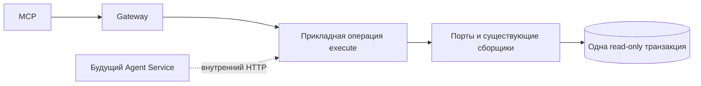

# Проектное решение

## Контекст и зависимости

Зависит от `add-versioned-read-tools`, который поставляет общий выбор версии, HTTP-заголовки, совместимую пагинацию модели и промежуточные 22 tools. Не зависит от `use-pkce-for-cli-mcp`. Мотивация — в proposal.md. Ни старые HTTP-тела, ни платформы, ни схема JS db-service не заменяются.

Архитектурный источник — `agent-architecture-handoff.md`: сложная предметная сборка выполняется общими backend-операциями. MCP идёт через Gateway, будущий Agent Service — через внутренний HTTP с доверенными actor/project/scopes; frontend feature-модули не становятся библиотекой Agent Service. Новый Agent Service вне scope.

## Составные операции и границы слоёв



Сохраняются presentation → application → domain, data и di. У каждого нового/изменённого UseCase ровно один публичный execute. Общие механизмы оформляются сервисами; feature-to-feature зависимости не вводятся. Проверки доступа и целостности переиспользуются, обязательный designSystemId в каждую старую ID-ручку не добавляется. Не вводится новый запрет чтения доступного ресурса другой DS из-за локального контекста tool.

## Конфигурация и токен-ссылки

Конфигурация компонента — `appearance` выбранной дизайн-системы. Существующий `GET /appearances` с фильтрами `designSystemId` и `componentId` возвращает доступные `appearanceId`, имена и признак конфигурации по умолчанию с серверной пагинацией. Вызов без фильтров сохраняет прежний массив. Существующий `GET /appearances/{id}/variations` возвращает объявления осей в порядке `position`, их значения и ID. `component_styles_get` читает каталог стилей и не заменяет список конфигураций.

Новая составная операция чтения параметров принимает `appearanceId` и необязательный набор `selectedValueIds`: ID объявлений значений осей этого оформления. Имена используются только для показа. Сервер проверяет принадлежность каждого значения выбранной версии оформления и отсутствие двух значений одной оси. Неизвестный ID, значение другого оформления и несовместимая выбранная версия отклоняются без поиска по имени. Пустой выбор запрашивает базовые свойства оформления.

Параметры строятся из существующей модели редактора: базовые значения, значения отдельных выбранных осей и записи сочетаний, все участники которых выбраны. Для одного свойства и набора состояний записи применяются по возрастанию `position` осей: более поздняя ось переопределяет раннюю. Запись сочетания применяется на позиции последней участвующей оси и переопределяет одиночные записи на этой позиции. При нескольких применимых сочетаниях на одной позиции более конкретное сочетание имеет приоритет; при равной длине порядок определяется последовательностью `position` участвующих осей, начиная с наибольшей различающейся позиции. Ответ содержит итоговое значение, `propertyId`, `tokenId` при наличии и ID/техническую редакцию записи-источника. Порядок `position` в модели уже хранится, но это правило разрешения конфликтов вводится этим Change; существующий экспорт не объявляется реализацией этого правила.

Выбор версии разрешается один раз, проверка ID и расчёт параметров выполняются в одной согласованной read-only транзакции подходящей изоляции. Действующий `GET /appearances/{id}/editor-model` остаётся источником структуры и ID для редактора; новая операция возвращает вычисленный результат для выбора значений. `POST DS/component-config/export` и его пакет meta/components/underivedTypes сохраняются для генераторов и CLI без новых параметров.

Новая операция чтения токен-ссылок принимает `appearanceId` и `selectedValueIds` для полного выбора всех осей. Она использует те же итоговые параметры и возвращает items со стабильными `tokenId`, именами, `propertyId`, ID записи-источника и путями использования. Произвольные строки не объявляются токенами; значения темы не вычисляются. Version остаётся query-параметром; фактическая граница передаётся X-DS-Read-Context.

## Обогащение существующих чтений

Параметр include существующих ID-маршрутов включает дополнительные поля, не меняя прежний ответ без параметра:

- properties: `include=platformParams` — существующие платформенные параметры свойств;
- deps: `include=reuseConfig` — настройки переиспользования выбранной DS; метаданные родителей/детей уже есть и не реализуются повторно.

MCP №16–17 явно включает нужные данные. Где ресурс глобальный, а расширение зависит от DS, запрос расширения принимает designSystemId и использует существующую проверку связи; это не новый обязательный параметр всех старых чтений. Платформы компонентов web/compose/xml/ios и токенов web/android/ios сохраняются.

`component_variations_get` (№15) уже подключён первым Change к существующему `GET /appearances/{id}/variations` с обязательным appearanceId. Оси, значения и defaultStyleId входят в прежний ответ. Его схема и результат сохраняются без include=values,defaults, новых серверных проекций и повторной реализации. `GET /components/{id}/variations` не используется MCP; его удаление или изменение остаётся за другим Change.

## Публикации документации

Документация имеет независимые version/platform/publicationId. Новая операция `GET DOC/publications` возвращает существующий для документационных списков объект items/nextCursor с опубликованными выпусками выбранной DS, включая переиздания, новые первыми; candidate исключаются. Фильтры version/platform необязательны, limit по умолчанию 20 и максимум 100. Cursor непрозрачный и привязан к проекту/DS/фильтрам/порядку. Модельная публикация с тем же номером не требуется.

Все остальные маршруты сохраняются: publications/active; publications/{publicationId}/navigation; pages/{path}; bindings и bindings/{bindingId}; search; kb/fetch. Без явного ID MCP требует точные version/platform из аргументов или контекста, отклоняет draft и не использует серверную возможность latest. Сначала разрешается active publication, затем читается конкретный ID. Эти два простых HTTP-вызова допустимы; дополнительных /navigation, /pages или /bindings по селектору не создаётся. По явному ID выполняется один запрос, его фактические метаданные не блокируются унаследованными параметрами другой публикации; явно несовместимые параметры отклоняются.

401/403/503 разрешения не превращаются в PUBLICATION_NOT_FOUND. Недоступность проекта и существующие проверки принадлежности публикации сохраняются. Дополнительный обязательный DS-фильтр всех ID-ресурсов не вводится; фактическая DS видна в контексте. Нельзя объявлять документацию авторитетной моделью или выводить componentId по похожему имени; поле допустимо только при доказанном соответствии.

X-DS-Read-Context для документации содержит designSystemId/version/platform/publicationId из фактической публикации; versionId модели отсутствует. Список разных публикаций содержит только designSystemId. HTTP-тела сохраняются, метаданные не содержат credentials или внутренних URL.

## Поиск и совместимость cursor

Существующий search принимает несколько повторяющихся subject, числовой offset cursor и возвращает items/nextCursor с прежним числовым типом. Добавляется явный publicationId. Первая страница по version/platform возвращает фактический ID в заголовке; следующие MCP-запросы передают этот ID и исходные query/subjects. Сервер ищет по явному ID, только пока публикация доступна. Если после переиздания прежняя публикация недоступна, сервер возвращает NOT_FOUND без переключения на новый active pointer. Вызывающий клиент при необходимости начинает новый поиск; MCP не выполняет автоматический повтор. Жизненный цикл публикаций не меняется.

Числовой cursor не объявляется непрозрачным привязанным ко всем фильтрам токеном: статической гарантии такой привязки при сохранении типа нет. Изменение фильтров начинает новый поиск. Ограничения candidate window, ранжирование, eval corpus и телеметрия без raw query сохраняются. Существующий HTTP без publicationId продолжает разрешать active publication как раньше.

Bindings listing сохраняет строковый nextCursor, его тип и items; cursor может стать непрозрачным и привязываться к публикации/фильтрам. Для совместимости сервер принимает прежнюю ID-форму cursor по старому правилу; выдаёт новую привязанную форму для продолжения, не меняя тип. `name` сохраняет регистронезависимую подстроку; необязательный `exactName` даёт точное имя, name вместе с exactName — INVALID_QUERY. Subject/kind уже поддержаны и не добавляются заново. Лимиты документации остаются 20/100.

## Серверные проекции с явным включением

Bindings listing получает `detail=summary|full`, без detail остаётся full; MCP явно запрашивает summary. Точная привязка получает detail=summary|variations|full и appearanceNames/variationNames (повторяющиеся параметры). Без detail и новых фильтров старый HTTP возвращает full. MCP без detail/variationNames передаёт summary; с variationNames без detail передаёт variations. Явный summary вместе с variationNames отклоняется. Summary содержит оформления, оси, defaults и counts без развёрнутых вариаций/styleApi; variations — выбранные непрозрачные имена вариантов и ссылки кода без styleApi; full — исходный payload после фильтрации. AppearanceNames/variationNames точные, не раскладываются на выдуманные оси. Для token-binding не изобретаются компонентные вариации.

`GET DOC/kb/fetch` получает `detail=full|compact`; без него ответ прежний с searchText, MCP явно передаёт compact. kbUrl определяет публикацию и сохраняет её при переиздании. Это исключение копии индекса, а не изменение markdown.

## Итоговый реестр и владельцы

Все 27 tools имеют необязательный designSystem. V — модельная версия; P — publicationId либо точные version/platform; L — пагинация с правилами соответствующего сервиса. Идентификаторы обязательны, если не отмечено иное.

| № | Tool | Параметры сверх designSystem | Владелец |
|---|---|---|---|
| 1 | design_system_get_context | V | add-versioned-read-tools |
| 2 | project_get_status | — | Сохранение в первом Change |
| 3 | design_system_versions_list | L | Первый Change |
| 4 | design_system_version_get | V | Первый Change |
| 5 | design_system_changes_list | V, L | Первый Change |
| 6 | tenants_list | V, name/query, L | Первый Change |
| 7 | tokens_list | V, type, name/query, groupId, L | Первый Change |
| 8 | token_get | V, tokenId | Первый Change |
| 9 | token_values_get | V, tokenId, tenantId?, mode?, platform? | Первый Change |
| 10 | token_groups_list | V, kind=color, parentId?, L | Первый Change |
| 11 | palette_get | V, tenantId, groupId?, type?, shade? | Первый Change |
| 12 | components_list | V, name/query, platform?, L | Первый Change |
| 13 | component_get | componentId | Первый Change: мета без выбора конфигурации и версии |
| 14 | component_styles_get | V, componentId, name?, L | Первый Change |
| 15 | component_variations_get | V, appearanceId | Первый Change: оси конфигурации с существующими значениями/defaults; без расширения |
| 16 | component_properties_get | V, componentId | Этот Change, новый tool |
| 17 | component_dependencies_get | V, componentId | Этот Change, новый tool |
| 18 | component_configurations_list | V, componentId, L | Этот Change, новый tool |
| 19 | component_config_get | V, appearanceId, selectedValueIds? | Этот Change, изменение прежнего tool |
| 20 | component_tokens_get | V, appearanceId, selectedValueIds | Этот Change, новый tool |
| 21 | documentation_publications_list | version?, platform?, L | Этот Change, новый tool |
| 22 | documentation_search | P, query, subjects[]?, L | Этот Change, изменение прежнего tool |
| 23 | documentation_fetch | kbUrl | Этот Change, изменение прежнего tool |
| 24 | documentation_get_navigation | P | Этот Change, изменение прежнего tool |
| 25 | documentation_get_page | P, path | Этот Change, изменение прежнего tool |
| 26 | code_binding_search | P, subject?, kind?, name?, L | Этот Change, изменение прежнего tool |
| 27 | code_binding_get | P, bindingId, detail?, appearanceNames[]?, variationNames[]? | Этот Change, изменение прежнего tool |

Name в code_binding_search сохраняет подстрочную семантику. Точные appearanceNames/variationNames принадлежат code_binding_get. Исходные 16 имён сохраняются, первый Change добавляет шесть, этот — пять. Оба launcher имеют один реестр из 27 tools, все аннотации read-only; служебные auth-команды не являются tools.

## Программное проектирование

```kotlin
interface ComponentPropertyResolver {
    fun resolve(model: AppearanceEditorModel, selectedValueIds: Set<UUID>): ComponentPropertyResult
}
interface TokenReferenceReader {
    suspend fun read(context: SelectedReadContext, query: ComponentTokenQuery): TokenReferenceResult
}
```

Прикладные операции имеют отдельные UseCase.execute. MCP не вычисляет приоритеты свойств, не строит config из экспорта и каталога, не фильтрует platformPayload и не вычисляет значения темы. Простое разрешение publicationId остаётся HTTP-оркестрацией.

## Выпуск и проверки

Сначала аддитивные API и OpenAPI, затем версия MCP с описанием несовместимых схем. Прежние HTTP-запросы, тела и полный экспорт остаются; rollback MCP не требует миграции БД. Проверяются прежние ответы без параметров и проекции по явному запросу, отсутствие новых enum платформ, конкурентное составное чтение, историческая модель, независимая документация и переиздания, отказ доступа без утечки и сохранение 401/403/503.

FAST → независимое read-only review → FULL, граф shared MCP и npm tarball вне Gradle, затем внешние чтения всех 27 tools обоими launcher с scopes и переизданием документации. Недоступная инфраструктура не считается пройденной проверкой. Этот документ не разрешает реализацию, архивирование или публикацию в текущем запросе.
