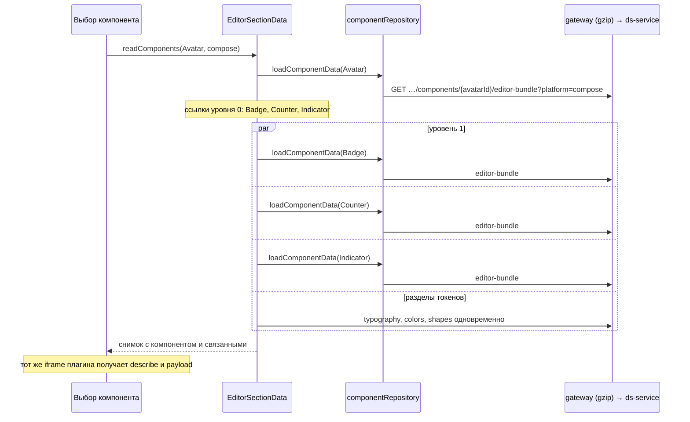

## Context

Выбор компонента в разделе «Компоненты» сейчас проходит так:

1. `EditorSectionData.readComponents` вызывает `readComponentDependencies(name, platform)`.
2. Тот в цикле с `await` вызывает `componentRepository.loadComponentData(context, signal, platform, name)`: сначала для выбранного компонента, затем по одному для каждого компонента, на стили которого он ссылается (`componentSectionReferences`).
3. Затем последовательно читаются разделы токенов, нужные панели и превью (`typography`, `colors`, `shapes`). Это происходит один раз на поколение.

Один вызов `loadComponentData` — это 11 чтений (Web) или 9 (Compose):

| Чтение | Область | Полный ответ | Нужное компоненту (`Button`) |
|---|---|---|---|
| `design-system-components` | вся ДС | 47 КБ | 0,2 КБ |
| `components` | глобальный каталог | 30 КБ | 0,2 КБ |
| `appearances` | все ДС проекта | 77 КБ | 0,3 КБ |
| `component-config/export` (POST) | компонент | 5 КБ | 5 КБ |
| `property-platform-params` | все свойства | 1004 КБ | 9 КБ |
| `property-variations` (только Web) | все свойства | 840 КБ | 6,6 КБ |
| `component-config/web-adapter` (POST, только Web) | вся ДС | 15 КБ | 0,3 КБ |
| `component-deps` | все связи | 25 КБ | 2,8 КБ |
| `components/{id}/properties`, `components/{id}/variations`, `design-systems/{ds}/components/{id}/styles` | компонент | 13 КБ | 13 КБ |

Все чтения проходят через `readEditor` (`api/editorReads.ts`). Он ограничивает поток: 4 запроса сразу, дальше один на 125 мс. Так клиент держится ниже лимита gateway (`limit_req rate=10r/s burst=20`).

Compose-превью: при смене компонента `ComponentEditorPreview` сбрасывает `lastComposePayload.current`, из-за этого `ComposePreviewFrame` размонтируется. Iframe уничтожается, и плагин заново скачивает и компилирует около 5,8 МБ Wasm, ждёт `ready` и только потом получает `describe` и payload.

В ds-service уже есть похожее чтение на одну сущность — `GET /api/ds/appearances/{id}/editor-model` (`AppearanceEditorRoutes`, `GetAppearanceEditorModelUseCase`, `AppearanceEditorModelReader`). Его используем как образец устройства слоёв, OpenAPI, манифеста маршрутов и тестов.

## Goals / Non-Goals

**Goals:**
- Один компонент открывается одним запросом. Связанные компоненты — такими же запросами, одновременно по уровням ссылок.
- Разделы токенов, нужные компоненту, читаются одновременно.
- Compose-плагин запускается один раз за посещение раздела компонентов.
- JSON-ответы маршрутов дизайн-системы передаются сжатыми.
- Ответ нового эндпоинта собирается из тех же DTO, что и сейчас. Клиентская сборка `Meta` (`toLegacyComponentConfig`, `enrichApi`, `collectDependencies`) не переписывается.

**Non-Goals:**
- Изменение или удаление существующих списочных эндпоинтов. Их по-прежнему используют полная загрузка (`ThemeEditorSession`), раздел «Цвета», импорт и экспорт.
- Вложение связанных компонентов в ответ и разрешение ссылок на сервере.
- Лёгкий список для меню, предзагрузка при наведении, `ETag`/`304`, изменение лимитов, brotli.
- Показ панели до загрузки связанных компонентов (см. решение 5).

## Decisions

### 1. Новый эндпоинт `editor-bundle` в `feature-components`

```http
GET /api/ds/design-systems/{designSystemId}/components/{componentId}/editor-bundle?platform=web|compose[&versionId=]
```

Ответ `ComponentEditorBundleResponse` содержит списки из тех же DTO, что сейчас отдают отдельные маршруты, только ограниченные одним компонентом:

| Поле | DTO | Содержимое |
|---|---|---|
| `component` | `ComponentResponse` | сам компонент |
| `appearances` | `AppearanceResponse` | оформления компонента в этой ДС |
| `export` | `ExportComponentConfigResponse` | экспорт конфигураций компонента для `platform`, как `component-config/export` с `components=[имя]` |
| `properties` | `ComponentPropertySummaryResponse` | свойства компонента |
| `platformParams` | `PropertyPlatformParamResponse` | платформенные параметры этих свойств |
| `propertyVariations` | `PropertyVariationResponse` | связи этих свойств с вариациями; пусто для `compose` |
| `variations` | `ComponentVariationSummaryResponse` | вариации компонента в контексте ДС |
| `styles` | стили компонента в ДС | тот же состав полей, что у `GET /design-systems/{ds}/components/{id}/styles` |
| `webAdapter` | `ComponentWebAdapterEntryResponse?` | запись web-адаптера компонента; `null` для `compose` |
| `dependencies` | `ComponentDependencyResponse` | связи, где компонент родитель или дочерний |
| `dependencyComponents` | `ComponentResponse` | компоненты по другую сторону этих связей, привязанные к той же ДС и платформе |

Почему так:
- **Те же DTO, что и раньше.** Клиент кладёт поля ответа в те же переменные, что и сейчас, и вся дальнейшая сборка не меняется. Риск расхождения правил сводится к фильтрации, и её можно проверить тестом сравнения со старыми маршрутами.
- **Платформа в запросе.** Экспорт и состав полей зависят от платформы. Один и тот же компонент Web и Compose — это разные строки `components`, а `platform` проверяет, что выбран компонент нужной платформы.
- **Компонент не привязан к ДС, недоступен или другой платформы → `404`.** Не привязан или недоступен — как у `design-systems/{ds}/components/{id}/styles`. Другая платформа — так же, чтобы не раскрывать соседние данные. Недопустимое `platform` → `400`.
- **Права:** `components:variations:read`, как у `editor-model`. Владение проверяется через ДС (`via-design-system`).
- **`versionId`:** контекст `TrustedDsRequestContextMapper`, чтение в `ExposedTransactionRunner.readOnly(context)`. Таблицы, разрешаемые по версии (оформления, вариации, стили, связи ДС), читаются из выбранной версии. Свойства, их параметры, вариации свойств и зависимости хранятся вне версий и читаются так же, как сейчас у списочных маршрутов. Семантика полностью совпадает с текущим набором чтений.

Слои:
- **presentation:** `ComponentEditorBundleRoutes` и DTO ответа; маршрут внутри `route("/api/ds/design-systems")` модуля `feature-components`.
- **application:** `GetComponentEditorBundleUseCase` — права, проверка платформы, вызов порта; порт `ComponentEditorBundleRepository`.
- **domain:** `ComponentEditorBundle` — данные пакета из существующих доменных моделей.
- **data:** `ExposedComponentEditorBundleRepository` — один read-only запуск транзакции. Внутри используются существующие запросы с добавленными фильтрами: по `propertyId` для платформенных параметров и вариаций свойств, по `componentId` и `designSystemId` для оформлений. Зависимости берутся из `ComponentRepository.dependencies`, экспорт — из `ComponentConfigRepository.export` с фильтром по имени. Стили — запросом по вариациям компонента и ДС, как в `/styles/by-variation/{id}/by-design-system/{ds}`.
- **di:** регистрация в `ComponentModelModule`; маршрут подключается в `registerComponentsFeature` (`Application.kt`).

Альтернативы:
- **Фильтры `?componentId=` у списочных маршрутов.** Байты уменьшаются так же, но запросов остаётся 9–11 на компонент, и при клиентском кеше они конфликтуют. Отклонено по замерам (см. proposal).
- **Расширить `editor-model` оформления.** Он про одно оформление и про редактирование осей, а нам нужен компонент целиком со всеми оформлениями и API-метой. Смешивать нельзя.
- **Возвращать готовую клиентскую `Meta`.** Это перенос клиентских правил сборки (шаблоны, сопоставление имён) на сервер. Слишком широко.

### 2. Клиент: путь выбранного компонента через `editor-bundle`

`componentRepository.loadComponentData` при заданном `componentName` выполняет один запрос `editor-bundle` (через `readEditor`, с `versionId` из `readRequest`). Его поля заполняют те же переменные `links`, `catalog`, `appearances`, `exported`, `params`, `propertyVariations`, `adapter`, `dependencies`, `properties`, `variations` и `styles`. Ниже по коду ничего не меняется. Без `componentName` поведение прежнее.

Компонент идентифицируется по `componentId` из индекса (`serverBinding.componentId`), а не по имени. `readComponentDependencies` берёт его из снимка, связанные компоненты — из записей индекса с тем же именем и платформой.

### 3. Связанные компоненты загружаются по уровням ссылок

`readComponentDependencies` переходит от очереди по одному к обходу в ширину:
- уровень 0 — выбранный компонент;
- уровень N+1 — ещё не посещённые компоненты, на стили которых ссылаются компоненты уровня N.

Запросы уровня запускаются через `Promise.all`. Затем результаты по очереди, в исходном порядке ссылок, вливаются в снимок. Множество посещённых не даёт загрузить компонент дважды. Одновременность по-прежнему регулирует `readEditor`.

### 4. Разделы токенов читаются одновременно

В `readComponents` цикл `for (const section of dependencies) await this.read({ section })` заменяется на одновременный запуск чтений разделов. Каждое чтение вливает свои токены в снимок синхронно после своего `await` (`mergeSectionTokens(this.snapshot, …)`), поэтому обновления не теряются. Чтение оболочки (`shellStale`) выполняется до запуска разделов, чтобы его не запустили несколько чтений сразу. Разделы начинают читаться, как только пришёл ответ уровня 0: от его свойств зависит, какие разделы нужны. Их чтение идёт одновременно с уровнем 1.

### 5. Панель не показывается раньше связанных компонентов

Вариант «показать панель до связанных компонентов» рассматривался и в этом изменении не делается. После решений 1–3 загрузка связанных компонентов — это один параллельный раунд маленьких запросов (десятки миллисекунд). Двухфазная выдача результата из `EditorSectionData` в `ThemeEditorSession` усложнила бы защиту от поздних ответов и инвалидаций ради малого выигрыша. Вернуться к нему стоит, если после замеров ожидание останется заметным.

### 6. Compose-плагин живёт на уровне раздела компонентов

Хост плагина (`ComposePreviewFrame` с сессией) выносится из `ComponentEditorPreview` на уровень страницы раздела (`pages/components/Components.tsx`). Там он монтируется один раз, когда у ДС есть Compose-компоненты и доступен адрес плагина. Так плагин прогревается при входе в раздел, а не при первом Compose-клике. Превью компонента показывает этот iframe в своей области, а не создаёт свой. Перенос iframe в другой узел DOM перезагружает его, поэтому iframe остаётся в стабильном узле страницы и позиционируется над областью превью.

При смене компонента:
- предыдущий кадр закрывается состоянием загрузки до `success` нового payload;
- `describe` и payload отправляются в ту же сессию;
- при переходе на Web-компонент iframe скрывается, но не размонтируется.

Перезапуск после `render_crashed`/`plugin_crashed` остаётся прежним. Сессия уничтожается при уходе из раздела, смене адреса плагина или контекста ДС.

Альтернатива: не сбрасывать payload и держать `ComposePreviewFrame` в `ComponentEditorPreview`. Не работает, если `ComponentEditor` размонтируется на время загрузки следующего компонента. Сейчас он возвращает `null`, пока нет `config`.

### 6а. Смена компонента не размонтирует страницу раздела

Сейчас выбранный компонент входит в ключ раздела `useDesignSystem` (`selection = { section, component }` → `sectionKey`). На время его загрузки `sectionLoading` становится `true`, и `Main.tsx` вместо `<Outlet>` показывает спиннер на всю область редактора. Из-за этого размонтируются вся страница «Компоненты», меню, шапка и `ComposePreviewHostProvider`, а значит, плагин всё равно перезапускается на каждом клике, вопреки решению 6.

Решение:
- `useDesignSystem` различает загрузку раздела и загрузку компонента. `sectionLoading` считается по ключу без компонента: контекст, версия, раздел. Новый `componentLoading` показывает, что раздел уже загружен, а ключ отличается только выбранным компонентом. Ошибка компонента отдаётся отдельно (`componentError`), а не через `sectionError`.
- `Main.tsx` показывает спиннер на всю область только при `isSectionSwitching`, `isEditorLoading` и `sectionLoading`. `componentLoading` и `componentError` передаются странице через контекст `Outlet`.
- `Components.tsx` при `componentLoading` оставляет меню, шапку и хост плагина. В областях настройки и превью он показывает состояние загрузки, при `componentError` — ошибку с повтором. Меню отмечает выбранный компонент сразу по URL.
- Защита от поздних ответов не меняется: результат применяется, только если ключ запроса совпадает с текущим.

Альтернатива: оставить общий спиннер, но поднять хост плагина выше `Outlet` в `Main.tsx`. Плагин бы выжил, но меню и шапка всё равно мигали бы. Это то, что пользователь просит убрать.

### 7. gzip в gateway только для JSON маршрутов дизайн-системы

В `location ~ ^/api/projects/([^/]+)/ds(/.*)?$` обоих конфигов (`nginx.local.conf`, `nginx.prod.conf.template`):

```nginx
gzip on;
gzip_types application/json;
gzip_min_length 1024;
gzip_comp_level 5;
gzip_proxied any;
gzip_vary on;
```

Почему так:
- **Только `location` дизайн-системы.** Маршруты Keycloak и `/auth/...` с токенами не меняются. Риск атаки BREACH, то есть подбора секрета по размеру сжатого ответа, для `ds`-маршрутов низкий: авторизация идёт заголовком, не cookie, и в ответах нет секретов.
- **Только `application/json`.** Поток SSE `…/events` (`text/event-stream`) идёт через тот же `location`, и сжатие копило бы события в буфере.
- **`gzip_proxied any`.** На стенде перед gateway может стоять внешний прокси.
- **Уровень 5.** Почти та же степень, что на 9, при меньшей нагрузке на процессор.

После решения 1 ответы выбора компонента и так маленькие (15–40 КБ). gzip остаётся полезен для остальных тяжёлых ответов: полная загрузка, списки токенов, `property-platform-params` в разделе «Цвета».

Альтернативы: сжатие в ds-service через Ktor `Compression` (gateway и так единая точка входа) и brotli (нет в стандартном образе nginx). Обе отклонены.

### Поток данных



Ожидаемое:

| Сценарий | Сейчас | После |
|---|---|---|
| Web `Button` | 11 запросов, ≈2 МБ | 1 запрос, ≈35 КБ (сжатый — меньше) |
| Compose `Avatar` с тремя связанными | ≈36 запросов, ≈4,7 МБ, 4 последовательных раунда | 4 запроса, ≈60 КБ, 2 раунда |
| Смена Compose-компонента | перезапуск плагина | тот же плагин: `describe` и payload |

## Программное проектирование

```kotlin
// feature-components / domain
data class ComponentEditorBundle(
    val component: Component,
    val appearances: List<Appearance>,
    val export: ComponentConfigExport,
    val properties: List<ComponentPropertySummary>,
    val platformParams: List<PropertyPlatformParam>,
    val propertyVariations: List<PropertyVariation>,
    val variations: List<ComponentVariationSummary>,
    val styles: List<ComponentStyleSummary>,
    val webAdapter: ComponentWebAdapterEntry?,
    val dependencies: List<ComponentDependency>,
    val dependencyComponents: List<Component>,
)

// feature-components / application
interface ComponentEditorBundleRepository {
    /** null — ДС или компонент недоступны, компонент не привязан к ДС или другой платформы. */
    suspend fun load(
        context: DsRequestContext,
        designSystemId: UUID,
        componentId: UUID,
        platform: ComponentPlatform,
    ): ComponentEditorBundle?
}

class GetComponentEditorBundleUseCase(
    private val policy: DsAccessPolicy,
    private val repository: ComponentEditorBundleRepository,
) {
    suspend operator fun invoke(
        context: DsRequestContext,
        designSystemId: UUID,
        componentId: UUID,
        platform: ComponentPlatform,
    ): ComponentEditorBundle // NotFound → 404
}

// feature-components / presentation
fun Route.componentEditorBundleRoutes(useCase: GetComponentEditorBundleUseCase)
@Serializable data class ComponentEditorBundleResponse(/* поля из таблицы решения 1 */)
```

```ts
// js/apps/client/src/api/editorContracts.ts
export interface ComponentEditorBundleDto {
    component: ComponentDto;
    appearances: AppearanceDto[];
    export: ComponentConfigExportDto;
    properties: ComponentPropertyDto[];
    platformParams: PropertyPlatformParamDto[];
    propertyVariations: PropertyVariationDto[];
    variations: ComponentVariationDto[];
    styles: ComponentStyleDto[];
    webAdapter: WebAdapterComponentDto | null;
    dependencies: ComponentDependencyDto[];
    dependencyComponents: ComponentDto[];
}

// js/apps/client/src/api/componentRepository.ts — сигнатура loadComponentData не меняется;
// при заданном componentName данные берутся из одного editor-bundle.
loadComponentData(context, signal?, platform?, componentName?, componentId?): Promise<Meta[]>;

// js/apps/client/src/composePreview — хост плагина уровня раздела.
// Описание story приходит колбэками: после перезапуска плагина ComposePreviewFrame повторяет describe сам,
// поэтому отдельного промиса describe() у хоста нет.
export function ComposePreviewHostProvider(props: {
    pluginUrl?: string;
    scope?: string; // projectId:designSystemId:tenantId — смена пересоздаёт сессию
    preload?: boolean; // прогрев при входе в раздел, если у ДС есть Compose-компоненты
    children: ReactNode;
}): JSX.Element;
export function useComposePreviewHost():
    | {
          render(request: { owner: string; payload?: PreviewPayload; onDescription?; onDescriptionError? }, slot: HTMLElement): void;
          hide(owner: string): void;
      }
    | undefined;
// Область превью компонента; без провайдера рисует собственный ComposePreviewFrame, как раньше.
export function ComposePreviewSlot(props: { pluginUrl: string; owner: string; payload?: PreviewPayload; onDescription?; onDescriptionError? }): JSX.Element;
// Iframe живёт в слое position: fixed страницы раздела и каждый кадр (requestAnimationFrame) совмещается
// с getBoundingClientRect области; обрезка по предкам — clip-path. Для Web-компонента слой получает
// opacity: 0, pointer-events: none и inert, но не размонтируется.
```

## Risks / Trade-offs

- **[Риск] Правила фильтрации на сервере разойдутся с клиентскими правилами отбора из полных списков.** → HTTP-тест на Postgres сравнивает каждое поле ответа с результатом старых маршрутов, отфильтрованным по тем же правилам, на Web- и Compose-компоненте. Клиентский тест сравнивает `Meta` из `editor-bundle` с `Meta` из старого пути на одном фикстурном наборе.
- **[Риск] Расхождение по `versionId` для таблиц вне версий.** → Повторяется поведение текущих маршрутов. Тест читает опубликованную версию через `?versionId=`.
- **[Риск] Новый маршрут меняет счётчик операций OpenAPI.** → Обновить `OpenApiDocumentResourceTest`, `route-manifest.json` и `documentation.yaml` в одном коммите.
- **[Риск] iframe над областью превью съедет при прокрутке или изменении размеров.** → Позиция берётся из области превью через `ResizeObserver` и пересчитывается при прокрутке контейнера. Если это окажется хрупким, запасной вариант — держать iframe в фиксированной области превью страницы, а `ComponentEditorPreview` оставляет под него место.
- **[Риск] gzip задержит SSE.** → `text/event-stream` не входит в `gzip_types`, это проверяется скриптом.
- **[Риск] На стенде внешний прокси уже сжимает или снимает сжатие.** → Внешняя проверка заголовков на DEV до архивирования.
- **[Компромисс] Существующие списочные маршруты остаются тяжёлыми** для полной загрузки и раздела «Цвета». Это вне скоупа, частично это закрывает gzip.

## План проверки и развёртывания

- **backend-kt:** `./gradlew :ds-service:app:test --tests '*ComponentEditorBundle*'` и `OpenApiDocumentResourceTest`, затем `./gradlew build` в `backend-kt`. Запускать с `JAVA_TOOL_OPTIONS=-Dapi.version=1.44` на Docker 29.
- **js/client:** `npm test`, `npx tsc --noEmit`, `npm run build`.
- **Gateway:** `nginx -t` для обоих конфигов и скрипт проверки сжатия.
- **Ручная проверка на локальном контуре:** число запросов и время во вкладке Network для Web `Button` → Web `Avatar` и Compose `Avatar` → Compose `ButtonGroup`. Смена Compose-компонента не перезагружает `.wasm`.
- **Развёртывание:** ds-service и gateway выкатываются раньше клиента или вместе с ним. Новый клиент без нового эндпоинта получает `404` на `editor-bundle`. Откат — откат клиента, старые маршруты не менялись.
