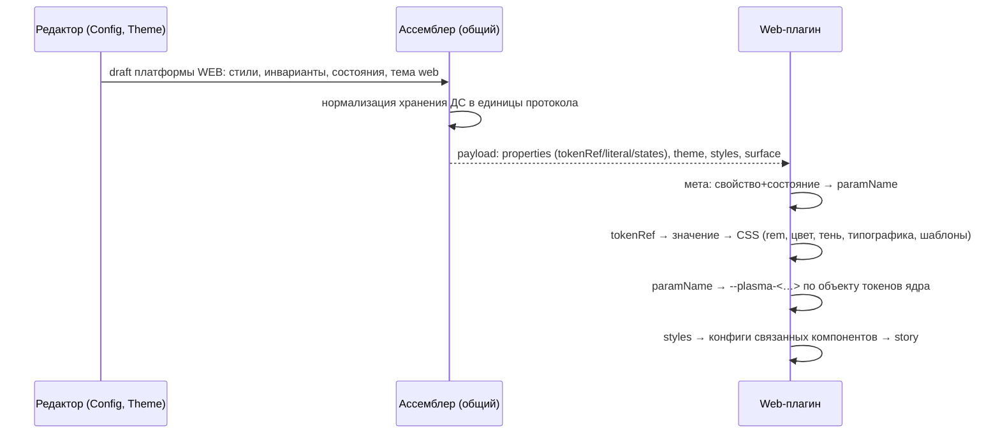

## Context

В пилоте и следующем изменении web-плагин получает payload, отличный от Compose:
- **`component.properties`** — web-параметры компонента с готовыми CSS-строками. Клиент получает их через `getWebTokenValue`: токены темы разрешены, размеры в `rem`, шаблоны и корректировки применены, состояния выражены суффиксами `Hover`/`Active`.
- **корневое поле `web`** — `themeVariables` (бывший `createThemeVars`), `fontFamily`, `background`, `relatedComponents` (полные конфиги дочерних компонентов в CSS) и `relatedProperties`. Схема его не описывает.

Compose-путь устроен иначе. Общий ассемблер (`composePreview/draft.ts` + `assembler.ts`) отдаёт свойства по каноническому имени, источники `tokenRef`, `literal`, `styleRef`, состояния через `states` и токены темы в структурах схемы. Вложенные стили приходят через `styles`. Перевод в типы Compose делает плагин сгенерированными фабриками.

Что есть для web-плагина:
- **API-мета** `api-meta.json` (`plasma-new-hope` 0.386.0): по компоненту `params[{paramName, type, id, state?}]`, где `id` — имя свойства, а `paramName` — ключ токена ядра (например, `buttonBackgroundColorActive` для `backgroundColor` + `pressed`).
- **Шаблоны многозначных свойств** (`$1`) лежат в статичном `js/cli/.sdds/web/web-adapter.json`: 21 компонент, `свойство → {ключ ядра: шаблон}`, например `Button.iconMargin → buttonLeftContentMargin: "0 $1 -0.125rem"`. Файл генерируется один раз и не меняется. Те же шаблоны продублированы в базе ds-service как web-корректировки (`variation_platform_param_adjustments`: 1230 записей, все web, у Compose 0, значения почти целиком шаблоны вида `0 $1`).
- **Web-значения токенов в ДС** хранятся строками: `rem`, тени и градиенты CSS-строками, шрифты `woff2`, `letterSpacing: "normal"`.

Схема v1: ресурсы только `TTF`, `OTF`, `SVG`, `PNG`; у типографики нет `fontStyle`; запись `styles` — `{component, properties}`. Декодер контракта в plasma-android настроен с `ignoreUnknownKeys = true`.

## Goals / Non-Goals

**Goals:**
- Один формат payload для `COMPOSE` и `WEB` по одной схеме и одним ассемблером в клиенте.
- Клиент не знает web-библиотеку: ни имён параметров и переменных ядра, ни CSS, ни единиц `rem`.
- Web-плагин делает всё преобразование сам по своей API-мете, как Compose-плагин.
- Обратносовместимое расширение схемы, без изменения кода Compose-плагина.

**Non-Goals:**
- Публикация web-плагина в S3 и импорт меты при публикации.
- Удаление story и React-превью из клиента.
- Генератор пакета `js/cli` на мете плагина.
- Новые возможности протокола сверх нужного web (анимации, адаптивная типографика по размерам экрана).

## Decisions

### 1. Один ассемблер с платформой компонента

`ComposePreviewDraft` и ассемблер получают платформу (`COMPOSE` | `WEB`) из `config.getPlatform()`. От неё зависят три вещи:
- `payload.platform`;
- значения токенов: `values.android` для Compose, `values.web` для web;
- отбор свойств: у web — по наличию web-параметра (`platformMappings.web`) вместо Compose-параметра. Логика `missing_mapping` и пропуска свойств чужой платформы та же.

Свойства идут по каноническому имени, состояния — через `states`, корректировки ассемблер применяет как сейчас. `webPayload.ts`, тип `WebPreviewPayload` и поле `web` удаляются. `ComponentEditorPreview` для web-рендерера вызывает тот же ассемблер.

Альтернатива — оставить для web отдельный сборщик, но в формате схемы. Тогда два кода делают одно и то же и расходятся. Отклонено.

### 2. Клиент переводит хранение ДС в единицы протокола, и только это

Web-значения токенов хранятся CSS-строками. Ассемблер нормализует их в структуры схемы, так же как сейчас нормализует Android-значения:

| Хранение (web) | Протокол |
|---|---|
| `"0.75rem"`, `"12px"` | `dimension` 12 (px) |
| `"#FFFFFFF5"`, `"rgba(…)"` | `color` `#RRGGBBAA` |
| `"0 4px 12px -2px rgba(0,0,0,.2), …"` | `shadow.layers[{x, y, blur, spread, color}]` |
| `"linear-gradient(90deg, …)"` | `gradient.layers[{kind, angle, stops}]` |
| typography `{fontSize: "1rem", lineHeight: "1.5rem", letterSpacing: "normal", fontWeight: "600", fontStyle}` | `typography {fontSize, lineHeight, letterSpacing: 0, weight, fontStyle?}` |
| fontFamily `{name, fonts[{src: "url(…woff2) format('woff2')", fontWeight, fontStyle}]}` | `fontFamily.faces` + `assets` типа `WOFF2` |

Это знание формата хранения дизайн-системы, а не библиотеки: те же разборы нужны генератору пакета и импорту. Разбор CSS-строк выносится в отдельный модуль клиента (`composePreview/webTokenValues.ts`) с тестами на реальные значения темы `base`.

Альтернатива — передавать web-значения как есть, строками. Тогда формат снова расходится с Compose, а схема не проверяет значения. Отклонено.

### 3. Web-плагин владеет переводом в стили

Новый слой плагина `src/resolve/`:
- **`meta.ts`** — `api-meta.json` импортируется в бандл (`import meta from '../public/api-meta.json'`). Индекс `компонент → (свойство, состояние) → paramName`. Значения состояний меты `hovered` и `pressed` сопоставляются `when` из `states`; комбинации состояний — по последнему подходящему, как правило схемы о `states`.
- **`tokens.ts`** — разрешение `tokenRef` по `theme`, применение `alpha`, перевод в CSS:
  - `dimension` px → `rem` (база 16);
  - `shape.cornerRadii` → `border-radius`;
  - `shadow.layers` → `box-shadow`;
  - `gradient` → `linear-gradient`;
  - `color` `#RRGGBBAA` → hex8.
- **`typography.ts`** — токен `typography` (и его `fontFamilyTokenId`) → значения параметров типографики ядра: `fontFamily`, `fontSize`, `fontWeight`, `fontStyle`, `letterSpacing`, `lineHeight`. Параметр выбирается по `type` меты и суффиксу `paramName`, как это сейчас делает `typography.ts` клиента.
- **`templates.ts`** — шаблоны многозначных свойств из `web-adapter.json` в бандле плагина (файл переносится из `js/cli/.sdds/web`), подстановка `$1…$n`.
- **`theme.ts`** — CSS-переменные окружения из цветовых токенов `theme` по правилу бывшего `createThemeVars` (`dark.text.default.primary` → `--text-primary`), фон из `surface.background`, шрифт из токена шрифта тела, `@font-face` из `assets` (`WOFF2`/`WOFF`/`TTF`/`OTF`).
- **`related.ts`** — конфиги связанных компонентов из `styles` с `variation`, `name` и `invariant`. Стиль по умолчанию каждой вариации ассемблер помечает в записи `styles` полем `default: true`. Затем конфиг объединяется с конфигом ядра через `mergeConfig`.

`cssVariables.ts` (объекты токенов ядра и исключения) остаётся. Отрисовка (`render.tsx`), реестр, story и `describe` не меняются.

Свойство, которого нет в мете для компонента, не рисуется, а в `success` уходит предупреждение `unmapped_property`. Так Compose-плагин поступает с неподдержанными значениями.

Альтернатива — генерировать по мете код при сборке, как Compose. Для web это не нужно: перевод — это поиск по словарю во время работы, типизированные билдеры не нужны.

### 4. Связанные компоненты — через `styles`

Для web-компонента ассемблер добавляет в `styles` каждый стиль каждой вариации и инварианты каждого компонента из зависимостей выбранного, то есть тот же набор, что `createRelatedComponents`:

```jsonc
"styles": {
  "Button/view/accent":    { "component": "Button", "variation": "view", "name": "accent", "default": true, "properties": { "backgroundColor": { "base": { "type": "tokenRef", "tokenId": "dark.surface.solid.accent" } } } },
  "Button/view/secondary": { "component": "Button", "variation": "view", "name": "secondary", "properties": { … } },
  "Button/invariants":     { "component": "Button", "invariant": true, "properties": { … } }
}
```

Токены, на которые они ссылаются, попадают в `theme`. Общие переменные зависимостей `compose` (бывший `relatedProperties`) плагин строит сам: стиль связанного компонента с тем же именем вариации, что у выбранного стиля родителя, — правило `createRelatedComponentVars` переезжает в плагин.

Альтернатива — отдельное поле `components` в корне. Это новое понятие в схеме ради того, что выражается существующими `styles`. Отклонено.

### 5. Расширение схемы v1 без смены версии

Только необязательные поля:
- `asset.type`: + `WOFF`, `WOFF2`;
- `typography.fontStyle?`: `NORMAL` | `ITALIC`;
- `style.variation?`, `style.name?`, `style.invariant?`, `style.default?`.

Шаблоны и web-корректировки в payload не передаются: это знание web-библиотеки, оно лежит в плагине.

Обновляются README, `CONTRACT.sha256` и общие фикстуры: valid-фикстура со стилями связанного компонента и web-шрифтом, invalid — неизвестный тип ресурса остаётся. Web-фикстура `fixtures/v1/web/valid/web-button.json` переписывается в новый формат.

Копия в plasma-android синхронизируется `fingerprint.sh --sync-to` и отдельным PR. Декодер там с `ignoreUnknownKeys = true`, поэтому код Compose-плагина не меняется. Существующие фикстуры не меняются, Compose-тесты остаются зелёными.

Альтернатива — поднять версию протокола до v2. Изменения обратносовместимы, а v2 потребовал бы менять обработку версии у обоих плагинов. Отклонено.

### 5а. Подмены значений web-параметров — данные ДС

В базе в `variation_platform_param_adjustments` кроме шаблонов (1034 записи, все есть в `web-adapter.json`) лежат 168 записей (66 разных) с полем `value`: имя токена, которое заменяет значение свойства для конкретного web-параметра стиля. Например, `Chip.color` → `text.on-dark.primary`, `Button.backgroundColor` → `surface.default.accent-hover`/`…-active`. Это данные дизайн-системы для платформы web, в `web-adapter.json` их нет.

Решение: ассемблер для `WEB` берёт подмену как значение свойства на этой платформе (`tokenRef` на токен подмены), так же как значения токенов темы выбираются по платформе. Знания библиотеки в клиенте не появляется, формат payload не меняется. Если у одного свойства несколько web-параметров с разными подменами, по имени свойства их не выразить. Такие случаи проверяются при реализации, и при их наличии формат решается отдельно, до продолжения работы. 28 пустых записей (без значения и шаблона) игнорируются.

### 6. Из клиента уходит web-рендер

Удаляются:
- React-путь `ComponentEditorPreview`;
- `src/stories` (57 файлов) и `hooks/useStory.ts`;
- `controllers/componentPreview` (`coreTokens.ts`, `themeConfig.ts`, `componentVars.ts`);
- `createComponentVars`, `createThemeVars`, `createThemeConfig`, `createRelatedComponents` и `createRelatedComponentVars` с их вызовами в `ComponentEditor`.

Перед удалением проверяется, что эти функции нужны только превью. Если что-то из них использует, например, раздел «Цвета» (связи токенов, канвас), общая часть переносится в модель ДС без знания о web-библиотеке. Без плагина область превью показывает «Превью недоступно» с причиной, а панель настройки работает. Аргументы story и выбор story приходят от плагина через `describe`, как уже сделано.

Альтернатива — оставить React-превью запасным. Это противоречит цели: знание библиотеки и вторая копия story остаются в клиенте.

### 7. Совпадение с генератором пакета `js/cli`

Генератор пакета (`js/cli/src/generator/componentBuilder`) — копия того же `componentBuilder`: `Prop`, `getWebTokenValue`, шаблоны, корректировки, разложение типографики. По сути он решает ту же задачу, что новый слой `resolve/` плагина: «значения ДС + мета + шаблоны → параметры ядра `plasma-new-hope`». Только генератор пишет результат в исходный код пакета, а плагин применяет его во время работы.

В этом изменении код плагина пишется так, чтобы его ядро не зависело от DOM и React: чистые функции «payload → значения параметров ядра». Тогда в следующем изменении генератор пакета сможет перейти на тот же модуль и на мету и шаблоны плагина вместо своей копии `componentBuilder` и своего `node_modules`. Перенос генератора в этот change не входит.

### 8. Переменные типографики темы — из токенов ДС в плагине

Данные `base` ссылаются на тему CSS-строками `var(--plasma-typo-…)`: Bold и Medium у `Text`, `Body`, `Heading` и `Dspl` (`var(--plasma-typo-text-m-bold-font-weight)`), шрифт у `Avatar` и `Dropdown`. Прежнее React-превью получало эти переменные случайно, из темы интерфейса самого билдера (`plasma_infra`), а не из темы ДС. В плагине их нет, поэтому Bold и Medium не применяются.

Решение: ассемблер для `WEB` кладёт в `theme` все типографические токены текущего экрана и их шрифты, как цветовые токены окружения. Плагин строит из них переменные по правилу генератора тем: имя токена через дефис, суффикс `normal` опускается, затем поле (`text.m.bold` → `--plasma-typo-text-m-bold-font-weight`, `text.m.normal` → `--plasma-typo-text-m-font-weight`). Поля — `font-family`, `font-size`, `font-style`, `font-weight`, `letter-spacing`, `line-height`, а также `--plasma-typo-<группа>-font-family` по шрифту группы. Клиент знаний о CSS-именах не получает.

### 9. Производные токены состояний — в плагине

Ассемблер сейчас сам подставляет `<токен>-hover` и `<токен>-active` в состояние цвета без значения. Это соглашение имён темы web, а в клиенте его быть не должно.

Решение: ассемблер передаёт в `states` только состояния со значением. Плагин для цветового свойства с `tokenRef` берёт ключи состояний `hovered` и `pressed` из меты. Если в `states` нет записи для такого состояния, а в `theme` есть `<tokenId>-hover` или `<tokenId>-active`, плагин использует этот токен. Токен ищется под тем же именем и среди цветов окружения с режимом (`dark.<tokenId>-hover`): свойства ссылаются на токены без режима, а цвета окружения приходят с ним, и в payload всегда один режим.

Это шире прежнего клиента. Тот выводил токен только для состояния, объявленного в конфигурации без значения. Плагин выводит его для любого состояния, у которого есть параметр в мете, а явной записи нет. В данных `base` состояний без значения 14, все пустые строки у `Skeleton`. Основная разница: у цвета с явным `hovered`, но без `pressed` теперь задаётся и `-active` из темы.

### 10. Клиент больше не читает web-шаблоны и не зависит от `plasma-new-hope`

Шаблоны из `component-config/web-adapter` и поля `webAdapter` editor-bundle клиент кладёт в `platformMappings.web[].adjustment`, и это поле больше никто не читает. Запрос и поле убираются: `templateLookup`, `WebAdapterComponentDto`, чтение `component-config/web-adapter` в списочной загрузке. Поле `webAdapter` в ответе editor-bundle ds-service остаётся, пока шаблоны не удалены из базы отдельным изменением. `@salutejs/plasma-new-hope` в клиенте не импортируется, зависимость удаляется из `package.json`. UI билдера использует `plasma-b2c`, `plasma-icons`, `plasma-themes`, `plasma-colors` и `plasma-tokens-utils`.

### 11. Канвас «Цвета» загружает выбранный компонент

С ленивой загрузкой компонентов (#109, `speed-up-component-preview-loading`) раздел «Цвета» знает компоненты только по индексу. Выбор вида канваса перечисляет все компоненты, а данные есть только у уже открытых в разделе компонентов. Остальные приходят на канвас пустыми заглушками и рисуются криво, и в прежнем React-пути тоже.

Решение: при открытии выбора вида канваса клиент читает индекс компонентов (без него в свежем разделе «Цвета» список пуст), а при выборе компонента загружает его и связанные компоненты превью тем же загрузчиком, что раздел компонентов (`EditorSectionData.loadComponent`), не меняя активный раздел. Пока данных нет, канвас показывает загрузку, а не компонент. Связи токенов и пары контраста по всем компонентам («Доступность», удаление токена) этим не чинятся. Это отдельная задача ленивой загрузки.

### Поток



## Программное проектирование

```ts
// js/apps/client/src/composePreview/draft.ts
export type PreviewRendererPlatform = 'COMPOSE' | 'WEB';
export interface ComponentPreviewDraft { rendererPlatform: PreviewRendererPlatform; themeValuePlatform: 'android' | 'web'; /* … */ }

// js/apps/client/src/composePreview/webTokenValues.ts
export function normalizeWebTokenValue(type: TokenDefinitionDto['type'], raw: JsonValue): PreviewTokenValue | PreviewDiagnostic;

// js/apps/client/src/composePreview/assembler.ts
export function assembleComposePreviewPayload(draft: ComponentPreviewDraft): AssemblyResult; // платформа из draft

// js/apps/preview-web-plugin/src/resolve/index.ts
export interface ResolvedPreview {
    variables: Record<string, string>;            // CSS-переменные ядра компонента и темы
    relatedComponents: Record<string, unknown>;   // для story
    fontFaces: string;                            // @font-face из assets
    warnings: PreviewWarning[];
}
export function resolvePayload(payload: PreviewPayload, meta: ApiMeta): ResolvedPreview;
```

## Risks / Trade-offs

- **[Риск] Разбор CSS-строк web-значений в клиенте** (тени, градиенты, `rgba`) неполон. → Тесты на все web-значения темы `base`. Нераспознанное значение даёт диагностику `incompatible_value`, как сейчас для Android.
- **[Риск] Перевод в плагине расходится с тем, что давал прежний React-путь** (`getWebTokenValue`): порядок перекрытия, шаблоны, типографика. → До удаления React-пути из клиента CSS-переменные для набора стилей `Button`, `ButtonGroup`, `Tabs` и `Typography` один раз снимаются и сохраняются фикстурой плагина. Тест `resolvePayload` сверяется с ней. После этого в клиенте этого кода нет. Итог сверки (14 кейсов) — совпадение после трёх правок: `letterSpacing` в протоколе в px, плагин переводит в `em` от `fontSize`; родители по `compose` (`Tabs` у `TabItem`) не входят в `relatedComponents`; `transparent` и `#00000000` равны. Расхождение `--plasma-chip-width` (`NaNrem` у прежнего клиента, `auto` у плагина) — ошибка прежнего пути, принято. Фикстура и тест сверки удалены (задача 6.4).
- **[Риск] Payload вырастет** из-за полных `styles` связанных компонентов и токенов темы. → Это локальный `postMessage`, без сети. Payload пересобирается только при изменении содержимого.
- **[Риск] Синхронизация контракта с plasma-android.** → Отдельный PR в plasma-android в рамках изменения. Без него у plasma-android падают проверки отпечатка на `main`. Это внешняя проверка до архивирования.
- **[Компромисс] Web-шаблоны и корректировки остаются в базе ds-service до отдельного изменения.** Клиент и плагин их больше не читают. Удаление из базы, `components push` и `component-config/web-adapter` затрагивает схему ds-service и генератор пакета, поэтому делается отдельно.
- **[Риск] Без плагина web-превью нет вовсе.** На стендах плагин пока не публикуется, поэтому там превью web-компонентов пропадёт до публикации плагина. → Раздел компонентов на PROM выключен флагом. Для DEV публикацию стоит сделать следующим шагом, иначе там будет «Превью недоступно».
- **[Компромисс] Требования `web-preview-payload`** из незаархивированных изменений пилота и компонентов описывают старый формат. Их нужно убрать из этих изменений до архивирования.

## План проверки и развёртывания

- **Клиент:**
  - `npm test`: ассемблер для `WEB` (свойства, состояния, тема web, `styles` связанных компонентов, отбор по web-параметрам), нормализация web-значений, payload проходит схему; Compose-тесты без изменений; удалённого React-пути и его тестов нет;
  - `npx tsc --noEmit`, `npm run build`.
- **Плагин:**
  - `npm test`: `resolvePayload` (мета, состояния, единицы, типографика, шаблоны, тема, связанные компоненты), сравнение с фикстурой CSS-переменных, снятой с прежнего React-пути до его удаления, смоук по реестру на новом формате, `invalid_payload` на старом;
  - `npx tsc -b`, `npm run build`.
- **Контракт:** тест схемы клиента принимает новые фикстуры, `fingerprint.sh --write`, затем `--check`.
- **plasma-android:** `fingerprint.sh --sync-to`, `jvmTest` модуля `preview-contract` и Compose-плагина. Это внешняя проверка: PR в plasma-android.
- **Ручная проверка:** `Button`, `ButtonGroup`, `Tooltip`, `Tabs`, `Typography` рисуются плагином как раньше; без плагина — «Превью недоступно».
- **Выкладка:** клиент и web-плагин выкатываются вместо прежней пары. На стендах без опубликованного web-плагина превью web-компонентов недоступно до шага публикации. Старый web-плагин новый payload отвергнет (`invalid_payload`), и клиент покажет ошибку. Пока плагин только локальный, это касается только локального контура.
