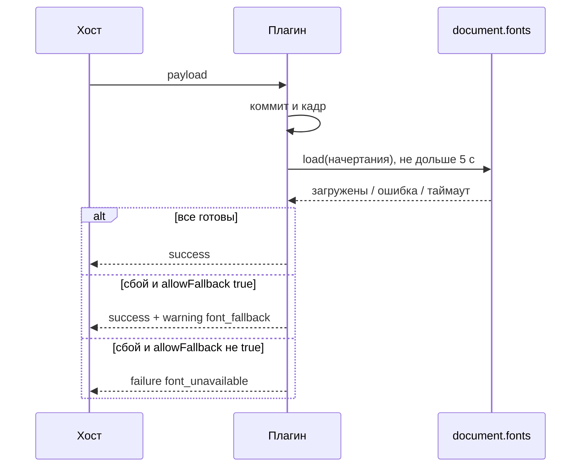

## Контекст

`projectThemeValue` превращает сплошное значение градиента в слой `{ kind: 'color', background }`: через этот объект раскрываются ссылки на палитру, и его же понимает Android-ветка ассемблера. Web-ветка (`normalizeGradient` в `webTokenValues.ts`) принимает только строки, поэтому такой токен даёт `incompatible_value`.

`RenderedSignal` завершает отрисовку после кадра или через 50 мс. Шрифты подключаются правилами `@font-face` с `font-display: swap`, их загрузка никак не отслеживается. ADR-0006 требует завершить подготовку темы до `rendered` и возвращать warning при fallback. `ComposePreviewFrame` при этом не читает `warnings` успешного результата. Хост ждёт ответа 10 секунд (`requestTimeoutMs`).

## Цели / Вне целей

**Цели:**

- Сплошной градиент проходит сборку web-payload от черновика до протокола.
- `success` означает, что шрифты готовы либо их отсутствие явно диагностировано.

**Вне целей:**

- Отображение warnings в интерфейсе конструктора.
- Проверка digest и кеш ресурсов из ADR-0006.
- Изменение значения `allowFallback`: ассемблер по-прежнему ставит `true`.

## Решения

### Нормализатор принимает слой `color`, ассемблер не меняется

Строковый разбор остаётся, к нему добавляется объект `{ kind: 'color', background }`: его `background` идёт по той же ветке, что и однотонная строка. Отказ от обёртки в `projectThemeValue` для web отвергнут: функция работает одинаково для всех платформ, а ссылки на палитру раскрываются именно в этом объекте.

### Загрузка через `document.fonts.load`

`fontFaces` дополнительно возвращает список начертаний (`family`, `weight`, `style`, `tokenId`, `allowFallback`) в `resolved.fontLoads`. После коммита и кадра `RenderedSignal` вызывает `document.fonts.load()` для каждого начертания и ждёт всех результатов. Явный вызов нужен, потому что `document.fonts.ready` не запускает загрузку шрифтов, которые ещё не применены к тексту, и не сообщает, какой шрифт не загрузился. Если `document.fonts` отсутствует (jsdom), ожидания нет.



### Таймаут 5 секунд

Запас до 10 секунд хоста нужен, чтобы плагин успел ответить диагностикой, а не сработал таймаут хоста. Таймаут считается как недоступный шрифт. Шрифт, догрузившийся позже, браузер подставит сам благодаря `font-display: swap`. Предел общий на запрос, а не на начертание, иначе сумма могла бы превысить таймаут хоста.

### Отсутствие `allowFallback` запрещает подмену

Поле в протоколе плагина необязательное. По ADR-0006 подмена разрешена, только когда указана явно, поэтому `undefined` равносильно `false`.

### Warnings на хосте — в консоль

`ComposePreviewFrame` выводит warnings успешного результата через `console.warn`. Этого достаточно для диагностики, интерфейс конструктора остаётся без изменений.

## Программное проектирование

```ts
interface ResolvedFontLoad {
    tokenId: string;
    family: string;
    weight: number;
    style: 'normal' | 'italic';
    allowFallback: boolean;
}

// resolved.fontLoads: ResolvedFontLoad[]
const waitForFonts: (loads: ResolvedFontLoad[], fonts?: FontFaceSet, timeoutMs?: number) => Promise<ResolvedFontLoad[]>; // незагруженные

type RenderOutcome =
    | { ok: true; warnings?: PreviewWarning[] }
    | { ok: false; code?: string; message: string; stack?: string; componentStack?: string };
```

## Риски / Компромиссы

- [Медленный шрифт задерживает `success` на всех запросах плагина, идущих по очереди] → Предел 5 секунд на запрос; загруженные и уже упавшие шрифты браузер отдаёт сразу, поэтому повторная отрисовка не ждёт.
- [Компонент виден до `success`, пока шрифт грузится] → Поведение `font-display: swap` сохраняется, индикатор хоста показывает незавершённую отрисовку.
- [Ветка `font_unavailable` сейчас недостижима с реальным ассемблером] → Она реализует контракт протокола и покрыта тестом.
