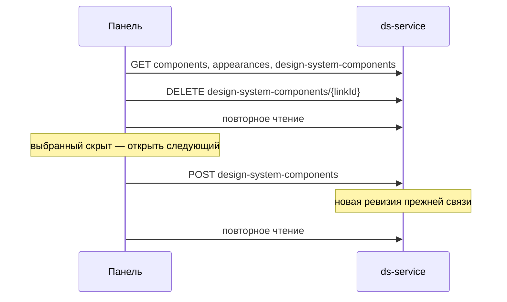

## Context

Источник поведения — прототип портала (`componentsEditor`, `componentAddDialog`). Интерактивно он не проверялся: расширение браузера не было подключено.

Текущее состояние:

- Панель — `MenuOld` с заглушкой поиска, `canAdd={false}`, `canDisable={false}`; страница компонентов — его единственный потребитель.
- Страницы цветов, типографики и размеров используют `TypographyTree`, `SizeTokenTree`, `ColorTokenTree`: это один набор разметки (`token-browser`, `sidebar-header`, `sidebar-search-field`, `token-tree-group`, `token-tree-heading`, `token-row`), но общего компонента нет, а стили ограничены классом экрана.
- `components.platform`: `web|compose|xml|ios`; один компонент на разных платформах — разные записи с разными `id`.
- Состав ДС хранится в `design_system_components`. Удаление пишет ревизию с `deleted = true`. Если у связи нет опубликованной истории, триггер сжатия черновика удаляет строку целиком и записи в журнале не остаётся; иначе она видна в журнале и откатывается.
- `DELETE /design-system-components/{id}` требует `components:delete`, `POST` — `components:variations:write`: роль editor может вернуть компонент, но не скрыть.
- `loadComponentIndex` смотрит на оформления, а удаление связи их не затрагивает, поэтому скрытый компонент остался бы в панели.
- Уникальный индекс `(design_system_id, component_id)` действует на стабильную таблицу: `createOwned` и `ComponentConfigImporter.link` после удаления падают на вставке.
- `GET /components` для обычного пользователя отдаёт компоненты со связью с ДС проекта или с глобальной ДС без проекта. Компоненты `base` видны всегда, а Compose-компонент, связанный только с ДС проекта, при скрытии исчезает.
- `GET /design-systems/{id}/appearances` не проверяет связь и видимость компонента: оформления скрытых компонентов в нём остаются.
- Выгрузка `component-config/export` идёт от оформлений и связи не проверяет, `editor-bundle` проверяет.

## Goals / Non-Goals

**Goals:**

- Поведение панели как в прототипе, с учётом выбранной ДС и платформы.
- Скрытие и возврат, обратимые и видимые в журнале.

**Non-Goals:**

- Подсветка проблем WCAG: жёлтые строки на снимке означают именно их, в клиенте нет проверки контраста компонентов. Отдельная задача.
- Индикатор «изменён» и фильтры «изменённые/скрытые»: в панели прототипа их нет.
- Категории на сервере: группы остаются в клиенте и манифесте плагина.
- Редактор Android XML и iOS: `editor-bundle` принимает только `web|compose`.
- Добавление компонента, у которого нет оформления в этой ДС: для него нечего открывать в редакторе, нужен отдельный сценарий заполнения.
- Изменение ширины панели перетаскиванием.

## Decisions

### Новых ручек нет, каталог собирается на клиенте

`loadComponentIndex` уже читает `/components` и `/appearances`; добавляется чтение `/design-system-components`, которое уже используется в `readComponentLists`.

- видимый компонент: есть оформление в ДС и связь с этой ДС, `linkId` берётся из связи;
- скрытый компонент: оформление есть, связи нет.

`GET /design-systems/{id}/components` не подходит: он не возвращает `platform`, `linkId` и скрытые записи. Отдельная ручка каталога избыточна: она отдала бы те же данные.

### Скрытый компонент остаётся в списке компонентов

`ComponentOwnership.catalogComponentIds` дополняет читаемые компоненты теми, у кого есть оформление в ДС проекта, и используется только в `GET /components`. Остальные проверки чтения не меняются.

Перевод `readableComponents` на стабильную таблицу связей не подходит: триггер `compact_subject_draft` физически удаляет связь без опубликованной истории, а оформление остаётся всегда.

### Повторное добавление учитывает оба исхода удаления

Удаление связи без опубликованной истории стирает строку: повторный `POST` создаёт новую связь с новым `id`. Связь с опубликованной историей остаётся со статусом `deleted`, и вставка упёрлась бы в уникальный индекс, поэтому `createOwned` и `ComponentConfigImporter.link` пишут новую ревизию прежней строки под блокировкой сущности. Для активной связи возвращается она же.

### Выгрузка учитывает связь

`appearances()` в `ExposedComponentConfigRepository` соединяется с `DesignSystemComponentsTable`, иначе скрытый компонент попадёт в сборку.

### Скрытие — через существующие ручки

Скрыть — `DELETE /design-system-components/{linkId}`, вернуть — `POST /design-system-components`. При нескольких платформах клиент выполняет запросы последовательно и после них перечитывает каталог. Если запрос упал посреди, перечитанный каталог покажет фактическое состояние, а пользователь получит сообщение об ошибке.

### Панель строится по образцу страниц токенов, MenuOld удаляется

`ComponentTree` повторяет `TypographyTree`: те же разметка и классы, управляемые `query`, `searchOpen`, `collapsed` с состоянием на странице.

```ts
interface ComponentTreeProps {
    title: string;
    groups: ComponentTreeGroup[];
    platform: PlatformFilter;
    selected?: string;
    query: string;
    searchOpen: boolean;
    collapsed: Record<string, boolean>;
    editable: boolean;
    emptyMessage: ReactNode;
    onPlatform: (platform: PlatformFilter) => void;
    onSelect: (name: string) => void;
    onRemove: (name: string) => void;
    onAdd: () => void;
    onQuery: (query: string) => void;
    onSearchOpen: (open: boolean) => void;
    onToggle: (group: string) => void;
}
```

- Фильтр платформ использует разметку `typography-screen-control` из того же экрана: вкладки уже есть, новый элемент не нужен.
- Иконки панели и диалогов — SVG-глифы прототипа в `TyGlyph` (поиск, плюс, закрытие, шевроны, платформы): аналоги из `@salutejs/sdds-icons` не совпали с макетом, решение пользователя. Пакет `@salutejs/sdds-icons` подключён к клиенту, но в панели пока не используется.
- Диалог возврата и подтверждение скрытия построены на общем `Modal` из `components/Overlay`: портал, ловушка фокуса, Escape и клик по фону, возврат фокуса. `Modal` получил необязательные `subtitle`, `closeIcon`, `role` и `describedBy` и приоритет фокуса для `[data-autofocus]`; остальные окна не меняются.
- Отправленное скрытие блокирует только свою строку до перечитывания меню, остальные строки остаются доступными.
- Выбор идёт по имени, поэтому мост индексов в `Components.tsx` убирается. `utils/menuItems.ts` остаётся источником групп, но отдаёт простую структуру вместо формата `MenuOld`.
- Стили: `styles/component-tree.css`, область `.component-tree-panel`, значения берутся из `typography.css` и прототипа. Правила уже существующих файлов не меняются, чтобы не затронуть страницы токенов.
- Панель остаётся в слоте `menu` компонента `Workspace`, редактор не переносится на каркас экрана токенов.
- Ширина панели меняется общим хуком `hooks/usePanelWidth`: перетаскивание меняет переменную `--panel-left` корня страницы, `Workspace` получает её через `menuWidth`. Хук повторяет поведение сайдбаров «Цветов» и «Типографики» и хранит ширину в том же формате `{ left, right }`; их перевод на хук в эту задачу не входит.

Общий компонент для всех четырёх панелей не выносится: `ColorTokenTree` намного сложнее остальных, и перенос затронул бы готовые страницы. Альтернатива из запроса — переработать и переименовать `MenuOld` — не нужна: разметка страниц токенов подошла.

Каталог `layouts/Menu` (`Menu.tsx`, `ui`, утилиты) и `getMenuItems` после удаления `MenuOld` потребителей не имеют и удаляются; в `utils/menuItems.ts` остаются только группы компонентов.

### Правила платформ

- Фильтр по умолчанию — «Все», записи объединены по имени. Значение живёт в состоянии страницы; выбор компонента хранится в URL, как сейчас.
- В «Все» клик открывает первую доступную платформу: Web, затем Compose. На вкладке платформы — эту платформу.
- Скрытие действует на текущую вкладку: на «Все» — на все платформы компонента, на вкладке — только на неё. Подтверждения нет, как в прототипе: действие обратимо.
- Android XML и iOS отображаются всегда; без компонентов показывается сообщение «Для выбранной платформы компонентов нет». Записи этих платформ без редактора в список не попадают.
- Compose по-прежнему требует адрес плагина.
- Группа определяется существующими таблицами; компонент вне таблицы попадает в «Другое», а не теряется, как сейчас.

### Страница без компонентов не уводит на цвета

Сейчас при отсутствии платформ страница перенаправляет на `colors`. Если скрыты все компоненты, панель остаётся на месте с сообщением, иначе их нечем вернуть.



## Risks / Trade-offs

- [Расширение `readableComponents` затрагивает много чтений] → правка ограничена проектом, прогоняются тесты владения.
- [Часть CSS дублирует стили токенов] → дублирование ограничено областью панели, общий вынос возможен отдельной задачей.
- [Скрытие без опубликованной истории не попадает в журнал] → вернуть компонент можно диалогом.
- [Отказ в правах при скрытии] → права сервера не расширяем, панель показывает сообщение об ошибке.
- [Загрузчик раздела не обновляет данные, пока у открытого компонента не сохранены правки, а журнал после отката ждёт автосохранение не дольше 10 секунд] → панель сама перечитывает меню при открытии и по событию устаревания и сверяет меню с составом, принудительно перезагружая данные при расхождении (не больше трёх попыток).
- [Откат скрытия в журнале не обновит панель] → перечитывать каталог после отката, как делают разделы токенов.
- [Зависимости между компонентами] → скрытие используемого компонента запрещено, возврат забирает скрытые зависимости: без них превью родителя падает (`relatedComponents` получает `undefined`).
- [Прототип не проверен вживую] → после подключения браузера сверить внешний вид.

## Migration Plan

Миграции нет. Сначала выезжает бэкенд, затем клиент: на дев-стенде бэкенд обновляется вручную, без него повторное добавление завершится ошибкой. Откат — возврат клиента и бэкенда, данные не меняются.
